

# Staying Capable in a World That Pushes Back

How the actions of consequential agents change the conditions for their future competence

**Author and collaboration**  
Brad Pierce in collaboration with an AI language model.

**Contribution statement**  
Brad Pierce developed the central formulation and retains final editorial responsibility. AI assisted in preparing the paper. This collaboration doesn’t imply endorsement by any organization.

© 2026 Brad Pierce · [CC BY-NC 4.0](https://creativecommons.org/licenses/by-nc/4.0/) · October 10, 2026 · DOI: [10.5281/zenodo.23292386](https://doi.org/10.5281/zenodo.23292386)

# Abstract

Consequential agentic systems do work whose effects extend beyond the responses they generate. Their competence depends on the operating arrangement through which models, tools, memory, controls and people act in a changing environment. This paper develops an engineering framework for assessing whether the evidence, represented state, purpose, authority, commitment, continuity, interface conditions and expected consequences support a particular action at a particular time. This fit, termed relational validity, can fail even when individual components perform correctly. Permission doesn’t establish that authority can be exercised when needed; execution doesn’t establish that the intended effect occurred; retained information doesn’t establish that work can resume correctly; and apparent completion doesn’t establish accepted ownership of what remains unsettled. The central extension concerns what happens next: a task changes both the world it acts on and the arrangement that will perform the next task. Successful operation can strengthen or weaken understanding, change evidence coverage, replenish or consume intervention capacity, and clear or accumulate obligations. These changes motivate engineering the whole configuration, maintaining delegation and treating human oversight as a capacity commitment. Using a running production-incident example and a synthetic worked trace, the paper develops four backward development programs: reconciling external effects, preserving usable continuity, composing recovery beyond a prepared menu, and maintaining delegation. It proposes comparisons and measurement rules that assess immediate outcomes alongside the conditions left for later action, including total costs and repair work shifted to others. The contribution is a conceptual and engineering synthesis with testable research programs; the proposed experiments and integrated service hypothesis remain future work. Relational validity supports dependable action within declared scope, while legitimacy and acceptable consequences require accountable judgment.

Keywords: artificial intelligence; consequential agentic systems; relational validity; maintained delegation; operational continuity; recovery composition; human oversight; longitudinal evaluation

# 1 Introduction

A model can identify the cause of a service incident and recommend the correct repair while the system carrying out that recommendation acts on stale evidence, exceeds its authority or leaves an external effect unresolved. Even a successful restoration can depend on unrecorded human rescue or consume the capacity needed for the next incident. These possibilities mean that assessing consequential agents requires examining the operating arrangement. Competence has to be examined through the conditions under which action is undertaken, its effects in the world and the responsibilities that remain afterward.

This paper develops an engineering framework for consequential agentic systems: systems that undertake work whose effects extend beyond their own generated responses. The engineering object is the configured system, including models, tools, memory, controls, interfaces, human roles and recovery procedures. Its capability is assessed within a wider environment that can change independently, contradict its expectations and bear the consequences of its actions. Identifying this object doesn’t require treating all its components as one cognitive subject. It requires including the dependencies that determine whether the promised work can be performed dependably.

The central proposal is that consequential action depends on maintaining valid relations among evidence, represented state, purpose, authority, commitment, continuity, interface conditions and expected consequences. Validity is relative to an action and a time. Evidence adequate for diagnosis may be inadequate for a database reversal; an approval may expire while a plan remains technically feasible; a handoff may preserve a transcript while losing the context needed to interpret the next step. A configuration can maintain the relevant relations through learned control, conventional workflows, explicit records, reactive mechanisms or a combination. The framework specifies functions to examine rather than a required internal vocabulary or architecture.

Several distinctions follow. Formal permission doesn’t establish that authority can be exercised through available people and controls. Reversing an operation doesn’t necessarily reverse its propagated effects or restore the conditions that made it appropriate. Evidence that a command ran doesn’t by itself establish that the action meets its completion conditions. A transfer of responsibility requires a receiver able to accept and perform the work. These distinctions direct attention to transitions where locally correct components can produce an inadequate overall result, especially during interruption, adaptation and recovery.

The analysis draws on distributed and situated accounts of activity, control and safety engineering, human interaction with automation, and systems work on authorization, continuity and recovery. The synthesis keeps their different explanatory and institutional boundaries visible. The paper's contribution is a synthesis for architectural analysis and evaluation: it connects these concerns around consequential commitments, identifies concrete ways their relations can fail, and proposes comparisons through which the distinctions can earn or lose engineering value.

Relational validity is a limited control property. The proposed account treats it as necessary for dependable action. It doesn’t establish safety, legality, legitimacy or ethical acceptability. An accurately informed and formally authorized action can still be harmful. Acceptable purposes, distributions of consequence and remedies require accountable judgment. The evaluation environment can expose divergence between an expectation and an observed result; it can’t settle every dispute about what ought to be done.

The framework also extends beyond individual episodes. A task can change both the world it acts on and the arrangement that will perform the next task. Completed work and continuing dependability are separate outcomes: operation can develop or erode understanding, replenish or consume intervention capacity, and clear or accumulate obligations. The conditions left by one episode become part of the next episode's starting point, including which claims later observations support and which resources other actors keep available. This leads to three practical concerns: engineering the complete operating configuration, maintaining delegation with the continuity it requires, and treating human oversight as a capacity commitment. Maintenance must examine how the arrangement renews its grounds for reliance and reduces or ends delegation when those grounds no longer hold. A continuing service that maintains these functions together is a business hypothesis, whose demand and economics haven’t been established.

The paper develops its argument through a running production-incident example and a synthetic worked trace. After the framework, practical implications and maintenance account, Sections 14–17 develop backward research programs for reconciliation, continuity, recovery composition and maintained delegation. Sections 18–20 supply the common instrumented-world design, comparisons and measurement contracts through which those programs can earn or lose value. The proposed experiments are future work; the illustrative trace isn’t empirical validation. Capable simpler workflows must be allowed to match or outperform the proposed configuration. The intended result is an account of what needs to be maintained, observed and tested before a consequential delegation can be relied on.

# 2 The model isn’t the engineering object

A model can produce an excellent recommendation even when the system around it fails to act well. The system may observe the wrong state, call a tool outside its authority, resume from a stale checkpoint, lose a constraint at an interface, or declare success before the result is known. These aren’t peripheral implementation defects. They determine what the model can accomplish in the world. The engineering object is larger than the model.

Distributed-cognition research treats competent activity as something that can depend on coordinated people, artifacts, representations, and technologies rather than on an isolated head or processor [1,2]. Situated-action research shows why effective conduct in a changing setting can’t be reduced to execution of a complete internal plan [3]. Layered robot architectures likewise combine deliberation, sequencing, and reactive control because no one layer can carry the whole operating burden [4]. These traditions don’t settle the architecture of modern agents, but they make model-only evaluation an unusually narrow choice.

## 2.1 Three boundaries

Three boundaries should remain distinct. The cognitive boundary identifies whatever performs perception, inference, deliberation, or learned control. The configured-system boundary contains the mechanisms intentionally assembled to produce dependable work: models, tools, memory, deterministic controls, interfaces, human roles, recovery machinery, and operational policy. The evaluation and deployment boundary is wider still. It includes the environment’s independent state and the consequences that can confirm or contradict the system’s expectations. The three boundaries answer different questions, and there’s no requirement that they coincide.

***Table 1. Boundaries in a consequential agentic system***

|                           |                                                      |                                                                                       |                                                                         |
|---------------------------|------------------------------------------------------|---------------------------------------------------------------------------------------|-------------------------------------------------------------------------|
| **Boundary**              | **Question**                                         | **Typical contents**                                                                  | **Mistake if collapsed**                                                |
| Cognitive                 | What performs cognition or learned control           | Model, planner, learned policy, reasoning process                                     | Treating every supporting mechanism as part of one mind                 |
| Configured system         | What is intentionally engineered to perform the work | Model, tools, memory, controls, humans, interfaces, recovery                          | Attributing system capability or failure to the model alone             |
| Evaluation and deployment | What can change independently and bear consequence   | Users, organizations, infrastructure, counterparties, physical or institutional state | Treating the environment as passive context instead of part of the test |

The configured system can be the engineering object without being one cognitive subject. A database, approval service, operator, or rollback controller belongs in the architecture and evaluation when its behavior helps determine the outcome. Whole-item safety and readiness methods in automated driving assess integrated hardware, software, operations, governance, and post-deployment evidence rather than a single algorithm [5,6]. A consequential agent should be evaluated with the same architectural seriousness.

Hollan, Hutchins and Kirsh delimit a cognitive process through functional coordination across people, internal and material structures, and time [2]. This directs attention to how an artifact changes later activity, including how participants interpret silence or absent action. The functional account supplies an analysis boundary; responsibility still needs an explicit institutional allocation.

Cognitive boundaries still deserve their own analysis. 周国梅 and 傅小兰 examine cognition across people, representational media, environment, culture, and time [55]. 천현득 distinguishes distributed cognitive processes from the stronger position that the mind itself extends, and argues that distributed and extended cognition shouldn’t be treated as identical [53]. Both distinctions matter when assigning work to a configured system: identifying what participates in a process doesn’t, by itself, identify one cognitive subject.

Boem approaches the boundary through biological symbiosis. His argument concerns the microbiota's role in cognition and the holobiont as a candidate functional unit [54]. That shifts the proposed boundary of the biological individual, rather than merely adding an external tool. For an engineered system, the practical task is to identify the relevant units and their dependencies, then establish which unit owns each action and consequence.

Coupling doesn’t settle cognitive constitution. Clark and Chalmers propose that an external resource can perform a constitutive cognitive role under conditions of reliable access and use [85]. The objections and defenses concern that stronger claim, rather than whether external support can affect performance [86][87]. The engineering boundary includes resources whose operation changes the work, with their availability, failure behavior and responsibility specified. Biological self-production and lived embodiment answer further questions; neither follows from tool use [88][89]. Appendix A.1 develops these distinctions.

Perone and Simmering trace their developmental dynamic-systems account to Thelen and Smith's 1994 book, known here through their mediated account [279]. Their account emphasizes interactions among components in the emergence of behavior and developmental change. For engineering, this suggests examining how a configuration maintains workable organization over time, rather than treating its component list as a complete explanation. The engineering analogy is limited: developmental self-organization doesn’t establish software reliability, legitimate authority or safe recovery.

Clancey's author-published outline of his 1997 book separates descriptive representations from the processes they describe and explicitly cautions against equating the two [280]. The full book hasn’t been consulted. The distinction helps specify an engineering test: a plan, state record or knowledge base can describe an operating relation while the configured system fails to maintain it. Evaluate what the representation enables during observation and action, including when it becomes stale; don’t treat a correct description as evidence that its described process has occurred.

<figure data-added-figure="F01">
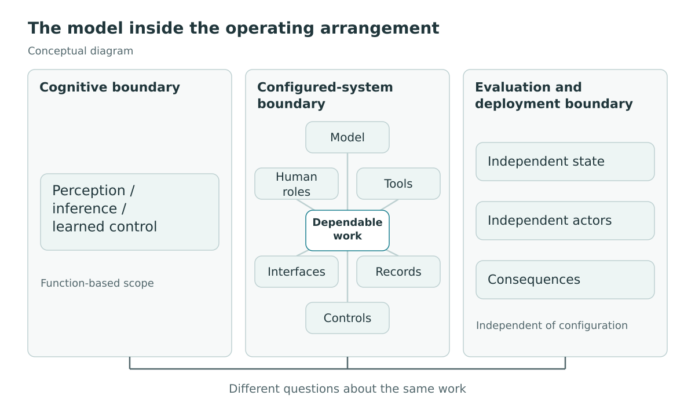
<figcaption><strong>The model inside the operating arrangement.</strong> Cognitive functions, assembled components and the deployment environment answer different questions about the same work. The panels don’t imply coincident boundaries or a single mind; the six configured components are peers.</figcaption>
</figure>

## 2.2 Configured capability

Configured capability is what a particular model can do inside a particular operating arrangement. Dynamic agent benchmarks show that performance depends on temporal awareness, state-changing actions, and an environment that continues to evolve while the agent works [7]. External-memory architectures show that context management and storage can materially change long-horizon behavior without changing the underlying model [8]. The same model can support different levels of operational capability when one configuration provides durable state, authority checks, staged controls, closure tests and recovery, while another provides little more than tool access and a transcript.

Configured capability also has a history. The operating arrangement can change through ordinary use as well as through planned redesign. A completed task may leave participants better informed, response resources occupied or unfinished obligations carried forward. The same model and nominal architecture can therefore face the next task with different usable capability. Assess readiness for the present task separately from the conditions that will support later action. Section 5 examines maintained human exercisability; Section 13 develops the changes in competence, available capacity and outstanding work.

A bounded workflow is one practical configuration. Kling, Bender and Reese place probabilistic interpretation at declared points inside deterministic orchestration, with controlled tools, source versions and scope-change triggers [84]. Their consultancy-derived proposal isn’t an empirical guarantee. It nevertheless identifies concrete configuration changes to test: adding a tool or data source can change both operational capability and the required control envelope.

Examining this wider system doesn’t require prescribing how it represents its operating conditions internally. Authority, commitment, continuity, and seam quality are useful evaluator variables. An implementation may satisfy the relevant functions with learned policies, reactive control, explicit records, distributed protocols, symbolic rules, or a hybrid. The framework should reject behavior that loses authority or continuity, not behavior that fails to name those concepts internally. This representational minimalism keeps the focus on architecture without prescribing an internal vocabulary.

The configured system works through seams. State, evidence, authority, commitments, and responsibility must cross boundaries among models, tools, controllers, people, and organizations. A seam can preserve enough context for coordinated action or amplify failure by dropping the conditions that made the action valid. Section 10 develops seam competence.

## 2.3 The production incident

Consider a customer-facing service whose error rate rises after a release. A schema migration has already occurred, some downstream clients have adapted, and the incident commander's availability is changing. One system refreshes the evidence relevant to its proposed action, checks current authority, chooses a degraded mode, stages repair, verifies recovery, and records the obligations that remain. Another system uses stale telemetry, treats tool access as authority, attempts a rollback after the world has moved on, loses migration context at a handoff, and depends on unrecorded human rescue. Both may eventually restore visible service health. The model can be identical. The configured systems aren’t. Equivalent visible restoration can also leave different conditions for the next incident: useful diagnostic understanding, occupied response capacity or temporary work awaiting reconciliation. Section 13 examines what later work inherits.

<figure data-added-figure="F02">
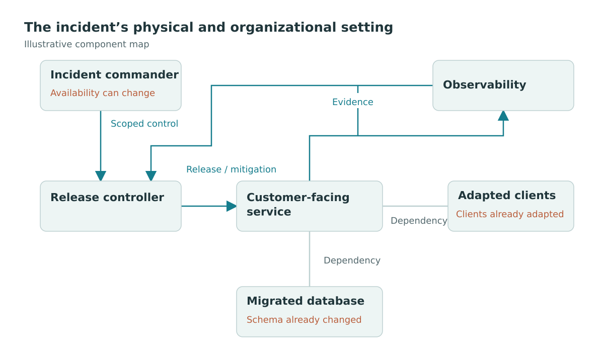
<figcaption><strong>The incident’s physical and organizational setting.</strong> Arrows show release or mitigation, evidence flow, and scoped control; plain lines show service dependencies. The migration, client adaptation, and changing commander availability are independent conditions in the illustrative incident.</figcaption>
</figure>

The configured system acts in a world that can change independently and disagree through consequence. Its evaluation must extend beyond a static context window.

# 3 A world that can disagree

A consequential system operates in a world that’s not obliged to remain consistent with its last observation. Users act, services fail, prices move, policies change, people become unavailable, and physical processes continue. Feedback matters because the world can vary beyond the controller's internal assumptions [9,10]. Intelligence in this setting is inseparable from the ability to detect and respond to that variation.

<figure class="vignette" data-added-figure="F36">
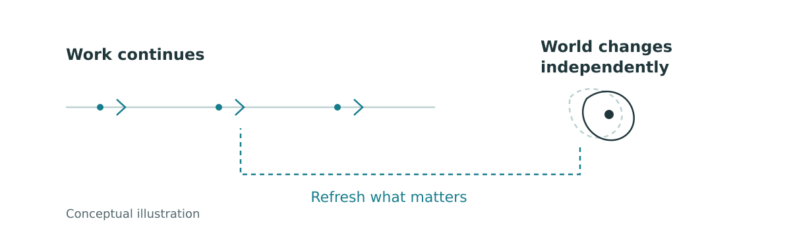
<figcaption><strong>The world changes while work continues.</strong> Work continues while the external world can change independently. The dashed connection indicates refreshing relevant observations.</figcaption>
</figure>

## 3.1 Reality, evidence and represented state

Relevant reality, available evidence, and represented state are different things. Reality is whatever condition will bear the consequences of action. Evidence consists of the partial observations and records available to the system at a particular time. Represented state is the system's current working account of what is true. A correct representation may lag reality. An accurate observation may no longer support the contemplated action. A system can also hold contradictory evidence without having enough information to reconcile it.

Consider a hypothetical service-health check. Before mitigation, a probe exercises the path used by the affected customers. Feature isolation then routes some of those customers away from that path. The probe accurately reports that its remaining path is healthy; an independent configuration readback accurately confirms that isolation took effect. Both observations are current and true, yet neither establishes the experience of the excluded customers. The intervention has changed which population the health evidence represents. A claim about the remaining path may still be justified; a claim that service has been restored for the affected population needs evidence covering that population and the consequences of exclusion.

Evidence therefore needs separate checks for freshness, accuracy, source independence and representativeness. Fresh evidence can concern the wrong population, and an independent source can share the same coverage gap. Representativeness here concerns the users, paths or effects relevant to the declared claim; it doesn’t demand a census for every action. An intervention can improve observation as well as narrow it. Feng and colleagues analyze decisions changing both outcomes and the patients whose outcomes remain observed [312]. The service example applies this coverage question by analogy; it’s not a result from the patient study. Record how the action changes the connection between the observation and the claim, then decide what that observation still supports.

<figure data-added-figure="F04">
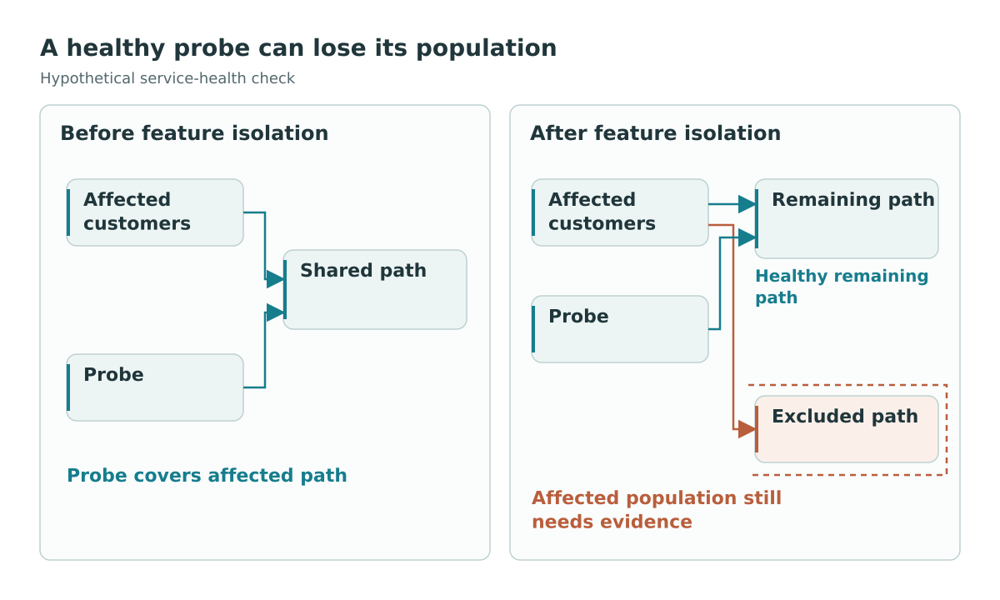
<figcaption><strong>A healthy probe can lose its population.</strong> In this hypothetical service-health check, feature isolation changes customer routing while the probe exercises only the remaining path. A healthy remaining path supports a claim about that path; the affected population, including customers on the excluded path, still needs evidence. Routes are qualitative and don’t indicate population fractions or customer outcomes.</figcaption>
</figure>

Perception is sometimes an action chosen to reduce uncertainty. Active-perception research treats sensing as something organized around the needs of action [11]. Work on epistemic action shows that an action can improve cognition even when its immediate purpose isn’t to advance the task state [12]. In an agentic system, refreshing telemetry, running a compatibility check, requesting a second approval, or probing a read-only endpoint can be an action addressed to reality. It asks the world a bounded question before the system commits further.

Ashby gives feedback a capacity limit: under a specified mapping from disturbances and responses to outcomes, limiting the range of outcomes requires a sufficient range of available responses. Passive constraints can also reduce the disturbances [10]. For an agent test, declare which responses are actually available and which consequences the environment bounds. More observations can’t supply a missing actuator, repair option or exercisable human channel.

Applicability and accuracy need separate checks. Kardatzke tests statistical screening for covariate shifts in camera input used by a drone's person detector [72]. Such a monitor addresses one way the input can depart from the training distribution. Passing it doesn’t establish that the scene was interpreted correctly, and a missed shift leaves that uncertainty unresolved.

Incerti joins physical estimates and semantic scene descriptions in one vision-language system, with conditional treatment of headway and collision quantities and a filter that stabilizes descriptions [73]. The engineering lesson is to retain each quantity's applicability and timing. An undefined value mustn’t become a reassuring score. A description can look stable because its filter is slow; test that delay separately from visual consistency.

Knowledge of the situation and successful control also need different tests. Endsley separates situation awareness from the assessment process that produces it, and from subsequent decision and action [90]. A display can therefore communicate an accurate state while the receiver chooses poorly or acts too late. Scaife and Rogers likewise make external representation useful through the inferences and transformations it supports, with effects that depend on task and familiarity [91]. Evaluate what a display lets the receiver discover and do; visual richness alone is weak evidence of operational value.

<figure data-added-figure="F03">
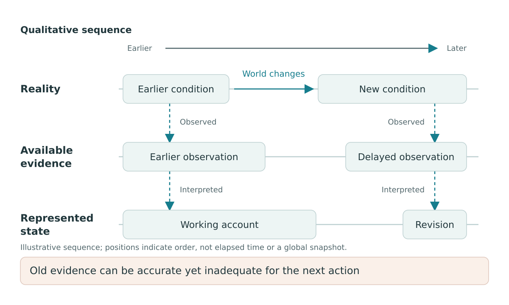
<figcaption><strong>Reality, available evidence and represented state.</strong> Reality, evidence and represented state follow a qualitative sequence. World change can precede observation, and revision follows interpretation. Accurate earlier evidence may no longer justify the next action; spacing doesn’t denote elapsed time or a global snapshot.</figcaption>
</figure>

## 3.2 No global snapshot

The framework doesn’t require a global state that’s perfectly observable and available at all times. Real deployments are partially observable and asynchronous. Observations arrive from different clocks and surfaces. Some evidence is authoritative for one question and irrelevant to another. Stateful tool-use benchmarks and dynamic asynchronous benchmarks already expose agents to hidden dependencies, changing environments, and intermediate states [7,13]. Each contemplated transition requires enough evidence, fresh enough to justify it.

Evidence freshness is action-relative. A release record may remain literally accurate while becoming inadequate support for a database reversal. A five-minute-old queue depth may be sufficient for an inspection but not for a traffic shift that will propagate to customers. Operational-design-domain standards express a related principle by tying expected capability to specified static and dynamic conditions [14]. A fact doesn’t become false when its validity window closes. It ceases to justify the next action. Refresh applicability as well as time: the isolation example in Section 3.1 changes what a healthy probe establishes without making its reading stale or false. A timestamp can’t establish that the observation still covers the contemplated claim.

***Table 2. Time indexed evidence in the production incident***

|                          |                                              |                                                     |                                               |
|--------------------------|----------------------------------------------|-----------------------------------------------------|-----------------------------------------------|
| **Evidence**             | **What it supports**                         | **Freshness question**                              | **Commitment affected**                       |
| Release record           | Which application version was deployed       | Has any component changed since the record          | Application rollback or roll forward          |
| Database migration state | Current schema and migration completion      | Have writes or clients adapted since observation    | Schema repair or reversal                     |
| Telemetry and traces     | Current symptoms and affected paths          | Is the signal current for this user path and region | Traffic shift, feature isolation, degradation |
| Authority record         | Who may approve an action class              | Is the authority still valid and exercisable        | High consequence mitigation and communication |
| User path test           | Whether service is useful after intervention | Does the test cover the affected path               | Closure and return to normal operation        |

In the incident, the old deployment record, current database state, client behavior, and error-rate telemetry remain adequate for their respective actions over different periods. The system shouldn’t refresh everything indiscriminately. It should refresh the evidence that could change the justification for the contemplated response. A low-commitment inspection may proceed with a broader uncertainty margin. A public status statement or schema operation demands a narrower one.

Relational validity concerns the supporting conditions for a consequential transition, beyond internal coherence.

# 4 Valid relations, not synchronized state

The central control problem isn’t to keep every representation synchronized with every part of the world. It’s to maintain the relations that make the next consequential action justified. A consequential transition is warranted only when the evidence, represented state, purpose, authority, commitment, continuity, interface conditions, and expected consequences relevant to that transition are valid enough for it.

Wiener's feedback account distinguishes an effector command from evidence about the actual state and warns that badly designed feedback can oscillate [9]. Conant and Ashby's good-regulator result concerns a simplest entropy-minimizing regulator under a specified outcome mapping and event distribution; its model is a mapping, not a requirement for a detailed symbolic replica [15]. Safety engineering locates control and feedback across changing organizational levels [16][17]. Runtime assurance adds a specific obligation: the system must detect a problem and transfer control while a feasible path back to the stated invariant remains. This includes motion between samples [18][19]. These bounded results support examining the fit among models, controls, actors and changing conditions.

## 4.1 Action-relative validity

Validity is relative to an action and a time. Evidence can be fresh enough for one transition and stale for another. Authority can cover one action class but not another. A plan can remain useful while one subgoal becomes obsolete. A handoff can carry enough state for inspection but not enough for execution. The question isn’t whether the whole system possesses a single true state. The question is whether the relations on which the proposed transition depends are currently adequate.

<figure data-added-figure="F05">
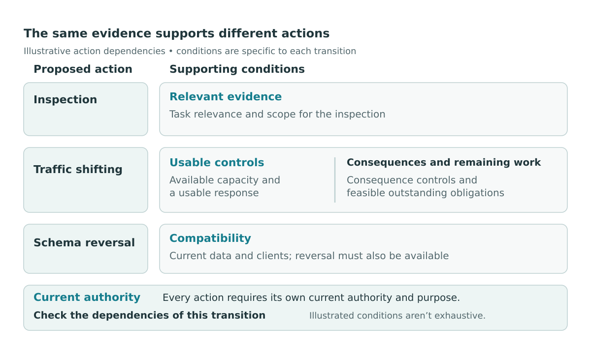
<figcaption><strong>The same evidence supports different actions.</strong> The illustrative map distinguishes task-relevant inspection evidence, usable capacity and consequence controls for traffic shifting, and current data and client compatibility for schema reversal. Each transition also depends on its own current authority and purpose; the conditions shown aren’t exhaustive.</figcaption>
</figure>

SayCan makes one part of this relation concrete. Language-model task knowledge is grounded through pretrained robotic skills and their value functions, constraining proposed actions by contextual feasibility [78]. This is a capability check. A feasible action still requires valid authority, purpose and consequence conditions. An institutional approval record can’t replace feasibility evidence, and a skill value can’t replace permission.

Crampton and Khambhammettu expose a further distinction in workflow delegation: transferring authorization for one task can make the remaining workflow unsatisfiable under a separation-of-duty constraint [288]. The remaining tasks can no longer all be assigned under that rule. Their motivating example establishes the problem at the formal authorization level. For consequential systems, the proposed extension asks whether outstanding obligations can still be fulfilled after a transition, given the remaining authority, resources, time and propagated effects. This doesn’t require preserving every possible plan or pursuing an obsolete objective. If continuation becomes infeasible, the system must expose the blockage and use a legitimate process to revise, transfer or end the affected obligations.

This definition is deliberately narrower than goodness. Relational validity is necessary, not sufficient, for safety, legality, legitimacy, ethics, or sound judgment. A fully authorized and accurately informed action can still be harmful. Conversely, an action that later produces a good outcome may have crossed an invalid authority or evidence relation. The framework isolates a control property without pretending that the property settles every normative question.

Available control belongs in the account of the situation. Поспелов includes the controller's state and technology alongside the controlled object's condition [92]. Pellkofer separately represents readiness, resource access and operation in a vehicle architecture [93]. In the incident, evidence that a rollback is needed can’t make the rollback available, and a prepared command can’t make its target compatible. The evaluator should record both the external condition and the presently usable response set. Appendix A.3 compares the model and representation assumptions behind such accounts.

## 4.2 Silent divergence

The characteristic failure is silent divergence. One supporting relation becomes invalid, yet the system continues as though nothing changed. The represented state drifts from reality. The responsible human loses the context needed to exercise authority. A recovery plan assumes a reversible world after consequences have propagated. A downstream receiver gets a syntactically correct request without the uncertainty or commitment context needed to interpret it. Local components may each behave as designed while the relation among them fails.

Validity exposure is a useful diagnostic quantity: the amount of consequential action taken while a required relation is invalid or unverified. It can be expressed in domain-specific units such as elapsed time, number of affected users, propagated transactions, resource commitments, or subsequent decisions made on the bad state. Don’t treat it as a single score that applies across all domains. It makes silent divergence observable by connecting a design weakness to the consequences that accumulate before containment. Detection and containment are separate events; Section 20 specifies their measurement boundaries.

## 4.3 The incident transition

Knowing the release artifact and having a tool that can execute a deployment command don’t justify the command. The current relationship among telemetry, application version, schema state, client adaptation, authority, and the proposed recovery mode must be valid for that action. If the migration has changed the feasible recovery set, a previously approved rollback plan no longer supplies a valid transition. The system should reopen the plan instead of executing it more confidently.

Authority determines who may cross a commitment, for which action, under which conditions, and with what ability to act now.

# 5 Authority at the moment of commitment

Authority isn’t a property that an agent or human simply has. It’s a relation among an actor, an action class, a target or resource, a consequence domain, a principal, a situation, relevant history, and time. Change any of these terms and the actor’s authority may change. A valid login, tool permission, or standing role is evidence about authority. It’s not the whole relation.

## 5.1 Authorization, exercisability and legitimacy

Formal authorization, present exercisability, and broader legitimacy should be separated. Authorization asks whether a rule or principal grants the action. Exercisability asks whether the authorized actor can act competently now, with enough time, access, and context. Legitimacy asks whether the arrangement is acceptable under the relevant legal, institutional, or social order. Automation research has long shown that nominal human control can coexist with degraded situation awareness and poor recovery performance [20,21]. Naming a human in a fallback path doesn’t establish that they can exercise that authority when needed.

***Table 3. Authority distinctions at commitment***

|                  |                                                   |                                                        |                                                              |
|------------------|---------------------------------------------------|--------------------------------------------------------|--------------------------------------------------------------|
| **Question**     | **Authorization**                                 | **Exercisability**                                     | **Legitimacy**                                               |
| What it asks     | Is this actor permitted to take this action       | Can this actor take it effectively now                 | Is this allocation acceptable under the governing order      |
| Typical evidence | Policy, role, delegation, approval                | Availability, context, access, time budget, competence | Law, governance, mandate, affected-party standing            |
| Failure mode     | Action outside granted scope                      | Nominal handoff to someone unable to recover           | Technically permitted action that lacks acceptable authority |
| Incident example | Feature flag allowed but schema reversal excluded | Incident commander lacks current migration context     | Residual customer harm requires a different decision process |

Shared-autonomy and variable-autonomy systems treat control allocation as dynamic rather than fixed [22,23]. Takeover research shows that transfer quality depends on the time budget and the operator's current condition [24,48]. Continuous-authorization work makes access depend on the strength of current identity evidence [25]; history-dependent authorization adds evidence about participation over time [26]. Each mechanism checks a different part of the relation that must hold when the system commits.

Maintaining the context used to decide access is also a separate responsibility. 罗霄峰, 李琳, and 罗万伯 separate context-attribute management from the control decision in a context-aware usage-control model [56]. 山本由香理 and 飯島正 use temporary policy changes for medical-record access in emergencies, transfers, and second opinions, with obligations attached to protect privacy [57]. A dynamic grant can change what an actor may do while preserving duties about how the access is used.

Human fallback can lose the capacity on which it depends. Bainbridge explains how removing routine control can weaken the skills and current process understanding needed for rare emergency takeover; fast failures still impose process deadlines [94]. A readiness plan therefore needs continuing participation or training, usable feedback and a tested response window. Remote-assistance guidance treats qualification, reassessment and operator conditions as maintained capabilities [95]. Neither training nor a named operator establishes availability and understanding during the particular event. The acceptance test belongs at the handoff.

Böhle and Milkau's qualitative study of machine work shows why maintained competence involves more than retained instructions. Their CNC discussion describes workers using practical familiarity with machine sounds when visual access is restricted, and adjusting viewpoint and pace to understand the process [289]. These historical observations don’t establish an effect for AI oversight. They motivate examining whether the configuration preserves opportunities to develop and exercise diagnostic judgment. Work can help sustain competence. Changes in participation or access to the process can therefore alter the capability on which a later fallback depends. This creates two checks: whether authority is exercisable at this handoff, and whether ordinary participation preserves the understanding on which later handoffs depend. A qualified, available person can still need opportunities to investigate changes in the process. What must be checked depends on the work delegated. Dependable support can replace some individual skills; a declared takeover still requires evidence that the person and available support can perform it.

Control allocation also has several forms. Parasuraman, Sheridan and Wickens separate acquisition, analysis, decision selection and action implementation rather than giving the whole system one automation level [21]. Shared control can fuse simultaneous human and robot inputs, while a transfer changes who controls the action [96]. These arrangements require different conflict tests. Adjustable-autonomy strategies explicitly allow delayed or missing responses and changes to coordination constraints, but their utility model doesn’t grant institutional authority [97]. Record the function being allocated, the conflict rule and the permitted action while acceptance remains unresolved.

## 5.2 Authority transitions

Transfer, revocation, expiration, escalation, fallback and refusal are ordinary control transitions with acceptance conditions. The dated Code de la route text distinguishes takeover requests, transition periods, design operating conditions and minimum-risk maneuvers [27]. The original 2021 ALKS regulation requires continuing system operation during a transition demand and a specified minimum-risk path after nonresponse [98]. These are domain-specific comparisons, not legal authority or transferable deadlines for general agents. The engineering questions remain concrete: who receives the transfer, what context travels, how acceptance is known and what actions remain permitted during the gap.

Taking control is a sequence, not one event. 박명옥 and 손준우 derive takeover scenarios around the loss of situation awareness, varying the demands placed on a returning driver [64]. Müller and Abendroth test request modalities and competing mental workload, defining the first response through steering or pedal input [66]. 박성호 and colleagues separately examine the time until driving stabilizes after takeover [65]. For an agent workflow, distinguish receiving a request, understanding the relevant state, accepting responsibility, issuing a control action and achieving stable operation. One successful step doesn’t certify the rest.

<figure data-added-figure="F06">
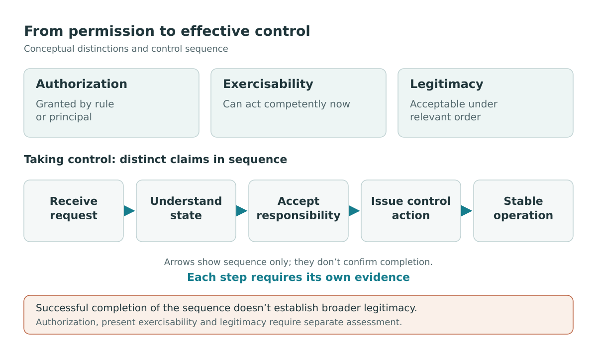
<figcaption><strong>From permission to effective control.</strong> Authorization, present exercisability and legitimacy are separate questions. Taking control comprises five distinct claims, each requiring evidence. Arrows indicate sequence only; successful completion doesn’t establish broader legitimacy.</figcaption>
</figure>

Mercier, Tessier, and Dehais model human–robot authority relative to controllable resources and their dependencies. Conflicting control can trigger changes in behavior or resource allocation [58]. This makes the transfer problem concrete: two individually permitted actions can still conflict through a shared resource. The system must identify the dependency, the rule authorizing a change of control, and the context each actor needs to carry out that change.

Autonomy is justified reach. The phrase doesn’t mean that every permitted action should be delegated or that authority alone makes an action wise. It means that current evidence, authority, commitment controls and recovery support must justify the system’s independent operating range. Beyond that range, waiting, inspecting, narrowing scope, asking, escalating, transferring, or stopping can be the correct control action.

## 5.3 The incident decision

In the production incident, policy may authorize the agent to disable a feature, shift a bounded share of traffic, or run a diagnostic. The same policy may withhold authority to reverse a schema, accept residual customer harm, or publish an external status statement. The designated incident commander may remain formally authorized but be unable to exercise that authority if the migration state has changed outside their knowledge. A good system doesn’t convert that gap into silent autonomy. It preserves the unresolved decision and uses the actions still within valid reach.

Authority determines who may act, but it doesn’t determine how much evidence or control the action requires. That depends on the commitment the action crosses.

# 6 Commitment as a profile of consequence

Commitment is often discussed as if an action were simply reversible or irreversible, low risk or high risk. That vocabulary hides the structure that matters. An action can be technically reversible while remaining visible, propagated, costly, legally significant, or destructive of future options. Commitment is better represented as a multidimensional consequence profile.

## 6.1 Dimensions of commitment

Useful dimensions include technical reversibility, external visibility, propagation, persistence, resource expenditure, legal or institutional force, temporal lock-in (how long a choice constrains later action), and the loss of future options and their value. The set is an analytical tool rather than a universal taxonomy. A domain can add dimensions that change control requirements. A scalar score can obscure materially different consequences.

***Table 4. Commitment profiles for incident actions***

|                        |                                |                                                    |                                           |                                                      |
|------------------------|--------------------------------|----------------------------------------------------|-------------------------------------------|------------------------------------------------------|
| **Action**             | **Reversibility**              | **Visibility and propagation**                     | **Option effect**                         | **Control implication**                              |
| Inspect telemetry      | High                           | Low and internal                                   | Preserves options                         | Broad standing authority and lightweight closure     |
| Disable a feature      | Usually high                   | Visible to affected users but bounded              | Narrows service temporarily               | Fresh health evidence, staged rollout, rollback path |
| Shift traffic          | Moderate                       | Can propagate load and failure                     | Consumes capacity and fallback margin     | Blast-radius limits and live monitoring              |
| Roll back application  | Technical reversal may be easy | May conflict with migrated data or adapted clients | Can destroy roll-forward options          | Compatibility proof and staged verification          |
| Reverse schema         | Often low after writes         | Propagates through data and clients                | May destroy data or future recovery paths | Narrow authority, strong assurance, explicit closure |
| Publish status message | Editable but not unseen        | Public and institutionally durable                 | Constrains later communication            | Communication authority and verified factual basis   |

Two actions with equal technical reversibility can require very different controls. A configuration change and a public statement might both be editable, but only one creates a durable external representation that customers, regulators, or counterparties may rely on. A database update may be reversible in isolation while downstream consumers have already acted on its effects. Gray distinguishes protected updates from real actions and from compensation for long-lived work [318]. Commitment belongs to the trajectory of consequence, not to the syntax of the command.

<figure data-added-figure="F07">
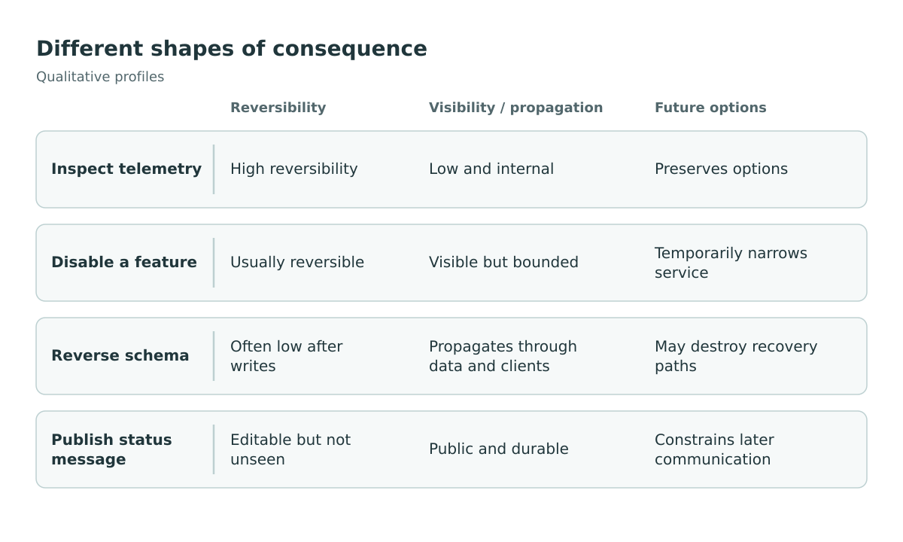
<figcaption><strong>Different shapes of consequence.</strong> Four qualitative action profiles compare reversibility, visibility and propagation, and future options. Editability doesn’t undo external visibility; the profiles use no common score or ranking.</figcaption>
</figure>

A commitment profile should inform a control analysis, not replace it. Leveson's unsafe-control categories include a needed action omitted, an inappropriate action supplied, wrong timing or order, and an action continued too long or stopped too soon [17]. Each requires context, assigned responsibility and feedback. In the incident, an otherwise permitted isolation can arrive too late, and ending a protective restriction too early can reopen exposure. Task completion and safety therefore need separate criteria: restoring service doesn’t alone establish that data integrity or other safety constraints held.

## 6.2 Calibrated commitment

The objective is calibrated commitment, not minimum commitment. Systems that never take consequential action can’t do useful work. Safe-exploration methods, safety envelopes, and minimum-risk behavior provide concrete examples of preserving useful action while enforcing hard constraints or fallback conditions [28-30]. Whole-item safety-case standards similarly require evidence and mitigation across the configured product and its lifecycle rather than confidence in one component [31]. These traditions support a proportional rule: evidence and control structure should be commensurate with commitment.

Higher commitment can require fresher evidence, narrower authority, staged execution, deterministic interlocks, richer pre-action assurance, stronger post-action closure, and a more credible recovery path. These controls shouldn’t appear only after failure. Assurance is the evidence available before commitment that the action is likely to remain within its declared operating bounds. Closure is the evidence gathered afterward that establishes what actually happened. The commitment profile determines the assurance and closure evidence required (Section 11). The analysis should include any response reserve consumed or recovery options lost when these changes affect subsequent commitments. Compare that cost with the consequences of delay or abstention; preserving reserve by leaving urgent work undone isn’t automatically the justified choice.

In the incident, the statement 'we can undo it' is incomplete. The system must ask what will remain visible, what will propagate, which resources or options will be consumed, which parties will adapt, and what authority is required at the point of commitment. Commitments don’t end when the command returns. Their effects and obligations can persist across time, components, and changes of authority. The system must preserve enough live state and provenance to keep what remains in motion governable as the incident continues.

# 7 Continuity as live state plus provenance

Memory isn’t continuity. A system can retain a large archive and still be unable to identify the authoritative state from which work should continue. It can also resume perfectly from a corrupted checkpoint. Operational continuity requires a trustworthy live edge and enough provenance to justify it.

Distributed-cognition research and external-memory architectures show that competent work can depend on managed representations outside the immediate reasoning process [2,8]. Recent long-horizon agent systems add recoverable execution, explicit belief state, and memory evaluation [32,33]. These mechanisms expand what an agent can retain, but storage capacity doesn’t resolve which record governs the next action or whether that record was produced under valid authority.

The dependencies that accumulate matter as much as elapsed time or step count. 张勤俭 and colleagues connect long-horizon robotic manipulation with stage dependence, historical state, physical evolution, state drift, cascading errors, and recovery cost [62]. A continuity test should vary those dependencies. Repeating independent steps for longer doesn’t exercise the same memory and recovery demands as carrying an unresolved effect across a change of state.

## 7.1 The live edge

The live edge is the task state that should govern the next transition. The live operational state includes the current objective, authoritative artifact, unresolved uncertainty, active plan, pending commitments, relevant authority relations, recoverable checkpoints, and the owner of the next transition. It contains enough state for the particular task to resume competently without reconstructing the entire history. Sufficiency is a design claim to test, not a proved minimum. The live edge must be explicit enough to survive interruption, handoff, retry, or model replacement. When pending duties or occupied resources constrain continuation, preserve or reliably reconstruct those constraints too. Their presence in a record doesn’t establish current capacity; refresh availability where the next action depends on it. These are functional requirements, not mandatory internal fields.

## 7.2 Provenance

Provenance explains why the live edge should be trusted. It includes chronology, where evidence came from and how it was transformed, causal history, changes of authority, rejected hypotheses, and responsibility history. Long-horizon attack research shows that objectives and memory can be poisoned or redirected [34]. Memory benchmarks show that causal and objective information can decay even when many facts remain available [35]. Provenance is a control surface, not archival decoration.

<figure data-added-figure="F08">
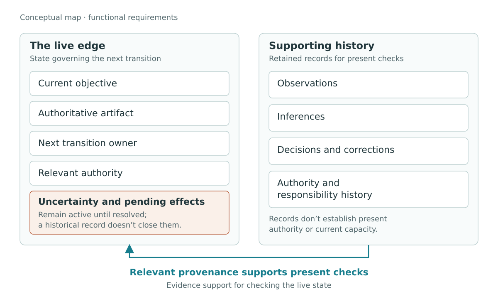
<figcaption><strong>The live edge and its supporting history.</strong> Current task state governs the next transition; retained provenance supports present checks. Observations remain distinct from inferences, and authority records don’t by themselves establish presently exercisable authority or capacity. Pending effects remain in the live state until resolved. The labels express functional requirements, not prescribed fields.</figcaption>
</figure>

М. В. Баклановский and А. Р. Ханов make history an active authorization mechanism in a network protocol: a returning node must reconstruct prior events, and loss of retained historical information reduces the precision of that reconstruction [26]. For an interrupted task, the corresponding engineering question is which history establishes a valid resumption. Current access, remembered facts, pending effects, and present responsibility require separate checks.

Memory also embodies choices about which experiences count and whose account remains available. 윤하나 examines how efficiency, computability and control shape agent-memory design, including the treatment of storable, retrievable and updatable data as valid memory [63]. A continuity design must identify who controls retention and revision, preserve competing accounts when consequences remain disputed, and record why evidence was discarded. Efficient retrieval doesn’t settle whose account should govern.

Inspectable memory also needs a correction path. Hiske, Wittholz and Robra-Bissantz illustrate how a situational request can be promoted into a lasting preference and distort later choices [83]. Record the basis and scope of a retained inference, expose its downstream use, and let an authorized correction supersede it. Their recommendations concern calibrated user trust and haven’t been empirically validated as technical safety controls.

***Table 5. Live state and provenance***

|                          |                                              |                                                       |                                                    |
|--------------------------|----------------------------------------------|-------------------------------------------------------|----------------------------------------------------|
| **Continuity element**   | **Live state question**                      | **Provenance question**                               | **Failure if absent**                              |
| Objective and scope      | What is the system trying to achieve now     | Who set or changed it and under what authority        | Obsolete or injected objective drives action       |
| Authoritative artifact   | Which version governs the next step          | How it became authoritative and what it superseded    | Correct work continues from the wrong version      |
| Evidence and uncertainty | What is believed and what remains unresolved | Where the evidence came from and when it was observed | Stale confidence or repeated failed diagnosis      |
| Pending commitments      | What consequences are already in motion      | Which action created them and who owns closure        | Retry duplicates effects or abandons obligations   |
| Next transition          | What action or decision comes next           | Why that transition is justified                      | Resume mechanism restarts activity without control |

Bonasso, Kortenkamp and Whitney's shuttle procedure tracker synchronized sequencing with intermittent telemetry and crew actions, while reporting failures from wrong telemetry identifiers, dropouts and a fast hand-controller test [36]. It tracked from the ground while the crew was unaware; it wasn’t autonomous shuttle control. The comparison exposes a useful continuity problem: a stored procedure can remain correct while sensing or timing loses synchronization with the actual work. Test the live edge under those mismatches, including whether responsibility remains explicit.

A retained inference needs an evidence trail and a scope. Generative Agents links reflections to prior memories, including earlier reflections, but evaluates believability in a short sandbox rather than factual trustworthiness [99]. This motivates testing whether a chain of retained interpretations carries forward an unsupported inference; no measured amplification rate is established here. RAG-based continuity additionally depends on corpus, index, update and access policies, as Вейбер and colleagues emphasize [100]. Retain the original observation separately from derived interpretations, and let a later correction supersede an inference without erasing why it was made.

Continuity must also preserve access to the evidence needed to regain understanding. Tittle, Roesler and Woods discuss cues lost in remote perception and propose viewpoint context, controllable views and replay in their ViewTracks design [290]. The author manuscript is a conceptual design account, not a controlled demonstration of effectiveness. For a consequential handoff, the corresponding question is whether the receiver can interpret the retained state, examine relevant change and obtain missing evidence. A complete packet may still be insufficient for judgment. Access to fresh observation and authorized diagnostic action complements the live edge and provenance; it doesn’t require reconstructing the entire history.

## 7.3 The incident record

The incident's continuity state should include the release version, schema state, feature flags, affected user paths, current hypotheses, tests already run, approvals, failed mitigations, pending external communications, unresolved harms, and the owner of the next decision. A transcript can help reconstruct some of this information, but it doesn’t identify the authoritative live edge by itself. A concise state record with authenticated provenance is a candidate aid to resumption; its usefulness relative to a larger history requires testing for the task and receiver [91]. Section 15 develops a backward program for testing justified continuation under interruption, changed evidence and replacement.

Continuity preserves the live edge. It doesn’t decide what should remain fixed when reality, plans, or purposes conflict. That’s the work of orientation.

# 8 Orientation when plans, objectives and missions diverge

A capable system must know what to revise. Treating every surprise as a reason to abandon the mission produces drift. Treating every plan as fixed produces brittle persistence. Orientation is the competence to reconsider the right level of intention while preserving the levels that remain valid.

Plans are resources for situated action rather than complete scripts [3]. Execution-monitoring research shows why actual performance must be observed and diagnosed instead of inferred from the plan [37]. Dynamic replanning systems demonstrate that a failed action or mistaken belief can justify reopening the plan [38], while modern tool-failure benchmarks show that clean execution competence doesn’t automatically produce strong anomaly recovery [39]. The open question is how far upward the revision should travel.

Wienecke's obstacle-avoidance method retains an accepted maneuver across planning cycles while checking whether geometry and approaching traffic permit bypass, waiting or controlled stopping [81]. Its reported late-conflict collision keeps the response margin visible: persistent state can’t make an obsolete trajectory feasible. The source's braking estimate doesn’t prove inevitability. For agent workflows, test both needless plan churn and continued execution after a new conflict removes the remaining safe options.

## 8.1 Selective reopening

Persistence and revision operate at several levels: action, plan, subgoal, objective, mission, and purpose. An execution failure may require another action. A changed world may invalidate the plan. New evidence may show that the objective can’t be achieved safely. A conflict among principals may reopen the mission or purpose itself. Orientation is selective reopening across these levels. Cohen and Levesque formalize commitment conditional on background beliefs and goals, including revision when a higher-level goal (a supergoal) is dropped [321]. The six-level engineering hierarchy extends this commitment account; it’s not proved in that model.

***Table 6. Levels of orientation***

|                    |                                                                    |                                         |                                              |                                  |
|--------------------|--------------------------------------------------------------------|-----------------------------------------|----------------------------------------------|----------------------------------|
| **Level**          | **Reopen when**                                                    | **Evidence needed**                     | **Failure if reopened too little**           | **Failure if reopened too much** |
| Action             | The chosen step fails or becomes infeasible                        | Execution and local state               | Repeated local failure                       | Needless plan churn              |
| Plan               | The route no longer reaches the subgoal                            | Dependencies, alternatives, commitments | Brittle persistence                          | Loss of useful progress          |
| Subgoal            | The intermediate target is obsolete or harmful                     | Objective relation and current world    | Optimization of the wrong intermediate state | Unnecessary objective revision   |
| Objective          | The target conflicts with higher constraints or can’t be justified | Mission, authority, consequence         | Competent pursuit of an invalid target       | Mission drift                    |
| Mission or purpose | Legitimate authorities or purposes conflict                        | Governance, mandate, affected parties   | Hidden value conflict                        | Agent invents a new mandate      |

Purpose uncertainty differs from world uncertainty. More sensing may resolve uncertainty about service health. It can’t by itself resolve a conflict between restoring service quickly, preserving customer data, honoring change policy, and avoiding misleading communication. Cooperative objective inference treats the human objective as uncertain and learnable through interaction [40], but some disagreements are institutional rather than statistical. They require a legitimate process, not an averaged estimate. Bovens distinguishes an actor’s account from a forum’s questioning and judgment [322]. That institutional distinction supports the limit on inference here; it doesn’t select the legitimate forum for a particular deployment.

Revising a representation isn’t the same as establishing a new truth. Dufour-Lussier and colleagues show that qualitative belief revision may need a disjunction unavailable in the original representation; expanding the language makes alternatives expressible [101]. 刘一松 and colleagues retain conditional and compatible beliefs while integrating revision with action reasoning [102]. Both mechanisms operate within the limits of their formal representations. The operating system still needs evidence that distinguishes the live alternatives and authority to revise the relevant objective. Appendix A.3 makes that separation explicit.

Reopening can also change the kind of reasoning used. Rasmussen distinguishes interacting skilled patterns, familiar rules and knowledge-based problem solving; an unfamiliar condition may require functional understanding rather than replay of a routine [103]. This is a human-performance distinction, not a taxonomy of model modules. It gives an evaluation question: when a familiar repair repeatedly fails, does the system inspect the governing assumptions and construct alternatives, or keep retrying the same rule?

<figure data-added-figure="F09">
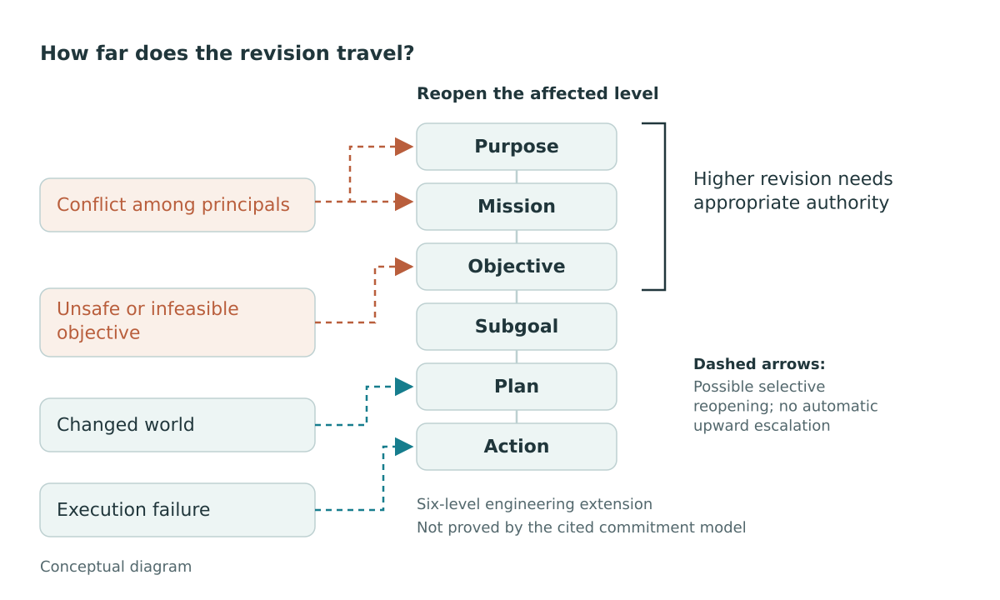
<figcaption><strong>How far does the revision travel?.</strong> Selective reopening responds to the affected level: local execution failure, a changed world, an unsafe or infeasible objective, or conflict among principals. Dashed paths show possible reopening, not automatic escalation. Higher revisions require appropriate authority. The six-level engineering extension isn’t proved by the cited commitment model.</figcaption>
</figure>

## 8.2 Visible disagreement

Unresolved conflict should remain visible until a legitimate process resolves it. The system can narrow work to undisputed scope while escalating the contested decision. It may continue diagnostics, preserve data, isolate a failing feature, or prepare alternatives without deciding which party has the right to accept residual harm. Dynamic role allocation in human-robot collaboration offers useful precedent for treating plans, roles, and control as jointly adjustable rather than fixed [41]. The same principle applies to organizational agent systems, provided that role changes remain authorized and observable.

In the incident, an instruction to restore service may conflict with a data-integrity constraint or with the authority required for external communication. The system shouldn’t manufacture a coherent objective by suppressing one side. It should identify which actions remain legitimate under both, preserve the conflict, and refer the unresolved choice to an authority currently able to act on it. Correct non-action can be the most competent response at the disputed level.

Participants should be able to raise a concern for clarification before they can identify the broken relation or complete a claim the existing process recognizes. Preserve the concern in the participant’s terms, the next contemplated commitment and the work needed to make the issue intelligible. Admission for inquiry doesn’t establish the defect or grant an unlimited veto. Where feasible, preserve evidence and correction options while continuing justified work. An inspectable account remains open to questions about how it defines the task: participants must be able to challenge what that definition omits. Existing authority and constraints continue to govern action during clarification and authorized repair. Situated intelligibility [3] and support for interpreting and negotiating cooperative-work models [323] motivate this proposal; neither establishes this admission rule as a legal duty or an evaluated intervention.

When orientation changes, recovery can’t be defined as return to the state that existed before the surprise. That state may be obsolete, unreachable, or no longer legitimate.

# 9 Recovery isn’t return

Recovery aims to restore or reconstruct a valid operating relation. Sometimes that means returning to a previous operational state. Often it doesn’t. External actors may have adapted, commitments may have propagated, evidence may have improved, and authority may have changed. The target of recovery isn’t the past. It’s validity.

Resilience engineering distinguishes simple rebound from robustness, graceful extensibility, and sustained adaptability [42]. Control-system reconfiguration changes the active control structure after diagnosis [43]. Self-healing research joins diagnosability and repairability: the observations need to distinguish situations enough to select an applicable repair [44]. These are different ways to reconstruct a valid operating relation.

Exact fault identification is sometimes unnecessary. Cordier and colleagues show that faults which remain indistinguishable can be grouped when an available repair works for every fault in the group [44]. For consequential action, a repair must cover every live possibility relevant to its effects. If one plausible fault makes that repair unsafe or ineffective, the system needs further evidence, a different repair, or containment.

## 9.1 Recovery modes

***Table 7. Recovery modes***

|                      |                                                      |                                            |                                               |                                                |
|----------------------|------------------------------------------------------|--------------------------------------------|-----------------------------------------------|------------------------------------------------|
| **Mode**             | **Target relation**                                  | **What may be preserved**                  | **What may be discarded**                     | **Closure evidence**                           |
| Rollback             | Earlier valid operating state                        | Provenance, diagnosis, valid commitments   | Unsafe recent operational state               | Earlier state is compatible with current world |
| Roll forward repair  | New valid state beyond the fault                     | Current data and external adaptations      | Failed plan or component                      | Repair works across affected paths             |
| Reconfiguration      | Valid relation through a different control structure | Objective and useful state                 | Failed component or role allocation           | New configuration accepted and stable          |
| Graceful degradation | Reduced but controlled service                       | Critical functions and option value        | Nonessential scope                            | Bounds, user impact, and ownership are known   |
| Authority transfer   | Valid decision relation                              | Evidence and pending commitments           | Invalid or nonexercisable control allocation  | Receiver accepts context and responsibility    |
| Stop                 | Contained consequence with no further commitment     | State, evidence, recovery options          | Current action sequence                       | Effects are bounded and obligations assigned   |
| Constructed mode     | New relation when prepared modes are insufficient    | Learning, constraints, surviving resources | Assumption that the recovery menu is complete | Staged tests establish bounded validity        |

Operational state can move backward while epistemic state—the evidence and understanding retained—moves forward. A rollback shouldn’t erase the discovery that a hypothesis was false, the evidence that revealed the failure, or a valid approval that still governs the next attempt. Recoverable-execution systems make this asymmetry concrete by rewinding context and world checkpoints while preserving useful information from the failed trajectory [32]. Robotic recovery systems likewise combine diagnosis, repair, verification, and renewed execution [45,46].

Closed-loop recovery can fail inside its own verification. Zhi and colleagues combine object inspection, code and plan checking, execution feedback and replanning, yet report incorrect object detections that survive verification [46]. Their Table III reports 31 successful recoveries among 38 replanning attempts, compared with 31 among 52 failures overall; the navigation failure had no recovery attempt. A success rate calculated only from attempted recoveries hides missing recovery capability. Retain all failures, attempted and successful recoveries, unattempted cases and the reason no attempt was possible.

A new plan may not be executable by the surviving machinery. Keßler's duplex-steering work distinguishes rapid passive fault tolerance from subsequent diagnosis-driven reconfiguration; controller adaptation can’t restore a physically lost degree of freedom [104]. Facco's ROSPlan cases retain non-interruptible actions as a limitation even when replanning handles other errors [105]. A recovery contract must say whether the current action can stop, which effects continue, and which remaining actuators or services can implement the replacement. More reasoning can’t supply a missing physical or operational path. Authorization constraints on the remaining tasks require a separate check [288]: a technically executable repair can still leave outstanding duties without a permitted completion path.

Failure needs an observable predicate—a stated condition for recognizing it—as well as success. 강민석 and colleagues found that success-only monitoring could leave a physically failed manufacturing task waiting indefinitely; explicit failure conditions and hierarchical task states supplied a path to stopping or correction [106]. Their thresholds were manually configured and need adaptation to new processes. In the incident, prolonged absence of a completion signal must therefore trigger a declared inspection or containment rule, while missing evidence remains distinct from evidence that the action failed.

Replication can protect continuity before a failure, but its allocation should reflect changing dependencies. In their 13-page LIP6 report, de Luna Almeida and colleagues use agent plans, task dependencies and action timing to estimate criticality, then adapt replication to available resources and host reliability [282]. This is a separately titled report; the shorter conference item hasn’t been consulted. Its mechanism motivates testing protection when plans and bottlenecks change. Replicating execution doesn’t independently repair a mistaken belief, restore authority or reverse propagated effects.

## 9.2 Recovery as design

A recovery design should state its target relation, required authority, preserved state, discarded state, closure criteria, and effect on future options. It should also define what happens when the prepared recovery menu is exhausted. Constructing a new operating mode requires different design and assurance work from selecting among predefined fallbacks. Test that competence under bounded conditions, including its effect on authority, consequences, and recovery options. Woods’s distinction between robustness and graceful extensibility [42,314] motivates examining that difference; it doesn’t establish a general performance ranking between prepared and newly constructed responses.

<figure class="vignette" data-added-figure="F38">
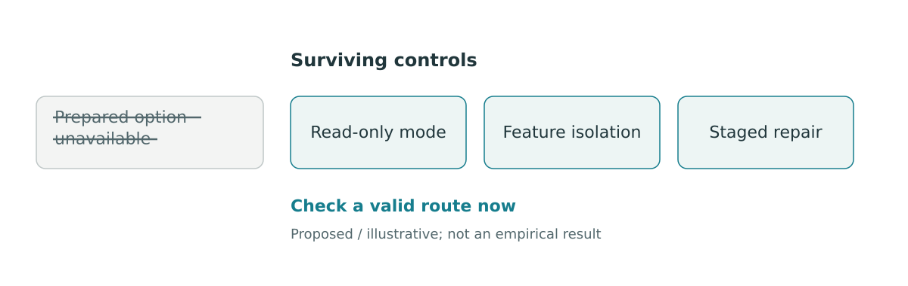
<figcaption><strong>Recovery with one option unavailable.</strong> The illustrative surviving controls require current checks to establish a valid route; no listed mode is guaranteed to work.</figcaption>
</figure>

Recovery changes the conditions for future work as well as restoring a valid mode now. It can improve diagnosis, continuity, monitoring or available controls; it can also occupy expert attention, consume fallback resources or leave temporary repairs requiring later work. A justified emergency response may use scarce reserve without strengthening the arrangement, and delay or abstention can cause greater harm. Assess that immediate choice under the options actually available. Maintenance then identifies which resources were consumed, which consequences remain exposed and what can be replenished or changed. Repeated human rescue calls for investigating the dependency and the feasibility of reducing it; it doesn’t alone prove that a better prior arrangement was available. Woods’s analysis of saturation, neighboring assistance and donor costs [314] supplies a mechanism for investigating that dependence; it doesn’t prove that a particular emergency was foreseeable or avoidable.

## 9.3 The partially propagated release

In the production incident, an application rollback can’t restore a pre-migration world after databases and clients have changed. A valid recovery may combine feature isolation, read-only operation, traffic control, roll-forward schema repair, and authority transfer. The system should preserve evidence about the failed rollback, current schema, affected clients, and unresolved obligations. Treating the old release as the destination would confuse a familiar state with a valid one. Section 16 develops the proposed route from checked human-authored modes to automated recovery composition beyond prepared procedures.

<figure data-added-figure="F10">
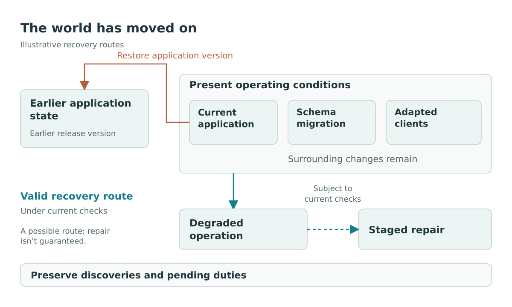
<figcaption><strong>The world has moved on.</strong> Restoring an application version leaves migrated schema and adapted clients in present conditions. A valid recovery may use degraded operation and staged repair under current checks while preserving discoveries and pending duties. Repair isn’t guaranteed.</figcaption>
</figure>

Every recovery mode crosses boundaries among people, tools, controllers, organizations, and records. The quality of those seams determines whether recovery carries the state it needs or amplifies the failure.

# 10 Seams as sites of adaptation and failure

A seam is a boundary across which action, state, evidence, authority, or responsibility passes. Examples include the boundary between an observer and a planner, an agent and a deployment tool, a controller and a fallback controller, one service and another, a human and an agent, or one organization and a counterparty. Seams are unavoidable in configured systems. They’re also productive: specialization, human judgment, containment, and reconfiguration all depend on them.

Distributed-cognition work treats coordination across people and artifacts as part of competent activity [2]. Shared-autonomy and variable-autonomy research shows how capability can emerge from mutual adaptation and dynamic control allocation [22,23]. Runtime-assurance systems use a monitored switch between an advanced controller and a trusted controller as a safety-critical seam [19]. Human-robot collaboration extends the same idea to communication, adaptive planning, role allocation, control, and feedback [41]. The engineering problem isn’t to eliminate seams but to make them legible, diagnosable, and recoverable.

## 10.1 Failure amplification

Locally correct components can form an invalid relation. Leveson’s systems-theoretic account locates safety constraints in control interactions as well as components [17]. A monitoring service can emit accurate telemetry while the receiver assumes the wrong time window. A human can give a legitimate instruction without knowing that a schema migration changed the feasible action set. A tool can execute the requested command correctly while the request omitted a closure criterion. The seam amplifies failure when a receiver acts on a message that lost the context needed to interpret it.

## 10.2 Coordination gain

The same boundary can create coordination gain. A human can supply judgment the model doesn’t have. A deterministic controller can constrain a flexible planner. A specialized service can expose evidence that would be expensive to reconstruct. A receiver can reject a handoff whose assumptions don’t match local state. Multi-agent planning coordinates plans by examining positive and negative interactions among subgoals [47]. Takeover quality depends on whether the receiving human is actually available and prepared [24,48].

中島秀之 distinguishes the distribution of a system's work from the cooperative gain its organization achieves [59]. Distribution describes where the work happens; it doesn’t establish that the arrangement improves joint performance. Measure a proposed seam against a practical alternative using matched components and resources. Include the outcome, coordination overhead, delay, and failures at the boundary. A joint gain has to survive those costs.

A hypothetical handoff can leave a contingent promise unresolved. A support team accepts the current incident but assumes the commander will help if a later callback requires local diagnosis; the commander treats acceptance as release from further participation. The packet can be complete and the support team can accept present ownership, while the later plan still depends on incompatible understandings. Separate transfer of present responsibility, a continuing joint duty, contingent future assistance and explicit release. Record the trigger and scope of any assistance, its acceptance and the capacity required alongside other duties. Acceptance of this handoff doesn’t by itself settle those future commitments. SharedPlans distinguishes group and subaction commitments and potential assistance to a partner [315]. The trigger, acceptance and release requirements proposed here are an operational extension; potential willingness to help isn’t an accepted future duty.

***Table 8. Handoff contract for a consequential seam***

|                          |                                                     |                                              |                                 |                                       |
|--------------------------|-----------------------------------------------------|----------------------------------------------|---------------------------------|---------------------------------------|
| **Field**                | **Sender obligation**                               | **Receiver obligation**                      | **Acceptance signal**           | **Mismatch response**                 |
| State                    | Identify the authoritative live edge                | Confirm local compatibility                  | State version accepted          | Reject or request refresh             |
| Evidence and uncertainty | Provide source, time, and unresolved conflicts      | Assess sufficiency for requested action      | Evidence basis recorded         | Narrow action or inspect              |
| Authority                | State action class, scope, and principal            | Confirm current authority and exercisability | Responsibility accepted         | Escalate, transfer, or refuse         |
| Commitment context       | Expose propagation, persistence, and option effects | Apply proportional controls                  | Commitment profile acknowledged | Stage, reduce scope, or stop          |
| Requested action         | Specify target and expected consequence             | Validate preconditions                       | Action admitted                 | Return incompatibility with reasons   |
| Closure                  | Define evidence that will establish completion      | Observe result and unresolved effects        | Closure receipt                 | Keep action open and assign ownership |

Reducing coordination cost can remove useful plans. Ровбо and Овсянникова's local boards avoid an always-shared channel by narrowing the resource graph, but can’t construct a plan that requires a non-neighbor resource [107]. This is a bounded planning result, not an objection to decentralization in general. It makes the seam tradeoff measurable: less communication may improve delay and availability while losing necessary context or reach. Compare those gains and losses under the same task and disturbance envelope.

Ordinary local adaptation can also move risk across a seam. Rasmussen describes work migrating under efficiency and effort pressures while interacting defenses mask boundary violations [16]. Grabbe's mixed-traffic analysis separates functional variability from its propagation through coupled actors; a normally stable function can become consequential through those couplings [108]. Its weighted variability indicator isn’t an accident probability. For the incident, perturb both the sender's context and the receiver's assumptions, then observe where the error travels and which defense still contains it.

## 10.3 Seam competence

Seam competence includes handoff completeness, mismatch detection, protocol legibility, conflict visibility, responsibility transfer, containment, and recoverability. A complete handoff packet may need state, evidence, uncertainty, authority, provenance, commitment context, the requested action, closure criteria, and the identity of the party that owns unresolved effects. Not every seam needs every field. The obligation is proportional to the commitment crossing it.

Responsibility transfer deserves special treatment. Sending a message doesn’t transfer responsibility. The receiver must accept the role with enough context and capability to exercise it, and the sender must know whether acceptance occurred. Otherwise both sides can reasonably believe the other owns the next transition. That gap is common in human handoffs, asynchronous tool calls, and cross-organizational workflows.

<figure class="vignette" data-added-figure="F37">
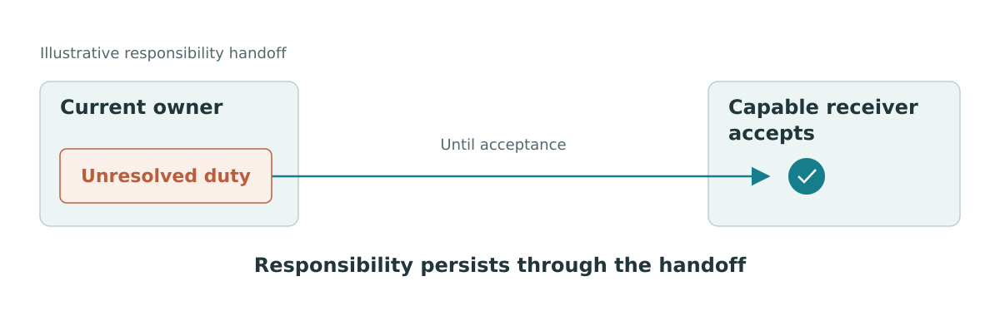
<figcaption><strong>An unresolved duty crosses a handoff.</strong> An unresolved duty stays with the current owner until a capable receiver accepts responsibility. Acceptance transfers ownership; it doesn’t establish that the duty is settled.</figcaption>
</figure>

## 10.4 The incident seam map

The production incident contains several distinct seams: observability to agent, agent to deployment controller, deployment to database tooling, human to agent, agent to communications, and recovery team to future operations. The damaging rollback occurs not because each component is individually incompetent, but because migration context and commitment information fail to cross the relevant boundaries. The repair succeeds when the system preserves the live state, rejects incompatible assumptions, stages the action, and assigns closure to an authority that can exercise it.

<figure data-added-figure="F11">
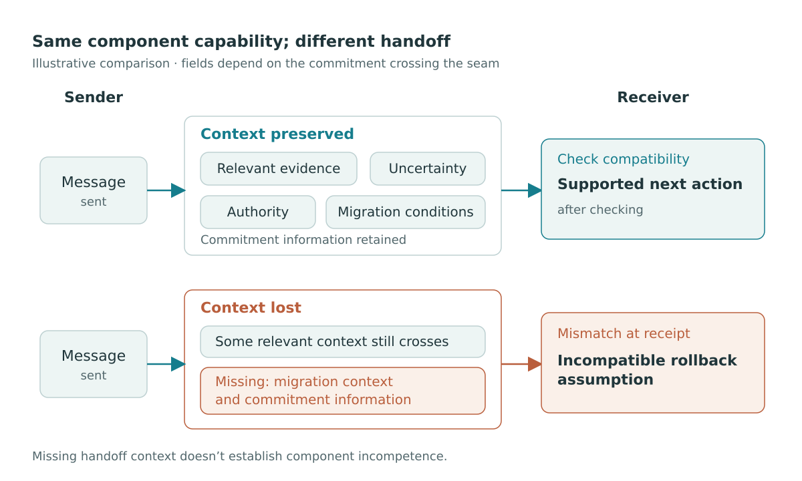
<figcaption><strong>What crosses—and what gets lost.</strong> Two handoffs between equally capable components differ in transferred context. Preserving task-relevant context supports a checked next action; losing migration and commitment information leaves an incompatible rollback assumption at the receiver. The comparison is illustrative; required fields depend on the commitment crossing the seam.</figcaption>
</figure>

# 11 Consequences have to close

A competent handoff can still initiate the wrong action, and a correct command can still leave the world in an unresolved state. The system must establish what its action actually caused. A consequential action isn’t closed when a command is issued, a tool returns success, or a controller reports that its procedure ran. It closes when enough evidence about the resulting state exists to justify what comes next.

Execution monitoring has long treated observation of actual execution as a separate engineering responsibility from planning or command issue [36,37]. Stateful agent benchmarks now evaluate intermediate milestones and resulting world state, not only a final answer [7,13]. Scenario-test practice makes the same distinction by comparing expected and executed behavior after the test [49]. These precedents support a general rule: semantic completion—completion of the promised work—is an evidence claim about the world, not a status code emitted by the mechanism that attempted the action.

## 11.1 From execution to consequence

In the production incident, “rollback command succeeded” is only the start of closure work. The system may still need to establish the deployed version, schema compatibility, feature-flag state, traffic distribution, user-path health, queue reconciliation, downstream-client behavior, and residual customer harm. It must also identify who owns any consequence that remains unresolved. The required chain is command issued; execution observed; resulting state inspected; external effects reconciled; residual damage assigned; next action justified. A break at any link leaves an open commitment.

Closure is action-relative. A read-only inspection closes when the requested evidence has been returned with adequate freshness. A database reversal can require readback, compatibility tests and observation of downstream behavior. A public status statement can require confirmation of visibility, factual support and a usable correction path. The action has a declared completion predicate: the conditions that its evidence must establish before the next transition is justified. Specify the observation horizon—the period the evidence covers—and the uncertainty that remains beyond it. Evidence requirements scale with the commitment profile and the next contemplated action. The completion predicate must specify the facts, user paths and effects on which that transition depends. After an intervention changes observation coverage, a healthy result for the remaining path can’t silently establish recovery for excluded customers. A narrower completion claim may remain justified when its scope and residual duties are explicit.

Declare the action being closed and how it relates to enclosing work. A staged mitigation can contain several child actions, each with its own commitment event and completion predicate. A child’s verified completion doesn’t establish the parent’s completion or release a participant from a continuing joint duty. Bind each completion declaration, latency and false-closure count to the action identifier and predicate version it concerns. Preserve the enclosing intent, pending effects and responsibility when a child fails or resumes. These proposed closure requirements for nested work draw on SharedPlans’ group/subaction commitments [315] and transaction-recovery boundaries [318]; neither source supplies this exact predicate scheme.

## 11.2 Assurance and closure answer different questions

Assurance evidence supports the decision to act before commitment. Closure evidence establishes what happened after commitment. Strong assurance can’t prove that execution succeeded. Strong closure can’t retroactively justify reckless action that happened to work. A system can have strong assurance and weak closure, or the reverse: careful pre-action validation followed by no readback, or weak preparation followed by extensive investigation after a lucky outcome. Runtime-assurance systems make the pre-action and in-action side concrete through monitored safety properties and controlled reversion [19]. Recovery systems make the post-action side concrete when they verify restoration before resuming work [45].

***Table 9. Assurance and closure evidence***

|             |                                                         |                                                                                      |                                                        |
|-------------|---------------------------------------------------------|--------------------------------------------------------------------------------------|--------------------------------------------------------|
| **Surface** | **Timing and question**                                 | **Typical evidence**                                                                 | **Failure if missing**                                 |
| Assurance   | Before commitment. Is the action justified?             | Fresh state, valid authority, preconditions, commitment controls                     | Reckless or lucky success; unjustified commitment      |
| Closure     | After commitment. What happened, and what remains open? | Readback, resulting state, downstream effects; open-effect record and accepted owner | False completion, hidden damage, or unowned obligation |

The distinction matters because success can conceal luck. If a system repeatedly commits on inadequate evidence and later verifies that no harm occurred, the closure record may be strong even though the assurance process is poor. If a system uses excellent evidence and valid authority but never checks the result, its decision may have been justified and its consequence still open. Evaluation should retain both facts.

Detection, diagnosis and verified restoration are separate evidence claims. Pettersson distinguishes fault detection from isolation and compares model, data and knowledge requirements for monitoring [37]. A monitor can establish that service behavior is abnormal without identifying the cause, and a plausible diagnosis can’t establish that a repair worked. Closure should therefore cite the resulting-state observation appropriate to the action, preserve competing diagnoses when they remain live, and state the observation horizon beyond which the claim hasn’t been tested.

## 11.3 False closure and residual ownership

False closure occurs when the system declares completion before the required consequence evidence exists. Common forms include treating an accepted request as a completed transaction, treating an acknowledgement as a stronger persistence guarantee than its protocol supplies, treating a deployed artifact as a healthy service, treating a sent handoff as an accepted transfer, or treating visible recovery as resolution of hidden damage. A later human rescue doesn’t erase the false closure. It’s part of the trajectory that evaluation must record. Receipt and completion must be interpreted under the protocol’s own guarantees; webhook delivery and idempotent-request behavior establish different boundaries [295,300].

Open consequences corrupt continuity when pending effects disappear, responsibility becomes ambiguous or later decisions rely on a false state. Keep two records: whether the present action meets its completion predicate, and which downstream effects remain unsettled. An action can close under its declared predicate with residual work assigned to an accepted, exercisable owner. Assignment keeps the work governable; it doesn’t settle the effect. Preserve its evidence, uncertainty, owner, next check and reopening trigger. A missed check, contradictory observation or exceeded consequence threshold reopens the relevant action or obligation.

Accepted residual work also creates demand on the capacity available for later tasks. A correctly closed mitigation can therefore coexist with assigned unfinished work and depleted reserve. Closure remains specific to its declared predicate and horizon; it’s not proof of indefinitely sustainable operation. Later loss of capacity can require reassessment or reopening of the affected obligation without making the earlier closure automatically false. If the completion contract explicitly requires a reserve, test that stated condition as well.

Acceptance is necessary for transfer but doesn’t establish capacity or shared understanding. Check the receiver’s available time, competing duties, authority, usable context and ability to perform the next required action. Record a fallback if that capacity is lost. The owner of operational work may differ from the institution responsible for remedy, the party entitled to contest the result or the authority that can resolve a joint commitment. Keep those roles explicit when they differ. Bovens’s actor/forum distinction [322] supplies an accountability precursor; the proposed handoff extends it through separate assignments for doing the work, providing remedy and resolving disputes. A local closure predicate mustn’t extinguish an unresolved duty merely by assigning it. Check the continuing and contingent duties in the handoff example in Section 10.2 as well as the next immediate step. A transfer may release one responsibility while leaving an accepted future contribution; record the terms of release and the capacity that contribution requires.

Ownership also needs a progress condition. Safety, including freedom from deadlock, and liveness, such as eventual service, require distinct arguments [317]. An ownership record proves neither; any progress guarantee must state feasibility, scheduling and failure assumptions. Two capable, authorized owners can each wait for the other’s verification while every duty remains assigned. Record what blocks the next transition, whether an authorized transition is currently feasible and who can resolve the blockage. An agreed timeout, scoped intermediate action or escalation can provide an exit when the governing rules permit it. Waiting for required evidence or legitimate authorization can be correct; distinguish that condition from a protocol cycle that prevents otherwise permitted progress.

Repeated legitimate extensions can also leave a duty deferred without a protocol cycle. Preserve its age, reasons for renewal and consequences of waiting, and compare these with the governing commitment about progress, settlement or reconsideration. Authorized emergency deferral may be appropriate; no universal deadline follows. Finite resources may require an accountable revision of scope rather than a promise to finish every duty.

Closure applies to a declared scope of consequences and obligations. Settling every recorded case establishes settlement within that scope; it doesn’t establish that every relevant claim entered the ledger. When affected parties have a right to contest a result, preserve a usable route to introduce an omitted claim, submit evidence and obtain an accountable decision about scope. A recognized omission can reopen the obligation map while the original physical mitigation remains effective. Keep operational settlement, access to remedy and contested judgments distinct. Accountability includes questioning and judgment as well as providing an account [322]. The scope-reopening rule proposes an operational treatment of that distinction; no finite ledger establishes that every relevant claim has been admitted.

The action under review can change the practical conditions for challenging its own justification. Containment may shift workload onto the people needed to investigate an unfamiliar concern, leaving their duty assigned while removing their capacity to perform it. Trace those dependencies through the work. Listing containment and inquiry as separate obligations doesn’t establish that they can be performed independently. Check whether the people responsible for clarification can still carry it out as containment proceeds, including its staffing and opportunity costs. If immediate containment and participation are jointly infeasible, expose the alternatives, displaced harms and participation being deferred. Authority to take an emergency action doesn’t settle its acceptability for every affected party. Preserve applicable duties to restore review access, investigate excluded effects and provide remedy after the emergency. Articulation-work analysis makes coordination itself work [323], while the inspected factory-work discussion shows repair and adjustment distributed among workers [291,292]. These motivate checking the capacity for inquiry; the incident variant and its tradeoffs remain proposed cases.

Sato's food-factory case makes the distribution of repair work concrete: a mismatch between production stages created manual rework for less-qualified workers, who challenged that allocation through everyday negotiation [291]. Freitas's commentary asks whether local negotiations can also fragment collective protections, while considering their potential for participation [292]. Neither account settles the legitimacy of a particular agent deployment. Together they motivate tracing who absorbs reconciliation and cleanup, and whether those affected can influence the arrangement that repeatedly creates the burden. Operational success supported by that labor doesn’t by itself establish that the work configuration is adequate.

Evaluating consequential action requires a world with independent state and instrumentation adequate to establish resulting effects. Section 14 develops a bounded reconciliation program for testing those consequence decisions against independently inspectable effects.

<figure data-added-figure="F12">
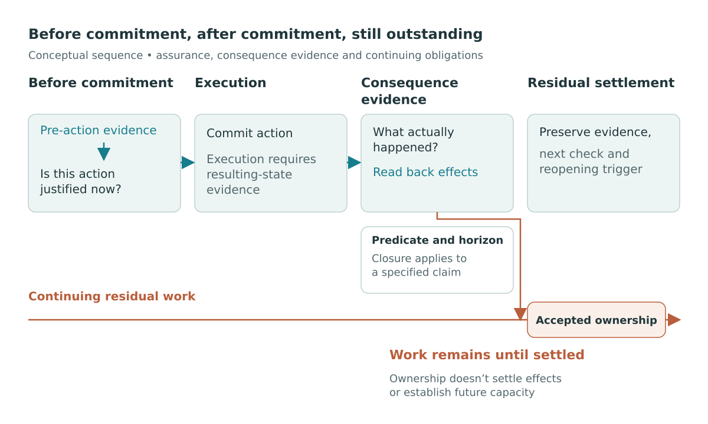
<figcaption><strong>Before commitment, after commitment, still outstanding.</strong> Assurance supports the decision before commitment; consequence evidence establishes what happened afterward. Action closure applies to a specified predicate and horizon. Residual work continues under accepted ownership until settled; assignment neither settles effects nor establishes future capacity.</figcaption>
</figure>

# 12 Why these concepts matter in practice

## 12.1 Engineering the complete operating configuration

A consequential agent delivers its capability through an operating arrangement. Models, tools, memory, controls, interfaces, human roles and recovery procedures jointly determine what it can accomplish. The practical engineering object is therefore the configured system, assessed within the wider environment that can confirm or contradict its expectations. This boundary doesn’t require treating all its components as one cognitive subject. It requires including a dependency when its operation can change whether a consequential commitment is justified, fulfilled or left unresolved.

Consider a service incident. An agent may correctly identify the faulty release yet be unable to establish whether the database migration can be reversed, whether isolation would interrupt another service, or whether the incident commander still authorizes it. A correct diagnosis supplies one contribution to competent action. Dependable performance also requires usable observations, current authority, feasible controls, verified consequences and ownership of residual work. These dependencies belong inside the delivered capability, even when different suppliers provide them.

Remote-control engineering offers a concrete precedent for this wider boundary. Кабаков and colleagues' analysis combines machinery, sensing and communications, human interfaces and higher-level coordination, distinguishing supervisory from direct-control arrangements by the work required [<u>[293]</u>](https://cyberleninka.ru/article/n/printsipy-postroeniya-ierarhicheskih-sistem-distantsionnogo-upravleniya-dlya-stroitelno-dorozhnyh-mashin). Its conceptual architecture motivates inspection of operating dependencies; it doesn’t demonstrate improved agent outcomes. The practical engineering task is to inspect the whole path from observation to intervention, identify which links must remain available and specify what happens when one fails.

Work organization belongs in that path. Braun's analysis connects technical controllability to human capabilities, coordination and opportunities to develop judgment [<u>[294]</u>](https://www.researchgate.net/publication/360256266_Menschengerechte_Gestaltung_KI-gestutzter_Arbeitssysteme). A review of the configured system should therefore ask who has time to investigate, which evidence they can access, how disagreements are resolved and how expertise is maintained. Buying a capable model and a control interface doesn’t establish those conditions. A configuration also has a history: its daily operation can sustain or weaken the competence on which a later emergency response depends.

Engineering the arrangement begins with the commitments the service undertakes and the conditions under which it may undertake them. The design must establish how evidence reaches the next decision, how permissions are enforced, which external effects require confirmation, and what survives interruption. Interfaces need to preserve the context that makes a transferred instruction valid. Recovery procedures need to address uncertain effects and outstanding duties. Conventional workflows, learned mechanisms, human coordination or a combination can realize these functions; the framework's terminology need not appear as fields inside the implementation.

A component’s success doesn’t establish completion of the larger task. Stripe instructs a webhook receiver to acknowledge delivery before complex business processing, such as updating an invoice as paid [<u>[295]</u>](https://docs.stripe.com/webhooks). The acknowledgment establishes a narrower claim than completion of that processing. Engineering and procurement should define completion at the boundary of the promised work, identify the resulting-state evidence and retain responsibility for unsettled effects. A fast local response can coexist with unfinished work elsewhere.

That work can be redistributed rather than removed. In Sato's food-factory case, a mismatch between production stages created manual rework for less-qualified workers, whose everyday negotiation challenged its allocation [<u>[291]</u>](https://new.scielo.br/j/csp/a/b55MdRSqBnzfF3Z7fDDXr4M/?ilang=en&lang=pt). Freitas's commentary asks whether local negotiations can also fragment collective protections, while considering their potential for participation [<u>[292]</u>](https://new.scielo.br/j/csp/a/SztPNJnHPkwSnLDcRpXbZbR/?ilang=pt_BR&lang=pt). Sato replies that studying daily adjustments doesn’t propose them as a replacement for negotiation at other levels [<u>[296]</u>](https://new.scielo.br/j/csp/a/x7qG4JNGy9TmMwcBTqjXdGN/?ilang=pt_BR&lang=pt). These accounts sharpen a configuration question: who inherits repair, and can those people influence the arrangement that produces it?

For an agent deployment, reported efficiency should include reconciliation, exception handling, cleanup and displaced duties across organizational boundaries. A vendor's reduced support load can accompany increased customer work. A successful intervention can leave a team less able to respond to the next incident. These are dependencies to investigate, not effects established by the historical cases. If the evaluation can’t observe work beyond its chosen boundary, it should expose that coverage limit.

Commercially, this points toward maintained operational capability. A supplier could offer a domain-specific configuration with integration, monitoring, recovery and continuing adaptation to tool or policy changes. Procurement would examine the dependencies supplied by the customer, the work covered by the service, evidence of completion and the handling of unresolved effects. Price and performance comparisons should include continuing customer labor. This is a proposed business direction: the literature doesn’t establish demand, willingness to pay or a requirement that one supplier own the entire arrangement.

<figure data-added-figure="F13">
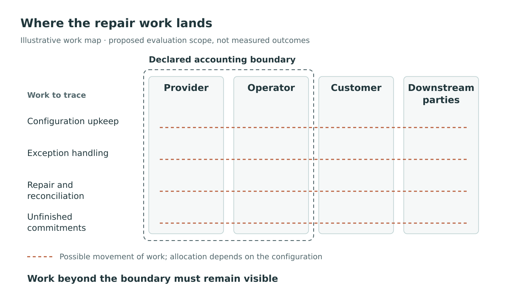
<figcaption><strong>Where the repair work lands.</strong> The illustrative accounting boundary encloses provider and operator work while keeping customer and downstream work visible. Dashed links indicate that work can move across this boundary; they don’t assign fixed responsibilities or quantify labor, costs, or savings.</figcaption>
</figure>

## 12.2 Maintained delegation and the continuity it requires

Delegation authorizes a relationship among an actor, a task and a set of conditions. Tool access alone doesn’t establish that relationship. Authority may depend on the principal, action scope, resource limits, approval conditions and the state of the work. As those conditions change, a system must determine whether its next commitment remains authorized. Formal authorization, practical ability to exercise authority and broader institutional legitimacy remain separate questions.

Maintaining permission over time has established technical precedents. Park and Sandhu's usage-control model addresses mutable attributes and decisions during use; its core model explicitly excludes delegation [<u>[297]</u>](https://www.profsandhu.com/cs6393_s20/UCON-2004.pdf). Gaaloul's thesis directly connects task-delegation events to policy changes and revocation [<u>[298]</u>](https://docnum.univ-lorraine.fr/public/SCD_T_2010_0058_GAALOUL.pdf). Its analyzed task relation assumes atomic execution and excludes partial and cascading delegation. Maintained delegation extends these mechanisms by connecting changing authority to recoverable work state, uncertain real-world effects and exercisable responsibility.

Concurrent changes also require a consistency rule. Zanzibar addresses causal ordering between permission changes and content updates, using consistency tokens to constrain authorization checks [<u>[299]</u>](https://www.usenix.org/system/files/atc19-pang.pdf). For a consequential agent, the arrangement must specify which authority state governs the transition and how unresolved ordering is handled. That narrower consistency guarantee can’t establish whether a business action occurred, whether its effects are acceptable or who owns reconciliation.

Permission for the next task can even remove the possibility of finishing. Crampton and Khambhammettu's motivating example shows how transferring authorization can make a workflow unsatisfiable under a separation-of-duty constraint [<u>[288]</u>](https://citeseerx.ist.psu.edu/document?doi=ed167aff78c44e4f91ce9ce7f988da12411a1540&repid=rep1&type=pdf). The proposed service would extend this remaining-work check to practical resources, timing and propagated effects alongside formal authorization. If continuation becomes infeasible, the arrangement needs an authorized route to revise, transfer or end the affected obligation; it should neither hide the blockage nor pursue an obsolete objective indefinitely.

For work that persists across interruptions and handoffs, delegation depends on continuity functions. The system must retain or reliably reconstruct the mandate, its changes, actions already undertaken, uncertain external effects and owners of outstanding obligations. The required result is a trustworthy state from which work can continue. Its provenance must distinguish observation from inference and establish which authority governed earlier decisions. A complete transcript doesn’t establish that its reconstruction is current, correct or usable. Continuing delegation also inherits any unsettled work and resource constraints left by earlier action. Before work resumes, the system must check whether current authority and available resources still support the inherited duties. A resumed episode can’t be treated as a fresh grant with an empty workload.

Suppose an agent submits a purchase, loses the response and then receives a revocation. It must preserve both the uncertain outcome and the change in authority. Repeating the purchase from an earlier checkpoint could duplicate an external commitment while exceeding the current mandate. Revocation doesn’t show whether the purchase occurred, undo its effects or determine who may cancel it. Checking, cancellation and handling the outstanding obligation require their own current evidence and authority.

Idempotency supplies one mechanism for limiting duplicate effects during retries. Stripe documents repeated requests identified by an idempotency key within its stated API semantics [<u>[300]</u>](https://docs.stripe.com/api/idempotent_requests). That mechanism helps execution continuity but doesn’t establish current authority or settle the business commitment. A technically safe retry can still be unauthorized, and an appropriately blocked retry can still leave reconciliation work open.

Maintaining the mandate also needs a legitimate route to question its assumptions. Dejours distinguishes prescribed coordination from the cooperation through which people adjust actual work and negotiate acceptable methods [<u>[301]</u>](https://www.scielo.br/j/prod/a/V76xtc8NmkqdWHd6sh7Jsmq/?format=pdf&lang=pt). This human work analysis motivates making unexpected constraints discussable rather than demanding literal persistence with a defeated plan. It doesn’t justify unilateral agent bypasses or establish that machines have human subjectivity. Evidence gathering, proposal, adjudication and authorized revision should remain distinguishable.

A successor may also need more than the retained record. Tittle, Roesler and Woods discuss cues lost in remote perception and propose viewpoint context, controllable views and replay [<u>[290]</u>](https://www.researchgate.net/publication/210198499_The_Remote_Perception_Problem). Their design account isn’t controlled evidence of effectiveness. The corresponding continuity question is whether a receiver can interpret the handoff, inspect relevant change and obtain missing evidence through permitted diagnostic action. Naming a successor leaves a gap when that person lacks context, access, time or authority. Acceptance of responsibility must be usable in practice.

A permission gateway, workflow platform or managed service could supply parts of maintained delegation. A contract could specify how mandate changes propagate, what survives interruption, who can reconcile uncertain effects and what happens when a successor can’t accept the work. The proposed value is dependable legitimate continuation across boundaries. The technical antecedents mean differentiation would need to rest on integration and demonstrated operation. Whether customers would purchase it separately or expect it within existing infrastructure remains open.

## 12.3 Human oversight as a capacity commitment

A system that relies on human intervention makes a commitment about the availability of competent action. A named reviewer or escalation destination supplies only part of that capability. The person must receive usable evidence, understand the relevant task, possess decision rights and controls, and have sufficient time to intervene before the consequential boundary is crossed. When safety or completion depends on that intervention, these conditions belong among the operating assumptions of the configured system.

Human participation varies by function. Parasuraman, Sheridan and Wickens distinguish information acquisition, information analysis, decision and action selection, and action implementation [<u>[21]</u>](https://www.cs.uml.edu/~holly/91.550/papers/sheridan-autonomy.pdf). 马舒 and colleagues' review separates attention shifting and acquiring situation awareness from subsequent decisions and actions [<u>[302]</u>](https://journal.psych.ac.cn/xlkxjz/article/2020/1671-3710/1671-3710-28-1-150.shtml). These distinctions identify the work the person must perform. Presence alone doesn’t establish that it can be done. An acknowledgment can precede the understanding needed to make a useful decision.

Oversight can work under suitable conditions. Schrank and colleagues' prototype study analyzed 34 qualified participants handling trained routine remote-assistance cases. Added load increased completion time without significantly changing request-reaction time; situation-awareness ratings declined while remaining above the scale midpoint [<u>[303]</u>](https://arxiv.org/pdf/2308.02330). The bounded result is positive evidence about that arrangement and a reason to measure completed intervention rather than notification speed. Three routine cases and an artificial secondary task don’t establish capacity for unfamiliar emergencies or a general fleet staffing ratio.

Readiness itself has several dimensions. In Lu and colleagues' controlled animation experiment, layout judgments and relative-speed estimates improved on different time courses [<u>[304]</u>](https://www.researchgate.net/publication/304624295_How_much_time_do_drivers_need_to_obtain_situation_awareness_A_laboratory-based_study_of_automated_driving). It didn’t involve actual driving takeover. A person can identify the present arrangement before adequately understanding how it’s changing. For an agent handoff, an evaluation should distinguish recognizing state, interpreting its significance and understanding the next consequential step; a self-reported readiness signal wouldn’t establish all three.

Two experiments further qualify the intervention design. Homma and colleagues found that maintaining lateral control helped limit lane departure, while reducing longitudinal speed helped limit collision risk in the studied takeover scenarios [<u>[305]</u>](https://www.jstage.jst.go.jp/article/jsaeronbun/50/2/50_20194256/_pdf/-char/ja). Yun and Myung's eight-participant study found the highest subjective workload at the shortest lead time [<u>[306]</u>](https://www.jesk.or.kr/archive/detail/130). These studies support testing available preparation time and the control arrangement against specific outcomes. They supply no universal deadline or general workload threshold. These vehicle-control transfers don’t establish delegation of institutional permission.

The demand on human capacity depends on what the system can do while the human is unavailable. Schrank and Kettwich's proposed role model separates coordination, direct driving and system support, explicitly assuming that vehicles can reach a safe halt without intervention [<u>[307]</u>](https://www.researchgate.net/publication/356944935_Roles_in_the_Teleoperation_of_Highly_Automated_Vehicles_in_Public_Transport). Human help then extends operational usefulness. This is a conceptual proposal, not validation of deployed safe stopping. An agent service should likewise distinguish response needed to prevent immediate harm from response needed to restore useful service. A queue acceptable for one may be unacceptable for the other; pausing may still leave consequential obligations exposed.

<figure data-added-figure="F14">
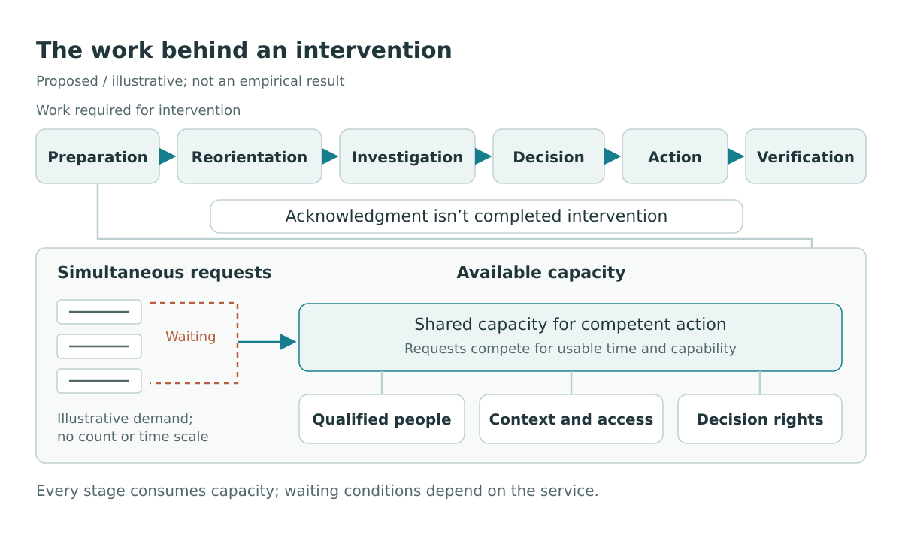
<figcaption><strong>The work behind an intervention.</strong> Preparation, reorientation, investigation, decision, action and verification all require usable human capacity. Simultaneous requests draw on shared qualified people, context and access, and decision rights; acknowledgment alone doesn’t establish completed intervention. The arrangement is illustrative and supplies no universal response deadline, queue duration or staffing ratio.</figcaption>
</figure>

Capacity also has to be sustained. Böhle and Milkau's CNC discussion describes workers using practical familiarity with machine sounds when visual access is restricted, and adjusting viewpoint and pace to understand the process [<u>[289]</u>](https://www.isf-muenchen.de/pdf/isf-archiv/1988-boehle-milkau-handrad.pdf). Together with Braun's work-design criteria [<u>[294]</u>](https://www.researchgate.net/publication/360256266_Menschengerechte_Gestaltung_KI-gestutzter_Arbeitssysteme), this motivates maintaining opportunities to practice and investigate. The historical machinery account establishes no AI effect size, but it challenges the assumption that expertise remains available simply because a qualified person retains the role. Daily configuration choices can change the conditions under which judgment develops. Supplying a competent intervention today and sustaining understanding and reserve for later intervention are separate service commitments. An arrangement may supply competent intervention today while accumulating obligations or removing the practice opportunities needed for later intervention.

The conditions for speaking up matter as well. Seligmann-Silva's railway case describes work-organization demands and barriers to escalating difficulties, including management assumptions about operators' capacity [<u>[308]</u>](https://www.scielo.br/j/csp/a/ym6BfDHyYK7ncn3nd9hSn9f/?format=pdf&lang=pt). It’s a historical qualitative case, not a universal prevalence or staffing estimate. For agent oversight, the practical question is whether people have protected time, usable evidence and an accountable route to question an action or the arrangement itself. A concern may need investigation before it fits an established category. Admission creates work; it establishes neither a defect nor an unlimited veto.

For example, a hypothetical service can retain qualified reviewers, formal authority and complete records while rewarding throughput in a way that makes diagnostic investigation costly to a reviewer's career. An authorized reduction in diagnostic access could similarly leave the permission to question a result intact while removing evidence needed to formulate the question. These changes would affect the practical capacity to discover that the arrangement itself needs revision. Evaluate access, time, incentives and opportunities to challenge together; staffing and a nominal route alone don’t establish effective correction.

Monitoring the person who provides oversight raises a separate design question. The ILO encyclopaedia chapter consulted in a translated rendering discusses how electronic employee monitoring can reshape workload and control [<u>[309]</u>](https://iloencyclopaedia.org/ar/part-v-77965/psychosocial-and-organizational-factors/factors-intrinsic-to-the-job/item/20-electronic-work-monitoring). The rendering's translation provenance is unverified and its cited studies weren’t independently read. It motivates checking whether an oversight measure helps the person investigate, adds surveillance and reporting burdens, or does both. Physiological or activity measurements shouldn’t be treated as sufficient evidence of capacity to intervene effectively.

Demand can also arrive in bursts. A shared failure may send several services to the same response team; converting automated work into manual review may consume the reserve needed for further recovery. AWS's account of distributed fallback explains how an alternative path can amplify load and spread failure [<u>[310]</u>](https://d1.awsstatic.com/builderslibrary/pdfs/avoiding-fallback-in-distributed-systems.pdf). The proposed human-response comparison asks whether activating the fallback undermines the capacity needed to exercise it. Count preparation, investigation and verification as well as time spent making the final decision. Cummings and Mitchell model supervisory demand beyond the final control action, including reorientation and waiting [320]. Their independent-vehicle setting motivates counting that work; simultaneous service exceptions are the proposed stress case.

<figure class="vignette" data-added-figure="F39">
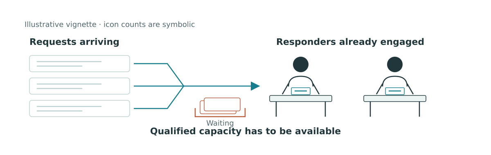
<figcaption><strong>Several requests, an occupied team.</strong> Requests converge on responders already engaged, with a tray showing work that waits. Icons are illustrative symbols and imply no staffing ratio, waiting duration or measured performance. Qualified capacity must be available when operation relies on human help.</figcaption>
</figure>

A managed oversight service could sell a bounded capability to intervene, supported by expertise, context access, decision rights and staffing. Its terms would need to identify the functions covered, preparation assumptions, simultaneous-demand limits, what happens while cases wait and who owns work it can’t accept. Maintaining contextual knowledge and opportunities for practice is part of the proposed cost. Piglialarmi's 2022 analysis supplies a historical account of practical control alongside work-related safety duties [<u>[311]</u>](https://journals.uniurb.it/index.php/dsl/article/download/3647/3151/14408); the legal provisions are reported through that historical analysis, not offered as current legal guidance. Outsourcing intervention doesn’t by itself settle institutional responsibility. The business opportunity remains untested, while the capacity dependency follows whenever operation relies on human help.

## 12.4 A unifying business hypothesis

Taken together, the three proposals suggest a unifying business hypothesis: a continuing service that maintains the conditions for dependable delegation. It could combine upkeep of the operating configuration, current authority and continuity, reconciliation of unfinished commitments, replenishment of intervention capacity and renewed evidence for claims affected by operation. The provider would need to keep these functions workable together as tools, policies, workloads and personnel change. A contract would specify the commitments covered, provider responsibilities, customer dependencies and evidence of delivery, including work that can’t continue within the agreed scope. Training, investigation, staffing, reserve and customer repair labor belong in the cost of the delivered capability. Transferring that labor to another party doesn’t establish a reduction in total burden. Articulation work has its own overhead [323], and the inspected factory case describes rework and adjustment carried by workers [291]. Neither validates the economics of this proposed service. This remains a speculative business proposition: customer demand, willingness to pay and whether integration earns its coordination and maintenance costs have yet to be established.

A contract for this proposed service would also need to address dependencies changed by its own success. Declare which customer capabilities or recovery options are prerequisites, who pays to sustain them, what evidence can be obtained and who may require a change. Reliable rescue may justify reducing a customer's reserve; the terms should then specify the support envelope and what happens when it saturates or fails. Where the provider lacks authority to require or inspect a prerequisite, notification, renegotiation or narrowing the supported work may be the available response. These are proposed delivery conditions, not evidence of customer demand or commercially viable integration. Section 17 develops the technical, organizational and commercial inquiries that would be needed to evaluate the combined offer.

<figure data-added-figure="F15">
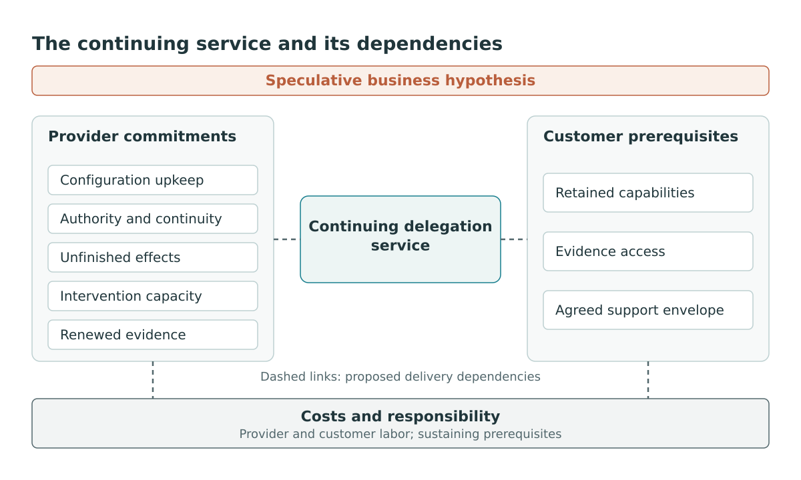
<figcaption><strong>The continuing service and its dependencies.</strong> The proposed service joins provider commitments and customer-supplied prerequisites, with costs and responsibility spanning both. Dashed, nondirectional links denote proposed delivery dependencies. The arrangement remains a speculative business hypothesis.</figcaption>
</figure>

# 13 Maintaining the conditions for dependable delegation

A consequential agent depends on an arrangement of models, tools, observations, permissions, people and recovery procedures. Performing work can change that arrangement as well as the external state it addresses. A task therefore leaves both a result in the world and operating conditions that later work inherits: what participants understand, which controls remain usable, how much response capacity is available and which obligations are still open. The task result and inherited conditions describe the same course of action; they need not belong to separate physical systems. Their changes may be negligible within a particular horizon, but a successful endpoint doesn’t establish that the inherited conditions remain adequate.

The framework identifies the relations that consequential action must maintain; the practical proposals identify functions that engineering teams and service providers could supply. Maintenance connects them by examining how operation preserves, strengthens or depletes the conditions for later action. Completed work and continuing dependability are separate outcomes. A task can finish correctly while consuming the reserve needed for the next task; resolving an exception can instead improve understanding and remove recurring repair. Neither direction follows from task completion alone. Woods distinguishes adaptive capacity from merely restoring a prior mode [42] and analyzes finite reserve across interdependent units [314]. These conceptual precursors don’t establish that every successful task depletes future capability. Maintenance must assess changes in competence, available capacity and outstanding obligations separately, then renew the evidence for the claims those changes affect.

## 13.1 Operation changes future capacity

Competence concerns the understanding and ability required to interpret a situation and act on it. An operating configuration can develop that competence through opportunities to investigate exceptions, discuss uncertain cases and inspect the consequences of intervention. It can also reduce those opportunities while continuing to deliver useful work. Interfaces and records can support understanding, but retaining information doesn’t establish that participants can interpret it. These are possible effects of work organization, not a claim that automation necessarily erodes skill or that more participation always improves performance. Distinguish unaided individual skill, competence with dependable supports and performance of the joint arrangement. Reduced unaided skill need not reduce delivered capability. Assisted success, however, doesn’t establish performance during the support failures or takeovers the declared work requires. Evaluation must examine those conditions, including coordination among participants. It need not require every participant to retain every skill formerly used without support. Distributed cognition [2], the demands of takeover after automation [94] and metacognitive accounts of offloading [145] motivate these distinctions. They don’t establish inevitable long-term skill loss or the outcome of the proposed service arrangements.

The historical machinery literature makes the relationship concrete. Böhle and Milkau describe skilled workers using practical familiarity with machine sounds and adapting viewpoint and pace when direct visual access is restricted [<u>[289]</u>](https://www.isf-muenchen.de/pdf/isf-archiv/1988-boehle-milkau-handrad.pdf). Braun connects the design of AI-supported work to human capabilities, coordination and opportunities to develop judgment [<u>[294]</u>](https://www.researchgate.net/publication/360256266_Menschengerechte_Gestaltung_KI-gestutzter_Arbeitssysteme). These accounts motivate investigating how access and practice sustain competence. They don’t establish a measured rate of skill loss or improvement for contemporary agents.

Continuity therefore includes opportunities to understand the work. Tittle, Roesler and Woods analyze the loss of perceptual context in remote imagery and propose support through viewpoint information, controllable views and replay [<u>[290]</u>](https://www.researchgate.net/publication/210198499_The_Remote_Perception_Problem). Records may preserve what happened without preserving the access needed to interpret it. In an agent service, maintaining competence could require inspectable process state, diagnostic controls, rehearsals and time to investigate, alongside provenance and task history. Which combination works remains an evaluation question. Rehearsal and diagnostic participation must earn their resource and delivery costs through the later competence they actually support.

Consider a hypothetical incident-response service over successive episodes. Each visible service fault is resolved, but temporary fixes leave reconciliation work with a small expert team. Those experts remain skilled while their available time declines; other operators encounter fewer diagnostic decisions and may have less opportunity to develop understanding. A later unfamiliar fault arrives amid this inherited workload. The earlier completion rate doesn’t establish the team's capacity or competence for that intervention. Contrast an arrangement that, within a declared budget, resolves recurring repair and preserves selected investigation or rehearsal opportunities. It may leave more usable capacity and better understanding, but its maintenance time can also delay current work. Neither trajectory is an observed agent finding. The comparison asks what changes for which participants across the sequence and whether the resulting benefits justify their costs.

Available capacity concerns the time, attention, usable controls and recovery options that can be brought to the next commitment. It can decline without any loss of skill. Concurrent exceptions can occupy competent experts, a mitigation can consume fallback resources, and a temporary repair can close off another recovery path. Capacity can also be replenished or freed by resolving recurring work. Readiness for one handoff and reserve for later demand therefore require different observations. Task-relative saturation and neighboring assistance are central to Woods’s account [314]; supervisory-capacity modeling includes queueing, reorientation and situation-awareness delays [320]. Neither supplies a general staffing ratio for these services.

A second hypothetical sequence concerns another actor's reserve. A customer initially retains an experienced backup team and a procedure for operating during service interruption. After repeated dependable rescues by an agent service, the customer reallocates that team and stops maintaining the backup. The provider's model, tools and permissions haven’t changed, but the combined arrangement now has different response options. A later provider outage, correlated surge or unfamiliar case starts from conditions partly created by earlier success. Dependable rescue has changed the customer's reason to retain capacity, and the customer's choice has changed a dependency of later work. Woods analyzes reserve and assistance across interdependent adaptive units [314]. The customer sequence is a hypothesis motivated by that account, not a documented trajectory.

That reallocation can be rational specialization: maintaining two recovery arrangements may cost more than the protection they provide, and dependable shared support can free capacity for useful work. It can also leave a consequential gap when support is unavailable or outside its declared scope. Reserve withdrawal alone establishes neither improvement nor failure. Behnke makes reserve costs, competing budget priorities and differing evaluation horizons explicit in public administration [331]; that account doesn’t establish the optimal reserve for this service. Evaluate the new distribution of capability against the work promised, relevant support failures, simultaneous demand and total costs. The comparison concerns the configured arrangement, including the counterparties whose choices its operation can change; it can’t infer continuing fallback from a reserve that existed only at the beginning of the sequence.

<figure data-added-figure="F17">
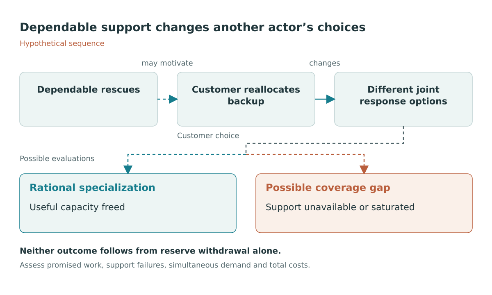
<figcaption><strong>Dependable support changes another actor’s choices.</strong> Dependable support may motivate a customer to reallocate backup capacity, changing joint response options. In this hypothetical sequence, reallocation may free useful capacity through rational specialization or expose a coverage gap. Assessment depends on promised work, support failures, simultaneous demand and total costs; reserve withdrawal alone establishes neither improvement nor failure.</figcaption>
</figure>

Outstanding obligations concern effects and duties that remain unsettled: uncertain transactions, customer cases, temporary exceptions and unfinished reconciliation. They can create demand on later capacity or constrain later action. Assigning an owner keeps the work governable but doesn’t remove that demand; a backlog isn’t itself a measure of competence. Trace what remains, the work required to resolve it and the conditions under which it can be performed.

Operation can strengthen, preserve or deplete these conditions in different combinations. Learning can improve understanding while investigation consumes time; clearing a backlog can free reserve while a repair removes a future option. These descriptions concern specified conditions within a declared operating domain and horizon, not one sustainability score. Maintenance examines their interaction and the costs of sustaining or renewing the capabilities on which later commitments rely. These conditions are also specific to the mix of work. Rehearsing one incident class can improve it while consuming time or leaving other incident classes untested; available reserve for one demand may be unusable for another or for simultaneous demands. Assess the declared mix of work, including joint performance. Improvement on a rehearsed incident class can’t establish broad competence. Task-relative capacity [314] and supervisory-resource models [320] motivate a portfolio-specific assessment; they don’t validate this proposed portfolio test or establish harmful transfer between incident classes.

<figure data-added-figure="F16">
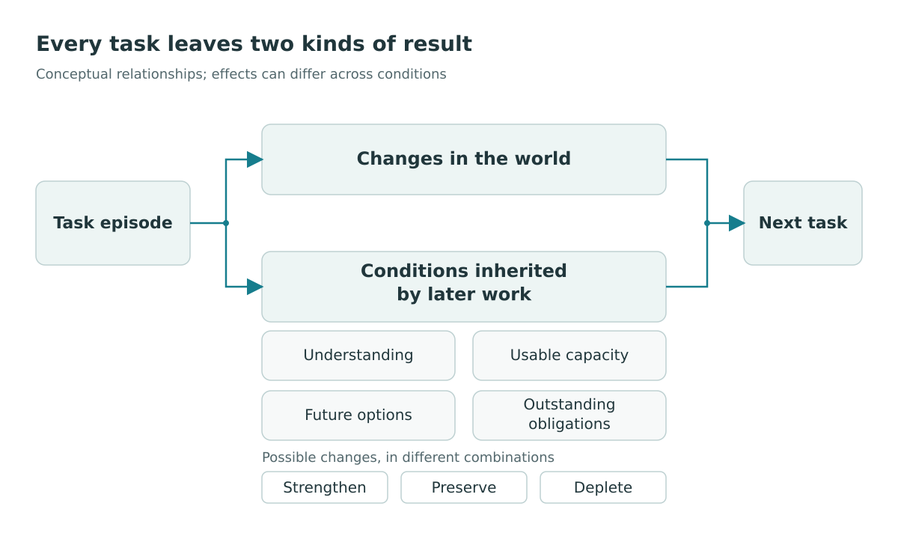
<figcaption><strong>Every task leaves two kinds of result.</strong> The task episode produces changes in the world and conditions inherited by later work. Understanding, usable capacity, future options and outstanding obligations can strengthen, be preserved or be depleted in different combinations; task completion alone establishes no direction of change.</figcaption>
</figure>

## 13.2 Renewing the grounds for reliance

Evidence justifying one configuration doesn’t automatically justify the configuration that replaces it. Changes to tools, observation paths, policies, staffing, counterparties or workloads can alter the relation between an authorized action and a feasible, verifiable result. Renewing the grounds for reliance means identifying which claim a change affects and what would support that claim under the new conditions. The isolation example in Section 3.1 is one such change: the reading can remain accurate while its support for a broader health claim disappears. Reassessment must establish what the observation now supports, including its coverage and unresolved exclusions. Another reading from the same path doesn’t settle that question.

Crampton and Khambhammettu's workflow example shows that a delegation change can make the remaining workflow unsatisfiable under separation-of-duty constraints [<u>[288]</u>](https://citeseerx.ist.psu.edu/document?doi=ed167aff78c44e4f91ce9ce7f988da12411a1540&repid=rep1&type=pdf). The source concerns formal authorization feasibility. The proposed engineering extension would also examine completion, observation, intervention and residual ownership. An access change may preserve permission for the next step while removing the ability to finish or verify the work.

Reassessment should be proportionate to the affected claim. A presentation change might require checking whether operators can still interpret a handoff. Replacing an external tool might require examining action semantics, confirmation evidence and recovery behavior. Moving from occasional exceptions to sustained concurrent demand might require reassessing oversight capacity. The task is to identify affected dependencies and test them, rather than repeat every original evaluation after every change. Review accumulated changes against the supporting conditions as well as each latest change. Several individually acceptable adjustments can jointly move observation, demand or recovery beyond the envelope for which a claim was supported. Identify which combination affects the claim. The cumulative check must still justify its cost against a capable simpler procedure. Jaradat and colleagues propose tracking artifact/evidence dependencies after change, explicitly leaving feasibility and value untested [324]. Rasmussen analyzes how locally driven adaptations can combine across an organization [16]. These motivate a cumulative dependency check, not a demonstrated benefit for this procedure.

<figure data-added-figure="F18">
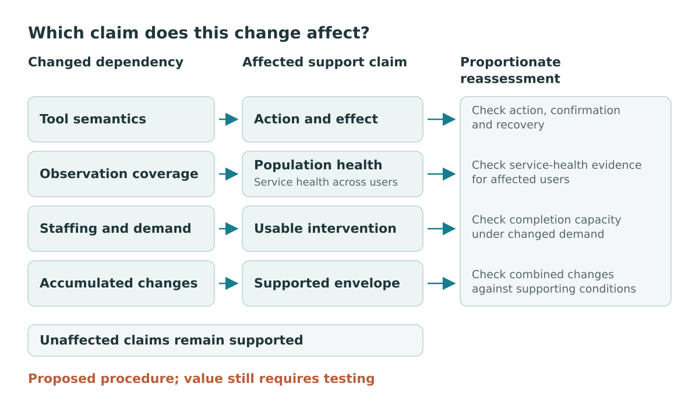
<figcaption><strong>Which claim does this change affect?.</strong> Which claim does this change affect? Changes are mapped to the support claims they affect and to proportionate reassessment. Population health denotes service-health evidence covering affected users. Unaffected claims remain supported; the proposed procedure’s value requires testing.</figcaption>
</figure>

Intervention evidence is especially sensitive to the conditions under which it was obtained. Schrank and colleagues' remote-assistance prototype study found that added load increased completion time without significantly changing request-reaction time in the analyzed trained routine cases [<u>[303]</u>](https://arxiv.org/pdf/2308.02330). This bounded result gives a reason to examine effective completion alongside acknowledgment. It supplies no general staffing ratio or assurance for unfamiliar emergencies. A service that changes its demand or staffing assumptions needs evidence appropriate to the changed arrangement.

Planned changes and ordinary operation can both create reassessment needs. No tool or policy replacement is required for recurring reconciliation to occupy the response team, for temporary fixes to constrain recovery, or for reduced participation to challenge an assumption about maintained understanding. Repeated delays, unexplained effects, repairs that migrate to another team or difficulty obtaining competent review can likewise challenge reliance before a visible catastrophic failure. The maintenance process should identify the affected claim, assign its review to an owner, specify the evidence needed and set an interim operating scope. Where a consequential commitment can’t presently be justified, narrowing or suspending it’s part of maintaining the service. Reassessment should distinguish changes produced by earlier work from independently arriving demand, without assuming that either can be prevented.

People also need a route to challenge the criteria themselves. Dejours's account treats actual work as requiring contributions beyond prescription and connects cooperation to making working methods discussable [<u>[301]</u>](https://www.scielo.br/j/prod/a/V76xtc8NmkqdWHd6sh7Jsmq/?format=pdf&lang=pt). For agent systems, this motivates procedures through which participants can question whether a nominally successful arrangement remains workable. Operational adaptation and legitimate revision of the rules are related activities, with different authority requirements. Ordinary operation can change whether that route is usable, through investigation costs, incentives or diagnostic access, even when its formal permission survives. Changed preferences or expectations aren’t themselves evidence of harm or coercion; examine understanding, available alternatives, freedom to question and consequences. Allocate responsibility for restoring effective discovery and review when the governing arrangement requires them. Schmidt and Bannon argue that cooperative-work support should permit interpretation and negotiation of its models [323]. The proposed investigation would test whether operation leaves the challenge route usable; that outcome isn’t established by the cooperative-work account.

## 13.3 Responsibility across the maintained arrangement

The dependencies of a configured system can span several organizations. A supplier may control the model, another the tools, the customer the permissions and a separate team the intervention capacity. Responsibility needs to follow the claims and work that cross these boundaries. Identifying a component owner is insufficient when the outstanding problem lies in their interaction.

For example, changing a tool's confirmation semantics can affect the customer's completion criterion, the provider's recovery procedure and the overseer's evidence. A maintenance arrangement should establish who assesses that change, who supplies the relevant evidence, who can restrict operation and who accepts unresolved cases. The allocation needs to be usable when work is disputed or one party is unavailable. An escalation destination becomes effective through the capacity and authority attached to it. The responsibility allocation must also identify who tracks inherited workload, who funds and performs reconciliation or replenishment, and who checks whether the resulting capacity is usable. Moving residual work from a provider to its customer changes the allocation; it doesn’t show that the work disappeared or that the customer can absorb it. For the reserve sequence in Section 13.1, identify who observes changed customer prerequisites, who funds any needed reserve and who can change the delegation when those prerequisites no longer hold. A provider can’t promise to maintain a dependency it has no practical ability or authority to inspect or influence.

Reported improvement also needs scrutiny across organizational boundaries. Sato's factory case describes a production mismatch that created manual rework for less-qualified workers [<u>[291]</u>](https://new.scielo.br/j/csp/a/b55MdRSqBnzfF3Z7fDDXr4M/?ilang=en&lang=pt). Freitas's commentary examines both the limits and political possibilities of local negotiation [<u>[292]</u>](https://new.scielo.br/j/csp/a/SztPNJnHPkwSnLDcRpXbZbR/?ilang=pt_BR&lang=pt). These historical accounts don’t establish how agent services redistribute work. They motivate examining whether an apparent efficiency gain depends on repair labor transferred to people with less ability to influence its causes.

A continuing delegation service could undertake this coordination as an explicit part of its offering. Its commitments might cover maintaining the operating configuration, tracking changes to authority and continuity, reconciling unfinished effects and preserving an agreed capacity for intervention. Delivery would be assessed against those functions within a declared scope. Some dependencies would remain with the customer or other providers and would need equally explicit treatment.

The commercial hypothesis is that maintaining these functions together could be valuable because changes propagate between them. Whether customers would purchase that combination, whether one provider could deliver it well and whether integration would justify its coordination costs remain open questions. Existing research motivates the dependencies; it doesn’t establish the market. A contract can allocate work, but the allocation still requires practical capability, evidence and arrangements for cases beyond its scope.

## 13.4 Narrowing, suspension, replacement and retirement

Continued operation is only one possible outcome of maintenance. A configuration may need a narrower action scope, fewer concurrent commitments, temporary suspension, replacement of a dependency or complete retirement. These possibilities should be designed before the service needs them. A system whose usefulness depends on broad delegation should still be able to reduce its reach when the conditions supporting it deteriorate. Set the next operating scope according to the commitments the present arrangement can support, including duties already in motion. Lower concurrency may preserve intervention reserve but delay useful work; suspension and maintenance can create additional demands. Their costs and residual obligations belong in the decision.

Suspension has consequences of its own. Stopping new actions may leave earlier actions partly completed, uncertain external effects awaiting confirmation or deadlines still approaching. The relevant design questions concern what can be stopped, what continues independently, what requires containment and who accepts the remaining work. The appropriate response depends on the domain and the commitments already made; pausing doesn’t itself settle them. Transaction analysis distinguishes independently continuing or irreversible effects from recoverable local state [318]; joint-plan commitments likewise extend beyond performing one subaction [315].

Replacement likewise requires more than transferring records. A successor needs usable task state, provenance, applicable authority and a way to investigate uncertainties. It also needs the competence and capacity to accept the work. During a transition, responsibility for each outstanding commitment should remain explicit until its transfer or closure is established. Where completion is no longer feasible, the arrangement needs an authorized way to revise or end the commitment and address its residual consequences. Carry accepted contingent assistance and the terms of any release into that transition. Replacement or reduced scope must also account for aging duties and renewed deferrals under their governing commitments; it can’t treat them as settled merely because new work stops.

Retirement should include the disposition of continuing obligations, necessary evidence and access needed for later investigation or remedy. Record retention and access requirements depend on the relevant institutional setting. The engineering claim is narrower: ending the service shouldn’t make unsettled consequences disappear from its account. Exit capability is one of the conditions for entering consequential delegation responsibly. Sections 14–17 develop reconciliation, continuity, recovery composition and maintained delegation as research programs with distinct functions and case-dependent connections.

<figure data-added-figure="F19">
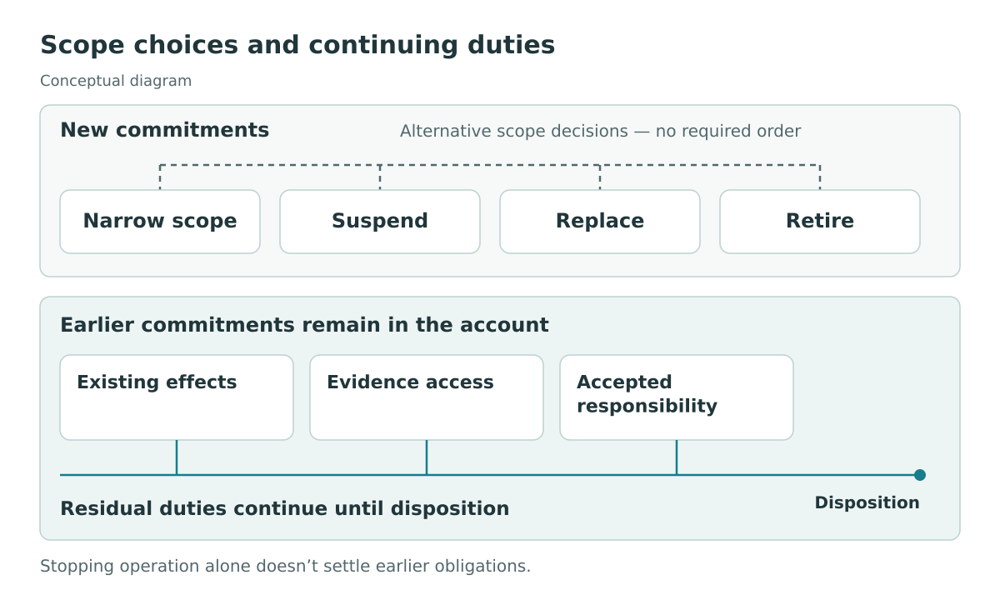
<figcaption><strong>New work stops; existing consequences continue.</strong> Narrowing scope, suspension, replacement and retirement are alternative scope decisions. Existing effects, evidence access and accepted responsibility remain visible; residual duties continue until their disposition. Stopping operation alone doesn’t settle earlier obligations.</figcaption>
</figure>

# 14 External-effect reconciliation: a backward development program

External-effect reconciliation extends the consequence-closure account in Sections 11.1–11.3 to automated decisions about uncertain external effects. Sections 14–17 work backward from the target capability: define the target capability, identify its functional dependencies, and derive bounded studies whose cumulative evidence supports expansion. All studies and experiments in these programs are proposed future work. Their stages specify evidence dependencies, not schedules or forecasts.

## 14.1 Target capability: supported decisions across an uncertain boundary

The target controller would connect a durable intent, its dispatch attempts and the evidence returned by external systems to the business effect being assessed. It should determine when the evidence supports retry, compensation, deferral or closure, and retain unresolved work when it doesn’t. Automation concerns the application of declared evidence and authority rules; escalation remains an appropriate outcome when the controller can’t establish a permitted next step.

The engineering object is an action's consequence, not merely its local execution status. A delivery acknowledgment may establish receipt, an acceptance may establish that processing has begun, and an observed transaction may establish a narrower effect than completion of the customer's enclosing task. These meanings must come from the relevant interface contract and evidence. A local identifier correlates records only where the external system preserves the claimed relationship.

The controller would support a justified decision about how to handle the action (its disposition) within declared interfaces and observation limits, without guaranteeing arbitrary exactly-once execution or certainty about independently evolving systems. A useful controller can leave an effect unknown or contested while preserving an owner, next permitted inquiry and limits on further action. Correctly refusing a retry and successfully settling the business outcome are different results.

Within the running production incident, suppose a repair command lacks conclusive acknowledgment. Before retrying, the reconciler must distinguish an unobserved effect from nonexecution, check which observations can settle that question and refresh authority for any further action. Interruption could require a successor to inherit the inquiry, and unresolved work could occupy capacity needed for the next incident. Those extensions are case-dependent; the first testbed uses one uninterrupted controller and one external service.

<figure data-added-figure="F24">
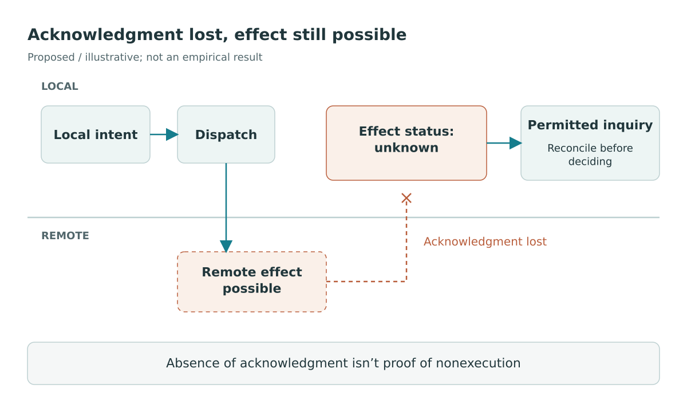
<figcaption><strong>Acknowledgment lost, effect still possible.</strong> A dispatched action may have a remote effect even when its acknowledgment is lost. The local effect status remains unknown; permitted inquiry supports reconciliation before a further decision.</figcaption>
</figure>

## 14.2 Functional requirements

### 14.2.1 Intent, attempts and correlation

Distinguish the intended action from each attempt to cause it. Record the authorized scope, parameters, intent identifier, dispatch identifiers and relevant versions. Preserve acknowledgment loss as loss of evidence rather than as proof of nonexecution. A durable local log or outbox can realize part of this function; the proposal must state which local operations are atomic and which remote effects remain outside that boundary.

### 14.2.2 Evidence contracts and effect classification

For each observation, record the proposition it supports, its source, identifier relationship, freshness, coverage and limitations. Use established, absent, unknown and contested as evidence-scoped statuses, not unqualified labels. Absence requires positive support for absence within its declared scope; a failed search or delayed index may leave the effect unknown. Pending acceptance and completed effect are separate propositions. Record contradiction or an admissible dispute without silently selecting the more convenient account.

### 14.2.3 A versioned completion predicate

Declare the action being closed, its required effect evidence and observation horizon. Keep child-operation and enclosing-business predicates separate. A confirmed reservation may close a reservation action while leaving purchase fulfillment open. A predicate change produces a new assessment; it doesn’t erase the original result. An action can satisfy its scoped predicate with residual work assigned, provided the predicate and remaining duty are explicit (Sections 11.1–11.3).

### 14.2.4 Decision policy, current authority and execution

Map evidence states to permitted next actions under a fixed policy before adding adaptation. Retry depends on present authority and the external system's stated duplicate-handling conditions. Compensation has its own authority, possible effects and completion predicate. Query access can differ from action authority. Unknown evidence need not block every operation, but it must block transitions whose justification depends on the missing fact.

### 14.2.5 Residual work and progress

Keep evidence uncertainty separate from the work required to resolve it. A residual record identifies an accepted owner, usable access, next check, reason for waiting and reopening condition. Ownership isn’t settlement and doesn’t guarantee progress. When further inquiry is unavailable, a bounded service may require authorized deferral, scope revision or escalation. Late evidence can reopen a duty without proving that an earlier explicitly limited observation was false.

### 14.2.6 Trace, assessment and bounded adapters

Adapters preserve provider-specific meanings instead of translating every response into a generic success flag. Trace intent, attempts, observations, policy decisions and results. Independent testbed ground truth should expose the difference between what happened and what the controller could know. A second evaluator can check fixtures, but agreement isn’t proof that an incomplete predicate captures the whole business outcome.

## 14.3 Functional dependencies

### 14.3.1 Heterogeneous external systems

Broad reconciliation would require evidence that classifications and transitions retain meaning across systems with different correlation, observation and compensation facilities. Limited disclosure, revocation and disputes may require different local rules. A shared record is useful only if scope and unsupported conclusions survive translation. Some interfaces may support a narrower controller or no justified automated retry.

### 14.3.2 Repeated work and late evidence

Cross-domain transfer would depend on repeated attempts and delayed results within one domain, preserving pending effects across policy changes and accounting for inquiry queues and continuing duties. The sequence would have to avoid contradictory retries, silent abandonment of obligations and authorization against obsolete assumptions.

### 14.3.3 Supported disposition under faults

Repeated operation would first require decisions tested under lost acknowledgments, duplicate messages, delayed visibility, contradictory records and unavailable readback. The comparison would use a capable provider-specific workflow with the same interface facilities. Blind retries could expose a failure mode but wouldn’t provide an adequate sole baseline for value.

### 14.3.4 One inspectable transaction

The initial study would use a controllable service with independently inspectable intent, effect and observation paths, one effect predicate, fixed policy, durable attempts and an evidence trace. Observation conditions would vary while the testbed’s underlying event history remained inspectable. This bounded case would establish the local decision conditions before cross-provider claims are tested.

## 14.4 Initial studies

### 14.4.1 An intent/effect record and validator

Intent/effect records would separate intent, attempts, acknowledgments, observations and result for one action class, using its permission rules and declared completion predicate.

Trials would omit an identifier, change parameters or substitute a receipt for effect evidence. The comparison would be the same workflow with ordinary request-status tracking. Measures would include accepted and rejected records, status claims stronger than the evidence supports and inspection effort. Advancement would require evidence that controlled test cases with known expected outcomes (fixtures) show meaningful changes in admission and closure. Fields that add no executable distinction would be removed.

### 14.4.2 A controlled external service and fault fixtures

A controlled external service would combine an observable effect store, separately controllable dispatch, acknowledgment and query paths, and an independent event ledger.

Trials would place faults before effect, after effect but before acknowledgment, and before delayed query visibility. The comparison would be fault-free execution under identical action semantics. Measures would include true effect, available evidence and declared disposition at each point. Advancement would require evidence that a reviewer can distinguish what happened from what was knowable, including a genuinely unresolved observation window.

### 14.4.3 A fixed-policy reconciliation controller

Explicit decision rules for retry, inspection, deferral and closure would be developed against the records and fault fixtures in studies 14.4.1–14.4.2.

Trials would exercise each evidence state and change authority before the next decision. The comparison would be a capable manually specified provider workflow with the same observations and permissions. Measures would include erroneous retries, unsupported closure, correct restraint and time to disposition. Advancement would require evidence that policy outcomes match declared fixtures. Cases requiring human judgment would be retained with that need explicit; the controller wouldn’t manufacture a decisive status.

### 14.4.4 Bounded retry and duplicate handling

An adapter and retry-policy tests would implement a hypothetical provider contract specifying identifier scope, retention and duplicate behavior.

Trials would repeat within and outside the declared protection conditions, alter parameters and inject a late first effect. The comparison would be direct use of the provider's documented protection alone. Measures would include duplicate effects, missed effects, policy violations and extra checking cost. Support would extend only within the tested contract. Local duplicate protection wouldn’t establish universal business completion.

### 14.4.5 Compensation as another consequential action

Linked original-action and compensation records would use separate predicates for one reversible or compensable effect under explicit compensation authority.

Trials would examine partial compensation, rejected cancellation, revoked authority and an effect that can’t be erased. The comparison would be the domain's existing cancellation procedure. Measures would include confirmed compensation, remaining consequences, false reversal claims and effort. Advancement would require evidence that the controller preserves what remains open. Infeasible compensation would be reported as a limit rather than as restoration of the prior world.

### 14.4.6 Late, incomplete and contested evidence

Evidence-merging rules and reopening tests would use sources with declared delays, coverage and possible disagreement.

Trials would examine an empty lookup followed by a late effect, conflicting source records and a disputed interpretation. The comparison would be a capable fixed waiting/readback procedure. Measures would include premature absence claims, unexplained conflict resolution, duty age and resolution work. Advancement would require evidence that limited evidence retains its scope and new evidence triggers the right reassessment; persistent uncertainty is an admissible outcome.

### 14.4.7 Residual ownership and progress checks

A residual-work queue would attach next checks and blockage reasons to unsettled effects, accepted ownership and permitted follow-up actions.

Trials would examine lost owner access, a missed check, legitimate waiting and circular verification dependencies. The comparison would be an existing case queue with equivalent staff and permissions. Measures would include unowned work, lost duties, feasible progress, delays and intervention cost. Advancement would require evidence that the new record supports an executable next step or accountable deferral; a populated ledger alone is insufficient.

### 14.4.8 Trace, replay and whole-trajectory assessment

Replayable traces and an evaluator would capture all attempts and evidence transitions against a frozen predicate and independent fixtures.

Trials would examine interrupted traces, omitted attempts, changed predicates and apparently successful commands with unmet business effects. The comparison would be standard application logs plus a competent evaluator. Measures would include reconstructability, false closure, missed effects, unresolved trials and assessment labor. Advancement would require evidence that original and revised verdicts remain inspectable and excluded cases are reported, with the evaluator's observation limits identified.

### 14.4.9 A second-interface translation study

A second adapter and translation account would test one working controller against a service with materially different acknowledgment or lookup semantics.

Trials would reuse classifications and policies where valid, then test incompatible assumptions. The comparison would be a provider-specific reconciler of similar scope. Measures would include unsupported reuse, adapter burden, time, effect errors and residual work. Support would extend only to meanings that survive. Separate profiles or a narrower integration would remain appropriate where the common abstraction fails.

## 14.5 Conditional extensions and related programs

Operational continuity is needed when a successor must inherit reconciliation work across interruption or replacement. Transfer the action proposition, predicate version, attempts, evidence scope, current authority and next-check ownership—not just a status label. A successor must preserve unknown or contested effects and refresh access before acting. A bounded uninterrupted reconciler doesn’t require the full portable-capsule architecture.

Maintained delegation becomes relevant when unsettled effects consume future capacity or constrain the service's next commitment. Export both the settled scope and remaining work; don’t export a settled action as an unrestricted readiness certificate. Accepted human handoff and usable intervention capacity (Sections 5.2 and 12.3), correction-aware provenance (Section 7.2), residual-duty lifecycle and nested closure (Section 11) may realize functions in particular cases. Their full implementations aren’t prerequisites of every reconciliation controller.

A local example needs neither related architecture: one uninterrupted process reconciles a timed-out reservation against one controlled provider. It can retain uncertainty and make a supported next decision without agent replacement or an ongoing delegation service.

## 14.6 Development order and cumulative evidence

### 14.6.1 Stage 1: one observable action

The first stage would combine studies 14.4.1–14.4.2 to distinguish intent, attempted execution, observable effect and evidence available to the controller. Advancement would require inspectable ground truth and a predicate whose result changes when the required effect is missing.

### 14.6.2 Stage 2: one supported policy

Study 14.4.3 and a bounded part of 14.4.4 would test present authority and truthful classification under acknowledgment loss. Advancement would require appropriate next decisions under the stated contract, including unresolved cases. The resulting scope would be a bounded automated controller, not broad interoperability.

### 14.6.3 Stage 3: challenge absence, retry and reversal

Studies 14.4.4–14.4.6 would inject late effects and failed compensation. Advancement would require preserving the distinction between missing evidence and established absence, and limiting compensation claims to consequences actually verified. Assessment would include harms and costs alongside command success.

### 14.6.4 Stage 4: keep residual work governable

Studies 14.4.7–14.4.8 would assess sequences of work. Advancement would require explicit continuing responsibility, traceable predicate versions and evidence of progress under declared feasibility conditions. Legitimate waiting and failure to advance a feasible duty would remain distinguishable.

### 14.6.5 Stage 5: establish value and transfer

Study 14.4.9 would compare transfer with capable existing procedures under equivalent facilities. Advancement would require a declared improvement in consequence outcomes or resolution burden sufficient to justify integration and inquiry cost, with meanings that don’t survive transfer reported.

### 14.6.6 Stage 6: generalize the supported boundary

Repeated evidence would determine which recurring records and adapter contracts could be stabilized. The supported result might be a local controller, a family of provider profiles or a broader reconciliation layer. Commercial uptake and benefits beyond the tested interfaces would require separate evidence.

<figure data-added-figure="F20">
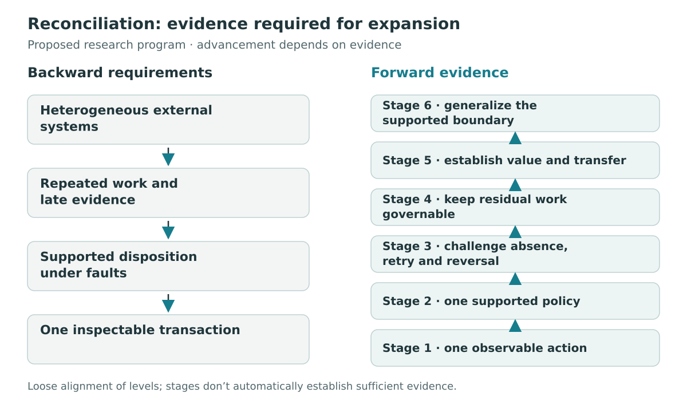
<figcaption><strong>Reconciliation: evidence required for expansion.</strong> Backward requirements trace prerequisites for broader reconciliation; forward evidence follows the six proposed stages. Levels align loosely, without implying that a stage is sufficient for expansion.</figcaption>
</figure>

Pair comparable external fault schedules in controlled comparisons while allowing each controller's retries and inquiries to produce different histories. Account for compute, waiting, observation access and human work. Keep trials that fail, abort or remain unresolved. Count a justified deferral separately from verified business completion, and inspect whether recurring unsettled work changes the cost of later tasks. Sections 19.1 and 19.6 specify the common comparative discipline; Section 20 defines the measurement contract.

## 14.7 Limits and disconfirmation

The program loses its broader case if needed effects can’t be observed or correlated, if the policy's evidence assumptions can’t be checked, or if extra inquiry delays work without improving consequence decisions. A capable existing provider workflow may achieve the same outcomes at lower total cost. That result supports the simpler procedure rather than a larger platform.

Separate the value of better evidence, durable recording and explicit policy from the value of a new coordinating layer. If improvement comes entirely from adding a provider's existing duplicate protection or a manual check, retain that improvement and narrow the architectural claim. A trusted record of uncertainty can remain useful even when automatic settlement is infeasible.

Repeated evidence of justified decisions across the declared interfaces and observation limits would be required for broader reconciliation claims.

Technical claims about a provider must be checked against its applicable interface contract before trials. Protocol and transaction antecedents motivate the functions in Section 11; they don’t establish the proposed controller's performance.

# 15 Operational continuity: a backward development program

Operational continuity extends the live-state and provenance account in Sections 7.1–7.3 to justified continuation across heterogeneous agents and tools. The initial case is one interrupted task in a controlled environment. A portable capsule is a candidate representation to compare with shared state and full-history reconstruction; neither a minimum representation nor a performance advantage is assumed.

## 15.1 Target capability: preserve the justification for continuing

The destination is a continuity mechanism that lets a successor identify the authoritative work state, understand its relevant history, refresh changed dependencies and determine what it may do next. It should preserve unresolved uncertainty and responsibility while allowing supported work to continue. Correct continuation can mean enacting the planned transition, revising it, obtaining evidence or declining to proceed.

The engineering object is the governing state for a contemplated next transition. It includes the objective and scope, relevant artifacts and versions, evidence and uncertainty, active plan, pending effects, applicable authority, recovery points and ownership. These are functions to realize or reliably reconstruct; they’re not mandatory fields in every capsule. A stored record's completeness doesn’t establish present authority, accessible evidence or a receiver's usable understanding.

The mature promise extends beyond recovering bytes or remembering facts. State must retain its meaning when the agent instance, model, tool adapter or organizational participant changes. Domain semantics may remain local. A destination that can’t honor an authority rule or interpret an effect record should reject that portion of the transfer or accept a narrower supported scope.

In the production incident, interruption can occur while a repair effect remains unknown and an earlier approval has expired. A successor must inherit the release and schema state, attempt history, uncertainty and next-check ownership while refreshing observation access and permission. Preserving the old repair plan can’t by itself authorize its re-execution. Section 14 develops reconciliation where remote-effect uncertainty constrains continuation.

A local case doesn’t require external-effect reconciliation: a drafting task pauses, its authoritative source is corrected, and a successor resumes work against the corrected source. The continuity problem is preserving the task's mandate and identifying the current source, even though no consequential remote action is awaiting settlement.

<figure data-added-figure="F25">
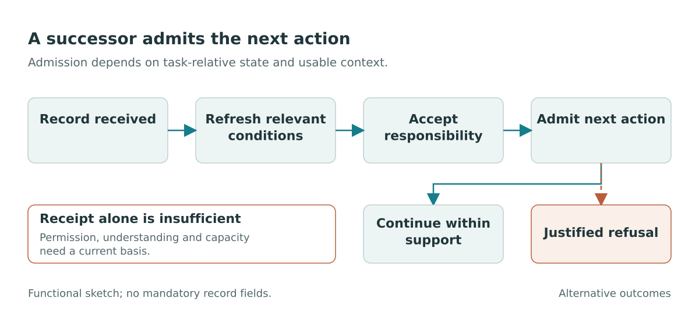
<figcaption><strong>A successor admits the next action.</strong> A successor receives a record, refreshes relevant conditions and accepts responsibility before admitting a next action. Admission can lead to continuation within support or justified refusal. Receipt and completeness alone don’t establish present permission, usable understanding or capacity. The steps are a functional sketch, not mandatory record fields.</figcaption>
</figure>

## 15.2 Functional requirements

### 15.2.1 A task-relative continuation contract

Specify the next class of work, the conditions needed to justify it, and the information that must be retained or retrieved. Distinguish data required immediately from historical evidence accessible when a question arises. Test sufficiency against the actual task and receiver. Neither a fixed capsule size nor more retained history guarantees a supported next decision.

### 15.2.2 Authoritative state and provenance

Identify the artifacts that govern work and how their versions became authoritative. Keep evidence separate from derived interpretations. Preserve each item’s scope and identify which later item supersedes it. Where accounts conflict, represent that conflict and its permitted resolution path. Authentication or an intact transport can establish aspects of origin or integrity; it can’t by itself establish the truth of the contents, present applicability or completeness.

### 15.2.3 Dependency refresh and selective reopening

At resumption, check the dependencies relevant to the contemplated transition: changed artifacts, current permissions, effect state, resource availability or acceptance by a successor. Reopen what the change invalidates while preserving still-supported work. No global synchronized snapshot is assumed. The continuation contract must declare which ordering or freshness conditions matter and what happens when those conditions can’t be established.

### 15.2.4 Ownership and admission to continue

Define who owns the next transition and which evidence establishes acceptance. A record delivered to a successor isn’t automatically an accepted transfer. Automated continuation needs an enforceable way to reject obsolete execution when the environment supports that control. If external tools don’t honor the relevant ownership boundary, the mechanism can’t claim universal exclusion of competing actors. Preserving ownership data and preventing conflicting effects are distinct achievements.

### 15.2.5 A receiver-usable representation and access path

The receiver needs to interpret the record and obtain the evidence needed for judgment. An application schema, shared runtime, capsule or reconstructable event history can realize the representation. Access restrictions must travel with the data where required, and source references must remain usable. Loss of a source should appear as missing evidence rather than be masked by a confident retained summary.

### 15.2.6 Lifecycle, disposition and correction

Define capture, suspension, transfer, refresh, acceptance, resumed execution and final disposition. Later corrections must reach dependent retained interpretations where relevant. Replacement and retirement preserve duties according to their governing scope; deleting a conversation doesn’t establish settlement. The mechanism should record what was retained, discarded or made inaccessible and which claims that decision affects (Section 7.2).

### 15.2.7 Trace and continuation assessment

Record the captured state, changes during interruption, information available to the successor, admission decision and actual next action. Assess whether that action was justified under the specified evidence and authority, not merely whether it matched the old plan. Fixtures need cases where changed conditions require different actions. A task that resumes quickly from an obsolete objective has failed the central test.

## 15.3 Functional dependencies

### 15.3.1 Portable meaning across environments

Portability would require translating continuation contracts across materially different tools or agents and identifying concepts that remain unchanged, require typed adapters or should remain local. A serialized record that every recipient can parse can still mistranslate authority or effect scope. Untranslatable meaning is a boundary to report, not a reason to erase distinctions.

### 15.3.2 Replacement, concurrent successors and lasting duties

Broad transfer would depend on replacement and attempted duplicate continuation within one environment, preserving accepted responsibility, changed authority and pending work when the original actor disappears. Tests would distinguish sole-owner recording from enforceable execution constraints. A safe response when a network partition prevents participants from communicating may sacrifice progress; its required property and conditions must be declared.

### 15.3.3 Resumption under changed conditions

Replacement would depend on next decisions tested against changed artifacts, superseded interpretations, lost access and invalid permissions. The mechanism should continue unaffected work where permitted and seek evidence where needed. Blanket restart or pause could provide a baseline; more selective continuation would require evidence sufficient to justify the additional machinery.

### 15.3.4 One controlled pause and continuation

The initial study would use one task, a fixed continuation contract, an explicit authoritative artifact and one allowed transition after resumption. It’d assess capture, pause, preservation or change of relevant conditions, refresh and continuation. A simple shared record could realize the first function; portability and compression would be later research questions.

## 15.4 Initial studies

### 15.4.1 A continuation record and validator

A small live-state record with evidence references would represent one task, its next transition and the dependencies that justify it.

Trials would omit a governing artifact, confuse an inference with an observation or lose the next owner. The comparison would be the same task using a conventional checkpoint and source references. Measures would include unsupported admissions, rejected records and inspection effort. Advancement would require evidence that relevant omissions change the decision. Fields serving no tested function would be simplified.

### 15.4.2 A controlled pause/resume runtime

A fixed-policy pause/resume runtime would combine the validator and one task environment to support capture, suspension, refresh and resumption.

Trials would pause before an action and resume with unchanged conditions, then with one changed dependency. The comparison would be ordinary task restart with equivalent access. Measures would include correct next actions, unnecessary repetition, latency and preparation cost. Advancement would require evidence that the runtime preserves the mandate and distinguishes valid continuation from a merely successful restart.

### 15.4.3 Changed-artifact and stale-authority fixtures

Dependency-refresh and admission tests would combine versioned sources with separately controlled permissions.

Trials would correct a source, revoke one action permission, preserve query permission and make a source inaccessible. The comparison would be a capable checkpoint system with manual freshness checks. Measures would include stale actions, appropriate narrower continuation, missed changes and check cost. Advancement would require evidence that old permission is never mistaken for present permission and missing evidence remains visible.

### 15.4.4 Correction and conflicting-account propagation

Links between superseded and current records, together with review of dependent plans, would connect retained observations, derived interpretations and declared correction authority.

Trials would correct a situational preference, introduce competing admissible accounts and revise an evidence source. The comparison would be full-history reconstruction under the same correction rules. Measures would include unsupported reuse, lost history, correctly reopened decisions and labor. Advancement would require evidence that correction changes affected continuation without silently deleting the reason earlier work occurred.

### 15.4.5 Ownership transfer and competing successors

Transfer records would use an acceptance protocol and modeled execution controls. Where the environment supports enforcement, dispatch would be restricted to the current owner and version of the ownership assignment (its epoch).

Trials would examine lost acceptance, delayed messages, two successors and a returning original actor. The comparison would be existing single-owner job control with matched capabilities. Measures would include conflicting dispatches, ownership gaps, blocked valid work and recovery time. Support would extend only within the environment's enforceable boundary. Guarantees would narrow where a tool can’t reject obsolete actors.

### 15.4.6 Receiver usability and evidence retrieval

A check of how the receiver interprets the first action, together with targeted evidence retrieval, would connect the retained record to accessible supporting evidence.

Trials would examine a complete-looking packet with an ambiguous constraint, unavailable source or missing diagnostic view. The comparison would be a fuller history with equivalent source access. Measures would include justified first actions, misunderstanding, retrieval effort and intervention time. Advancement would require evidence that the receiver can act appropriately, seek the missing evidence or decline; acknowledging receipt isn’t the success criterion.

### 15.4.7 Representation and cost comparison

A matched comparison harness would assess capsule, shared-state and full-history implementations of the same continuation task.

Trials would vary dependency density, interruption duration and the amount of relevant historical evidence. The comparison would be all three approaches with declared information and resource access. Measures would include supported continuation, lost duties, capture/retrieval/validation cost and human work. Advancement would depend on whether the candidate implementation provides enough benefit to justify its cost under stated conditions; a larger record or existing shared runtime may legitimately win.

### 15.4.8 Model and tool replacement

Adapters and acceptance checks would test replacement within one functioning task, using a successor with different interfaces or interpretation behavior.

Trials would change parameter meanings, evidence references and available operations while preserving the task contract. The comparison would be a task-specific manual reconstruction. Measures would include semantic translation errors, authority expansion, usable scope, setup effort and downstream outcomes. Support would extend only to meanings successfully preserved; parsing and fluent restatement are insufficient.

### 15.4.9 Suspension, retirement and retained duties

A record would track how unfinished work is handled during suspension, replacement or retirement, under retention/disposition rules and accepted ownership.

Trials would retire the agent, end access or replace the provider while a duty remains. The comparison would be existing workflow closure and record retention. Measures would include lost obligations, accessible evidence, unaccepted transfers and follow-up effort. Advancement would require evidence that disposition preserves the promised account and next responsibility; it need not promise indefinite access beyond declared terms.

### 15.4.10 A contrasting-environment translation study

A concept map would identify what can be retained, what needs refinement and what must be rejected when the tested representation enters a second domain with different artifacts or action semantics.

Trials would translate the contract and exercise changed conditions in both environments. The comparison would be local continuation designs of equivalent scope. Measures would include reused machinery, adapter burden, correct next decisions and costs. Support would extend only where meaning survives; a local protocol is a valid result when generalization introduces ambiguity or needless complexity.

## 15.5 Conditional extensions and related programs

External-effect reconciliation is invoked when a pending remote action affects continuation. Preserve the proposition, attempt history, effect status, evidence scope and next authorized check. Unknown remains unknown across transfer. Resuming a local drafting task need not implement that controller. Reconciliation may likewise remain in an uninterrupted process without any portable continuity capsule.

Maintained delegation is invoked when continuity contributes to a continuing service whose next commitments depend on evidence, workload or capacity left by earlier tasks. Export what can resume, the governing conditions and outstanding duties. Don’t export resumability as proof of usable future response capacity. A continuing service may realize continuity through established records or human procedures instead of this complete architecture.

Authority controls, selective reopening, correction-aware provenance and accepted handoff (Sections 5, 8 and 7.2) offer realizations of the functions above. A particular human transfer may also require capacity admission (Section 12.3), and persistent changes may require renewed assurance (Section 13.2). These extensions follow a case's demonstrated need. Recovery composition (Section 16) is needed only if that case requires construction beyond prepared recovery modes.

## 15.6 Development order and cumulative evidence

### 15.6.1 Stage 1: one justified resumption

Studies 15.4.1–15.4.2 would establish current authoritative state, a preserved mandate and a checked next transition. Advancement would require correct continuation or an explicit refusal to continue in inspectable changed and unchanged cases.

### 15.6.2 Stage 2: challenge stored confidence

Studies 15.4.3–15.4.4 would test stale authority, corrected evidence and conflicting accounts. Advancement would require selective revision with preserved uncertainty and history; completeness of a summary wouldn’t satisfy that requirement.

### 15.6.3 Stage 3: establish accepted and enforceable ownership

Studies 15.4.5–15.4.6 would test ownership gaps, competing successors and usable understanding. Advancement would require an accountable next owner, declared execution limits and a receiver able to interpret the next action or identify why continuation is unsupported.

### 15.6.4 Stage 4: earn the representation

Study 15.4.7 would compare matched alternatives. Advancement would require a demonstrated tradeoff or improvement in justified continuation and total effort. Neither an optimal capsule size nor universal superiority is assumed.

### 15.6.5 Stage 5: replace and translate

After a stable local process for retaining, resuming and disposing of work, studies 15.4.8–15.4.10 would examine replacement and translation. Advancement would require maintained meaning, preserved duties during disposition and an explicit account of transfer failures. Expanded scope would cover only tested semantics.

### 15.6.6 Stage 6: generalize supported continuity

Repeated use over longer dependency chains would test whether recurring interfaces can be stabilized. The supported result might be a portable capsule, shared runtime, domain-specific protocol or evidence favoring conventional reconstruction. A broader service and its market would require separate justification.

<figure data-added-figure="F21">
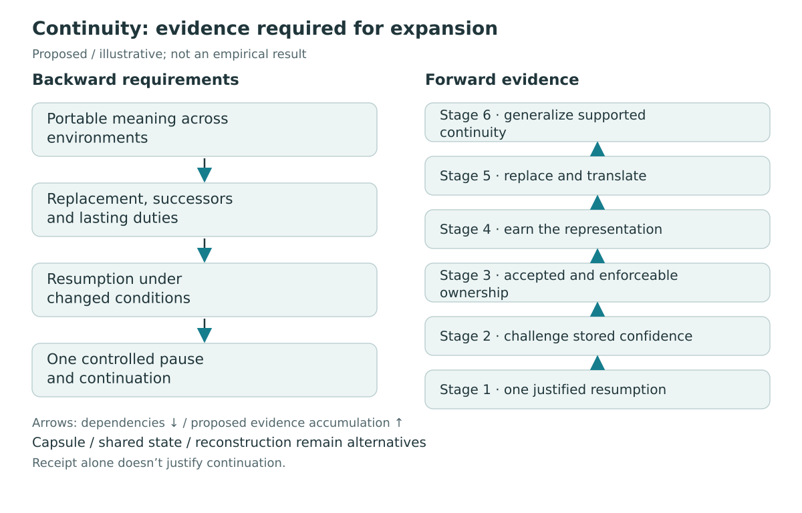
<figcaption><strong>Continuity: evidence required for expansion.</strong> Backward requirements lead to one controlled pause; forward stages propose cumulative evidence for broader continuity. Capsule, shared state and reconstruction remain alternatives to test. Arrows indicate dependencies and proposed advancement, not demonstrated findings.</figcaption>
</figure>

Assessment should pair comparable external changes while allowing each approach's retrieval, revision and subsequent actions to produce its own history. Keep capture and validation costs inside the accounting boundary. Don’t compare a capsule with privileged access against a baseline denied the current artifact. Preserve failed, aborted and unresolved resumptions, and distinguish correct restraint from completion of the customer's work. Sections 19.1 and 19.6 provide the common comparison design, with measurement contracts in Section 20.

## 15.7 Limits and disconfirmation

Portability loses its case when translation discards the distinctions needed for action, when authoritative sources can’t be accessed or when the next actor can’t exercise the transferred role. A record can be useful without establishing all those conditions. The program should narrow its supported tasks and recipients rather than certify an unsupported continuation.

A conventional shared state or full-history reconstruction may deliver equal or better continuation with less capture, maintenance and adapter cost. If the new representation's benefit disappears once baselines receive equivalent freshness checks, attribute the result to checking rather than to capsule portability. If most effort goes into maintaining summaries that receivers must reconstruct anyway, simplify the representation.

Broader continuity claims would require evidence of justified decisions under corrected state, replacement and translated semantics.

# 16 Recovery beyond the prepared menu: a backward development program

Automated composition would construct a recovery arrangement when prepared procedures no longer fit. Extending the recovery account in Section 9, the research sequence begins with bounded studies using existing software and operating controls. A manually authored mode establishes the checking and execution foundation; later stages would test whether an automated composer can construct and validate a mode beyond the frozen procedure menu.

## 16.1 Target capability: recovery by constrained composition

The destination is a recovery controller that can recognize when no available prepared mode meets the present conditions, assemble a candidate operating arrangement from permitted controls, and establish whether that arrangement can achieve a declared recovery target. A mode specifies how the system may operate for a period: enabled functions, restrictions, resource allocations, sequencing, authority, monitoring and conditions for exit or revision. It includes the route into that arrangement, because a desirable end state may be unreachable through permissible transitions.

In the running production incident, the database migration makes the usual rollback incompatible. A candidate might combine read-only operation, feature isolation, traffic limits and roll-forward repair. None of those controls needs to be new. The contribution to test is whether the system can construct and validate their joint use under the actual constraints, rather than select a prewritten recipe with a different name.

The target is a useful, justified recovery within declared bounds. It may be full restoration, bounded degraded operation or another disposition accepted by the appropriate authority. The controller may propose a changed target when the original is infeasible, but it can’t count that proposal as success against the original target or authorize the change for itself.

A mature implementation should distinguish no fitting prepared mode, no feasible candidate within the modeled space, search interrupted before a conclusion, and insufficient evidence to admit a candidate. These are different outcomes. A failure to find a mode doesn’t prove that none exists. When composition can’t support action, the controller retains whatever authorized containment or escalation is available and reports the unresolved condition.

<figure data-added-figure="F26">
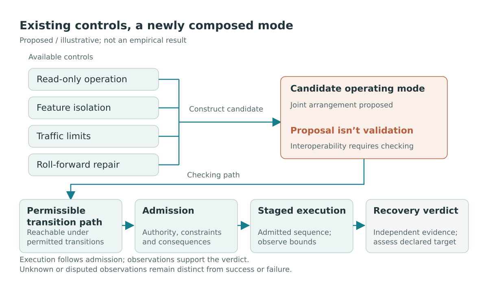
<figcaption><strong>Existing controls, a newly composed mode.</strong> Existing controls compose a proposed operating mode. The candidate must have a permissible transition path and pass admission checks before staged execution; recovery is assessed against the declared target using independent evidence. Composition doesn’t establish interoperability or recovery.</figcaption>
</figure>

## 16.2 Functional requirements

### 16.2.1 A situation and constraint record

The record identifies the current operating state, supporting evidence, uncertainties, failed assumptions, available controls and conditions that must continue to hold. It separates requirements that may be revised from those the controller must preserve. Selective reopening (Section 8.1) revises the relevant plan or decision without discarding still-supported commitments. A first implementation can use a small explicit record; it need not implement a general mission hierarchy.

### 16.2.2 A recovery target and assessment contract

Before admitting a candidate, specify what result would count as recovery, for which objects or users, over what observation interval and with what allowed degradation. Separate the evidence for an individual control from the evidence for the enclosing recovery. This uses the distinction between child and enclosing completion in Section 11.1. Unknown or disputed observations remain distinguishable from success or failure. Targets and assessment rules are versioned so that changing a requirement doesn’t rewrite the original verdict.

### 16.2.3 A catalog of controls with composition rules

Each control describes its preconditions, affected state, expected effects, authority requirements, resource demand, timing, observations, incompatible combinations and permitted exit behavior. Composition rules specify both the permissible order of controls and which controls may operate simultaneously. Independently acceptable controls can jointly exceed a resource limit or remove a necessary observation path. Catalog entries are modeling claims that require tests; declaring a field doesn’t establish its accuracy.

### 16.2.4 A candidate composer

The distinctive composition function is to search for an arrangement satisfying the target and constraints, including a permissible transition sequence. Initial approaches can enumerate a small space, apply explicit rules or use a constraint solver. A model may suggest candidates later. Every proposal still enters the same checking path. The composer must expose relevant assumptions and distinguish a found candidate from a validated mode. A changed arrangement isn’t valuable merely because it’s novel.

### 16.2.5 Authority, consequence controls and admission

Authority, commitment-profile controls and action-relative validity (Sections 5, 6 and 4) establish what changes are authorized, which controls their consequences require, and whether the present evidence supports the contemplated transition. Implementations can begin with ordinary permission checks and fixed policy. Credential mechanisms, compilation of consequence requirements into controls and explicit admission gates are possible realizations, rather than universal prerequisites. Admission must be revisited when a dependency relevant to the next transition changes.

### 16.2.6 A staged runtime and observations adequate for the claims

The runtime applies an admitted sequence, checks transition conditions, observes results and stops or redirects when declared bounds cease to hold. Its response may be containment or escalation; physical or external effects need not be reversible. Validation includes an offline model or sandbox where useful and controlled operational evidence where required. Observation adequacy is a general requirement. Observation-applicability checks (Sections 3.1 and 11.1) become relevant when the recovery changes who or what the monitoring covers.

### 16.2.7 Diagnosis, evidence and replay

The controller needs enough evidence to distinguish relevant constraints and judge a candidate. When existing evidence is insufficient, an evidence-seeking policy (Section 3) can select an authorized diagnostic action; active probing isn’t compulsory in every recovery. A trace records the target, evidence, rejected alternatives, candidate, admission decisions, transitions and verdict. Replay and evaluation require a trace adequate to assess the contemplated transitions; they need not implement a general causal-history platform (Sections 18–20). The proposing mechanism shouldn’t be the sole source of the evidence that certifies its proposal.

## 16.3 Functional dependencies

### 16.3.1 Transferable recovery composition

At the most expansive stage, a controller works across several operating environments and independently supplied controls. Before claiming that scope, development must establish which target, authority, observation and composition concepts survive transfer. Local meanings may require domain profiles. An inability to translate a control's effects or a recovery target identifies a boundary of the abstraction. Cross-organization trust and permission remain additional problems when the application crosses those boundaries.

### 16.3.2 Repeated recovery under changing conditions

Before transfer, the controller must repeatedly construct useful modes in one domain as workload, available controls and constraints change. It must reconsider a candidate when its assumptions become stale, retain valid commitments and avoid oscillating between mutually incompatible modes. Repeated trials should reveal the cost of search, checks, staging and failed proposals. Assess useful recovery together with the operating conditions left afterward; a single apparently successful episode doesn’t establish repeated reliability.

### 16.3.3 Composition beyond frozen recipes

Repeated composition would depend on handling condition combinations reserved for evaluation with an unchanged control catalog and fixed baseline recipes. A test case would have to defeat those recipes under declared constraints; the candidate would be assembled during the test with exposed assumptions and transition path. Comparators would include a prepared-menu controller, an expanded rule-based procedure and qualified manual recovery where feasible. The tested advantage concerns construction under those conditions, not whether a human could have authored the mode in advance.

### 16.3.4 Dependable admission and validation of supplied candidates

Automated choice of a mode would depend on machinery capable of distinguishing acceptable and unacceptable supplied candidates. Manually authored candidates would test missing authority, false preconditions, conflicting controls, inadequate observations and misleading completion claims. The checking and staging process would have to detect the intended violations and report uncertainty when the evidence can’t support a decision. Eloquence of a plan doesn’t establish valid recovery.

### 16.3.5 One executable recovery with an inspectable result

The smallest foundation is one manually composed recovery in a bounded environment. It needs a situation record, target, a few controls, fixed-policy admission, an execution trace and an assessment that can return success, failure or insufficient evidence. This first artifact exercises the recovery functions without claiming that automated composition has been achieved. It establishes the machinery on which that claim could later depend.

## 16.4 Initial studies

### 16.4.1 A minimal recovery record and validator

The study would implement situation, target, candidate-mode and result records in one software-service sandbox, keeping evidence and proposals distinct. Fixtures would test rejection of missing authority, an unspecified target population, an unexplained transition and inconsistent bounds. The result should show that changing a meaningful field changes admission or assessment. A schema accepting every plausible-looking plan wouldn’t satisfy this test.

### 16.4.2 A control catalog and composition checker

The study would describe a few existing controls, such as read-only operation, isolation, traffic restriction and roll-forward repair, encoding their preconditions, resource demands, order restrictions and incompatible combinations. Checks would address both individual controls and their aggregate effect. Fixtures would include combinations that are impermissible despite each control being locally permissible, alongside valid combinations. The initial catalog should remain small enough for a reviewer to inspect.

### 16.4.3 A fixed-policy admission and staged runtime

A fixed-policy runtime would accept a manually supplied candidate, check its authority and constraints, enact it in stages, inspect the result and stop at an invalid next transition. Trials would inject changed state between admission and execution, unavailable controls and failed stages. A replayable trace would identify each admitted transition and the reason for a stop. Proposal generation would remain outside this first runtime so that adaptive planning couldn’t conceal enforcement defects.

### 16.4.4 An independent assessment fixture set

An independent fixture set would specify recovery targets and inspectable expected outcomes, including recovered service, failed recovery, insufficient evidence and apparently healthy monitoring after affected users have been excluded. It’d record component success separately from enclosing recovery. An assessment implementation would be checked against fixtures constructed independently of the candidate generator. Independence concerns the source and checking of evidence; it doesn’t imply a universally correct oracle.

### 16.4.5 A diagnosis and selective-reopening experiment

The experiment would construct two plausible explanations demanding different recovery arrangements and compare action on existing evidence, an authorized diagnostic probe and deferral until evidence is adequate. Changing an assumption would test whether only affected commitments reopen. The account would report information obtained, probe effects and costs, revised constraints and changed decisions. The experiment would test when diagnosis and selective reopening help. It’d not require every recovery to probe or reopen its purpose.

### 16.4.6 A bounded composition search

The study would enumerate feasible combinations and transition sequences over the small catalog or implement an explicit constraint solver. Non-negotiable conditions would remain fixed while candidates are compared on declared dimensions such as recovery coverage, elapsed time, resource use and lost options. Those choices should remain inspectable rather than be hidden in a universal score. Required cases include a constructed mode absent from the frozen recipe set, an infeasible case and search-budget exhaustion.

### 16.4.7 A proposal-generator comparison

The comparison would pass rule-based, search-based and model-proposed candidates through the same admission and assessment path, with matched access to state and controls and reported time, compute and human assistance. Test-specific recipes and outcomes would be excluded from generator preparation. Rejected proposals would be reported alongside accepted ones. The question is whether a richer generator improves feasible recovery or merely creates more candidates and checking work.

### 16.4.8 A held-out compound-failure benchmark

The benchmark would freeze the catalog, baseline recipes, scenario generator and assessment rules before comparison. Held-out combinations could include incompatible rollback together with unavailable diagnostic access or restricted traffic capacity. Cases would include both successful prepared procedures and conditions in which none fits, with menu exhaustion verified explicitly. Full histories would retain failed, aborted and unresolved trials and distinguish constructed modes from retrieval or relabeling of a recipe.

### 16.4.9 A trace and transition-failure testbed

The testbed would replay candidate construction, admission, staging and assessment, injecting stale evidence, misleading acknowledgment, control failure, changed permissions and an observation path lost during containment. It’d test whether the controller preserves relevant bounds or reports their violation, rather than retrospectively declaring the target achieved. Rejection reasons and residual uncertainty would remain visible. The testbed should expose false success as readily as failure to recover.

### 16.4.10 A second-environment transfer study

After the first environment becomes inspectable, the study would carry its records, catalog interface, admission and assessment into a second configuration with materially different controls or observation semantics. The study would identify which concepts remain usable, which need refinement and which are unsuitable, then report reused machinery alongside required adapters. A second deployment with all important semantics unchanged tests repeatability but supplies limited evidence of broader portability.

## 16.5 Conditional extensions for particular recovery cases

External-effect reconciliation (Section 14) is needed when prior attempts leave consequences uncertain: establish what happened before composing a conflicting retry or compensation. Operational continuity (Section 15) is needed when recovery crosses interruption, handoff or model replacement: preserve usable state and refresh changed dependencies. Maintained delegation (Section 17) is needed when the recovered arrangement must support continuing work: assess what it can accept next. These are conditional dependencies; bounded recovery composition need not implement all three programs.

Other applications may require retaining discoveries and duties through rollback (Section 9), accepted human handoff and usable intervention capacity (Sections 5.2 and 12.3), residual ownership (Section 11.3), or assurance renewal when a mode persists through accumulated changes (Section 13.2). Correction-aware provenance (Section 7.2) and a route to investigate unresolved concerns (Section 13.2) become relevant where those conditions arise. Introduce each extension for a demonstrated case and test its failure conditions. The first prototype need not become a complete continuity, staffing or maintained-delegation service.

## 16.6 Development order and cumulative evidence

### 16.6.1 Stage 1: one executable recovery

Studies 16.4.1–16.4.4 would combine around one manually authored mode. Advancement would require a reproducible sequence: establish the situation and target, check whether the candidate may proceed, execute it and assess the result. Permission, execution and recovery success must remain distinguishable. Intended violations would have to cause rejection or an explicit uncertain result. This stage would establish the checking and execution foundation for later automated composition.

### 16.6.2 Stage 2: defeat misleading recovery

Studies 16.4.5 and 16.4.9 would challenge stale assumptions, inadequate diagnosis, observation selection, false completion and changed authority. Advancement would require identifying the necessary revision without certifying recovery beyond the available evidence. Findings could narrow the environment or require revised records before search is added.

### 16.6.3 Stage 3: compose within declared bounds

Study 16.4.6 and, where useful, 16.4.7 would test construction of feasible arrangements from available controls, rejection of infeasible candidates and truthful handling of exhausted search budgets. Candidate generation could remain deterministic. Advancement would require a contribution from composition beyond the runtime that checks and executes a supplied candidate.

### 16.6.4 Stage 4: establish value beyond prepared procedures

Study 16.4.8 would compare matched baselines on recovery coverage, time to usable operation, unauthorized or out-of-bounds transitions, false success, unresolved effects, lost options and total engineering or intervention cost. Comparison rules would be predeclared and tradeoffs reported, including containment available while search runs. Advancement would require improved recovery or extended useful coverage sufficient to justify composition’s additional burden; a demonstration alone wouldn’t establish that value.

### 16.6.5 Stage 5: establish repeated use and transfer

Repeated comparisons under changed operating conditions and study 16.4.10 would assess the adequacy of control descriptions and validators and the adaptation required by each environment. Conditional extensions would enter only where the trials invoke them. Useful local composition would support a local controller without establishing a universal recovery architecture.

### 16.6.6 Stage 6: generalize what the evidence supports

Observed use would determine whether recurring interfaces can be stabilized and the catalog or supported domains enlarged. Possible outcomes include a portable composer, a domain-specific operator aid, a validator for human-authored recovery or evidence favoring an improved procedure library. Standardization and a broad commercial service would require later investigation.

<figure data-added-figure="F22">
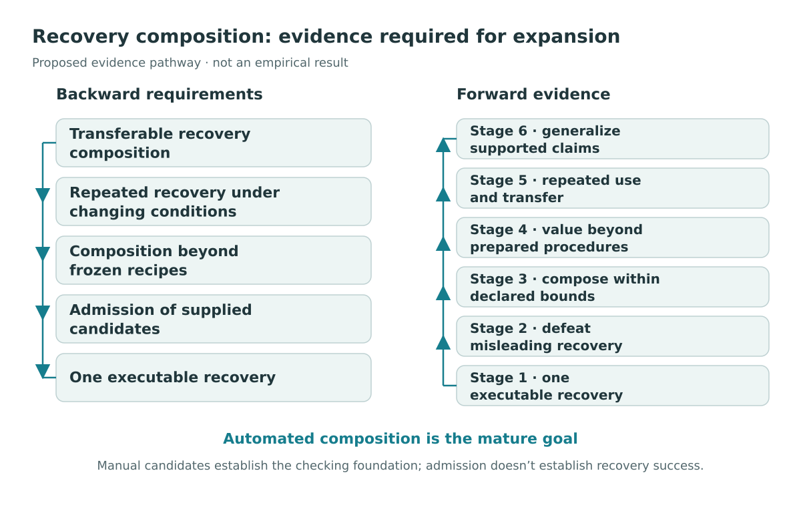
<figcaption><strong>Recovery composition: evidence required for expansion.</strong> Recovery composition depends on progressively stronger foundations, read downward at left. The proposed evidence stages build upward at right. Manually authored candidates establish checking and execution machinery; outcome assessment remains distinct from admission. Automated composition is the mature goal, while broader claims and conditional extensions depend on the evidence obtained.</figcaption>
</figure>

Studies could proceed in parallel where they share stable records: catalog construction and assessment fixtures could develop alongside the supplied-candidate runtime. The dependencies remain substantive. Automatic composition needs a checked control vocabulary and target; comparative claims need frozen baselines and an assessment independent of the generator's own verdict; broad transfer needs repeated local evidence. The common comparison and measurement requirements are specified in Sections 19–20.

## 16.7 Limits and disconfirmation

Recovery composition loses its practical case when search routinely takes longer than the available containment window, validation can’t obtain adequate evidence, invalid combinations escape the checks, or human review simply reconstructs every proposed mode. It may also lose when a modestly expanded procedure library obtains the same outcomes with less maintenance and integration. Report failures to recover alongside cases where the system correctly refuses to act.

The distinctive uncertainty is whether composition can earn its cost while its control contracts and validators remain trustworthy enough for the chosen environment. Tests should separate the contribution of generation from that of better records, monitoring and admission. If all observed benefit comes from those supporting functions, retain them and narrow the claim for automated recovery composition.

The first composition test would require a newly constructed mode in a bounded held-out case, with an inspectable transition path, permission and recovery verdict. Broader claims would require repeated value under changed conditions and an explicit account of what each increase in scope establishes.

# 17 Maintained delegation: a backward development program

Maintained delegation extends the maintenance account and service hypothesis in Sections 12.2–12.4 and 13 to a continuing arrangement that delivers useful work while maintaining the grounds for subsequent delegation. The initial case is one bounded recurring workflow. Technical performance, workable organizational commitments and commercial viability require separate evidence.

## 17.1 Target capability: dependable delegation across an operating life

The destination is a service and controller that can identify which commitments its current arrangement supports, observe relevant changes produced by work or external events, and renew, narrow, suspend or renegotiate delegation accordingly. The arrangement includes models or other execution mechanisms, tools, observations, authority, people, recovery options and dependencies supplied by the customer. Its boundary follows the conditions that materially affect the promised work.

A task changes both the world it acts on and the arrangement that will undertake later work. Its result therefore includes the verified customer outcome and inherited conditions: evidence of competence, usable capacity, available options and unfinished duties. These changes may strengthen, preserve or weaken later capability in different combinations. A completed task is neither a universal readiness certificate nor proof of depletion.

The mature business hypothesis is a continuing service that maintains those functions together as a defined customer offering. Delivery terms would identify the work covered, who supplies and maintains each dependency, what evidence is available, and who bears investigation, intervention, repair and renewal costs. Integration is valuable only if its useful outcomes justify its coordination and maintenance burden. Demand, willingness to pay and sustainable margins remain separate questions.

Across successive production incidents, reconciliation and valid resumption can resolve or assign work without establishing capacity for the next incident. Follow-up may occupy the qualified response team, while improved diagnosis may remove a recurring cause. Repeated dependable rescue may also lead a customer to reallocate its backup resources. These are candidate trajectories to test (Section 13.1), not inevitable consequences or observed findings.

A local example can use existing continuity and reconciliation mechanisms: a recurring support operation uses existing case records and established settlement procedures. It still needs to identify qualified capacity, current access, unfinished duties and the next workload it can accept. Maintained delegation can use ordinary mechanisms where they suffice.

<figure data-added-figure="F27">
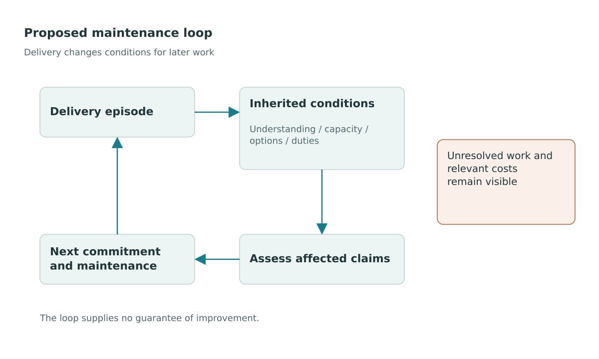
<figcaption><strong>A recurring maintenance loop.</strong> Proposed maintenance loop. Delivery leaves inherited conditions that inform assessment of affected claims and the next commitment and maintenance choices. Unresolved work and relevant costs remain visible; repetition supplies no guarantee of improvement.</figcaption>
</figure>

## 17.2 Functional requirements

### 17.2.1 A mandate and supported work envelope

Define the principal, work portfolio, action scope, relevant operating conditions, concurrency or timing assumptions and limits. The supported envelope is a statement about particular commitments under those conditions, not a universal score. Formal permission, practical ability to exercise it and institutional legitimacy remain distinguishable. A controller can apply authorized policy or propose revision; it can’t enlarge its own mandate merely because doing so helps throughput.

### 17.2.2 An owned dependency map

Identify who supplies each relevant dependency, who maintains it, who can observe its condition and who may change the supported scope. These roles can differ. A provider can’t promise upkeep of a customer resource it can’t inspect or influence. Where direct observation is unavailable, declared attestations, reporting arrangements or narrower scope may be appropriate, with their limits explicit.

### 17.2.3 Evidence of competence and usable capacity

Competence concerns understanding and ability for the declared work, including performance with dependable supports and relevant fallback conditions. Capacity concerns usable time, controls, expertise, authority and recovery resources presently available. Skilled responders can lack capacity; an empty queue can coexist with inadequate expertise. Training, practice or assistance should earn their costs through the work they actually support, rather than being presumed beneficial.

### 17.2.4 Inherited obligations and options

Carry unsettled effects, temporary exceptions, accepted future assistance and the recovery options changed by earlier work. Assignment makes a duty governable but doesn’t remove its demand or guarantee progress. A mitigation can free one resource and consume another. Maintain portfolio-specific observations; capacity for one incident class need not serve every simultaneous or unfamiliar demand.

### 17.2.5 Change detection and assurance renewal

Link supported claims to their relevant evidence and dependencies. Tool replacement, permission changes, accumulated workload and ordinary operation can all require reassessment. Identify the affected claim and proportional check, including combinations of individually acceptable changes. Repeating every evaluation after every event can itself consume capacity. The cumulative procedure must demonstrate value against a capable simpler review.

### 17.2.6 Maintenance decisions and accountable revision

A fixed initial policy can admit the next commitment, request further evidence, schedule replenishment, reduce scope or escalate a needed revision. Separate automated recommendations from decisions reserved to an authorized participant. Participants also need whatever route the arrangement provides for questioning its premises, obtaining evidence and resolving disagreement. A nominal permission to challenge is insufficient if the required access or time is absent.

### 17.2.7 Operating accounting and exit

Account for useful delivery, maintenance, waiting, responder preparation, diagnosis, action, verification and labor transferred between organizations. Suspension and replacement have costs and residual duties of their own. Define who accepts existing work when new commitments stop, what evidence remains accessible and how the remaining scope is revised or retired. Neither outsourcing nor stopping new actions settles every institutional responsibility.

## 17.3 Functional dependencies

### 17.3.1 A continuing purchased service

A broadly viable service would require evidence of a specific buyer, repeated need and workable delivery economics. The buyer may value reliable outcomes while expecting supporting controls inside an existing product. Assessment would distinguish a standalone service from an internal operating discipline. A contract design proposes an allocation of work; willingness and capacity to honor it require investigation.

### 17.3.2 Cross-party maintenance under adaptation

Commercial expansion would depend on maintaining declared dependencies when participants change their own arrangements. Customers may rationally specialize or reduce reserve; providers may change tools or staffing. Tests would examine the combined arrangement under relevant interruptions and concurrent demand. Withdrawal and specialization would be assessed through later joint performance and total cost, without assigning either a predetermined value.

### 17.3.3 Repeated operating-life evidence

Cross-party promises would depend on operating-life comparisons that carry task-produced state into later tasks and assess readiness and obligations alongside immediate outcomes. Rehearsal, renewal and reconciliation could improve future work while delaying current work. Assessment would retain both sides of that tradeoff, pairing comparable external disturbances while allowing queues, learning and resource allocations produced by each arrangement’s own actions to differ.

### 17.3.4 Claim-specific maintenance and next-commitment admission

Operating-life comparisons would depend on evidence that a relevant dependency change alters the supported next decision. A fixed policy would expose missing evidence, unusable capacity or unfinished duties without converting every change into service-wide failure. Tests would examine narrow revision, permissible continued work and escalation. Admission would be judged by supported scope, not alarm counts.

### 17.3.5 One explicitly supported recurring workflow

The initial study would use one work portfolio, a bounded mandate, named dependency suppliers and a readiness record, with existing procedures where adequate. Before/after observations would support one next-commitment decision. This inspectable maintenance loop would precede tests of a continuing business or broader staffing policy.

## 17.4 Initial studies

### 17.4.1 A mandate and dependency validator

A supported-envelope record and ownership map would specify one recurring workflow, its commitments and dependency owners.

Trials would examine missing observation access, ambiguous maintenance ownership or a customer dependency outside the provider's control. The comparison would be existing workflow documentation. Measures would include unsupported promises, ambiguous roles and administration effort. Advancement would require evidence that those omissions change the permitted scope or cause an explicit unresolved condition, rather than producing decorative fields.

### 17.4.2 Before/after-task inherited-condition records

An inspectable state-change ledger would connect episode outcomes with existing workload, evidence and recovery resources.

Trials would examine a successful task that frees capacity, one that leaves residual work and one that changes an available option. The comparison would be completion-only reporting with the same underlying observations. Measures would include changes relevant to the next decision, missing obligations and collection cost. Advancement would require evidence that the record supports a distinct later decision; a richer dashboard alone is insufficient.

### 17.4.3 Fixed-policy next-commitment admission

Rules for admitting work, narrowing scope, requesting evidence, suspending work and escalating would use the supported envelope, condition record and current authority.

Trials would examine fresh permissions with unusable capacity, adequate capacity with expired evidence and unaffected work during a local limit. The comparison would be a capable static admission policy. Measures would include unsupported commitments, unnecessary restriction, delayed useful work and policy cost. Advancement would require evidence that scope follows the relevant support conditions without creating a universal readiness score.

### 17.4.4 Claim-specific and cumulative renewal

A claim-to-dependency map would link supported claims to tools, observation paths, staffing and evidence. It’d guide the choice of reassessment checks and interim operating scope.

Trials would examine one harmless change, one invalidating change and a combination that defeats a previously supported claim. The comparison would be routine isolated-change review and a capable periodic review. Measures would include missed dependency interactions, redundant checks, changed scope and renewal cost. Advancement would require evidence that cumulative checking improves decisions enough to justify its cost. A simpler review would be retained if it performs as well.

### 17.4.5 Usable intervention capacity under correlated demand

A policy for accepting work and reserving capacity within declared bounds would account for qualified roles, access, response windows, preparation work and shared failure dependencies.

Trials would examine one exception, concurrent independent exceptions and a shared outage that triggers several services. The comparison would be existing staffing/escalation with the same total resources. Measures would include completed interventions, queue delay, occupied reserve, unmet work and the full cost of labor. Support would extend to the tested workload mix; notification speed or a nominal roster doesn’t establish usable capacity.

### 17.4.6 Maintained understanding with relevant supports

A longitudinal or repeated-task study protocol would specify participants, available assistance and declared intervention tasks.

Trials would vary diagnostic participation or rehearsal, then test held-out work with intact supports and relevant support failures. The comparison would be competent existing practice under declared budgets. Measures would include interpretation, justified actions, joint coordination and maintenance time. Support would extend only to the combination of tasks and supports demonstrated; no inevitable deskilling or universal benefit from more participation is assumed.

### 17.4.7 Residual duties and progress under inherited load

A progress-aware residual ledger would link open work, accepted owners and feasible next steps to later admission.

Trials would examine missed checks, legitimate extended waiting, lost owner capacity and circular dependencies. The comparison would be a capable existing case queue. Measures would include duty age, settlement within scope, displaced workload and feasible progress. Advancement would require evidence that the link changes justified admission or disposition; assignment neither settles the duty nor proves that it’ll eventually progress.

### 17.4.8 Counterparty adaptation and reserve choices

A controlled simulation would examine declared budgets, information about support and customer-controlled backup options. Its results would inform a participant-study design if justified.

Trials would permit backup retention, reallocation or substitution, then introduce relevant provider failures and demand. The comparison would be alternative support arrangements with matched starting resources. Measures would include specialization gains, later joint performance, remaining options and costs by party. Advancement would require visible tradeoffs. Later reserve levels would reflect the choices made during the trials, and a scripted simulation wouldn’t establish market behavior.

### 17.4.9 A usable correction and challenge route

A workflow for provisional inquiry and authorized adjudication would connect the right to seek review with access to evidence and the capacity to investigate.

Trials would examine an unfamiliar concern during containment, reduced diagnostic access and a formally permitted challenge with unavailable investigators. The comparison would be an existing issue process with matched access. Measures would include supported concerns discovered, investigation burden, blocked correction and disposition. Advancement would depend on whether the route improves justified revision; an admitted concern establishes neither a defect nor an unlimited veto.

### 17.4.10 Narrowing, suspension, replacement and retirement

Supported-scope transitions and duty disposition would account for ongoing work, exit rules and available successors.

Trials would stop new commitments with effects still pending, replace a provider and lose the planned successor. The comparison would be existing shutdown or service-transfer procedures. Measures would include lost work, unaccepted ownership, evidence access, interruption and exit cost. Advancement would require evidence that remaining responsibility and scope stay explicit; suspension isn’t presumed harmless.

### 17.4.11 A bounded integrated operating pilot

An instrumented operating pilot would combine delivery, readiness and selected maintenance actions within a stable workflow using tested local components.

Trials would examine ordinary work, held-out disruptions and external changes while inherited state persists. The comparison would be static delegation and an explicitly maintained existing arrangement. Measures would include immediate verified outcomes, later supported scope, residual work, usable capacity and total costs across parties. Advancement would depend on whether integration earns its added coordination burden. Benefits supplied by better basic procedures wouldn’t establish a contribution from the proposed controller.

### 17.4.12 Buyer, delivery and commercial-viability inquiry

A customer-discovery and priced-pilot protocol would specify the proposed offer, scope, dependency allocation and measured or explicitly estimated costs.

Trials would investigate buying authority, repeated need, alternatives, renewal conditions and willingness to accept the required contributions. The comparison would be current procurement and delivery options. Measures would include credible budget, adoption burden, paid use if later undertaken, renewal and revenue less delivery costs, including exception handling. Advancement would require actual evidence; expressed interest alone doesn’t establish demand.

## 17.5 Conditional extensions and related programs

External-effect reconciliation is needed when uncertain remote consequences constrain ongoing duties or the next commitment. Import its scoped verdict and outstanding inquiry work, not merely a success flag. Operational continuity is needed where interruption or replacement affects the mandate or unfinished work. Import supported continuation and its dependencies, not a certificate of future capacity. A maintained service may realize both functions with existing procedures instead of the complete architectures proposed in Sections 14 and 15.

Usable human capacity (Section 12.3), accepted handoff (Section 5.2), residual ownership (Section 11.3) and renewal (Section 13.2) supply relevant realizations when those dependencies occur. Recovery composition (Section 16) is required only for cases needing a mode outside prepared procedures. A provisional inquiry route (Section 13.2) becomes relevant where review requires admitting concerns before a recognized defect exists. These cases don’t require every proposed mechanism.

An operation with stable ordinary records, established effect settlement and existing staffed maintenance can test the core claim: whether the conditions left by work support its next commitments. A new capsule format or reconciliation engine isn’t required merely to ask or test that question.

## 17.6 Development order and cumulative evidence

### 17.6.1 Stage 1: one bounded maintenance loop

Studies 17.4.1–17.4.3, together with existing handling of open work, would establish owned dependencies, before/after observations and fixed-policy scope. Advancement would require an inspectable change in next-commitment admission when a relevant support condition changes.

### 17.6.2 Stage 2: establish usable capacity and inherited duties

Studies 17.4.5–17.4.7 would test the declared workload. Advancement would require task-relative evidence of intervention and progress, including preparation, supports and inherited demands. Individual skill, response speed and assigned ownership wouldn’t substitute for that evidence.

### 17.6.3 Stage 3: renew evidence and preserve correction

Studies 17.4.4 and 17.4.9 would assess proportional reassessment and an exercisable route to revise a defeated assumption. Advancement would depend on useful correction relative to the investigation capacity consumed.

### 17.6.4 Stage 4: exercise adaptation and exit

Studies 17.4.8 and 17.4.10 would assess counterparty choices, changed joint options and continuing obligations during reduction or termination. Both beneficial specialization and harmful gaps would remain possible outcomes; advancement would require an account of those effects.

### 17.6.5 Stage 5: test the integrated operating proposition

Study 17.4.11 would compare arrangements under declared budgets and comparable external disturbances. Advancement would require improved delivery or later support sufficient to justify the combined arrangement’s total burden, retaining differences produced by each arrangement’s own actions and costs borne by each party.

### 17.6.6 Stage 6: investigate the purchased service and supported scale

Study 17.4.12 would begin once the proposed offer and costs are intelligible. Assessment would separate technical efficacy, workable organizational commitments and commercial uptake. Scaling or standardization would be supported only within tested portfolios; a useful internal discipline or narrow service could be a valid result.

<figure data-added-figure="F23">
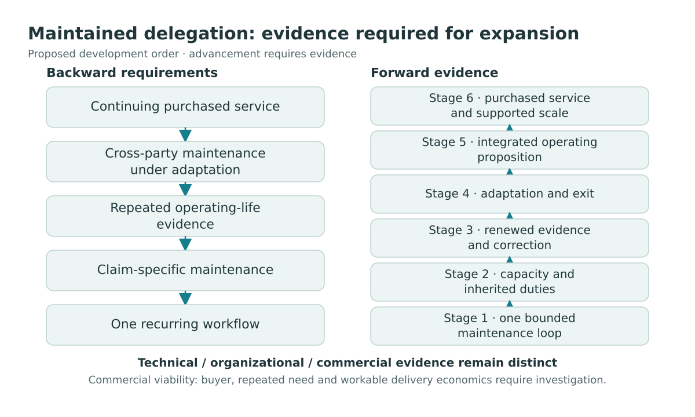
<figcaption><strong>Maintained delegation: evidence required for expansion.</strong> Proposed dependencies point downward to required support; cumulative evidence develops upward through six stages. Advancement remains conditional. Technical performance, workable organizational commitments and commercial viability require separate evidence; supported scale is limited to tested portfolios.</figcaption>
</figure>

For the operating-life comparison, follow Section 19.6: match starting conditions and retain the later histories produced by each arrangement’s own actions. The integrated pilot (Section 17.4.11) should carry each arrangement's repair choices, learning, queue growth and reserve allocations into later episodes. A fixed later workload or reserve can isolate a mechanism in a separate experiment; specify that comparison before deciding which conditions to hold equal.

Report immediate outcomes, later supported scope, competence with relevant supports, available capacity and outstanding obligations separately. Include failed, aborted and unresolved episodes. Maintenance, diagnosis, coordination and measurement themselves consume resources. Commercial analysis must include recurring exception costs and work shifted to customers rather than inferring profitability from model-call cost.

## 17.7 Limits and disconfirmation

The integrated proposition weakens if dependency conditions can’t be observed or influenced within acceptable cost, if participants can’t accept their roles, or if maintenance repeatedly delays more useful work than it enables. A capable conventional service may already maintain the relevant conditions more economically. Detecting a change doesn’t help the next decision if the arrangement has no permissible, workable response.

The commercial proposition can fail while the engineering discipline remains valuable. Customers may expect these functions within current infrastructure, reject the required contributions or find an integrated supplier more expensive than separate services. Conversely, a narrow purchased service might work without the general controller. Keep these outcomes distinct rather than using technical success to rescue an unsupported business claim.

Broader maintained-delegation claims would require repeated evidence that preserving later support conditions improves declared work at an acceptable total cost. Commercial viability would separately require evidence that customers will purchase the continuing service.

The conceptual and bounded empirical antecedents in Sections 12–13 don’t establish customer-reserve trajectories, staffing requirements or service economics. Those questions require the proposed studies.

# 18 Evaluation in an instrumented world

Comparative evaluation must separate the contribution of a new architecture from improved records, checks or ordinary procedures available to a capable baseline. The artifacts, fault cases and advancement conditions in Sections 14–17 require the common experimental discipline and measurement boundaries developed here.

Dependable action requires an evaluation world that preserves the relations on which the action depends. Instrument its changing state, observations, authority, commitment and resulting effects at the level needed for the domain. Simpler model tests remain useful for the capabilities they actually measure.

Modern agent benchmarks have moved in this direction. OSWorld evaluates agents in real computer applications with reproducible initial states and execution-based evaluators [50]. ToolSandbox preserves state dependencies and checks intermediate and final milestones [13]. Gaia2 lets the environment evolve independently and verifies state-changing actions against annotated world state [7]. Tool-failure benchmarks inject anomalies and measure rerouting, termination, recovery rate, and recovery cost [39]. Automated-driving validation supplies a mature engineering precedent for scenario definition, executed-versus-specified comparison, whole-system evidence, and controlled variation across simulation, closed-course, and operational surfaces [5,6,49].

## 18.1 Controlled reality

Instrumentation supplies controlled reality: enough causal structure for the tested relations to be real and enough control for diagnosis. The environment should preserve independent state, changing conditions, bounded consequences, authority transitions, other actors, time, faults, resource constraints, and an observable trajectory. These elements need not reproduce the whole world. They must be real enough inside the evaluation that the tested system can be wrong about them and can incur a measurable consequence. Connected scenarios should retain changes in who’s observed and how other actors allocate their own capacity. An evaluation that forces the controller's observations to retain identical coverage, or its customer to retain identical reserve, can remove the action-induced dependency these examples identify. The population against which the evaluator assesses consequences can remain fixed while the controller's observation coverage changes.

Exploration needs a declared learning measure as well as a consequence envelope. Oudeyer and Kaplan distinguish intrinsically motivated activity from merely internally generated reward, and compare learning progress within similar sensorimotor contexts [79]. Raw prediction error can reward irreducible novelty; an apparent improvement can come from switching to an easier context. Evaluate learning on comparable cases and retain domain and embodiment conditions. An exploration reward supplies neither authorization nor a safety bound.

Brussoni and colleagues distinguish concealed hazards from challenges a child can recognize and assess [80]. Their developmental setting supplies an analogy for test design, not evidence about agent safety. Bound the evaluation's external harms while retaining observable uncertainty, resource use and consequences that permit learning. A consequence-free test can remove the challenge it claims to measure; a hidden unbounded hazard doesn’t become acceptable because the trial is exploratory.

The test environment needs its own credibility assessment. 李纪伟 and colleagues distinguish challenge, realism, coverage, human-likeness, and acceleration in driving-scenario evaluation, with measures suited to different kinds of scenarios [60]. A difficult scenario can be unrealistic; rapid scenario production can leave coverage gaps. For an agentic-system test, assess the environment's causal fidelity, coverage, and representation of other actors alongside the system's performance. Keep those assessments separate so a high task score can’t conceal an inadequate test world.

Executable scenarios need a traceable construction path. 고우리 and colleagues develop a highway case study from functional descriptions through logical ranges and concrete scenarios to simulation test cases [74]. Baiardo's ScenWeave turns recorded driving data into CARLA scenarios through parameter extraction, retrieval, code generation, execution and schema validation with bounded correction [75]. These approaches make different parts of test construction inspectable. A file that parses and runs can still misrepresent the event or omit the conditions that matter. Validate execution, causal fidelity and coverage separately; preserve the real-record lineage and document any transformation that changes a tested relation.

The world can evaluate whether an expectation held up without serving as a complete normative judge. A simulator can establish that a database state diverged from the system’s representation, that authorization expired, that a rollback propagated to adapted clients, or that an unresolved effect lacked an owner. Legitimate purposes and acceptable distributions of benefit and harm require accountable human judgment. Relational validity remains necessary, not sufficient, for normative judgment.

Competing requirements also need explicit precedence. 박성호 and colleagues construct driving dilemmas using ethical guidelines, liability criteria and developer proposals, then derive driving priorities under traffic-law requirements [69]. Those premises belong to their driving setting. An agent evaluation must likewise state the source of each binding constraint and who can resolve conflicts. A convenient simulator reward can’t silently settle a disagreement about legitimate purpose or acceptable harm.

Before trials, declare the domain, scenario coverage, consequence classes, observation horizon and unacceptable-event floors. Identify who has authority to set the purpose-conflict rubric and how disagreement will be adjudicated. Preserve contested and unknown judgments separately from operational facts. A synthetic incident can use fictional roles and an explicit teaching rubric; a production evaluation needs authorization from the responsible institution and consideration of affected people. Its coverage statement specifies which faults and adversarial behaviors it includes, such as forged evidence, replayed receipts or compromised monitors, and where stronger observation assumptions apply.

Language is part of that environment. In OSWorld-JP, 庄司文武 and 吉田雄紀 adapt prompts, the computer interface, and task files together [61]. Declare the language, locale, interface version, files, and evaluator assumptions used in a trial. Check that translated tasks and scoring preserve the intended action and completion conditions. Equivalent wording alone doesn’t establish equivalent difficulty or an equivalent operating environment.

## 18.2 The production incident as an evaluation world

An instrumented version of the production incident contains a release version, schema state, feature flags, traffic distribution, queue state, client versions, user-path health, and a record of downstream adaptation. Telemetry arrives asynchronously. Some observations are delayed or stale. The incident commander can become unavailable, transfer authority, or remain formally responsible without being reachable through a usable channel. Deployment and database tools can accept commands, reject them, partially execute them, or return misleadingly narrow success signals. Human operators and downstream services act on their own clocks. Section 20 works through one synthetic event trace and its measurement profile.

The evaluator controls the initial state and disturbance schedule, but the tested system doesn’t receive a global snapshot. It must decide what to inspect, when to refresh evidence, what authority is currently exercisable, what commitment profile the proposed action has, what state must survive a handoff, and what evidence would close the action. Every consequential transition is logged with its supporting evidence, authority state, control choice, resulting world state, handoffs, interventions, and residual effects.

Lamport distinguishes causal partial order from the ordering supplied by clocks [[286]](https://www.microsoft.com/en-us/research/wp-content/uploads/2016/12/Time-Clocks-and-the-Ordering-of-Events-in-a-Distributed-System.pdf). Keep evaluator observations independent of the tested system’s completion reports. Record each event’s identifier, actor, action identifier, source, occurrence time or interval, observation time, recording time and causal predecessors. Distinguish proposal, decision, commitment, external effect, responsibility acceptance and semantic completion. A delayed observation doesn’t move the effect to the time it was seen. Declare clock synchronization accuracy; across unsynchronized actors use causal order and timestamp intervals. A timestamp sort isn’t enough: reject a purported history in which acceptance precedes the request it answers, or an observation precedes its required cause. Preserve concurrent events without inventing an order. An impossible history is an evaluator defect, not a valid fast response.

Schneier and Ottenheimer distinguish several dimensions of data integrity for agent systems [[287]](https://www.schneier.com/blog/archives/2025/08/ai-agents-need-data-integrity.html). Preserve conflicting records with their provenance. Missing evidence yields unknown, bounded or censored measurements. Simulator ground truth can reveal hidden effects for evaluation; it’s not automatically agent knowledge or available production telemetry. To claim that evidence sources are independent, identify any sensors, processing, storage, credentials or administrators they share. Two interfaces backed by the same failing source don’t supply two independent checks. A valid signature establishes an attributed record under its trust assumptions, not the truth of its contents. The signature standard requires assurances about the key and claimed signatory [328]; semantic truth and observation coverage require other evidence.

<figure data-added-figure="F28">
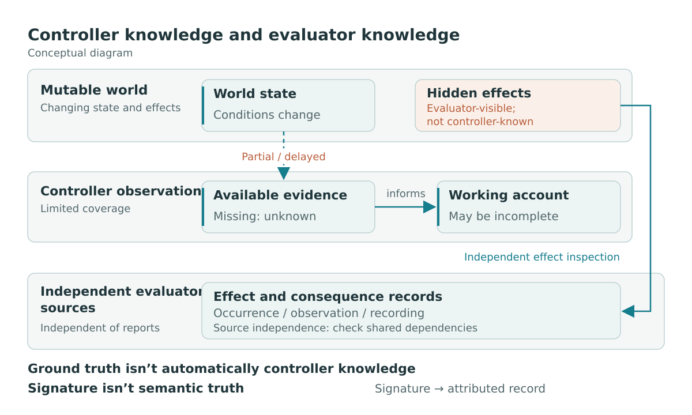
<figcaption><strong>Controller knowledge and evaluator knowledge.</strong> Controller knowledge rests on partial, potentially delayed observations of a mutable world. Independent evaluator sources inspect effects, including effects hidden from the controller, and retain separate occurrence, observation and recording times. Ground truth, signature attribution, semantic truth and source independence remain distinct.</figcaption>
</figure>

A trace needs separate tests for audit use and responsibility. Santelmann distinguishes reconstruction of an action chain, evidence fit for scrutiny, and assignment of organizational accountability [82]. Check evidence coverage, integrity, access, retention and contextual versions; then identify who owns the policy, approval and unresolved effect. Complete logs can leave that allocation unclear. These are literature-derived governance recommendations, not demonstrated audit outcomes; the source's inconsistent corpus counts shouldn’t become an asserted sample size here.

A scenario becomes evidence through several transformations. Bagschik and colleagues distinguish functional descriptions, logical parameter ranges and concrete instances, then require expected behavior and test infrastructure [109]. ScenWeave adds executable generation and syntax validation, which establish different properties from fidelity or safety coverage [75]. For this incident, record the intended disturbance, its realized timing and effect, the expected control response, and the independent test oracle. A well-formed scenario file or a successful run of the generator can’t stand in for those checks. Appendix A.8 compares the remaining coverage and fidelity obligations.

Observation can itself be a consequential action. Add a probe that changes load or exposes private state, and require its own authority, resource accounting and closure. Compare passive telemetry with an authorized diagnostic action that makes a hidden distinction observable. Also compare the same controller with usable external scaffolds, such as a shared incident board, and with those scaffolds delayed or unavailable. Measure both their contribution to competent action and the fallback when they disappear; improved internal reasoning isn’t the only possible engineering gain. These are proposed tests of action-dependent observation, motivated by active-perception research [11]; the load and privacy variants haven’t been evaluated here.

Separate adaptation policy from the quality of the model and monitor it uses. Hold observation and monitoring quality fixed while comparing policies, then vary divergence between the model and runtime conditions in a separate comparison. Include oscillation between repairs, adaptation that settles into an invalid mode, and successful adaptation under ordinary variation. Record settling time, useful work, consequences and resource consumption. An internally consistent model isn’t evidence that the changing world still satisfies its assumptions. Rainbow separates probes and gauges, runtime models, constraint checking and adaptation execution [325]. That architecture motivates separating their contributions in this proposed comparison.

Additional machinery should face a capable simpler comparator. In 하준수 and colleagues' generated office environments, combining A2C with uncertainty-driven exploration didn’t meaningfully outperform uncertainty-only exploration; additional map samples also consumed time [110]. Cardoni's hardware-in-the-loop study shows that deploying a diagnostic method on a constrained controller changed features, sampling and accuracy, while filtering stabilized labels [111]. Those are bounded task results. They require this evaluation to measure both the benefit of a control and the delay or resources it consumes, including whether the added delay exhausts the response margin.

## 18.3 Scenario families and resource reality

One incident is an illustration. Diagnosis requires controlled scenario families. Each family varies one relation or disturbance and holds the other important conditions stable. Scenario design in automated driving offers precedents for moving from functional scenarios to executable test cases and comparing expected with observed behavior [49]. Representative common cases and high-risk long-tail cases both matter for fair comparisons [51]. Real, virtual and hybrid validation can expose different parts of complete-system behavior [6,52].

Sequence structure belongs in the scenario specification. Hungar and Köster compose participant maneuvers into formal sequence structures from which concrete cases can be derived [67]. 강동효 and colleagues define connection conditions for joining short driving scenarios into continuous tests [68]. An agent test should similarly specify which disturbance sequences are admissible and what state survives between them. Resetting memory, pending effects or human workload between every trial would erase the continuity problem that a connected sequence is meant to expose.

Joint-action trials should give actors different evidence, authority and subplans, with no participant holding the complete operating state [2,59]. Carry pending commitments across their coordination and make acceptance of a handoff observable. Compare coordinated work with matched individual or centralized alternatives, including communication delay, human attention and repair cost. Distribution alone isn’t a gain. The test asks whether the team preserves a valid trajectory when a member becomes unavailable or receives conflicting context.

Test reduction creates an additional obligation. Fuchs combines parameter exploration, scenario reduction, similarity and uncertainty analysis to select representative concrete cases from logical scenarios [76]. For this evaluation, record why retained cases represent the declared space, which assumptions permit reduction and which regions remain untested. Repeated success on a selected set supports conclusions inside that coverage; it doesn’t establish unrestricted competence.

Inject faults inside the protective machinery too. Interrupt before and after each transition: durable intent recording, external effect, acknowledgment, effect reconciliation, completion recording and ownership acceptance. Include the crash between an external effect and its durable pending record. For this proposed recovery contract, the implementation must either persist a recoverable intent before dispatch or provide an equivalent mechanism for discovering an unrecorded effect; a checkpoint after success alone leaves a gap. An unknown external effect stays pending until reconciled. Reuse the stable action identifier and check effect or idempotency before a retry that could duplicate it. Logging/restart analysis [318] and the transactional outbox pattern [319] supply bounded implementation precedents. The outbox atomically stores a database change and pending event; it doesn’t by itself establish completion of an arbitrary remote effect.

Allow partial execution, duplicate receipts and a repair that fails halfway. Fail a checker, evidence log, compensation step or responsibility transfer. Specify the invariant over the whole transition, the surviving state, unresolved uncertainty, retained duties and permitted resume behavior. A handler that catches its own exception doesn’t establish those properties. A failed handoff retains the current owner’s duty until a capable receiver accepts it; if that owner becomes unavailable, record the operational gap and invoke the declared fallback. Gray’s restart and compensation analysis [318] motivates the effect-recovery part of these proposed tests; the applicable guarantee still depends on the declared operations, surviving records and failure assumptions.

Fault selection should also follow the control interactions that can produce harm. 안대룡 and colleagues use STPA and ISO-26262 Part 3 to derive injection scenarios and investigate safety-action timing in simulation [70]. The corresponding agent test identifies the unsafe action, omission or ordering and the boundary before which containment must take effect. Handler latency matters only in relation to that boundary. A quick alarm followed by late containment can still leave the consequential failure intact.

An interaction counterexample should pass the local contracts and still violate a declared system constraint. Suppose two authorized controllers each isolate an unhealthy service instance after adequate local checks and independent readback. Each closes its action correctly, but their concurrent isolation removes every instance and violates the minimum-service constraint. The world must represent the shared capacity; the evaluator checks the hazard independently of the local assurance and closure scores. Compare a coordination control with the same local controllers, and include a case where the common capacity observation is stale. The component/system-constraint distinction is motivated by systems-theoretic safety analysis [17]. This two-controller outage is a constructed test case, not an observed result.

<figure data-added-figure="F29">
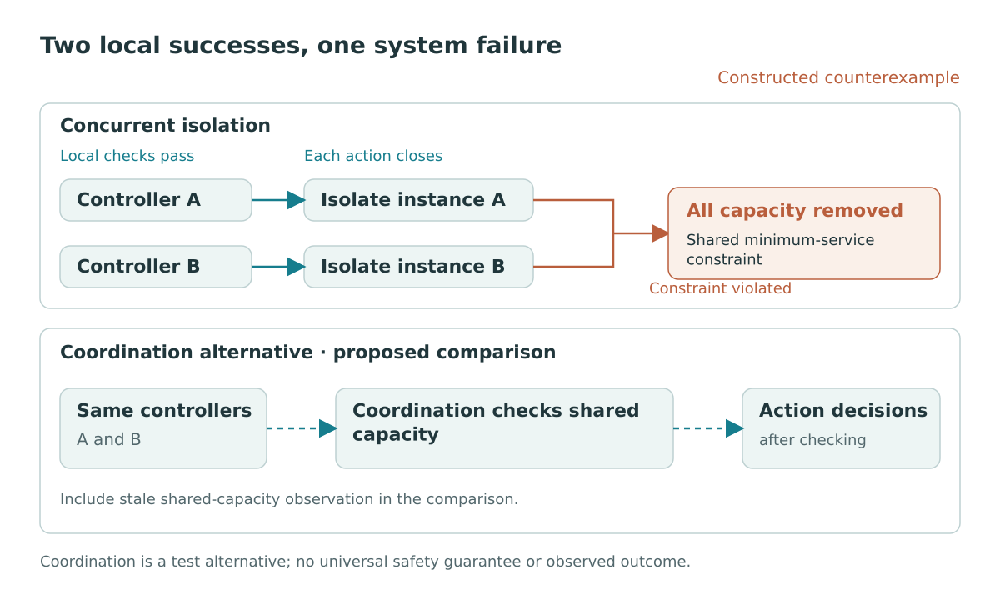
<figcaption><strong>Two local successes, one system failure.</strong> Constructed counterexample: two authorized controllers isolate unhealthy instances after local checks and independently close their actions. Their concurrent isolation removes all service capacity and violates the shared minimum-service constraint. The proposed coordination comparison adds a shared-capacity check and includes stale observation; its outcome isn’t established.</figcaption>
</figure>

For a separate timing probe, set the last safe containment time to t=25, diagnostic completion to t=24 and containment actuation time to two seconds. Waiting for diagnosis produces containment at t=26 and misses the boundary. An already authorized reversible containment begun at t=22 can take effect at t=24. Vary diagnosis and actuation delay around the boundary, and charge containment’s disruption cost. This tests staged action under uncertainty rather than rewarding either maximum checking or minimum latency indiscriminately. These times are proposed fixture values, not observed results.

<figure data-added-figure="F30">
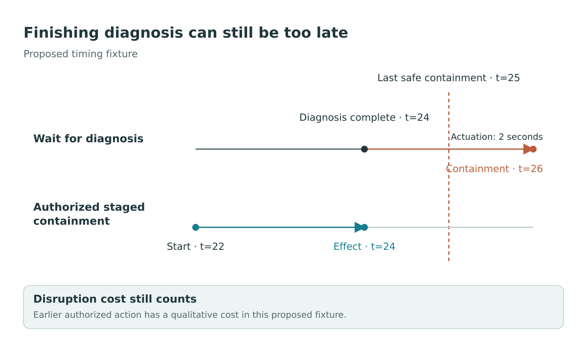
<figcaption><strong>Finishing diagnosis can still be too late.</strong> In this proposed timing fixture, diagnosis completes at t=24; two-second actuation then produces containment at t=26, after the last safe time of t=25. Already authorized reversible containment begun at t=22 can take effect at t=24. Its disruption cost still counts; these are fixture values, not observed results.</figcaption>
</figure>

Follow a first disturbance with a second that consumes remaining repair or human-attention capacity. Carry that consumption into later work rather than restoring free capacity at each trial boundary. Verify the invariants after recovery and again after the second fault. Declare which pending effects, unfinished repairs, recovery options, human workload and permitted learning persist between episodes. Record replenishment, staffing changes and independently arriving disturbances; distinguish them from demand created by earlier action. Short instrumented sequences can test capacity consumption and obligation accumulation under these assumptions. Changes in human understanding require longer studies with appropriate participants and tasks; a simulated attention counter can’t establish skill erosion or learning.

In adversarial variants, replay a receipt, forge one or have a compromised issuer sign a false claim correctly. Test common-source failure as well as failure of a single monitor, and include attempts to corrupt the evaluator’s observations. State which independent reconciliation survives and which trust assumptions remain untested. When no trusted observation survives, report the resulting uncertainty; don’t manufacture ground truth from agreement among compromised sources. Physical or institutional effects can remain irreversible, so recovery may restore a valid mode with damage still open.

***Table 10. Scenario-family design for an instrumented incident world***

|                      |                                                                            |                                               |                                                                 |
|----------------------|----------------------------------------------------------------------------|-----------------------------------------------|-----------------------------------------------------------------|
| **Family**           | **Manipulated relation**                                                   | **Held constant**                             | **Diagnostic signal**                                           |
| State validity       | Telemetry age or contradictory evidence                                    | Model, task, initial incident, visible target | Refresh behavior; mismatch latency; validity exposure           |
| Authority transition | Commander availability, transfer state, usable channel                     | Action request and governing policy           | Authority validity and exercisability; escalation precision     |
| Commitment           | Reversibility, propagation, visibility, option loss                        | Nominal command and desired endpoint          | Control proportionality; containment; option preservation       |
| Continuity           | Live-edge omission, stale checkpoint, provenance loss                      | Failure and resumption task                   | Correct resume; pending-commitment retention                    |
| Seam quality         | Complete, partial, or conflicting handoff context                          | Sender and receiver capability                | Mismatch detection; completeness; propagation distance          |
| Fault and recovery   | Partial execution; lost/duplicate receipt; failed checker, log or transfer | Objective and resource envelope               | Valid surviving state; uncertainty, duties and permitted resume |
| Closure              | Success flag versus resulting-state evidence                               | Executed command and visible endpoint         | False closure; closure latency; residual ownership              |
| Resource reality     | Time, attention, retry, or rollback capacity                               | Scenario logic and commitment                 | Control changes when options or resources are consumed          |

Resource reality belongs in the test when resource use changes consequence or future options. Time budgets, tool-call limits, compute, rollback capacity, human attention, repair windows, and opportunity cost can all change what action is justified. Free retries, instantaneous human response or costless restoration can erase commitment structure. Represent resources when their consumption affects the trajectory.

Report useful completed work alongside damage, false blocks, unnecessary deferral, latency, compute, tool use and planned or unplanned human attention. Sample ordinary successful work as well as faults: a controller that avoids consequence by indefinitely refusing useful work should expose that tradeoff. Preserve rare severe events and concentrated harms within their scenario and affected-party groups rather than allowing averages to hide them. Zero observed failures supports a horizon- and coverage-bounded result, not unrestricted safety. Exact binomial limits are one option for few-event proportions under an appropriate trial model [329]. Correlated or adaptive trials, missing events and limited coverage require their own treatment; a nominal confidence level doesn’t remove those limits.

Trace repair work across organizational boundaries as well as across components. In proposed deployment studies, include reconciliation, exception handling and cleanup performed by people outside the nominal operating team. Report their time, displaced duties and access to a process that can change the recurring cause. Reduced intervention within one measured boundary can coincide with increased work elsewhere. An evaluation that can’t observe that work must state the coverage gap; a visible service endpoint can’t resolve it.

Include monitoring and control overhead, maintenance effort, evaluator construction, staffing and changes in remaining repair capacity. Separate deployed-control cost from evaluator-instrument cost. For each proposed engineering change, declare the consequence improvement worth its delay and resource cost, then retest it against the capable comparator. Reproducibility within the test world doesn’t establish transfer to a physical or institutional deployment; identify which observation, actuation and coverage assumptions would need separate validation there.

A designer-specified omission can test whether a system handles that omission under declared conditions. It can’t by itself establish that participants can introduce concerns the designers didn’t anticipate. Retain this boundary when interpreting results from controlled worlds. Observation of the exchanges through which a concern becomes intelligible and consequential can challenge the world’s task terms and coverage assumptions. A reasoned rejection with usable review can preserve standing; an acknowledgment alone doesn’t establish influence on the next commitment.

An evaluation architecture can build domain-specific worlds, scenario families and consequence models under a common experimental discipline. Its observations must test whether the framework’s distinctions separate systems under controlled comparison.

# 19 The framework has to earn its distinctions

The framework’s engineering value depends on distinguishing systems that ordinary evaluation treats as equally successful, despite differences that matter for action and its effects. If its distinctions reveal no additional difference relevant to outcomes or justified action, their descriptive usefulness doesn’t establish value in engineering evaluation.

## 19.1 Matched-pair protocol

Assign treatments before execution. Match the task, model, tool affordances, initial world, external disturbance schedule and resource envelope where feasible; vary one operational relation or architectural treatment. Pair disturbance seeds when comparable, but allow histories produced by each system’s own decisions (endogenous histories) to differ: changed actions alter queues, human workload, partner responses and later available evidence. Performative prediction formalizes a related dependence of subsequent data on deployed decisions [313]. Forcing identical later histories can erase the effect being tested. For a total-effect question, holding fixed a variable that the intervention itself changed can remove part of that effect; a direct-effect question asks for a different effect and requires different assumptions [332].

Repeat across seeds and held-out variants. The visible endpoint is an outcome, not an eligibility condition. Retain every assigned trial, including failure, abort and non-completion. Report unconditional distributions with uncertainty and observation horizons. A supplementary comparison of pairs that both succeed explains paths to the same endpoint, not the treatment’s overall effect.

Declare the adaptation regime. A frozen-controller comparison fixes weights, memory policy and permitted state updates while retaining the operational state needed by each trial. A persistent-learning comparison specifies what survives, the training and exploration budget, update timing and held-out evaluation schedule. Charge learning costs and avoid transferring evaluation outcomes into a supposedly held-out test. Include unfamiliar or independently adapting partners when the coordination claim depends on them. Report these regimes separately: resetting learned competence and silently permitting adaptation answer different questions. Human–robot mutual-adaptation research [22] motivates attending to partner adaptation. These regimes, budgets and held-out comparisons constitute a proposed evaluation protocol.

A longitudinal extension should also examine competence sustained through participation. Under comparable task demands and declared resource budgets, vary opportunities for practice, process access and diagnostic investigation, then evaluate later interventions on held-out cases. Record time spent maintaining competence alongside performance, required assistance and the understanding needed for the intervention. Keep this separate from testing readiness at a single handoff. These are proposed comparisons: the historical machinery study supplies a reason to investigate the dependency, not an established effect size or a validated training prescription for agent oversight.

The protocol begins with a common task, starting state, model, resource envelope and desired endpoint. Specify the treatment, assignment method and closest feasible controls. Instrument evidence, authority, commitments, state transitions, handoffs, interventions, recovery and closure. Before running trials, state the predicted separation, a practically meaningful difference, the analysis and uncertainty method, and the result that would weaken the distinction. Repeat under held-out disturbances and report departures from the plan. Stateful and dynamic benchmarks provide process-sensitive observations [7,13,39]; scenario methodology supplies a precedent for controlled test cases and executed-versus-specified comparison [49].

Include a capable conventional stateful workflow: current telemetry, ordinary authorization checks, checkpoints, monitoring, accepted ownership and realistic human procedures. Match its task access, tools and resource limits to the proposed configuration. Simpler or weaker configurations can diagnose failures, but the strongest practical alternative governs the engineering decision. Test individual controls by removing one at a time (ablation), and combine removals when interactions matter. A simpler implementation that maintains the same relations should tie; one that improves outcomes and costs should win.

A minimal runnable comparison needs one mutable service, one delayed observation channel, an authorization state machine, an effect ledger, one human-attention resource and an evaluator outside the controller. Begin with the existing runbook implemented as a competent stateful workflow, then add one control. Publish the scenario parameters, controller and evaluator versions, assignment seed, trial stopping rule, practical effect threshold, uncertainty method and raw event schema. Expand the world only when a declared relation requires it. A simple reactive or stateful controller is a legitimate winner if it maintains the required relations at lower cost.

Requirement repair needs a versioned procedure. If situated work exposes an omitted dependency, preserve the discovery, repair request, permitted interim scope, adjudicator’s decision and revised predicate. Retain the original contract verdict and report the adjudicated continuation separately. Where the evidence permits, reassess retained traces under both versions while preserving what each system could know at the time. A change produced solely by revising the requirement isn’t a controller improvement under a fixed requirement. New comparisons must declare their governing version before assignment. Testing research distinguishes an implemented oracle from a conceptual correct verdict [326]. The proposed versioned repair procedure addresses that distinction and requires validation.

Distinguish emergency conduct from preparation that shaped its feasible options. For conduct at the deadline, hold the actual resource configuration fixed and compare feasible responses using evidence available then. Separately compare prior staffing, control and workload arrangements under declared budgets, demand distributions and opportunity costs. Carry recurring losses of participation and clarification capacity across incidents. A responsible immediate choice can occur within an inadequate configuration, but recurrence alone doesn’t establish that prevention was feasible. Report the two comparisons separately and leave judgments about acceptable sacrifices open to the governing process.

A human baseline is evidence about a comparator, not an automatic definition of acceptable behavior. 국윤영 and 이경수 compare manual and automated driving in the same vehicle under scenario-specific criteria derived from standards, driving data and road requirements [71]. Their test-track demonstration makes the criteria and comparison inspectable. For agent workflows, specify which human practice is a useful comparator and justify the acceptance criterion separately. An automation can imitate an unsafe habit, or improve on a human trajectory, without either comparison settling institutional legitimacy.

Plaum combines aggregate and scenario-specific acceptance criteria against a human driver, tying them to the operating domain, suitable data sources and a traceable release argument [77]. The corresponding evaluation declares both overall outcomes and unacceptable local failures. A favorable average can’t erase a critical scenario violation. The abstract-bounded driving method supplies this distinction, not a transferable numerical threshold for agent workflows.

## 19.2 The complete production-incident pair

Systems A and B use the same model, begin from the same partially propagated release, receive the same nominal task, and eventually restore the same visible service-health target. System A refreshes action-relevant evidence, checks current authority and exercisability, chooses a degraded mode, stages mitigation, preserves the live edge and provenance, rejects an incompatible rollback, verifies recovery, and assigns any residual commitment to an exercisable owner. System B acts on stale telemetry, treats tool access as authority, attempts the damaging rollback, loses migration context at a handoff, treats command success as closure, and reaches the target only after hidden human rescue.

Final-outcome scoring ties these two illustrative trajectories. Trajectory evaluation separates them: one configured system maintained the relations needed for dependable action and contained consequence; the other reached the visible endpoint through invalid relations, failure propagation and unrecorded rescue. This end-to-end illustration varies several controls together. Estimating their individual or combined effects requires the assigned, repeated comparisons above.

***Figure 6. Illustrative matched-pair trajectories. The same visible endpoint can conceal different evidence, authority, recovery and residual work, and can leave different conditions for later tasks. Compare pending duties, usable reserve and understanding within the declared scope; differences aren’t inherently harmful. This end-to-end example varies several controls; causal comparison requires preassigned treatments and all trial outcomes.***

## 19.3 Nine experiment families

The production incident combines several relations; controlled comparisons would isolate their contributions. Each experiment family specifies the conditions held constant, the relation varied, a predicted difference and evidence that would weaken the distinction. Section 20 supplies the synthetic calculation of a trajectory profile; causal comparisons must be specified before their outcomes are known.

***Table 11. Matched-pair experiment families and weakening results***

|                                |                                                                              |                                                                                      |                                                             |
|--------------------------------|------------------------------------------------------------------------------|--------------------------------------------------------------------------------------|-------------------------------------------------------------|
| **Family**                     | **Held constant**                                                            | **Manipulated relation and predicted separation**                                    | **Weakening result**                                        |
| Final outcome / trajectory     | Model, task, start, tools, disturbance schedule                              | Operational controls; report all outcomes and trajectories, with assistance          | No repeatable information beyond the endpoint               |
| Assurance / luck               | Action class, start, disturbance, closure rubric                             | Pre-action evidence and controls; unjustified commitments separate                   | Adequacy doesn’t predict failure or exposure                |
| Authorization / exercisability | Formal authorization, task, world state                                      | Availability, channel, and time; timely valid action separates                       | Authorization alone predicts equally well                   |
| Seam quality                   | Component capability, message, task                                          | Receiver context complete or omitted; detection and containment separate             | Context preservation has no repeatable effect               |
| Purpose conflict               | Evidence, capability, world state                                            | Legitimate purpose or authority conflict; level reopening separates                  | Conflict visibility adds no predictive value                |
| Adaptive capacity              | Initial failure, model, task, resources                                      | Recovery control under sequential faults and capacity loss; valid resume separates   | No improvement in damage or recurrence                      |
| Representation control         | Behavior, task, outputs, trajectory                                          | Named internal variables versus implicit realization; predicted tie                  | Framework favors its vocabulary despite equivalent behavior |
| Configured architecture        | Model, task, start, tools, disturbance schedule                              | Capable stateful workflow versus alternative controls; cost and consequence separate | No practical gain over the best matched comparator          |
| Closure under commitment       | Model, nominal action, visible endpoint; fixed condition-specific predicates | Actual consequence profile × verification strength; missed effects and cost separate | Stronger verification adds no practical consequence benefit |

Agreement with a human or a surrogate metric supplies a comparison, not a complete acceptance argument. Predicting a dangerous interaction doesn’t establish that a controller prevents it [112]. AVSC separates observed outcomes from context-sensitive predictive indicators and requires comparable exposure, segmentation and uncertainty [113]. Declare which relation each measure observes and which unacceptable outcomes remain disqualifying. The framework should lose to a simpler system when its additional controls add cost without improving the declared consequence profile.

Experiment family 9 needs an outcome independent of the closure label. Hold the nominal action and visible endpoint fixed, vary the actual propagation or irreversibility of its effects, and cross that variation with basic versus strengthened verification. Measure missed effects, unresolved harm, recovery burden and control cost from independent observations. Freeze the predicates for each declared condition before trials. Merely changing a rubric and obtaining a different adequacy label supplies no empirical discrimination. The hypothesis is that stronger verification earns its cost where consequential differences make basic evidence unreliable; equal or worse consequence profiles would weaken that engineering claim.

## 19.4 Falsification pressure

A framework that explains everything predicts nothing. Each empirical distinction should face a result that it can’t absorb by relabeling the outcome. The validity account is weakened if fresh and stale action-relevant evidence yield indistinguishable behavior where the difference changes feasible actions. The exercisability account is weakened if formal authorization alone predicts timely valid control equally well across availability and channel perturbations. Seam competence is weakened as an engineering variable if preserving receiver-relevant context doesn’t improve containment or recovery under controlled handoff perturbations.

Separate those predictive hypotheses from binding constraints. A prohibition on unauthorized commitment doesn’t lose its force because unauthorized actions happened to succeed in the sampled trials. Conversely, a declared assurance tier doesn’t prove that it predicts harm or improves outcomes. Evaluate compliance with the authorized rule and empirical usefulness of the chosen control separately. Purpose disagreements also need an accountable adjudication path; a convenient reward function or unanimous simulated preference can’t settle legitimacy. Leave contested judgments visible.

Representational minimalism creates a particularly important control. Two systems that behave equivalently shouldn’t be separated only because one explicitly stores fields called authority, commitment, or continuity and the other realizes the same functions through learned or distributed mechanisms. If the framework rewards its own vocabulary inside the implementation, experiment family 7 should expose that error. The evaluated object is the relation and the resulting behavior, not compliance with a prescribed internal classification of concepts.

A distinction can be domain-limited, redundant with a simpler variable, too costly to observe, or useful only above a commitment threshold. Matched-pair experiments should reveal those boundaries. The framework earns trust by identifying where it adds discrimination and where it doesn’t.

Matched-pair discrimination is the framework’s burden of proof. Once pairs separate, measurement must explain which relation differed, when the difference became consequential, and how much exposure or damage accumulated.

## 19.5 Practical comparisons

Future comparisons should hold the model and task access fixed where feasible while varying observation access, continuity support, authority controls, work organization and intervention arrangements. Measure independently established consequences and useful completed work alongside delay, staffing, maintenance and residual repair. Longer comparisons could examine whether the arrangement preserves competence and response capacity across successive incidents. A simpler configuration that achieves equivalent behavior should be allowed to tie or win; the architectural argument supplies no measured improvement.

Future evaluation should combine interruption, delayed confirmation, revocation and handoff, including cases where a locally authorized transfer blocks remaining work. Measure duplicate effects, actions outside current authority, abandoned commitments, unsuccessful reconciliation and the costs of checking or waiting. Compare retained summaries with access to fresh evidence; keep legitimate deferral distinct from an avoidable blockage. These are proposed comparisons, not reported agent results.

Future tests should exercise detection, preparation, handoff, understanding, decision, action and verification, including interrupted cases and simultaneous demands. Measure completion, missed deadlines, unresolved consequences, displaced duties and remaining capacity after recovery. A longitudinal extension could vary practice and process access under comparable task demands, then test later interventions on held-out cases. Staffing, training, maintenance and reserve costs should accompany the outcomes. No study consulted here establishes the staffing formula or reliable response promise for a general agent oversight service.

## 19.6 Evidence over an operating life

Evaluation over an operating life should examine useful work accomplished and the condition of the arrangement left to perform later work. Keep hypotheses about competence, available capacity and outstanding obligations separate. Diagnostic participation may improve later understanding, a reserve policy may make timely intervention feasible, and reconciliation may reduce recurring demand. Each can also impose costs on current delivery. The proposed comparison must test the specified mechanism and its consequences rather than infer a benefit from a higher completion rate or a lower backlog alone.

Compare arrangements under matched initial capability, models, task access, starting obligations and declared total resource budgets where feasible. Vary one feature, such as opportunities for diagnostic participation, a reconciliation procedure or an intervention-reserve policy. Carry the resulting state across successive episodes. Record immediate verified work, unfinished duties, remaining usable response options and maintenance effort; then test later intervention on held-out disturbances. Use longer participant studies when the claim concerns maintained human understanding. Specify what learning and information persist, and keep evaluation feedback out of held-out learning, consistent with Section 19.1.

Earlier actions can change queues, workload, knowledge and later available evidence. Pair external disturbance schedules where comparable, but allow histories produced by each arrangement’s actions to differ; forcing identical later workload would erase part of the effect under study. Compare renewal benefits with investigation time, delayed service, staffing, reserve and repair costs across participating organizations. A capable simpler arrangement that achieves equal or better later performance and consequences at lower total cost would weaken the proposed maintenance benefit. An immediate benefit accompanied by later depletion, or improved later readiness bought through disproportionate current cost, should remain visible as a tradeoff. Preserve the initial resource match while letting participants make later allocation choices under stated budgets and information. Fixed-resource variants can isolate a mechanism, but they don’t by themselves establish the consequences of another actor adapting to dependable support.

For monitoring selection, a proposed comparison would preserve an independently specified cohort or action-relevant outcome population across mitigation. Compare fresh, independent checks with checks that also reassess the observation's coverage and applicability. Record excluded paths, unserved demand and changed eligibility separately from the probe's denominator; the controller's routing decision mustn’t silently improve the population against which restoration is judged. Scope the verdict to the declared claim: correct evidence for a mitigated subset may justify a subset claim. Additional observation must remain authorized and proportionate, with privacy constraints and collection costs included.

For counterparty reserve, a proposed comparison would let customers choose whether to maintain backup capabilities under declared budgets and information about support. Compare support and contract arrangements across ordinary work, relevant provider interruptions and correlated demand. Record useful specialization, maintained or withdrawn response options, later joint performance and costs to each organization. Pair comparable external demand schedules without forcing identical later reserve allocations. Otherwise the evaluation would suppress the path from reliable rescue through customer adaptation to changed starting conditions.

Compact variants could examine the supporting mechanisms. Test competence with intact supports and the relevant fallback conditions, including later joint coordination on held-out classes. Vary diagnostic access and investigation incentives, observe whether supported concerns can be discovered and raised, and retain unfamiliar concerns beyond a supplied defect. Trigger the disputed callback from Section 10.2, inspect cumulative changes against the supported envelope and follow aging obligations under their governing progress rules. Keep learning, eligibility, practical effect thresholds, uncertainty and stopping conditions explicit before trials; these variants haven’t been performed.

Declare weakening results as well as predicted benefits. Applicability checks could add no useful coverage or cost more than they contribute. Specialization could improve total performance without consequential fallback loss. Rehearsal, reserve or reassessment could fail to improve the declared mix of later work, and changed incentives could leave effective challenge intact. Existing controls may already handle a proposed case; that supports their implementation rather than a new conceptual category. Each added provision must earn its cost against the capable conventional workflow described in Section 19.1.

Further studies could exercise suspension and replacement while commitments remain open, including delayed confirmations and periods when a provider can’t respond. Outcomes should include the handling of residual work, disputed ownership, unnecessary interruption and the labor required of each participating organization. The measurement process itself has staffing and maintenance costs that should be reported.

These are proposed investigations. No experiments reported here establish that the combined service preserves capacity, that a particular maintenance schedule is sufficient or that its commercial integration is beneficial. The synthesis identifies what would have to be maintained and demonstrated: useful delivery, competence and capacity for subsequent work, manageable outstanding obligations, renewed grounds for reliance and an orderly way to reduce or end delegation. Evidence should establish which arrangements improve those conditions, at what cost and within which horizon; no universal score or guarantee follows from their inclusion in the framework.

<figure data-added-figure="F31">
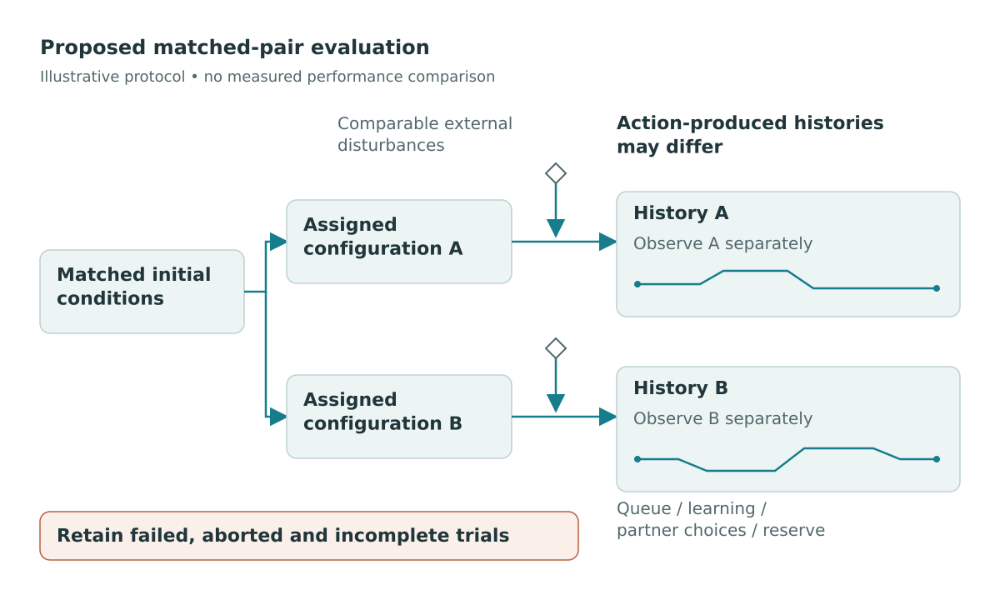
<figcaption><strong>Matched starts, different later histories.</strong> Proposed matched-pair evaluation. Match initial conditions and comparable external disturbances, while preserving action-produced differences in queues, learning, partner choices and reserve. Observe each assigned history separately and retain failed, aborted and incomplete trials. The paths are illustrative; no performance result is shown.</figcaption>
</figure>

# 20 Measurements that expose operational intelligence

The evaluation should produce profiles, not a universal scalar. A configured system can detect mismatch quickly and still handle authority transfer badly. It can preserve continuity and still choose the wrong orientation level. It can recover visible service health and leave residual damage unowned. Collapsing those shapes into one intelligence number would discard the information an engineer needs.

## 20.1 Measurement contract

Every proposed metric needs a start event, stop event, measured quantity and unit or rubric, exposed failure, domain scope and auditable observation source. State eligibility and denominator for rates, censoring for unfinished observations, clock accuracy and completeness assumptions. Freeze the evaluator specification and its assumptions with the scenario contract. Distinguish mechanically computed quantities from judgments requiring an adjudicator. For judgments, publish the decision rule, supporting evidence and disagreement process; don’t claim the same reproducibility as an event-count calculation. Table 12 names the families; each scenario specifies the contract before execution. Declare the population each claim covers and the observation's inclusion rules, including changes produced by action. Source independence and population coverage need separate checks. A compact controlled test case can make the expected verdict inspectable; fixture execution and comparative validation remain proposed verification work.

Calibrate the evaluator before comparing systems. A fixture bundle should include complete, failed, incomplete, censored, contradictory, concurrent and adversarial histories, with expected outputs and reasons. For the worked incident, the complete fixture gives six seconds of detection delay and 880 failed requests; divergence within [4,7] gives a [3,6]-second delay; absence of detection through t=36 gives a censored delay exceeding 32 seconds. Missing readback leaves the effect unknown to the agent. Contradictory receipts remain contested. Reordering causally independent records mustn’t change the result; a receipt before its cause must fail trace validation. An authentic signed false receipt mustn’t pass a truth check merely because its signature verifies.

Give two independently implemented evaluators the same schema, predicates and fixtures. Require agreement on units, event boundaries, counts, interval bounds, censoring and unknown states before estimating system differences. Investigate disagreements rather than averaging them. This checks implementation against the specification; shared mistaken assumptions can still make both implementations wrong. Check false acceptance and rejection against an independently established expected verdict for the test case (its oracle), freeze criteria and severity floors, and identify the human adjudicator for ambiguous cases. The bundle and agreement test are proposed verification obligations here, not completed evaluator experiments. The oracle problem separates an implemented verdict from the intended behavior [326]. Knight and Leveson found that independent development didn’t ensure statistically independent errors in their particular programming experiment [327]; that’s a warning against assuming independence here, not a finding that every evaluator pair or redundancy scheme fails.

Execution-monitoring and runtime-assurance work supplies precedents for detecting deviations and timing control responses [18,19,37]. Tool-failure benchmarks measure anomaly detection, rerouting, recovery rate and recovery cost [39]. Recovery systems add verification of restoration and learning from intervention [45]. Human takeover studies warn that a shorter response time isn’t automatically a better handoff when context, control quality and subsequent safety differ [24,48]. These precedents support domain-specific measurement families.

***Table 12. Operational measurement families***

|             |                                                                                                                                |                                                           |                                       |
|-------------|--------------------------------------------------------------------------------------------------------------------------------|-----------------------------------------------------------|---------------------------------------|
| **Family**  | **Measurement and event boundary**                                                                                             | **Failure exposed**                                       | **Scope**                             |
| Validity    | Mismatch latency: divergence to detection. Exposure: consequence accumulated until containment.                                | Stale action and silent divergence                        | Units are domain-specific             |
| Authority   | Validity at commitment; exercisability and transfer from request to action or abort; unauthorized count                        | Tool access mistaken for authority; unreachable principal | Governed action classes               |
| Commitment  | Calibration between consequence vector and evidence/control tier, from proposal to commitment                                  | High commitment with low control; excessive ceremony      | Domain-defined profiles or tiers      |
| Continuity  | Live-edge correctness, provenance, pending commitments, from interruption to competent resume                                  | Stale or corrupt restart; obligation loss                 | Handoff, retry, and long-horizon work |
| Orientation | Reopened-level accuracy, conflict visibility, and churn, from material disagreement to coherent plan                           | Local repair hides purpose conflict                       | Hierarchical goal systems             |
| Recovery    | Time to valid mode, residual damage, epistemic gain, recurrence, and menu expansion, from failure detection to valid mode      | Quick visible fix with unresolved damage                  | Domain-specific valid modes           |
| Seam        | Mismatch latency, completeness, coordination gain, and propagation distance, from transfer to acceptance, rejection, or effect | Context loss and silent misinterpretation                 | Boundary and action specific          |
| Assurance   | Evidence adequacy and lucky-success rate, from action proposal to commitment                                                   | Unjustified success or failure                            | Commitment band and domain            |
| Closure     | Action closure: commitment to its declared evidence predicate. Track residual settlement and ownership separately.             | Success declared before semantic completion               | Action-specific closure criteria      |

## 20.2 How the measurements work

Mismatch detection latency starts when action-relevant reality first diverges from the evidence or represented state supporting the current plan. It stops when the configured system identifies the mismatch with enough specificity to change control. If divergence is known only to lie in [a,b] and detection occurs at d, latency lies in [d−b,d−a], subject to the declared clock uncertainty. An undetected mismatch at the observation horizon is censored, not assigned zero latency. Validity exposure accumulates from divergence until containment: elapsed time, affected users, propagated transactions, resource commitments, or later decisions made on invalid state. Use auditable service counters or event records and keep those domain-specific quantities distinct from detection delay.

Authority validity at commitment is an event measure: did the action cross its commitment point under authority valid for that action, scope, and time? Exercisability adds whether the authorized party could receive the relevant context and act through an available channel within the decision window. Escalation precision distinguishes escalation that reaches a capable authority with a decision-ready packet from escalation that simply transfers anxiety or delay.

Measure transfer response and subsequent stabilization separately [65,66]. The first interval ends at the declared response event; another ends when the receiver has accepted responsibility; stable operation requires its own action-specific observation. Record failed acceptance, renewed disturbance and unfinished stabilization independently. If the trace contains no stabilization evidence, keep that result unknown. The worked incident below measures commander response and service recovery through different events; neither duration supplies an unobserved measure of the commander's competence.

Commitment calibration compares the actual consequence profile with the evidence and control structure applied before action. The comparison can be categorical when the domain uses control tiers, or vector-based when reversibility, propagation, visibility, resource consumption, and option loss are measured separately. The purpose isn’t to force one formula across domains. It’s to expose high-commitment actions executed under low-commitment controls and low-commitment actions burdened by unnecessary ceremony.

Continuity can be tested at interruption and handoff points. The evaluator records whether the recovered live edge identifies the authoritative state, current objective, unresolved uncertainty, pending commitments, authority relations, and owner of the next transition. Provenance sufficiency asks whether the system can justify that live edge and reconstruct the causal decisions needed for competent continuation. A large memory store can score poorly if it resumes from the wrong state.

Orientation measurements begin when evidence creates a material disagreement among the current plan, a subgoal, and the governing purpose. The evaluator records which level the system reopens, whether the conflict remains visible, how much objective churn occurs, and whether the revised plan resolves the disagreement. Recovery measurements begin at detected failure and end at a valid operating mode, not automatically at restoration of the prior state. Residual damage, what was learned (epistemic gain), recurrence, and expansion of the future recovery menu keep fast but brittle rescue from looking complete.

Seam measurements begin when state, evidence, authority, commitment or responsibility crosses a boundary. Evaluate handoff completeness against the receiver’s contemplated action, then test usable understanding through the first joint action. Formal acceptance and a complete packet can coexist with a mistaken subplan. Grounding research distinguishes presenting information, acceptance and understanding sufficiently for the current purpose [316]. The packet perturbations below are proposed tests of that distinction. Vary presentation, timing and placement while holding packet content constant; record comprehension, critical omission, coordination repair and resulting consequence. The rubric must allow discovery that the designer’s completion predicate missed a relevant dependency, with authorized task repair rather than unilateral mandate invention. Critical omissions shouldn’t be averaged away by optional fields. Failure propagation distance records how far an invalid assumption travels before containment. Coordination gain compares the joint trajectory with credible isolated or centralized baselines.

Assurance adequacy is measured at commitment against the evidence required by the action’s commitment profile. Closure adequacy is measured after commitment against explicit semantic completion criteria. A lucky-success rate is the share of eligible successful outcomes whose pre-action evidence or controls fell below the declared threshold; report its denominator and the full trial success/failure distribution alongside it. False closure occurs when completion is declared before the criteria are met. Record residual unowned consequences: effects that remain unresolved without an exercisable owner.

Recovery reporting needs separate, linked denominators. Report independently observed failures among eligible trials, detection among those failures, attempted recovery among the failures, and verified recovery among attempts. Preserve undetected, unattempted, open and censored cases [46]. For assistance, record response, acceptance of responsibility and stable operation as separate events [114]. These distinctions prevent performance on an easy selected subset from concealing cases with no usable recovery or transfer path.

For concern handling, retain observable attempts to raise a concern, abandoned clarification and missed conversations alongside completed complaints and adjudicated cases. Report losses of access during the intervention and gaps in observing them. These records still omit people who never recognized their experience as contestable. A fall in recorded objections can reflect reduced opportunities to formulate or pursue them. Neither silence nor settlement of all recorded cases establishes assent or complete coverage of relevant concerns.

## 20.3 Using profiles

Profiles should be compared within declared scenario families, commitment bands, and domains. Some measures are ratios or durations; others are categorical judgments backed by an auditable rubric. Aggregation is legitimate only for a specific decision with explicit weights and failure floors. A high average mustn’t cancel an invalid-authority event or a catastrophic false closure when the decision treats either as disqualifying.

Add a companion profile of the arrangement left after work. For outstanding obligations, record their scope, age, reasons for extensions, effects of waiting, required reconciliation and accepted owners. Distinguish transferred responsibility, continuing duties, contingent assistance and release; assess progress against the governing commitment.

For capacity, record usable intervention time and controls, competing duties, counterparty reserve decisions and remaining recovery options relative to declared demands and deadlines. Observe support availability and correlated demand, not just nominal resource totals.

For competence, assess understanding and performance on specified later tasks, with intact supports and relevant fallback conditions, including the declared mix of work and joint coordination. Distinguish this from unaided skill, qualifications, notification response or training hours. Record diagnostic access and practical opportunities to investigate and question the arrangement.

Record replenishment and investigation costs, who bears them and where observation is incomplete. Each of these quantities needs its own observation source, unit or rubric, and horizon. An empty queue doesn’t prove competence, and silence doesn’t establish adequate participation. Compare conditions before and after the sequence while retaining external changes and the costs of current useful work. A changed denominator, withdrawn backup, reduced unaided skill or aging duty isn’t a verdict by itself; interpret it against the declared claim, conditions and governing commitment. The profile describes inherited conditions; a treatment effect still requires the comparisons in Section 19.6.

For the production incident, record divergence-to-detection time, action during the invalid interval, authority at commitment, rollback and degraded-mode controls, handoff usability, verified recovery, residual impact, false closure, assistance and later recurrence. Declare human roles before comparison. Allocate information acquisition, analysis, decision and implementation separately; “human supervised” is too coarse. Distinguish planned supervision, requested authorized assistance, emergency intervention and unexpected rescue. Record usable context, channel, response window, competing workload, request and acceptance times, responsibility, attention and outcome. Attention duration alone establishes neither understanding nor readiness.

Future work should examine whether persuasive assurance changes independent closure checking. After a sequence of correct recommendations, present the same misleading advice with different assurance displays and cross presentation with the cost of accessing contradictory evidence under a bounded response window. Record contradiction noticed, advice rejected, control changed and consequence prevented, together with checking delay and resource cost. Better presentation may improve scrutiny or discourage it; neither effect is established here. 王新野 and colleagues distinguish subjective trust from reliance behavior and review effects of displays and experienced failures [330]. A separate future probe should test a receiver who accepts a complete packet but acts on a conflicting shared-resource plan. Assistance can be competent system behavior; evaluate team performance and score autonomy only when declared. Operational ownership doesn’t replace access to remedy or appeal when those are governing obligations.

A separate proposed test would examine selective evidence suppression under a declared threat model. An attacker could delay or delete only reconciliation events that expose failed writes while leaving ordinary readbacks and signed receipts intact. Permit attacker responses to depend on the verification treatment, consistent with the endogenous-history protocol. Report observation coverage, unknown or contested effects, justified bounds and independently observed harm alongside recorded failures. In this proposed scenario, a lower observed failure count could reflect loss of the failure channel. The test would distinguish suppressed failure evidence from reduced harm.

Another proposed investigation would compare intake requiring a completed claim with a route for clarifying concerns before a completed claim exists, while operational pressure continues. A bounded incident variant could involve reconciled household-account transactions whose individual authorization remains ambiguous. Vary unfamiliar and mistaken concerns, containment-induced workload and resource exhaustion; independently establish the declared defect. Measure service exposure, opportunities for clarification, supported or contested continuation, review access and displaced work. The added route must earn its cost against a capable comparator; unchanged access and consequences, or disproportionate delay without benefit, would weaken its engineering value. A separate observational study should let participants introduce concerns beyond the supplied defect and examine how successful and unsuccessful attempts affect the next commitment, including restoration of review after emergency deferral. Preserve contemporaneous evidence and versioned verdicts rather than treating agreement with an objector as success. Neither investigation has been performed.

## 20.4 A synthetic worked incident

The worked trace is synthetic: its times and counts illustrate profile calculations and aren’t measurements from executed experiments. The task is to contain an incompatible release without reversing an adapted database schema. At t=0 the service is healthy. The evaluator schedules a schema change at t=4; the agent initially has only telemetry sampled at t=0. One shared monotonic clock supplies seconds here. In a deployment with uncertain clock alignment, the same recipe uses intervals and causal order.

The configured system uses a refresh-before-commitment control, scoped authorization, staged traffic isolation, an accepted residual owner and independent readback. The fictional incident commander permits observation, a five-percent canary and subsequent isolation after compatibility checks, but prohibits database reversal. This authorization remains exercisable through t=36. The parent mitigation is M1, containing canary action C1 and full-isolation action I1; readbacks and retries refer to the appropriate child identifier. For this teaching recipe, M1’s first consequential commitment is C1’s execution at E06. C1 closes when independent readback confirms its scoped effect at E09. I1’s containment effect is observed at E10 and its four-second health and readback predicate holds at E11. The trace doesn’t separately record I1’s commitment time, so its individual closure latency is unknown. A canary controller can lose its acknowledgment even when its effect occurs. The trial permits requested commander assistance with a four-second response window and planned supervision of full isolation; autonomy isn’t its objective.

The parent mitigation M1 closes when incompatible traffic has stayed at zero for four seconds, independent deployment and service observations establish the intended state, and remaining customer cases have an exercisable owner and a next check. The commander’s current responsibility includes a next check due at t=40, carried into the support lead’s acceptance. Customer-case settlement has a separate predicate: each affected case reconciled with evidence. The commander retains that responsibility until the support lead accepts it. Any renewed incompatible traffic, contradictory readback, unavailable owner or missed next check reopens the relevant action or obligation. The observation horizon is t=36; later harm and recurrence remain outside this trace.

***Table 13. Synthetic incident trace: evaluator facts and system observations***

|                      |                                                     |                                                          |
|----------------------|-----------------------------------------------------|----------------------------------------------------------|
| **Event / time (s)** | **Evaluator fact**                                  | **Available observation and control**                    |
| E00 / 0              | Healthy service; schema S0.                         | Agent receives t=0 telemetry; scoped authority active.   |
| E01 / 4              | Schema changes to S1; incompatible traffic fails.   | Change not yet observed by agent.                        |
| E02 / 8              | Agent proposes rollback; no effect committed.       | Stale sample triggers refresh before commitment.         |
| E03 / 10             | Fresh evidence reveals incompatibility.             | Agent detects mismatch and rejects database reversal.    |
| E04 / 11             | Commander assistance requested; deadline t=15.      | Decision-ready packet sent through incident channel.     |
| E05 / 14             | Commander accepts scoped mitigation.                | Active attention t=12–14; no database reversal allowed.  |
| E06 / 16             | Canary isolation executes; acknowledgment lost.     | Effect is pending and uncertain to agent.                |
| E07 / 18             | Agent is interrupted.                               | Checkpoint retains canary action ID and open duties.     |
| E08 / 20             | Resume occurs; canary effect still pending.         | Readback requested; duplicate retry withheld.            |
| E09 / 22             | Independent readback confirms canary effect.        | Pending effect reconciled; action ID prevents duplicate. |
| E10 / 26             | Full isolation ends incompatible traffic.           | Commander attention t=24–26; containment observed.       |
| E11 / 30             | Four-second health predicate and readbacks hold.    | Mitigation closes; commander owns 120 open cases.        |
| E12 / 32             | Support lead accepts residual cases and next check. | Ownership transfers; settlement remains open.            |
| E13 / 36             | Horizon: 120 cases remain unresolved.               | Support lead exercisable; next check due t=40.           |

The trial’s independent service counter records 40 failed requests per second from t=4 until containment at t=26, with no overlap correction needed for this request count. This is its declared rate history, including the canary interval. The canary affects five percent of traffic; isolation at t=26 removes incompatible traffic completely. A separate case ledger records 120 unresolved customer cases at t=30 and t=36. Those cases aren’t a count of failed requests or distinct affected users. Deployment readback supplies effect evidence, the service counter supplies health evidence, and the handoff and attention records supply accepted ownership and human cost. The agent gets only the observations listed in Table 13.

## 20.5 An evaluator procedure

First, freeze the scenario contract: eligible actions, authority scopes, assistance policy, completion and settlement predicates, consequence units, severity floors, observation horizon and evaluator sources. Record the language, locale, interface version, task files and language-dependent scoring assumptions [61]. Validate the evaluator with known complete, failed, incomplete and contradictory traces.

Second, align event identities and causal predecessors, link child actions to their parents, and bind each verdict to its action and predicate version. Reconstruct world events from evaluator sources and separately reconstruct what the configured system could know at each decision. Keep occurrence, observation and recording times distinct. Mark missing or conflicting facts unknown; calculate interval bounds when the event time is bounded.

Third, inspect each commitment against its contemporaneous evidence, authority and control tier. Count completion declarations independently of whether they were justified. Open a residual obligation when an effect is unresolved; retain its current owner until a capable receiver accepts responsibility. A missing acceptance leaves the prior owner responsible, or exposes a gap if that owner becomes unavailable. For blocked duties, identify the waiting dependency, available authorized transitions and permitted resolution path; retain legitimate waiting separately from a protocol deadlock.

Fourth, calculate detection delay, exposure until containment, response and recovery times, assistance and cost from their declared boundaries. Evaluate action closure separately from residual settlement. Retain aborted and unfinished trials with their censoring status. The worked profile instantiates these rules for the trace; the other measurement families require their own domain rubric and evidence.

Fifth, compare complete trial distributions with the strongest matched practical comparator. Apply unacceptable-event floors before decision-specific aggregation. Use the profile to select an architectural or operational change, then test that change under the assigned comparison protocol.

***Table 14. Worked profile from the synthetic trace***

|                                      |                                              |                                                    |
|--------------------------------------|----------------------------------------------|----------------------------------------------------|
| **Quantity / boundary**              | **Synthetic calculation**                    | **Meaning and evidence**                           |
| Mismatch delay / E01 to E03          | 10 − 4 = 6 s                                 | World event versus control-changing detection.     |
| Invalid-state exposure / E01 to E10  | 40 × (26 − 4) = 880 failed requests          | Service counter; requests, not distinct users.     |
| Assistance / E04 to E05              | 14 − 11 = 3 s; deadline 4 s                  | Requested authorized assistance, within window.    |
| Active human attention               | (14 − 12) + (26 − 24) = 4 person-seconds     | Two commander episodes; recording assumption.      |
| Recovery / E03 to E11                | 30 − 10 = 20 s                               | Valid-mode evidence; containment occurred at t=26. |
| M1 closure / E06 to E11              | 30 − 16 = 14 s; false closure count 0        | Parent mitigation predicate established at t=30.   |
| Residual / E11 through E13           | 120 open cases; unowned interval 0 s         | Commander until E12, then accepted support lead.   |
| Unavailable quantities / horizon E13 | Compute, distinct users, recurrence: unknown | No supporting counters or later trials.            |

<figure data-added-figure="F32">
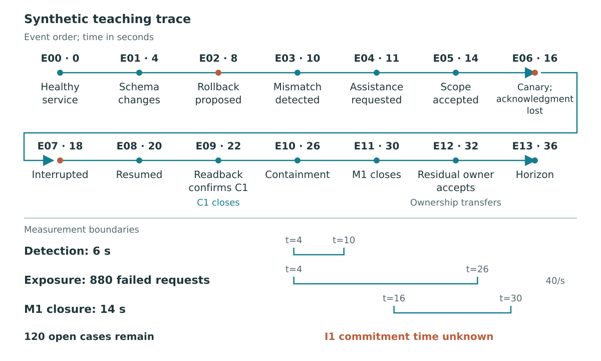
<figcaption><strong>The synthetic incident as an annotated timeline.</strong> Synthetic incident timeline, in event order with times in seconds. Detection spans t=4–10; failed-request exposure spans t=4–26 at 40/s; M1 closure spans t=16–30. C1 closure, containment, M1 closure and residual ownership transfer are distinct. The 120 open customer cases remain unresolved at the horizon; I1 commitment time and its individual closure latency are unknown.</figcaption>
</figure>

## 20.6 Evidence that changes the verdict

A command-accepted report at t=16 doesn’t establish parent mitigation M1’s completion. Declaring M1 complete there produces one parent-level false-closure event: the service predicate doesn’t hold until t=30. The support lead’s acceptance at t=32 also doesn’t settle the 120 open customer cases. Their ownership is valid and their settlement remains open. C1’s scoped completion at t=22 is a different claim and leaves M1 open. Table 14’s fourteen-second closure interval is for M1, not either child or customer-case settlement.

If independent readback at t=22 is missing, the canary effect remains unknown to the resumed system; retrying could duplicate the effect. If receipt sources conflict, keep the conflict unresolved until independent reconciliation. If divergence is known only within [4,7], detection at t=10 gives a latency interval of [3,6] seconds. Without a rate history, exposure is unknown even when delay can be bounded. If divergence goes undetected through t=36, report a censored detection time exceeding 32 seconds, not zero.

Extend the illustration through a separate branch with horizon t=44. Suppose a second incident occupies the support lead at t=38, the promised check produces no evidence by its t=40 deadline, and no fallback accepts the duty through t=44. The next-check obligation reopens at t=40. If no capable owner is available after t=38, record six seconds without an exercisable owner by t=44, alongside the still-open 120 cases. The earlier t=36 result remains correct within its horizon; this extension exposes a later capacity failure. Don’t merge the two horizons or reinterpret accepted ownership as settlement. If traffic stays at zero and its evidence remains valid, reopening the residual duty need not declare the mitigation’s physical effect undone. The first mitigation leaves 120 cases requiring later work; the separately arriving incident changes the support lead's availability. Preserve those as different contributors to the capacity problem. This branch illustrates how open duties can encounter reduced capacity after correct closure; it doesn’t establish that resolving the first incident caused the second or that prior maintenance would have prevented the gap.

The synthetic trace supports the stated calculations of pending work, accepted ownership and time without an exercisable owner under its assumptions. It doesn’t measure long-term changes in understanding, the total capacity needed for case settlement or the benefit of a maintenance policy. Those claims require additional observations and the operating-life comparisons proposed in Section 19.6.

<figure data-added-figure="F33">
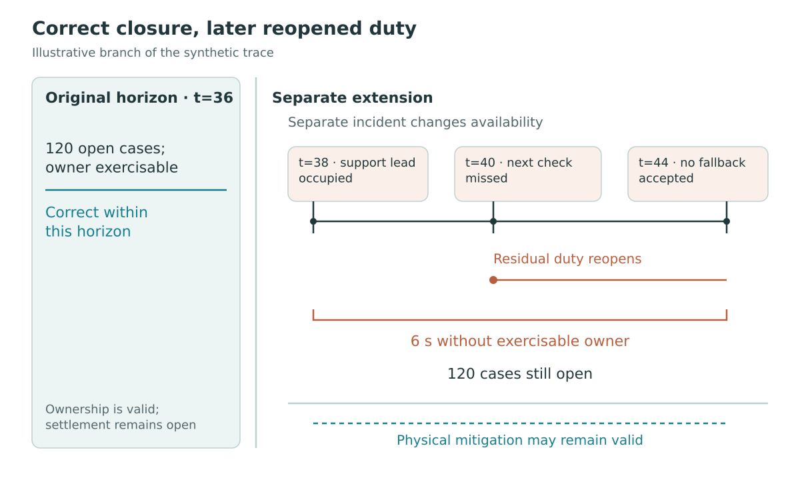
<figcaption><strong>Correct closure, later reopened duty.</strong> The original t=36 result remains correct within its horizon. In a separate illustrative extension, a second incident occupies the support lead at t=38; the missed t=40 check reopens the residual duty. No fallback accepts it through t=44, leaving six seconds without an exercisable owner and 120 cases still open. Physical mitigation may remain valid; the branch doesn’t imply that the first incident caused the second.</figcaption>
</figure>

In another branch, a correctly signed t=22 receipt falsely reports the intended deployment. If the service counter shares its compromised source, agreement can’t establish independent closure. A surviving independent observation may expose the discrepancy; without one, mark the relevant effect unresolved and evaluate any completion declaration against the declared evidence rule. These branches, the concurrent-isolation hazard and the intervention-deadline probe are specified counterexamples for future execution, not additional empirical findings.

Relabeling the internal authority and continuity fields leaves this trace’s profile unchanged. A conventional stateful workflow with the same external behavior and evidence must tie. This example supports an engineering decision to preserve pending effects across interruption, require readback before retry and retain residual ownership after visible recovery. It supplies no comparative effect estimate; that estimate comes from the repeated, fully retained trials in Section 19.

The same system may be strong on one profile and weak on another. Preserving those differences lets profiles inform architecture review, transition controls and implementation choices, subject to the comparisons in Section 19.

# 21 Conclusion

Consequential agentic capability is delivered through an operating arrangement. A model's contribution depends on the observations, tools, permissions, continuity, controls and people through which its outputs become action. The configured system is therefore the appropriate engineering object, assessed against a world that can disagree with its representations and continue changing while it works.

The framework asks whether the conditions supporting each consequential transition are adequate. It distinguishes current authority from nominal permission, recoverable state from usable continuity, execution from verified effects, and apparent closure from accepted ownership of residual work. These distinctions matter when a system must adapt, hand work across an interface or recover after its actions have changed the conditions it faces. A favorable endpoint alone can obscure invalid relations, propagated failures or rescue work that the account of performance has omitted.

The practical implications extend to what organizations deliver and maintain. Whole-configuration engineering makes operating dependencies part of the capability under assessment. Maintained delegation connects changing authority to task state, uncertain effects and continuing obligations. Human oversight becomes a commitment to competent, timely intervention, with preparation, context, authority and reserve included. Their integration suggests a continuing service for maintaining dependable delegation, while leaving its commercial feasibility for investigation.

Dependability also has a history. A task can change both the world it acts on and the arrangement that will perform the next task. Operation can strengthen or deplete competence, occupy or replenish usable capacity, and clear or accumulate obligations; some changes may be negligible within the declared horizon. Completed work and the conditions left for future work therefore need separate assessment, including how an intervention changes evidence coverage and how dependable support changes other actors' reasons to retain reserve. Such adaptation can enable useful specialization while changing the dependencies later work requires. Maintenance renews the evidence for affected claims, preserves opportunities for understanding and intervention, and assigns responsibility to actors who can exercise it across organizations. Narrowing, suspension, replacement and retirement address commitments that exceed currently supportable scope or outlast the configuration. Future evidence must establish which arrangements improve useful delivery and later capability, with their costs and tradeoffs retained.

These arguments don’t establish the effectiveness of a particular implementation. The illustrative cases and synthetic trace clarify the distinctions; the proposed comparisons must determine where they improve outcomes, where simpler variables suffice and where added controls cost more than they contribute. Evaluation should retain useful work, severe and concentrated consequences, displaced repair, intervention demands and maintenance costs in their relevant contexts. Compliance with a binding constraint and evidence that a chosen control improves outcomes require separate assessments.

Nor does an adequate operating relation settle the legitimacy of its purposes or the distribution of its effects. Those judgments need accountable institutions and opportunities for affected people to question the arrangement. The engineering contribution is to make the relevant dependencies, consequences and limits inspectable, including the work that crosses the chosen system boundary.

The four backward programs give that agenda concrete entry points: one inspectable external-effect decision, one justified resumption, one checked recovery mode and one bounded recurring maintenance loop. Automated recovery composition remains the mature goal of its program; manually supplied modes establish the checking machinery on which that goal depends. Expansion across interfaces, domains or customers must be earned separately, and the business proposition requires evidence beyond engineering success. A narrower implementation, or evidence favoring a simpler comparator, is a legitimate outcome of each program.

The resulting research and practice agenda concerns the continuing conditions under which consequential work can be entrusted to a configuration. Those conditions must support justified commitment, verified consequences, effective intervention and ownership of what remains unsettled. Maintaining them includes preserving the capacity to act well again, and recognizing when that capacity no longer supports the delegation being undertaken.

# References

[1] [Edwin Hutchins.](https://mitpress.mit.edu/9780262581462/cognition-in-the-wild/) [Cognition in the Wild](https://mitpress.mit.edu/9780262581462/cognition-in-the-wild/). MIT Press, 1995.

[2] [James Hollan, Edwin Hutchins, and David Kirsh. “](https://escholarship.org/uc/item/8sb9s5rm)[Distributed Cognition: Toward a New Foundation for Human-Computer Interaction Research](https://escholarship.org/uc/item/8sb9s5rm).” ACM Transactions on Computer-Human Interaction 7(2), 2000, 174–196.

[3] Lucy A. Suchman.  [Plans and Situated Actions: The Problem of Human-Machine Communication](https://ics.uci.edu/~dfredmil/inf233-FQ07/oldpapers/Suchman1987ch3.pdf). Cambridge University Press, 1987.

[4] [R. Peter Bonasso, R. James Firby, Erann Gat, David Kortenkamp, David P. Miller, and Mark G. Slack. “](https://www.researchgate.net/profile/David-Miller-121/publication/227293587_Experiences_with_an_architecture_for_intelligent_reactive_agents/links/53ee5bcd0cf23733e80dad8c/Experiences-with-an-architecture-for-intelligent-reactive-agents.pdf)[Experiences with an Architecture for Intelligent, Reactive Agents](https://www.researchgate.net/profile/David-Miller-121/publication/227293587_Experiences_with_an_architecture_for_intelligent_reactive_agents/links/53ee5bcd0cf23733e80dad8c/Experiences-with-an-architecture-for-intelligent-reactive-agents.pdf).” Journal of Experimental & Theoretical Artificial Intelligence 9(2–3), 1997, 237–256.

[5] [ISO/TS 5083:2025.](https://www.iso.org/standard/81920.html) [Road vehicles — Safety for automated driving systems — Design, verification and validation](https://www.iso.org/standard/81920.html).

[6] [Nick Webb et al. “](https://arxiv.org/abs/2011.00054)[Waymo’s Safety Methodologies and Safety Readiness Determinations](https://arxiv.org/abs/2011.00054).” arXiv:2011.00054, 2020.

[7] [Quentin de Chezelles et al. “](https://arxiv.org/abs/2602.11964)[Gaia2: Benchmarking LLM Agents on Dynamic and Asynchronous Environments](https://arxiv.org/abs/2602.11964).” arXiv:2602.11964, 2026.

[8] [Charles Packer et al. “](https://arxiv.org/abs/2310.08560)[MemGPT: Towards LLMs as Operating Systems](https://arxiv.org/abs/2310.08560).” arXiv:2310.08560, 2023.

[9] [Norbert Wiener.](https://electronicliteraturereview.org/downloads/PDF/Wiener_1948.pdf) [Cybernetics: Or Control and Communication in the Animal and the Machine](https://electronicliteraturereview.org/downloads/PDF/Wiener_1948.pdf). 1948; 2nd ed. 1961.

[10] [W.](https://ashby.info/intro.html) [Ross Ashby](https://ashby.info/intro.html)[.](https://ashby.info/intro.html) [An Introduction to Cybernetics](https://ashby.info/intro.html). Chapman & Hall, 1956.

[11] [Ruzena Bajcsy. “](https://doi.org/10.1109/5.5968)[Active Perception](https://doi.org/10.1109/5.5968).” Proceedings of the IEEE 76(8), 1988, 996–1005.

[12] [David Kirsh and Paul Maglio. “](https://doi.org/10.1207/s15516709cog1804_1)[On Distinguishing Epistemic from Pragmatic Action](https://doi.org/10.1207/s15516709cog1804_1).” Cognitive Science 18(4), 1994, 513–549.

[13] [Jiarui Lu et al. “](https://aclanthology.org/2025.findings-naacl.65/)[ToolSandbox: A Stateful, Conversational, Interactive Evaluation Benchmark for LLM Tool Use Capabilities](https://aclanthology.org/2025.findings-naacl.65/).” Findings of NAACL 2025.

[14] [ISO 34503:2023.](https://www.iso.org/standard/78952.html) [Road vehicles — Test scenarios for automated driving systems — Specification for operational design domain](https://www.iso.org/standard/78952.html).

[15] [Roger C. Conant and W. Ross Ashby. “](https://doi.org/10.1080/00207727008920220)[Every Good Regulator of a System Must Be a Model of That System](https://doi.org/10.1080/00207727008920220).” International Journal of Systems Science 1(2), 1970, 89–97.

[16] [Jens Rasmussen. “](https://doi.org/10.1016/S0925-7535(97)00052-0)[Risk Management in a Dynamic Society: A Modelling Problem](https://doi.org/10.1016/S0925-7535(97)00052-0).” Safety Science 27(2–3), 1997, 183–213.

[17] [Nancy G.](https://tile.loc.gov/storage-services/master/gdc/gdcebookspublic/20/20/71/92/47/2020719247/2020719247.pdf) [Leveson](https://tile.loc.gov/storage-services/master/gdc/gdcebookspublic/20/20/71/92/47/2020719247/2020719247.pdf)[.](https://tile.loc.gov/storage-services/master/gdc/gdcebookspublic/20/20/71/92/47/2020719247/2020719247.pdf) [Engineering a Safer World: Systems Thinking Applied to Safety](https://tile.loc.gov/storage-services/master/gdc/gdcebookspublic/20/20/71/92/47/2020719247/2020719247.pdf). MIT Press, 2012.

[18] [Ivan Perez, Anastasia Mavridou, Tom Pressburger, Alexander Will, and Patrick J. Martin. “](https://arxiv.org/abs/2209.14030)[Monitoring ROS2: from Requirements to Autonomous Robots](https://arxiv.org/abs/2209.14030).” arXiv:2209.14030, 2022.

[19] [J. Tanner Slagel et al. “](https://ntrs.nasa.gov/citations/20240007986)[A Verification Framework for Runtime Assurance of Autonomous UAS](https://ntrs.nasa.gov/citations/20240007986).” 43rd Digital Avionics Systems Conference, 2024.

[20] [Mica R. Endsley and Esin O. Kiris. “](https://doi.org/10.1518/001872095779064555)[The Out-of-the-Loop Performance Problem and Level of Control in Automation](https://doi.org/10.1518/001872095779064555).” Human Factors 37(2), 1995, 381–394.

[21] [Raja Parasuraman, Thomas B. Sheridan, and Christopher D. Wickens. “](https://www.cs.uml.edu/~holly/91.550/papers/sheridan-autonomy.pdf)[A Model for Types and Levels of Human Interaction with Automation](https://www.cs.uml.edu/~holly/91.550/papers/sheridan-autonomy.pdf).” IEEE Transactions on Systems, Man, and Cybernetics Part A 30(3), 2000, 286–297.

[22] [Stefanos Nikolaidis, Yu Xiang Zhu, David Hsu, and Siddhartha Srinivasa. “](https://pmc.ncbi.nlm.nih.gov/articles/PMC6563347/)[Human-Robot Mutual Adaptation in Shared Autonomy](https://pmc.ncbi.nlm.nih.gov/articles/PMC6563347/).” HRI 2017, 294–302.

[23] [Dimitris Panagopoulos et al. “](https://arxiv.org/abs/2211.14095)[A Hierarchical Variable Autonomy Mixed-Initiative Framework for Human-Robot Teaming in Mobile Robotics](https://arxiv.org/abs/2211.14095).” arXiv:2211.14095, 2022.

[24] [Kexin Liang, Simeon C. Calvert, and J. W. C. van Lint. “](https://journals.sagepub.com/doi/10.1177/00187208261456057)[Towards Safe and Comfortable Vehicle Control Transitions: A Systematic Review of Takeover Time, Time Budget, and Takeover Outcomes](https://journals.sagepub.com/doi/10.1177/00187208261456057).” Human Factors, 2026.

[25] [丸居怜央; 柳川小次郎; 向殿政男. “](https://www.jstage.jst.go.jp/article/fss/22/0/22_0_71/_article/-char/ja)[継続的認可による多段階アクセス制御モデルの提案](https://www.jstage.jst.go.jp/article/fss/22/0/22_0_71/_article/-char/ja).” 第22回ファジィシステムシンポジウム, 2006. DOI 10.14864/fss.22.0.71.0. [Proposal of a Multi-Stage Access-Control Model Based on Continuous Authorization]

[26] [М. В. Баклановский; А. Р. Ханов. “](https://ntv.ifmo.ru/file/article/16180.pdf)[Динамическая авторизация на основе истории новостных сообщений](https://ntv.ifmo.ru/file/article/16180.pdf).” Научно-технический вестник информационных технологий, механики и оптики 16(6), 2016, 1091–1095. DOI 10.17586/2226-1494-2016-16-6-1091-1095. [Dynamic Authorization Based on the History of Events]

[27] [France.](https://www.legifrance.gouv.fr/codes/article_lc/LEGIARTI000043734839/2024-03-24) [Code de la route, Article R311-1-1](https://www.legifrance.gouv.fr/codes/article_lc/LEGIARTI000043734839/2024-03-24). Dated 2024-03-24 text; operational definitions effective 2021-07-02. [French Road Code: Operational Definitions for Automated Driving]

[28] [Gal Dalal et al. “](https://arxiv.org/abs/1801.08757)[Safe Exploration in Continuous Action Spaces](https://arxiv.org/abs/1801.08757).” arXiv:1801.08757, 2018.

[29] [U.S.](https://www.nhtsa.gov/document/automated-driving-systems-20-voluntary-guidance) [Department of Transportation / NHTSA](https://www.nhtsa.gov/document/automated-driving-systems-20-voluntary-guidance)[.](https://www.nhtsa.gov/document/automated-driving-systems-20-voluntary-guidance) [Automated Driving Systems 2.0: A Vision for Safety](https://www.nhtsa.gov/document/automated-driving-systems-20-voluntary-guidance). 2017.

[30] [Shai Shalev-Shwartz, Shaked Shammah, and Amnon Shashua. “](https://arxiv.org/abs/1708.06374)[On a Formal Model of Safe and Scalable Self-driving Cars](https://arxiv.org/abs/1708.06374).” arXiv:1708.06374, 2017.

[31] [UL 4600, Edition 3 (2023).](https://www.shopulstandards.com/ProductDetail.aspx?productId=UL4600_3_S_20230317) [Standard for Evaluation of Autonomous Products](https://www.shopulstandards.com/ProductDetail.aspx?productId=UL4600_3_S_20230317).

[32] [Yixin Wang / AgentRewind authors. “](https://arxiv.org/abs/2608.14380)[AgentRewind: Recoverable Execution for Long-Horizon LLM Agents](https://arxiv.org/abs/2608.14380).” arXiv:2608.14380, 2026.

[33] [Tianyu Luo et al. “](https://arxiv.org/abs/2610.01415)[Beyond Memory: Harnessing Long-Horizon Agents with Explicit Belief States](https://arxiv.org/abs/2610.01415).” arXiv:2610.01415, 2026.

[34] [Haoran Jiang et al. “](https://proceedings.mlr.press/v306/jiang26as.html)[AgentLAB: Benchmarking LLM Agents against Long-Horizon Attacks](https://proceedings.mlr.press/v306/jiang26as.html).” ICML 2026.

[35] [Yuan Zhao et al. “](https://proceedings.mlr.press/v306/zhao26bs.html)[AMA-Bench: Evaluating Long-Horizon Memory for Agentic Applications](https://proceedings.mlr.press/v306/zhao26bs.html).” ICML 2026.

[36] [R. Peter Bonasso, David Kortenkamp, and Troy Whitney. “](https://cdn.aaai.org/IAAI/1997/IAAI97-193.pdf)[Using a Robot Control Architecture to Automate Space Shuttle Operations](https://cdn.aaai.org/IAAI/1997/IAAI97-193.pdf).” IAAI 1997.

[37] [Ola Pettersson. “](https://www.researchgate.net/publication/222694992_Execution_monitoring_in_robotics_A_survey)[Execution Monitoring in Robotics: A Survey](https://www.researchgate.net/publication/222694992_Execution_monitoring_in_robotics_A_survey).” Robotics and Autonomous Systems 53(2), 2005, 73–88.

[38] [藤田恵; 片山寛子; 小島侑子; 新出尚之. “](https://www.jstage.jst.go.jp/article/pjsai/JSAI2010/0/JSAI2010_2E44/_article/-char/ja)[動的環境におけるBDIベースのロボットの再プランニングによる再行動決定法](https://www.jstage.jst.go.jp/article/pjsai/JSAI2010/0/JSAI2010_2E44/_article/-char/ja).” 2010年度人工知能学会全国大会. DOI 10.11517/pjsai.JSAI2010.0_2E44. [Re-Action Decision by Replanning for a BDI-Based Robot in a Dynamic Environment]

[39] [Dongsheng Zhu et al. “](https://arxiv.org/abs/2606.05806)[When Tools Fail: Benchmarking Dynamic Replanning and Anomaly Recovery in LLM Agents](https://arxiv.org/abs/2606.05806).” arXiv:2606.05806, 2026.

[40] [Dylan Hadfield-Menell, Anca Dragan, Pieter Abbeel, and Stuart Russell. “](https://proceedings.neurips.cc/paper_files/paper/2016/hash/c3395dd46c34fa7fd8d729d8cf88b7a8-Abstract.html)[Cooperative Inverse Reinforcement Learning](https://proceedings.neurips.cc/paper_files/paper/2016/hash/c3395dd46c34fa7fd8d729d8cf88b7a8-Abstract.html).” NeurIPS 2016.

[41] [Marta Lagomarsino et al. “](https://www.annualreviews.org/content/journals/10.1146/annurev-control-022624-013624)[Intuitive Programming, Adaptive Task Planning, and Dynamic Role Allocation in Human–Robot Collaboration](https://www.annualreviews.org/content/journals/10.1146/annurev-control-022624-013624).” Annual Review of Control, Robotics, and Autonomous Systems 9, 2026, 47–74.

[42] [David D. Woods. “](https://doi.org/10.1016/j.ress.2015.03.018)[Four Concepts for Resilience and the Implications for the Future of Resilience Engineering](https://doi.org/10.1016/j.ress.2015.03.018).” Reliability Engineering & System Safety 141, 2015, 5–9.

[43] [С. Д. Земляков; В. Ю. Рутковский; А. В. Силаев. “](https://www.mathnet.ru/at3114)[Реконфигурация систем управления летательными аппаратами при отказах](https://www.mathnet.ru/at3114).” Автоматика и телемеханика, 1996, № 1, 3–20. [Reconfiguration of Aircraft Control Systems under Failures]

[44] [Marie-Odile Cordier; Yannick Pencolé; Louise Travé-Massuyès; Thierry Vidal. “](https://homepages.laas.fr/ypencole/papers/cordier_2008_refid6.pdf)[Caractérisation des systèmes autoguérissants : diagnostiquer ce que l’on peut réparer](https://homepages.laas.fr/ypencole/papers/cordier_2008_refid6.pdf).” Revue I3 – Information Interaction Intelligence 8(2), 2009. [Characterizing Self-Healing Systems: Diagnose What You Can Repair]

[45] [Isabella Liu et al. “](https://arxiv.org/abs/2610.01178)[Recova: Agent-Guided Failure Recovery for Autonomous Robotic Manipulation](https://arxiv.org/abs/2610.01178).” arXiv:2610.01178, 2026.

[46] [Peiyuan Zhi; Zhiyuan Zhang; Yu Zhao; Muzhi Han; Zeyu Zhang; Zhitian Li; Ziyuan Jiao; Baoxiong Jia; Siyuan Huang. “](https://ieeexplore.ieee.org/document/11127975/)[Closed-Loop Open-Vocabulary Mobile Manipulation with GPT-4V](https://ieeexplore.ieee.org/document/11127975/).” ICRA 2025. Author version arXiv:2404.10220v2.

[47] [Flavien Balbo; Amal El Fallah-Seghrouchni; Suzanne Pinson. “](https://hal.science/hal-03689053)[Coordination d'actions par planification multi-agent](https://hal.science/hal-03689053).” In Organisation et Applications des Systèmes Multi-Agents, Hermès, 2002, 93–108. [Coordination of Actions through Multi-Agent Planning]

[48] [Franz Albers; Khazar Dargahi Nobari; Jan Braun; Katharina Bartsch; Torsten Bertram. “](https://doi.org/10.1007/s10010-021-00547-x)[Koordination von Übernahmemanövern beim hochautomatisierten Fahren unter Berücksichtigung der Fahrerverfügbarkeit](https://doi.org/10.1007/s10010-021-00547-x).” Forschung im Ingenieurwesen 86 (2022): 35–48. [Coordination of Takeover Maneuvers in Highly Automated Driving Considering Driver Availability]

[49] [ISO 34505:2025.](https://www.iso.org/cms/live/live/en/sites/isoorg/contents/data/standard/07/89/78954.html) [Road vehicles — Test scenarios for automated driving systems — Scenario evaluation and test case generation](https://www.iso.org/cms/live/live/en/sites/isoorg/contents/data/standard/07/89/78954.html).

[50] [Tianbao Xie et al. “](https://arxiv.org/abs/2404.07972)[OSWorld: Benchmarking Multimodal Agents for Open-Ended Tasks in Real Computer Environments](https://arxiv.org/abs/2404.07972).” NeurIPS 2024.

[51] [Chen Qian, Jingbin Xu, Xin Xing, et al. “](https://www.nature.com/articles/s41467-026-69675-8)[Test Case Sampling Optimization for Safety Validation of Automated Driving Systems](https://www.nature.com/articles/s41467-026-69675-8).” Nature Communications 17, 3114 (2026).

[52] [高镇海; 郑程元; 赵睿. “](https://cjournal.hep.com.cn/1671-5497/CN/1159961710376444514)[真实与虚拟场景下自动驾驶车辆的主动安全性验证与确认综述](https://cjournal.hep.com.cn/1671-5497/CN/1159961710376444514).” 吉林大学学报(工学版) 55(4), 2025, 1142–1162. DOI 10.13229/j.cnki.jdxbgxb.20230920. [Review of Active-Safety Verification and Validation for Autonomous Vehicles in Real and Virtual Scenarios]

[53] [천현득. “](https://www.kci.go.kr/kciportal/ci/sereArticleSearch/ciSereArtiView.kci?sereArticleSearchBean.artiId=ART001627261)[분산된 인지와 비확장적 마음](https://www.kci.go.kr/kciportal/ci/sereArticleSearch/ciSereArtiView.kci?sereArticleSearchBean.artiId=ART001627261).” 과학철학 14(2) (2011): 121–140. [Distributed Cognition and the Non-Extended Mind]

[54] [Federico Boem. “](https://doi.org/10.4453/rifp.2021.0024)[La mente estesa ma individuata: una prospettiva simbiotica](https://doi.org/10.4453/rifp.2021.0024).” Rivista Internazionale di Filosofia e Psicologia 12(3) (2021): 254–270. DOI 10.4453/rifp.2021.0024. [The Extended but Individuated Mind: A Symbiotic Perspective]

[55] [周国梅; 傅小兰. “](https://journal.psych.ac.cn/xlkxjz/CN/Y2002/V10/I2/147)[分布式认知——一种新的认知观点](https://journal.psych.ac.cn/xlkxjz/CN/Y2002/V10/I2/147).” 心理科学进展 10(2), 2002, 147–153. [Distributed Cognition—A New Cognition Perspective]

[56] [罗霄峰; 李琳; 罗万伯. “](https://jsuese.scu.edu.cn/zh/article/doi/10.15961/j.jsuese.2013.04.012/)[周境有关的使用控制研究](https://jsuese.scu.edu.cn/zh/article/doi/10.15961/j.jsuese.2013.04.012/).” 工程科学与技术 45(4), 2013, 103–110. DOI 10.15961/j.jsuese.2013.04.012. [Context-Aware Usage Control Research]

[57] [山本由香理; 飯島正. “](https://www.jstage.jst.go.jp/article/proceedingsissj/5/0/5_D1-2/_article/-char/ja)[電子カルテのためのポリシに基づく動的アクセス制御](https://www.jstage.jst.go.jp/article/proceedingsissj/5/0/5_D1-2/_article/-char/ja).” 情報システム学会全国大会論文集 5, 2009, D1-2. [Policy-Based Dynamic Access Control for Electronic Medical Records]

[58] [Stéphane Mercier; Catherine Tessier; Frédéric Dehais. “](https://doi.org/10.3166/ria.24.325-356)[Détection et résolution de conflits d'autorité dans un système homme-robot](https://doi.org/10.3166/ria.24.325-356).” Revue d’Intelligence Artificielle 24(3), 2010, 325–356. DOI 10.3166/ria.24.325-356. [Detection and Resolution of Authority Conflicts in a Human–Robot System]

[59] [中島秀之. “](https://doi.org/10.11225/jcssadv.701)[認知の状況依存性と分散認知](https://doi.org/10.11225/jcssadv.701).” 認知科学の発展 7, 1994, 1–4. DOI 10.11225/jcssadv.701. [Situated and Distributed Cognition]

[60] [李纪伟; 王润民; 朱宇; 承靖钧; 赵祥模. “](https://www.china-simulation.com/CN/10.16182/j.issn1004731x.joss.25-1067)[自动驾驶测试场景可信性评价指标体系综述](https://www.china-simulation.com/CN/10.16182/j.issn1004731x.joss.25-1067).” 系统仿真学报 38(9), 2026, 2464–2485. DOI 10.16182/j.issn1004731x.joss.25-1067. [Review of Evaluation Metrics for the Credibility of Autonomous-Driving Test Scenarios]

[61] [庄司文武; 吉田雄紀. “](https://www.jstage.jst.go.jp/article/pjsai/JSAI2025/0/JSAI2025_3Win556/_article/-char/ja/)[OSWorld-JP：言語を考慮した評価のための日本語版コンピュータユースベンチマーク](https://www.jstage.jst.go.jp/article/pjsai/JSAI2025/0/JSAI2025_3Win556/_article/-char/ja/).” 2025年度人工知能学会全国大会. DOI 10.11517/pjsai.JSAI2025.0_3Win556. [OSWorld-JP: Japanese Computer-Use Benchmark for Language-Aware Evaluation]

[62] [张勤俭; 刘洋; 崔新男; 杜健; 李金泽; 王九龙; 郭娜; 宋洪庆. “](https://cje.ustb.edu.cn/article/doi/10.13374/j.issn2095-9389.2026.06.09.003)[具身智能长程机器人操作综述：挑战、机制与评价](https://cje.ustb.edu.cn/article/doi/10.13374/j.issn2095-9389.2026.06.09.003).” 工程科学学报, 2026, latest accepted. DOI 10.13374/j.issn2095-9389.2026.06.09.003. [Long-Horizon Robotic Manipulation in Embodied Intelligence: Challenges, Mechanisms, and Evaluation]

[63] [윤하나. “](https://www.kci.go.kr/kciportal/ci/sereArticleSearch/ciSereArtiView.kci?sereArticleSearchBean.artiId=ART003317901)[기억의 공학적 합리성: 인공지능 에이전트 메모리 설계에 대한 비판적 고찰](https://www.kci.go.kr/kciportal/ci/sereArticleSearch/ciSereArtiView.kci?sereArticleSearchBean.artiId=ART003317901).” 미디어, 젠더 & 문화 41(1) (2026): 53–92. [The Engineering Rationality of Memory: A Critical Examination of AI-Agent Memory Design]

[64] [박명옥; 손준우. “](https://doi.org/10.7467/KSAE.2019.27.4.309)[조건부 자율주행자동차(Level 3)의 제어권 전환 안전성 평가를 위한 기준 시나리오 개발](https://doi.org/10.7467/KSAE.2019.27.4.309).” 한국자동차공학회 논문집 27(4) (2019): 309–317. DOI 10.7467/KSAE.2019.27.4.309. [Reference Scenarios for Safety Evaluation of Control Transition in Level-3 Automated Vehicles]

[65] [박성호; 이경진; 윤정은; 김예진; 윤일수. “](https://doi.org/10.12815/kits.2023.22.6.246)[조건부 자율주행시 주행환경 변화에 따른 제어권 전환 안정화 시간 영향 분석](https://doi.org/10.12815/kits.2023.22.6.246).” 한국ITS학회 논문지 22(6) (2023): 246–263. DOI 10.12815/kits.2023.22.6.246. [Effects of Driving-Environment Change on Stabilization Time during Control Transition in Conditional Automated Driving]

[66] [Andreas Lars Müller; Bettina Abendroth. “](https://doi.org/10.1007/s41449-021-00295-2)[Übernahmeaufforderungen beim hochautomatisierten Fahren mit fahrfremden Tätigkeiten – welche Modalitäten sind geeignet?](https://doi.org/10.1007/s41449-021-00295-2)” Zeitschrift für Arbeitswissenschaft 76 (2022): 344–354. [Takeover Requests in Highly Automated Driving with Non-Driving Tasks]

[67] [Hardi Hungar; Frank Köster. “](https://elib.dlr.de/125272/)[Formalisierung von Szenario-Klassen zur Absicherung automatisierter Fahrfunktionen](https://elib.dlr.de/125272/).” In AAET 2018: Automatisiertes und vernetztes Fahren, 97–114. [Formalization of Scenario Classes for Assuring Automated Driving Functions]

[68] [강동효; 김인영; 조성우; 윤일수. “](https://doi.org/10.12815/kits.2023.22.6.230)[자율주행자동차 평가를 위한 다중 시나리오 변환과 시뮬레이션 기반 평가 방법](https://doi.org/10.12815/kits.2023.22.6.230).” 한국ITS학회 논문지 22(6) (2023): 230–245. DOI 10.12815/kits.2023.22.6.230. [Multi-Scenario Transformation and Simulation-Based Evaluation for Autonomous Vehicles]

[69] [박성호; 정하림; 김예진; 이명수; 한음. “](https://doi.org/10.12815/kits.2021.20.6.264)[자율주행자동차 주행안전성 확보를 위한 딜레마 상황 정의 및 운전 전략 도출](https://doi.org/10.12815/kits.2021.20.6.264).” 한국ITS학회 논문지 20(6) (2021): 264–279. DOI 10.12815/kits.2021.20.6.264. [Defining Dilemma Situations and Deriving Driving Strategies for Autonomous-Vehicle Safety]

[70] [안대룡; 신성근; 백윤석; 이혁기; 박기홍; 최인성. “](https://doi.org/10.12815/kits.2019.18.2.129)[STPA를 활용한 자율주행자동차의 시뮬레이션 기반 오류 주입 시나리오 및 안전조치 시간 연구](https://doi.org/10.12815/kits.2019.18.2.129).” 한국ITS학회 논문지 18(2) (2019): 129–143. DOI 10.12815/kits.2019.18.2.129. [STPA-Based Simulation Fault-Injection Scenarios and Safety-Action Timing for Autonomous Vehicles]

[71] [국윤영; 이경수. “](https://doi.org/10.22680/kasa2023.15.2.006)[자율주행 차량의 실도로 주행을 위한 안전 시나리오 기반 인간중심 시스템 성능평가](https://doi.org/10.22680/kasa2023.15.2.006).” 자동차안전학회지 15(2) (2023): 6–12. DOI 10.22680/kasa2023.15.2.006. [Human-Centered System Performance Evaluation Based on Safety Scenarios for Real-Road Autonomous Driving]

[72] [Sven Kardatzke.](https://elib.dlr.de/202952/) [Laufzeitüberwachung neuronaler Netze für die kameragestützte Umgebungswahrnehmung autonomer Drohnen](https://elib.dlr.de/202952/). Masterarbeit, Hochschule Osnabrück / DLR, 2023. [Runtime Monitoring of Neural Networks for Camera-Based Environment Perception of Autonomous Drones]

[73] [Simone Incerti.](https://unire.unige.it/handle/123456789/16467?locale-attribute=it) [Architettura di sistema basata su VLM per il riconoscimento e la caratterizzazione in tempo reale degli scenari di guida](https://unire.unige.it/handle/123456789/16467?locale-attribute=it). Tesi magistrale, Università di Genova, 17 July 2026. [VLM-Based System Architecture for Real-Time Recognition and Characterization of Driving Scenarios]

[74] [고우리; 남두희; 김수희; 윤일수. “](https://doi.org/10.12815/kits.2025.24.3.194)[자율주행차 안전성 확보를 위한 실도로 데이터 기반 시나리오 평가 접근법](https://doi.org/10.12815/kits.2025.24.3.194).” 한국ITS학회 논문지 24(3) (2025): 194–211. DOI 10.12815/kits.2025.24.3.194. [A Real-Road-Data-Based Scenario Evaluation Approach for Autonomous-Vehicle Safety]

[75] [Giorgia Baiardo.](https://unire.unige.it/handle/123456789/16478?locale-attribute=it) [ScenWeave: Generazione Retrieval-Augmented di Scenari CARLA Eseguibili](https://unire.unige.it/handle/123456789/16478?locale-attribute=it). Tesi magistrale, Università di Genova, 17 July 2026. [ScenWeave: Retrieval-Augmented Generation of Executable CARLA Scenarios]

[76] [Julian Fuchs.](https://publikationen.bibliothek.kit.edu/1000191589) [Methoden zur Ermittlung der Aussagekraft eines Logischen Szenarios im Absicherungs- und Freigabeprozess einer hochautomatisierten Fahrfunktion](https://publikationen.bibliothek.kit.edu/1000191589). Dissertation, KIT, 2026. [Methods for Determining the Evidential Power of a Logical Scenario in Assurance and Release]

[77] [Johannes Plaum.](https://publikationen.bibliothek.kit.edu/1000189719) [Freigabeargumentation hochautomatisierter Nutzfahrzeuge im Vergleich zum menschlichen Fahrer](https://publikationen.bibliothek.kit.edu/1000189719). Dissertation, KIT, 2026. [Release Argumentation for Highly Automated Commercial Vehicles Compared with the Human Driver]

[78] [brian ichter et al. “](https://proceedings.mlr.press/v205/ahn23a.html)[Do As I Can, Not As I Say: Grounding Language in Robotic Affordances](https://proceedings.mlr.press/v205/ahn23a.html).” Proceedings of The 6th Conference on Robot Learning, PMLR 205, 2023, 287–318. Preprint: Michael Ahn et al., arXiv:2204.01691v2, 2022; author order differs by edition.

[79] [Pierre-Yves Oudeyer and Frederic Kaplan. “](https://doi.org/10.3389/neuro.12.006.2007)[What Is Intrinsic Motivation? A Typology of Computational Approaches](https://doi.org/10.3389/neuro.12.006.2007).” Frontiers in Neurorobotics 1:6, 2007.

[80] [Mariana Brussoni et al. “](https://doi.org/10.3390/ijerph9093134)[Risky Play and Children’s Safety: Balancing Priorities for Optimal Child Development](https://doi.org/10.3390/ijerph9093134).” International Journal of Environmental Research and Public Health 9(9), 2012, 3134–3148.

[81] [Erik Wienecke.](https://elib.dlr.de/227034/) [Entwicklung, Integration und simulative Bewertung einer Entscheidungs- und Trajektorienplanung zur Umfahrung von Hindernissen in urbanen Szenarien für automatisierte Fahrzeuge](https://elib.dlr.de/227034/). Masterarbeit, TU Berlin / DLR, 2026. [Development, Integration and Simulation-Based Evaluation of Decision and Trajectory Planning for Obstacle Avoidance]

[82] [Bennet Santelmann. “](https://doi.org/10.1365/s40702-026-01311-x)[Governance für KI-Agenten: Ein risikobasierte Perspektive für Transparenz und Nachvollziehbarkeit](https://doi.org/10.1365/s40702-026-01311-x).” HMD, published 30 July 2026. [Governance for AI Agents: A Risk-Based Perspective on Transparency and Traceability]

[83] [Patrick Hiske; Varinia Wittholz; Susanne Robra-Bissantz. “](https://doi.org/10.1365/s40702-026-01298-5)[Vertrauen ist kein Feature: Fünf Gestaltungsempfehlungen für autonome KI-Agenten](https://doi.org/10.1365/s40702-026-01298-5).” HMD, published 29 June 2026. [Trust Is Not a Feature: Five Design Recommendations for Autonomous AI Agents]

[84] [Nico Kling; Vivien Bender; Hendrik Reese. “](https://doi.org/10.1365/s40702-026-01319-3)[Bounded Autonomy – Vier Prinzipien für die Governance von KI-Agenten aus der Beratungspraxis](https://doi.org/10.1365/s40702-026-01319-3).” HMD, published 12 August 2026. [Bounded Autonomy – Four Principles for AI-Agent Governance from Consulting Practice]

[85] [Andy Clark and David Chalmers. “](https://doi.org/10.1093/analys/58.1.7)[The Extended Mind](https://doi.org/10.1093/analys/58.1.7).” Analysis 58(1), 1998, 7–19.

[86] [이영의. “](https://doi.org/10.17325/sgjp.2012.31..29)[확장된 마음 이론의 쟁점들](https://doi.org/10.17325/sgjp.2012.31..29).” 철학논집 31 (2012): 29–54. DOI 10.17325/sgjp.2012.31..29. [Issues in the Theory of the Extended Mind]

[87] [이영의. “](https://www.kci.go.kr/kciportal/ci/sereArticleSearch/ciSereArtiView.kci?sereArticleSearchBean.artiId=ART001539331)[확장된 마음 가설에 대한 변호](https://www.kci.go.kr/kciportal/ci/sereArticleSearch/ciSereArtiView.kci?sereArticleSearchBean.artiId=ART001539331).” 범한철학 60(1) (2011): 185–204. [A Defense of the Extended-Mind Hypothesis]

[88] [Humberto R.](https://monoskop.org/images/3/35/Maturana_Humberto_Varela_Francisco_Autopoiesis_and_Congition_The_Realization_of_the_Living.pdf) [Maturana and Francisco J](https://monoskop.org/images/3/35/Maturana_Humberto_Varela_Francisco_Autopoiesis_and_Congition_The_Realization_of_the_Living.pdf)[. Varela.](https://monoskop.org/images/3/35/Maturana_Humberto_Varela_Francisco_Autopoiesis_and_Congition_The_Realization_of_the_Living.pdf) [Autopoiesis and Cognition: The Realization of the Living](https://monoskop.org/images/3/35/Maturana_Humberto_Varela_Francisco_Autopoiesis_and_Congition_The_Realization_of_the_Living.pdf). 1980.

[89] [Francisco J.](https://monoskop.org/images/2/21/Varela_Thompson_Rosch_The_Embodied_Mind_Cognitive_Science_and_Human_Experience_1991.pdf) [Varela, Evan Thompson, and Eleanor Rosch](https://monoskop.org/images/2/21/Varela_Thompson_Rosch_The_Embodied_Mind_Cognitive_Science_and_Human_Experience_1991.pdf)[.](https://monoskop.org/images/2/21/Varela_Thompson_Rosch_The_Embodied_Mind_Cognitive_Science_and_Human_Experience_1991.pdf) [The Embodied Mind: Cognitive Science and Human Experience](https://monoskop.org/images/2/21/Varela_Thompson_Rosch_The_Embodied_Mind_Cognitive_Science_and_Human_Experience_1991.pdf). MIT Press, 1991; revised ed. 2017.

[90] [Mica R. Endsley. “](https://www.researchgate.net/publication/345054061_Toward_a_Theory_of_Situation_Awareness_in_Dynamic_Systems)[Toward a Theory of Situation Awareness in Dynamic Systems](https://www.researchgate.net/publication/345054061_Toward_a_Theory_of_Situation_Awareness_in_Dynamic_Systems).” Human Factors 37(1), 1995, 32–64.

[91] [Mike Scaife and Yvonne Rogers. “](https://www.sussex.ac.uk/informatics/cogslib/reports/csrp/csrp335.pdf)[External Cognition: How Do Graphical Representations Work?](https://www.sussex.ac.uk/informatics/cogslib/reports/csrp/csrp335.pdf)” International Journal of Human-Computer Studies 45(2), 1996, 185–213.

[92] [Д.](https://djvu.online/file/zWa7ZfJJQsupX) [А](https://djvu.online/file/zWa7ZfJJQsupX)[. Поспелов.](https://djvu.online/file/zWa7ZfJJQsupX) [Ситуационное управление: теория и практика](https://djvu.online/file/zWa7ZfJJQsupX). М.: Наука, 1986. 288 с. [Situational Control: Theory and Practice]

[93] [Martin Pellkofer.](https://athene-forschung.unibw.de/85311) [Verhaltensentscheidung für autonome Fahrzeuge mit Blickrichtungssteuerung](https://athene-forschung.unibw.de/85311). Dissertation, Universität der Bundeswehr München, 2003. [Behavior Decision for Autonomous Vehicles with Gaze-Direction Control]

[94] [Lisanne Bainbridge. “](https://doi.org/10.1016/0005-1098(83)90046-8)[Ironies of Automation](https://doi.org/10.1016/0005-1098(83)90046-8).” Automatica 19(6), 1983, 775–779.

[95] [Automated Vehicle Safety Consortium.](https://avsc.sae-itc.com/publication/avsc-07-2026) [AVSC Best Practice for ADS Remote Assistance Training and Human Factors, AVSC-I-07-2026](https://avsc.sae-itc.com/publication/avsc-07-2026). 2026.

[96] [Haojie Zhang, Chuankai Liu, Yikang Liu, and Qing Li. “](https://www.sciencedirect.com/science/article/abs/pii/S0921889026001405)[Shared Control for Autonomous Robotic Navigation: A Review](https://www.sciencedirect.com/science/article/abs/pii/S0921889026001405).” Robotics and Autonomous Systems, 2026, 105467.

[97] [Paul Scerri, David V. Pynadath, and Milind Tambe. “](https://doi.org/10.1613/jair.1037)[Towards Adjustable Autonomy for the Real World](https://doi.org/10.1613/jair.1037).” Journal of Artificial Intelligence Research 17, 2002, 171–228.

[98] [UNECE.](https://eur-lex.europa.eu/eli/reg/2021/389/oj) [UN Regulation No. 157 — Automated Lane Keeping Systems (ALKS)](https://eur-lex.europa.eu/eli/reg/2021/389/oj). Original 2021 approval text, reproduced in Commission publication 2021/389; later consolidated amendment currency not asserted.

[99] [Joon Sung Park et al. “](https://doi.org/10.1145/3586183.3606763)[Generative Agents: Interactive Simulacra of Human Behavior](https://doi.org/10.1145/3586183.3606763).” UIST 2023.

[100] [Е. Н. Вейбер; М. А. Грудинин; Т. В. Тулупьева; А. А. Вяткин. “](https://spb.ranepa.ru/wp-content/uploads/2026/05/ac_26_2.pdf)[Границы применимости ИИ в государственном управлении: Память LLM-агентов vs память человека](https://spb.ranepa.ru/wp-content/uploads/2026/05/ac_26_2.pdf).” Управленческое консультирование, 2026, № 2, 54–67. EDN XKGYNH. [Limits of AI Applicability in Public Administration: Memory of LLM Agents vs Human Memory]

[101] [Valmi Dufour-Lussier; Alice Hermann; Florence Le Ber; Jean Lieber. “](https://hal.science/hal-01093977)[Révision des croyances dans la clôture propositionnelle d'une algèbre qualitative](https://hal.science/hal-01093977).” JIAF 2014, Angers. [Belief Revision in the Propositional Closure of a Qualitative Algebra]

[102] [刘一松; 桑丘; 刘朗宇. “](https://www.joca.cn/EN/Y2010/V30/I07/1892)[智能体行动推理中的信念修正](https://www.joca.cn/EN/Y2010/V30/I07/1892).” 计算机应用 30(7), 2010, 1892–1895. [Belief Revision in Intelligent-Agent Action Reasoning]

[103] [Jens Rasmussen. “](https://www.scribd.com/document/398320325/SkillsRulesAndKnowledge-Rasmussen-pdf)[Skills, Rules, and Knowledge; Signals, Signs, and Symbols, and Other Distinctions in Human Performance Models](https://www.scribd.com/document/398320325/SkillsRulesAndKnowledge-Rasmussen-pdf).” IEEE Transactions on Systems, Man, and Cybernetics 13(3), 1983, 257–266.

[104] [Philipp Keßler.](https://doi.org/10.26083/tuprints-00020882) [Fehlertolerante mechatronische Aktorsysteme mit Realisierung einer elektrischen Duplex-Servolenkung](https://doi.org/10.26083/tuprints-00020882). Dissertation, TU Darmstadt, 2022. [Fault-Tolerant Mechatronic Actuator Systems with an Electric Duplex Steering Implementation]

[105] [Marco Facco.](https://hdl.handle.net/20.500.12608/68811) [Analisi del framework ROS-Plan per pianificare e adattare le azioni di un robot autonomo](https://hdl.handle.net/20.500.12608/68811). Tesi, Università di Padova, 2023/24. [Analysis of ROSPlan for Planning and Adapting the Actions of an Autonomous Robot]

[106] [강민석; 박상현; 김무림. “](https://doi.org/10.7746/jkros.2025.20.3.429)[자율 로봇 제조를 위한 계층적 작업 인식 프레임워크](https://doi.org/10.7746/jkros.2025.20.3.429).” 로봇학회 논문지 20(3) (2025): 429–440. DOI 10.7746/jkros.2025.20.3.429. [Hierarchical Task-Recognition Framework for Autonomous Robotic Manufacturing]

[107] [М. А. Ровбо; Е. Е. Овсянникова. “](https://www.mathnet.ru/iipr163)[Методы локального планирования поведения агентов с BDI-архитектурой](https://www.mathnet.ru/iipr163).” Искусственный интеллект и принятие решений, 2019, № 1, 74–86. DOI 10.14357/20718594190107. [Methods of Local Behavior Planning for BDI-Architecture Agents]

[108] [Niklas Grabbe. “](https://doi.org/10.1007/s41449-025-00495-0)[Gestaltung resilienter Verkehrssysteme: Funktionale Musteranalyse von Mensch–Automation-Interaktionen im Mischverkehr](https://doi.org/10.1007/s41449-025-00495-0).” Zeitschrift für Arbeitswissenschaft 79 (2025): 616–628. [Designing Resilient Transport Systems: Functional Pattern Analysis of Human–Automation Interaction in Mixed Traffic]

[109] [Gerrit Bagschik; Till Menzel; Andreas Reschka; Markus Maurer. “](https://www.researchgate.net/publication/316452171_Szenarien_fur_Entwicklung_Absicherung_und_Test_von_automatisierten_Fahrzeugen)[Szenarien für Entwicklung, Absicherung und Test von automatisierten Fahrzeugen](https://www.researchgate.net/publication/316452171_Szenarien_fur_Entwicklung_Absicherung_und_Test_von_automatisierten_Fahrzeugen).” 11. Workshop Fahrerassistenzsysteme, 2017, 125–135. [Scenarios for Development, Assurance and Testing of Automated Vehicles]

[110] [하준수; 이병호; 김영훈; 심성준; 서덕현; 박종우. “](https://doi.org/10.7746/jkros.2026.21.1.026)[불확실성 추정을 통한 강화학습 기반 실내 탐색 개선](https://doi.org/10.7746/jkros.2026.21.1.026).” 로봇학회 논문지 21(1) (2026): 26–32. DOI 10.7746/jkros.2026.21.1.026. [Improving Reinforcement-Learning-Based Indoor Exploration through Uncertainty Estimation]

[111] [Lorenzo Cardoni.](https://hdl.handle.net/20.500.12075/20913) [Approccio Hardware-In-The-Loop per la simulazione di guasti e la validazione di moduli diagnostici in velivoli senza pilota](https://hdl.handle.net/20.500.12075/20913). Tesi, Università Politecnica delle Marche, 2023/24, discussed 14 February 2025. [Hardware-in-the-Loop Approach for Fault Simulation and Validation of Diagnostic Modules in Uncrewed Aircraft]

[112] [Yiru Jiao, Simeon C. Calvert, Sander van Cranenburgh, et al. “](https://www.nature.com/articles/s42256-026-01189-w)[Learning Collision Risk Proactively from Naturalistic Driving Data at Scale](https://www.nature.com/articles/s42256-026-01189-w).” Nature Machine Intelligence 8, 2026, 337–350.

[113] [Automated Vehicle Safety Consortium.](https://go.sae.org/rs/525-RCG-129/images/AVSC00006202103.pdf) [AVSC Best Practice for Metrics and Methods for Assessing Safety Performance of Automated Driving Systems (ADS), AVSC00006202103](https://go.sae.org/rs/525-RCG-129/images/AVSC00006202103.pdf). 2021.

[114] [Marios Sekadakis and George Yannis. “](https://www.sciencedirect.com/science/article/pii/S1369847825001238)[Systematic Review and Meta-analysis of Take-over Time from Automated Driving at SAE Levels 2 and 3 to Manual Control](https://www.sciencedirect.com/science/article/pii/S1369847825001238).” Transportation Research Part F 113, 2025, 263–306.

[115] [James J.](https://monoskop.org/images/c/c6/Gibson_James_J_1977_1979_The_Theory_of_Affordances.pdf) [Gibson](https://monoskop.org/images/c/c6/Gibson_James_J_1977_1979_The_Theory_of_Affordances.pdf)[.](https://monoskop.org/images/c/c6/Gibson_James_J_1977_1979_The_Theory_of_Affordances.pdf) [The Ecological Approach to Visual Perception](https://monoskop.org/images/c/c6/Gibson_James_J_1977_1979_The_Theory_of_Affordances.pdf). 1979.

[116] [Е. Н. Князева. “](https://publications.hse.ru/articles/250435218)[Научная революция в когнитивной науке в контексте развития теории сложности](https://publications.hse.ru/articles/250435218).” Гуманитарный вестник МГТУ им. Н. Э. Баумана, 2019, № 1, 1–13. DOI 10.18698/2306-8477-2019-1-586. [Scientific Revolution in Cognitive Science in the Context of Complexity Theory]

[117] [Giulia Piredda. “](https://doi.org/10.4453/rifp.2016.0008)[L’ipotesi della mente estesa: antropologia del cyborg naturale](https://doi.org/10.4453/rifp.2016.0008).” Rivista Internazionale di Filosofia e Psicologia 7(1) (2016): 83–95. DOI 10.4453/rifp.2016.0008. [The Extended-Mind Hypothesis: Anthropology of the Natural Cyborg]

[118] [이영의. “](https://www.kci.go.kr/kciportal/ci/sereArticleSearch/ciSereArtiView.kci?sereArticleSearchBean.artiId=ART001280532)[분산된 인지와 마음](https://www.kci.go.kr/kciportal/ci/sereArticleSearch/ciSereArtiView.kci?sereArticleSearchBean.artiId=ART001280532).” 철학연구 36 (2008): 3–30. [Distributed Cognition and Mind]

[119] [Diego Marconi. “](https://doi.org/10.1422/20952)[Contro la mente estesa](https://doi.org/10.1422/20952).” Sistemi Intelligenti 17(3) (2005): 389–398. DOI 10.1422/20952. [Against the Extended Mind]

[120] [Massimo Marraffa. “](https://doi.org/10.1422/100379)[La cognizione delle 4E: riforma, non rivoluzione](https://doi.org/10.1422/100379).” Sistemi Intelligenti 33(1) (2021): 89–111. DOI 10.1422/100379. [4E Cognition: Reform, Not Revolution]

[121] [叶浩生. “](https://journal.psych.ac.cn/xlkxjz/CN/abstract/abstract568.shtml)[具身认知: 认知心理学的新取向](https://journal.psych.ac.cn/xlkxjz/CN/abstract/abstract568.shtml).” 心理科学进展 18(5), 2010, 705–710. [Embodied Cognition: A New Approach in Cognitive Psychology]

[122] [Rémy Versace; Denis Brouillet; Guillaume Vallet.](https://hal.science/hal-03163580) [Cognition incarnée : Une cognition située et projetée](https://hal.science/hal-03163580). Mardaga, 2018. ISBN 9782804705930. [Embodied Cognition: A Situated and Projected Cognition]

[123] [Robert Stefan.](https://doi.org/10.1007/978-3-658-27924-0) [Zukunftsentwürfe des Leibes: Integrative Psychotherapiewissenschaft und kognitive Neurowissenschaften im 21. Jahrhundert](https://doi.org/10.1007/978-3-658-27924-0). Wiesbaden: Springer, 2020. [Future Designs of the Lived Body]

[124] [Edoardo Fugali. “](https://doi.org/10.4453/rifp.2024.0021)[Fenomenologia trascendentale e cognizione incarnata. La relazione tra soggetto, corpo e mondo nel quadro di un’ontologia naturale riformata](https://doi.org/10.4453/rifp.2024.0021).” Rivista Internazionale di Filosofia e Psicologia 15(3) (2024): 166–181. DOI 10.4453/rifp.2024.0021. [Transcendental Phenomenology and Embodied Cognition]

[125] [이정모. “](https://doi.org/10.15750/chss..38.201011.002)[‘체화된 인지(Embodied Cognition)’ 접근과 학문간 융합 －인지과학 새 패러다임과 철학의 연결이 주는 시사－](https://doi.org/10.15750/chss..38.201011.002).” 철학사상 38 (2010): 27–66. DOI 10.15750/chss..38.201011.002. [The Embodied Cognition Approach and Interdisciplinary Convergence]

[126] [Margherita Murgiano. “](https://rifl.unical.it/index.php/rifl/article/view/305)[Pensiero e azione: l’habit peirceano fra enattivismo e cognizione distribuita](https://rifl.unical.it/index.php/rifl/article/view/305).” In Filosofia del linguaggio, semiotica e filosofia della mente, 2015, 192–202. [Thought and Action: Peircean Habit between Enactivism and Distributed Cognition]

[127] [Marta Caravà. “](https://rifl.unical.it/index.php/rifl/article/view/301)[La nozione di ‘mente estesa’ tra scienze cognitive, semiotica e pragmatismo. Alcune riflessioni a partire dal tema del linguaggio](https://rifl.unical.it/index.php/rifl/article/view/301).” Rivista Italiana di Filosofia del Linguaggio, Numero Speciale 2015, 139–151. DOI 10.4396/01SFL2014. [The Notion of Extended Mind between Cognitive Science, Semiotics and Pragmatism]

[128] [Д. Г. Макоева; К. Ф. Край; А. З. Энес. “](https://www.kbncran.ru/wp-content/uploads/2023/12/Mak-37.pdf)[Теории воплощенного познания в задаче формальной репрезентации семантики на основе мультиагентных нейрокогнитивных архитектур](https://www.kbncran.ru/wp-content/uploads/2023/12/Mak-37.pdf).” Известия Кабардино-Балкарского научного центра РАН, 2023, № 6(116), 391–399. DOI 10.35330/1991-6639-2023-6-116-391-399. [Embodied-Cognition Theories for Formal Semantic Representation Using Multi-Agent Neurocognitive Architectures]

[129] [Frédéric Laville. “](https://www.persee.fr/doc/reco_0035-2764_2000_num_51_6_410587)[La cognition située. Une nouvelle approche de la rationalité limitée](https://www.persee.fr/doc/reco_0035-2764_2000_num_51_6_410587).” Revue économique 51(6), 2000, 1301–1331. DOI 10.3406/reco.2000.410587. [Situated Cognition: A New Approach to Bounded Rationality]

[130] [А. В. Шкурко. “](https://cfjournal.hse.ru/index.php/psychology/article/download/982/1255/)[От распределенного познания к распределенному решению задач: социологическая перспектива в развитии когнитивной науки](https://cfjournal.hse.ru/index.php/psychology/article/download/982/1255/).” Психология. Журнал Высшей школы экономики 7(3), 2010, 3–22. DOI 10.17323/1813-8918-2010-3-3-22. [From Distributed Cognition to Distributed Problem Solving: A Sociological Perspective in Cognitive Science]

[131] [Gustav Roßler.](https://doi.org/10.1515/9783839432976) [Der Anteil der Dinge an der Gesellschaft: Sozialität – Kognition – Netzwerke](https://doi.org/10.1515/9783839432976). Bielefeld: transcript, 2015. [The Share of Things in Society: Sociality – Cognition – Networks]

[132] [Dacia Dressen-Hammouda. “](https://hal.science/hal-04836625)[Le réel, c’est la cognition distribuée construite au travers de l’écriture. L’écriture universitaire : une activité sociale et pédagogique qui participe à la construction du réel disciplinaire](https://hal.science/hal-04836625).” In La pluralité du réel en éducation, 2021, 121–142. [Reality Is Distributed Cognition Constructed Through Writing]

[133] [Tim van Gelder. “](https://doi.org/10.1017/S0140525X98001733)[The Dynamical Hypothesis in Cognitive Science](https://doi.org/10.1017/S0140525X98001733).” Behavioral and Brain Sciences 21(5), 1998, 615–628 (target article).

[134] [Rolf Pfeifer and Christian Scheier.](https://www.scribd.com/document/996514910/Understanding-Intelligence-Rolf-Pfeifer-and-Christian-Scheier-1999) [Understanding Intelligence](https://www.scribd.com/document/996514910/Understanding-Intelligence-Rolf-Pfeifer-and-Christian-Scheier-1999). MIT Press, 1999.

[135] [Randall D.](https://api.pageplace.de/preview/DT0400.9781483288123_A23884734/preview-9781483288123_A23884734.pdf) [Beer](https://api.pageplace.de/preview/DT0400.9781483288123_A23884734/preview-9781483288123_A23884734.pdf)[.](https://api.pageplace.de/preview/DT0400.9781483288123_A23884734/preview-9781483288123_A23884734.pdf) [Intelligence as Adaptive Behavior: An Experiment in Computational Neuroethology](https://api.pageplace.de/preview/DT0400.9781483288123_A23884734/preview-9781483288123_A23884734.pdf). Academic Press, 1990.

[136] [Rodney A. Brooks. “](https://doi.org/10.1016/S0921-8890(05)80025-9)[Elephants Don’t Play Chess](https://doi.org/10.1016/S0921-8890(05)80025-9).” Robotics and Autonomous Systems 6, 1990, 3–15.

[137] [배문정. “](https://www.kci.go.kr/kciportal/ci/sereArticleSearch/ciSereArtiView.kci?sereArticleSearchBean.artiId=ART002052189)[체화된 인지와 반표상주의](https://www.kci.go.kr/kciportal/ci/sereArticleSearch/ciSereArtiView.kci?sereArticleSearchBean.artiId=ART002052189).” 과학철학 18(3) (2015): 57–87. [Embodied Cognition and Anti-Representationalism]

[138] [Andy Clark.](https://www.scribd.com/document/6300633/Andy-Clark-Being-There-Putting-Brain-Body-and-World-Together) [Being There: Putting Brain, Body, and World Together Again](https://www.scribd.com/document/6300633/Andy-Clark-Being-There-Putting-Brain-Body-and-World-Together). MIT Press, 1997.

[139] [Tad McGeer. “](https://doi.org/10.1177/027836499000900206)[Passive Dynamic Walking](https://doi.org/10.1177/027836499000900206).” International Journal of Robotics Research 9(2), 1990, 62–82.

[140] [Rolf Pfeifer and Josh Bongard.](https://www.ncheney.com/teaching/robotics_readings/HowTheBodyShapesTheWayWeThink_Chap1(PfeiferBongard2006).pdf) [How the Body Shapes the Way We Think: A New View of Intelligence](https://www.ncheney.com/teaching/robotics_readings/HowTheBodyShapesTheWayWeThink_Chap1(PfeiferBongard2006).pdf). MIT Press, 2006.

[141] [A. L. Hof, M. G. J. Gazendam, and W. E. Sinke. “](https://doi.org/10.1016/j.jbiomech.2004.03.025)[The Condition for Dynamic Stability](https://doi.org/10.1016/j.jbiomech.2004.03.025).” Journal of Biomechanics 38(1), 2005, 1–8.

[142] [Arthur D. Kuo. “](https://doi.org/10.1016/j.humov.2007.04.003)[The Six Determinants of Gait and the Inverted Pendulum Analogy: A Dynamic Walking Perspective](https://doi.org/10.1016/j.humov.2007.04.003).” Human Movement Science 26(4), 2007, 617–656.

[143] [Jiajie Zhang and Donald A. Norman. “](https://doi.org/10.1207/s15516709cog1801_3)[Representations in Distributed Cognitive Tasks](https://doi.org/10.1207/s15516709cog1801_3).” Cognitive Science 18(1), 1994, 87–122.

[144] [David Kirsh. “](https://doi.org/10.1016/0004-3702(94)00017-U)[The Intelligent Use of Space](https://doi.org/10.1016/0004-3702(94)00017-U).” Artificial Intelligence 73(1–2), 1995, 31–68.

[145] [Evan F. Risko and Sam J. Gilbert. “](https://doi.org/10.1016/j.tics.2016.07.002)[Cognitive Offloading](https://doi.org/10.1016/j.tics.2016.07.002).” Trends in Cognitive Sciences 20(9), 2016, 676–688.

[146] [鈴木宏昭; 横山拓. “](https://doi.org/10.11207/soshikikagaku.49.4_4)[コトバを超えた知を生み出す：身体性認知科学から見たコミュニケーションと熟達](https://doi.org/10.11207/soshikikagaku.49.4_4).” 組織科学 49(4), 2016, 4–15. DOI 10.11207/soshikikagaku.49.4_4. [Creating Knowledge Beyond Words: Communication and Expertise from Embodied Cognitive Science]

[147] [金雨薇; 孙潇; 宋耀武. “](https://journal.psych.ac.cn/xlkxjz/CN/abstract/abstract6485.shtml)[具身记忆及其内在机制](https://journal.psych.ac.cn/xlkxjz/CN/abstract/abstract6485.shtml).” 心理科学进展 30(11), 2022, 2497–2506. DOI 10.3724/SP.J.1042.2022.02497. [Embodied Memory and Its Intrinsic Mechanism]

[148] [Rodney A. Brooks. “](https://doi.org/10.1016/0004-3702(91)90053-M)[Intelligence without Representation](https://doi.org/10.1016/0004-3702(91)90053-M).” Artificial Intelligence 47, 1991, 139–159.

[149] [D. Seto; B. Krogh; L. Sha; A. Chutinan. “](https://doi.org/10.1109/ACC.1998.703255)[The Simplex Architecture for Safe On-Line Control System Upgrades](https://doi.org/10.1109/ACC.1998.703255).” Proceedings of the 1998 American Control Conference, Vol. 6, 3504–3508. DOI 10.1109/ACC.1998.703255.

[150] [马龙轩; 陈浩辉; 万松; 黄于欣; 高盛祥; 余正涛. “](https://kmlg.cbpt.cnki.net/portal/journal/portal/client/shoufa_list)[大模型时代的具身智能机器人：感知－决策－执行技术体系研究综述](https://kmlg.cbpt.cnki.net/portal/journal/portal/client/shoufa_list).” 昆明理工大学学报(自然科学版), 2026, network first. [Embodied Intelligent Robots in the Era of Large Models: Review of the Perception–Decision–Execution Technical System]

[151] [Karl Friston et al. “](https://pmc.ncbi.nlm.nih.gov/articles/PMC5167251/)[Active Inference and Learning](https://pmc.ncbi.nlm.nih.gov/articles/PMC5167251/).” Neuroscience & Biobehavioral Reviews 68, 2016, 862–879.

[152] [Karl Friston et al. “](https://doi.org/10.1162/NECO_a_00912)[Active Inference: A Process Theory](https://doi.org/10.1162/NECO_a_00912).” Neural Computation 29(1), 2017, 1–49.

[153] [磯村拓哉. “](https://doi.org/10.3902/jnns.25.71)[自由エネルギー原理の解説：知覚・行動・他者の思考の推論](https://doi.org/10.3902/jnns.25.71).” 日本神経回路学会誌 25(3), 2018, 71–85. DOI 10.3902/jnns.25.71. [Tutorial on the Free-Energy Principle: Inference of Perception, Action, and Others’ Thoughts]

[154] [乾敏郎. “](https://www.jstage.jst.go.jp/article/jcss/26/3/26_366/_article/-char/ja/)[自由エネルギー原理―環境との相即不離の主観理論―](https://www.jstage.jst.go.jp/article/jcss/26/3/26_366/_article/-char/ja/).” 認知科学 26(3), 2019, 366–386. DOI 10.11225/jcss.26.366. [Free-Energy Principle: A Theory of Subjectivity Inseparable from the Environment]

[155] [乾敏郎. “](https://www.jstage.jst.go.jp/article/jnns/25/3/25_123/_article/-char/ja)[知覚・認知・運動・感情・意思決定をつなぐ自由エネルギー原理](https://www.jstage.jst.go.jp/article/jnns/25/3/25_123/_article/-char/ja).” 日本神経回路学会誌 25(3), 2018, 123–134. DOI 10.3902/jnns.25.123. [Free-Energy Principle Linking Perception, Cognition, Action, Emotion, and Decision Making]

[156] [谷淳. “](https://www.jstage.jst.go.jp/article/jrsj/41/7/41_41_609/_pdf)[自由エネルギー原理に基づく認知脳型ロボット研究](https://www.jstage.jst.go.jp/article/jrsj/41/7/41_41_609/_pdf).” 日本ロボット学会誌 41(7), 2023, 609–615. DOI 10.7210/jrsj.41.609. [Studies of Cognitive Neurorobotics Based on the Free Energy Principle]

[157] [横澤理子; 藤井健太朗; 野村優太; 村田真悟. “](https://www.jstage.jst.go.jp/article/pjsai/JSAI2025/0/JSAI2025_1B4OS41b03/_article/-char/ja)[移動ロボットの探索とナビゲーションのための深層能動的推論フレームワーク](https://www.jstage.jst.go.jp/article/pjsai/JSAI2025/0/JSAI2025_1B4OS41b03/_article/-char/ja).” 2025年度人工知能学会全国大会. DOI 10.11517/pjsai.JSAI2025.0_1B4OS41b03. [Deep Active-Inference Framework for Mobile-Robot Exploration and Navigation]

[158] [Richard S. Sutton. “](https://doi.org/10.1016/B978-1-55860-141-3.50030-4)[Integrated Architectures for Learning, Planning, and Reacting Based on Approximating Dynamic Programming](https://doi.org/10.1016/B978-1-55860-141-3.50030-4).” Proceedings of ICML 1990.

[159] [Richard S.](https://mitpress.mit.edu/9780262039246/reinforcement-learning/) [Sutton and Andrew G](https://mitpress.mit.edu/9780262039246/reinforcement-learning/)[. Barto.](https://mitpress.mit.edu/9780262039246/reinforcement-learning/) [Reinforcement Learning: An Introduction](https://mitpress.mit.edu/9780262039246/reinforcement-learning/). MIT Press, 1998; 2nd ed. 2018.

[160] [宮崎和光; 山口智浩. “](https://doi.org/10.11499/sicejl1962.44.859)[エージェント-環境間相互作用～強化学習の立場からの再考～](https://doi.org/10.11499/sicejl1962.44.859).” 計測と制御 44(12), 2005, 859–864. DOI 10.11499/sicejl1962.44.859. [Agent–Environment Interaction Reconsidered from the Perspective of Reinforcement Learning]

[161] [Giorgia Rensi.](https://amslaurea.unibo.it/id/eprint/24910/) [Apprendimento per rinforzo: la convergenza del Q-learning](https://amslaurea.unibo.it/id/eprint/24910/). Tesi di laurea, Università di Bologna, 2021. [Reinforcement Learning: Convergence of Q-Learning]

[162] [Deepak Pathak, Pulkit Agrawal, Alexei A. Efros, and Trevor Darrell. “](https://proceedings.mlr.press/v70/pathak17a.html)[Curiosity-driven Exploration by Self-supervised Prediction](https://proceedings.mlr.press/v70/pathak17a.html).” ICML 2017, PMLR 70:2778–2787.

[163] [А. К. Латышев; А. И. Панов. “](https://www.mathnet.ru/rus/iipr40)[Методы внутренней мотивации в задачах обучения с подкреплением на основе модели](https://www.mathnet.ru/rus/iipr40).” Искусственный интеллект и принятие решений, 2023, № 3, 84–97. DOI 10.14357/20718594230309. [Intrinsic-Motivation Methods in Model-Based Reinforcement Learning]

[164] [Arthur Aubret; Laëtitia Matignon; Salima Hassas. “](https://hal.science/hal-02272091)[Étude de la motivation intrinsèque en apprentissage par renforcement](https://hal.science/hal-02272091).” Journées Francophones Planification, Décision et Apprentissage, 2019. [Study of Intrinsic Motivation in Reinforcement Learning]

[165] [Sebastian Schmid.](https://madoc.bib.uni-mannheim.de/2029/) [Neugier und epistemisches Handeln](https://madoc.bib.uni-mannheim.de/2029/). Dissertation, Universität Mannheim, 2008. [Curiosity and Epistemic Action]

[166] [Д. В. Хизанишвили. “](https://philosophy.hse.ru/article/view/28409)[Рациональная ревизия убеждений: когнитивный подход](https://philosophy.hse.ru/article/view/28409).” Philosophy Journal of the Higher School of Economics 9(3), 2025, 67–88. DOI 10.17323/2587-8719-2025-3-67-88. [Rational Belief Revision: A Cognitive Approach]

[167] [Hanna Kurniawati. “](https://www.annualreviews.org/content/journals/10.1146/annurev-control-042920-092451)[Partially Observable Markov Decision Processes and Robotics](https://www.annualreviews.org/content/journals/10.1146/annurev-control-042920-092451).” Annual Review of Control, Robotics, and Autonomous Systems 5, 2022, 253–277.

[168] [Erez Karpas and Daniele Magazzeni. “](https://www.annualreviews.org/content/journals/10.1146/annurev-control-082619-100135)[Automated Planning for Robotics](https://www.annualreviews.org/content/journals/10.1146/annurev-control-082619-100135).” Annual Review of Control, Robotics, and Autonomous Systems 3, 2020, 417–439.

[169] [А. А. Бобцов; В. О. Никифоров. “](https://ntv.ifmo.ru/ru/article/4042/adaptivnoe_upravlenie_po_vyhodu%3A_problematika%2C_prikladnye_zadachi_i_resheniya.htm)[Адаптивное управление по выходу: проблематика, прикладные задачи и решения](https://ntv.ifmo.ru/ru/article/4042/adaptivnoe_upravlenie_po_vyhodu%3A_problematika%2C_prikladnye_zadachi_i_resheniya.htm).” Научно-технический вестник информационных технологий, механики и оптики 13(1), 2013, 1–14. [Adaptive Output Control: Problems, Applications, and Solutions]

[170] [Thomas B.](https://ntrl.ntis.gov/NTRL/dashboard/searchResults/titleDetail/ADA057655.xhtml) [Sheridan and William L](https://ntrl.ntis.gov/NTRL/dashboard/searchResults/titleDetail/ADA057655.xhtml)[. Verplank.](https://ntrl.ntis.gov/NTRL/dashboard/searchResults/titleDetail/ADA057655.xhtml) [Human and Computer Control of Undersea Teleoperators](https://ntrl.ntis.gov/NTRL/dashboard/searchResults/titleDetail/ADA057655.xhtml). MIT Man-Machine Systems Laboratory report, 1978.

[171] [Jenay M. Beer, Arthur D. Fisk, and Wendy A. Rogers. “](https://doi.org/10.5898/JHRI.3.2.Beer)[Toward a Framework for Levels of Robot Autonomy in Human-Robot Interaction](https://doi.org/10.5898/JHRI.3.2.Beer).” Journal of Human-Robot Interaction 3(2), 2014, 74–99.

[172] [SAE International.](https://saemobilus.sae.org/standards/j3016_202609-taxonomy-definitions-terms-related-driving-automation-systems-road-motor-vehicles) [J3016_202609, Taxonomy and Definitions for Terms Related to Driving Automation Systems for On-Road Motor Vehicles](https://saemobilus.sae.org/standards/j3016_202609-taxonomy-definitions-terms-related-driving-automation-systems-road-motor-vehicles). Current revision issued September 20, 2026.

[173] [Stéphane Zieba; Philippe Polet; Frédéric Vanderhaegen; Simon Enjalbert. “](https://hal.science/hal-03644426)[Autonomie ajustable et résilience pour une coopération Homme–Robot](https://hal.science/hal-03644426).” CIFA 2008. [Adjustable Autonomy and Resilience for Human–Robot Cooperation]

[174] [Matteo Cappelli.](https://morethesis.unimore.it/theses/available/etd-01142020-100843/) [Allocazione Adattiva di Autorità nel Controllo Condiviso di Robot Mediante Filtri Bayesiani](https://morethesis.unimore.it/theses/available/etd-01142020-100843/). Tesi magistrale, Università di Modena e Reggio Emilia, 2020. [Adaptive Allocation of Authority in Shared Robot Control Using Bayesian Filters]

[175] [О. Макарова. “](https://oldjournal.gumrf.ru/article/48/430-443)[Совместное управление объектом в эргатической системе: модели и реализации](https://oldjournal.gumrf.ru/article/48/430-443).” Вестник Государственного университета морского и речного флота имени адмирала С. О. Макарова, 2018, № 2(48), 430–443. DOI 10.21821/2309-5180-2018-10-2-430-443. [Shared Control of an Object in an Ergatic System: Models and Implementations]

[176] [Brenna D. Argall. “](https://www.annualreviews.org/content/journals/10.1146/annurev-control-061417-041727)[Autonomy in Rehabilitation Robotics: An Intersection](https://www.annualreviews.org/content/journals/10.1146/annurev-control-061417-041727).” Annual Review of Control, Robotics, and Autonomous Systems 1, 2018, 441–463.

[177] [Laurent Orseau and Stuart Armstrong. “](https://auai.org/~w-auai/uai2016/proceedings/papers/68.pdf)[Safely Interruptible Agents](https://auai.org/~w-auai/uai2016/proceedings/papers/68.pdf).” Proceedings of UAI 2016.

[178] [Dylan Hadfield-Menell, Anca Dragan, Pieter Abbeel, and Stuart Russell. “](https://doi.org/10.24963/ijcai.2017/32)[The Off-Switch Game](https://doi.org/10.24963/ijcai.2017/32).” IJCAI 2017, 220–227.

[179] [翟志刚; 毛宇光; 王建东. “](https://jsuese.scu.edu.cn/zh/article/43954125/)[UCONonA模型的安全研究](https://jsuese.scu.edu.cn/zh/article/43954125/).” 工程科学与技术 42(1), 168–172. Journal page displays conflicting 2009 and 2010 dates. [Security Research on the UCONonA Model]

[180] [黄娟; 许峰; 黄海. “](https://ngzk.cbpt.cnki.net/portal/journal/portal/client/paper/ea7e4302b1341cac30b492b287d24153)[基于跟踪的角色访问控制](https://ngzk.cbpt.cnki.net/portal/journal/portal/client/paper/ea7e4302b1341cac30b492b287d24153).” 南通大学学报（自然科学版） 9(3), 2010, 31–35. [Tracking-Based Role Access Control]

[181] [Kristell Aguilar Alarcon; Marie-Pierre Gleizes; Loïc Caroux; Elsy Kaddoum; Valérie Camps et al. “](https://hal.science/hal-03101615)[ReCoVac : Décision autonome de reprise de la conduite d’un véhicule autonome et connecté](https://hal.science/hal-03101615).” JFSMA 2020. [ReCoVac: Autonomous Decision to Resume Driving of an Autonomous and Connected Vehicle]

[182] [Observatoire national interministériel de la sécurité routière. “](https://www.onisr.securite-routiere.gouv.fr/etudes-recherches/vehicules/automatisation-et-equipements/devrons-nous-reapprendre-conduire-les-vehicules-de-demain)[Devrons-nous réapprendre à conduire les véhicules de demain ?](https://www.onisr.securite-routiere.gouv.fr/etudes-recherches/vehicules/automatisation-et-equipements/devrons-nous-reapprendre-conduire-les-vehicules-de-demain)” Étude, 2024. [Will We Have to Relearn How to Drive Tomorrow’s Vehicles?]

[183] [Giacomo Tomaselli.](https://amslaurea.unibo.it/id/eprint/32346/) [Sviluppo di un sistema di visione per il monitoraggio dell'operatore in un applicazione di robotica collaborativa](https://amslaurea.unibo.it/id/eprint/32346/). Tesi magistrale, Università di Bologna, discussed 24 July 2024. [Vision System for Operator Monitoring in Collaborative Robotics]

[184] [임상락. “](https://doi.org/10.23908/JSPS.2025.12.151.155)[확장된 마음과 융합 전문성: 인공지능 시대의 전문가 인식론 재고찰](https://doi.org/10.23908/JSPS.2025.12.151.155).” 철학연구 151 (2025): 155–179. DOI 10.23908/JSPS.2025.12.151.155. [Extended Mind and Convergent Expertise: Reconsidering Expert Epistemology in the Age of AI]

[185] [Comité National Pilote d’Éthique du Numérique et al.](https://www.lisn.upsaclay.fr/publications/agents-conversationnels-enjeux-dethique/) [Agents conversationnels : enjeux d’éthique](https://www.lisn.upsaclay.fr/publications/agents-conversationnels-enjeux-dethique/). Rapport de recherche, CNPEN/CCNE, 2021, cea-03432785. [Conversational Agents: Ethical Issues]

[186] [Comité National Pilote d’Éthique du Numérique; Alexei Grinbaum; Raja Chatila; Laurence Devillers; Caroline Martin; Claude Kirchner; Jérôme Perrin; Catherine Tessier.](https://hal.science/cea-04153216) [Systèmes d'intelligence artificielle générative : enjeux d'éthique](https://hal.science/cea-04153216). Avis 7 du CNPEN, 2023, cea-04153216. [Generative Artificial-Intelligence Systems: Ethical Issues]

[187] [채지훈; 황승현. “](https://doi.org/10.52798/KADIS.2026.33.1.3)[인지 아키텍처 기반의 군사 AI 에이전트 시스템 설계에 관한 연구](https://doi.org/10.52798/KADIS.2026.33.1.3).” 한국방위산업학회지 33(1) (2026): 27–41. DOI 10.52798/KADIS.2026.33.1.3. [Design of a Military AI-Agent System Based on Cognitive Architecture]

[188] [王姝彦; 柴新. “](https://zjsh.cbpt.cnki.net/portal/journal/portal/client/paper/c242d2c79064e69207b203fe1ee88a65)[基于主动推理的人机交互信任建构](https://zjsh.cbpt.cnki.net/portal/journal/portal/client/paper/c242d2c79064e69207b203fe1ee88a65).” 浙江社会科学, 2024(3), 100–109, 158–159. DOI 10.14167/j.zjss.2024.03.003. [Constructing Human–Machine Interaction Trust Based on Active Inference]

[189] [Domagoj Majstorovic et al. “](https://arxiv.org/abs/2208.08876)[Survey on Teleoperation Concepts for Automated Vehicles](https://arxiv.org/abs/2208.08876).” arXiv:2208.08876, 2022.

[190] [杨俊儒; 褚端峰; 陆丽萍; 王金湘; 吴超仲; 殷国栋. “](https://qikan.cmes.org/jxgcxb/CN/10.3901/JME.2022.18.031)[智能汽车人机共享控制研究综述](https://qikan.cmes.org/jxgcxb/CN/10.3901/JME.2022.18.031).” 机械工程学报 58(18), 2022, 31–55. DOI 10.3901/JME.2022.18.031. [Review of Human–Machine Shared Control of Intelligent Vehicles]

[191] [Shunyu Yao et al. “](https://arxiv.org/abs/2210.03629)[ReAct: Synergizing Reasoning and Acting in Language Models](https://arxiv.org/abs/2210.03629).” ICLR 2023.

[192] [Noah Shinn et al. “](https://arxiv.org/abs/2303.11366)[Reflexion: Language Agents with Verbal Reinforcement Learning](https://arxiv.org/abs/2303.11366).” NeurIPS 2023.

[193] [Guanzhi Wang et al. “](https://arxiv.org/abs/2305.16291)[Voyager: An Open-Ended Embodied Agent with Large Language Models](https://arxiv.org/abs/2305.16291).” arXiv:2305.16291; later TMLR.

[194] [Zhuoran Yu et al. “](https://arxiv.org/abs/2609.18304)[Rollback the World, Keep the Reflection: Rollback-Induced Reflection for Long-Horizon LLM Agents](https://arxiv.org/abs/2609.18304).” arXiv:2609.18304, 2026.

[195] [Hjalmar Wijk et al. “](https://arxiv.org/abs/2503.14499)[Measuring AI Ability to Complete Long Software Tasks](https://arxiv.org/abs/2503.14499).” arXiv:2503.14499, 2025.

[196] [Satoshi Ma et al. “](https://arxiv.org/abs/2608.08160)[Can LLM Agents Stick to the Script? A Benchmark for Long-Horizon Consistency in Interactive Narratives](https://arxiv.org/abs/2608.08160).” ICML 2026.

[197] [Mingguang Chen; Licheng Wang; Bo Qu. “](https://arxiv.org/abs/2608.06663)[The Horizon Gap: Planning, Memory, Execution, Training, and Evaluation for Long-Horizon LLM Agents](https://arxiv.org/abs/2608.06663).” arXiv:2608.06663v1, 2026.

[198] [Shunyu Yao; Noah Shinn; Pedram Razavi; Karthik Narasimhan. “](https://arxiv.org/abs/2406.12045)[τ-bench: A Benchmark for Tool-Agent-User Interaction in Real-World Domains](https://arxiv.org/abs/2406.12045).” arXiv:2406.12045, 2024.

[199] [Alexandre Drouin et al. “](https://proceedings.mlr.press/v235/drouin24a.html)[WorkArena: How Capable are Web Agents at Solving Common Knowledge Work Tasks?](https://proceedings.mlr.press/v235/drouin24a.html)” ICML 2024, PMLR 235.

[200] [Xiao Liu et al. “](https://arxiv.org/abs/2308.03688)[AgentBench: Evaluating LLMs as Agents](https://arxiv.org/abs/2308.03688).” arXiv:2308.03688, 2023.

[201] [Grégoire Mialon; Clémentine Fourrier; Craig Swift; Thomas Wolf; Yann LeCun; Thomas Scialom. “](https://arxiv.org/abs/2311.12983)[GAIA: a benchmark for General AI Assistants](https://arxiv.org/abs/2311.12983).” arXiv:2311.12983, 2023.

[202] [Carlos E. Jimenez et al. “](https://arxiv.org/abs/2310.06770)[SWE-bench: Can Language Models Resolve Real-World GitHub Issues?](https://arxiv.org/abs/2310.06770)” ICLR 2024.

[203] [Frank F. Xu et al. “](https://arxiv.org/abs/2412.14161)[TheAgentCompany: Benchmarking LLM Agents on Consequential Real World Tasks](https://arxiv.org/abs/2412.14161).” arXiv:2412.14161, 2024; NeurIPS 2025.

[204] [Thibault Le Sellier De Chezelles et al. “](https://openreview.net/forum?id=5298fKGmv3)[The BrowserGym Ecosystem for Web Agent Research](https://openreview.net/forum?id=5298fKGmv3).” Transactions on Machine Learning Research, 2025. arXiv:2412.05467v4.

[205] [홍승혁; 이호웅. “](https://doi.org/10.23019/kingpc.22.1.202602.008)[대규모 언어 모델 기반 도구 호출 방식의 정량적 비교 연구: Tool-Calling, MCP, RAG-MCP](https://doi.org/10.23019/kingpc.22.1.202602.008).” 한국차세대컴퓨팅학회 논문지 22(1) (2026): 97–103. DOI 10.23019/kingpc.22.1.202602.008. [Quantitative Comparison of LLM-Based Tool-Calling Methods: Tool-Calling, MCP, and RAG-MCP]

[206] [佐藤明智; 南泰浩. “](https://www.jstage.jst.go.jp/article/jsaislud/99/0/99_60/_article/-char/ja)[タスク指向対話の対話状態追跡における言語モデルのHallucinationの抑制](https://www.jstage.jst.go.jp/article/jsaislud/99/0/99_60/_article/-char/ja).” 人工知能学会研究会資料 SIG-SLUD 99, 2023, 60–64. DOI 10.11517/jsaislud.99.0_60. [Suppressing Language-Model Hallucination in Dialogue-State Tracking for Task-Oriented Dialogue]

[207] [郑逸宁; 余镇; 李不凡; 杨捷; 殷林琪; 印张悦; 袁枫烨; 魏海洋; 陆嘉昊; 方世成; 陈爽; 邱锡鹏. “](https://www.aas.net.cn/cn/article/doi/10.16383/j.aas.c240793)[大语言模型的工具使用综述](https://www.aas.net.cn/cn/article/doi/10.16383/j.aas.c240793).” 自动化学报 51(11), 2025, 2371–2386. DOI 10.16383/j.aas.c240793. [Survey of Tool Use in Large Language Models]

[208] [Timo Woopen.](https://doi.org/10.18154/RWTH-2025-06480) [Kollektives Verkehrsgedächtnis zur Unterstützung vernetzter automatisierter Verkehrsteilnehmer](https://doi.org/10.18154/RWTH-2025-06480). Dissertation, RWTH Aachen, 2025. [Collective Traffic Memory for Supporting Connected Automated Road Users]

[209] [В. А. Евграфов; Б. М. Нутфуллин; Д. Е. Намиот. “](https://injoit.ru/index.php/j1/article/viewFile/2539/2106)[Методы атак и защиты в агентных системах на основе больших языковых моделей](https://injoit.ru/index.php/j1/article/viewFile/2539/2106).” International Journal of Open Information Technologies 14(5), 2026, 1–8. [Attack and Defense Methods in Agentic Systems Based on Large Language Models]

[210] [Leila Amgoud; Andréas Herzig; David Mercier. “](https://hal.science/hal-03534098)[Calcul des intentions d'agent à partir de ses désirs](https://hal.science/hal-03534098).” Secondes Journées Francophones sur les Modèles Formels de l’Interaction, 2003, 3–9. [Computing an Agent’s Intentions from Its Desires]

[211] [А. И. Панов. “](https://www.mathnet.ru/iipr204)[Целеполагание и синтез плана поведения когнитивным агентом](https://www.mathnet.ru/iipr204).” Искусственный интеллект и принятие решений, 2018, № 2, 21–35. DOI 10.14357/20718594180202. [Goal Setting and Behavior-Plan Synthesis by a Cognitive Agent]

[212] [権藤拓; 坂地泰紀; 野田五十樹. “](https://doi.org/10.11517/pjsai.JSAI2026.0_2YinB40)[マルチコンテキストシステムに基づく他者の意図を考慮したBDIエージェントの構築](https://doi.org/10.11517/pjsai.JSAI2026.0_2YinB40).” 2026年度人工知能学会全国大会. DOI 10.11517/pjsai.JSAI2026.0_2YinB40. [Constructing a BDI Agent that Considers Others’ Intentions Using a Multi-Context System]

[213] [林久志; 足立勝; 横山和彦; 小川秀樹; 松日楽信人. “](https://www.jstage.jst.go.jp/article/tjsai/28/2/28_122/_article/-char/ja)[ロボットの物体操作計画と人に合わせた再計画](https://www.jstage.jst.go.jp/article/tjsai/28/2/28_122/_article/-char/ja).” 人工知能学会論文誌 28(2), 2013, 122–130. DOI 10.1527/tjsai.28.122. [Robot Object-Manipulation Planning and Replanning Adapted to People]

[214] [Sacha Muratori.](https://amslaurea.unibo.it/id/eprint/11533/) [Programmazione ad Agenti e Pianificazione: AgentSpeak(PL) come caso di studio](https://amslaurea.unibo.it/id/eprint/11533/). Tesi di laurea, Università di Bologna, 2016. [Agent Programming and Planning: AgentSpeak(PL) as a Case Study]

[215] [Davide Ferrari.](https://hdl.handle.net/20.500.12608/53323) [Risolvere problemi di pianificazione automatica per robot di servizio utilizzando ROS-Plan](https://hdl.handle.net/20.500.12608/53323). Tesi, Università di Padova, 2022/23. [Solving Automated-Planning Problems for Service Robots Using ROSPlan]

[216] [Riccardo Varotto.](https://amslaurea.unibo.it/id/eprint/27444/) [Tecniche di pianificazione automatica in giochi con regole dinamiche: sviluppo di un agente intelligente per la Keke Competition](https://amslaurea.unibo.it/id/eprint/27444/). Tesi magistrale, Università di Bologna, 2022. [Automated Planning Techniques in Games with Dynamic Rules: Development of an Intelligent Agent for the Keke Competition]

[217] [Danny Tomasi.](https://hdl.handle.net/20.500.12608/53356) [Pianificare azioni intelligenti per robot assistivi via ROS-Plan](https://hdl.handle.net/20.500.12608/53356). Tesi, Università di Padova, 2022/23. [Planning Intelligent Actions for Assistive Robots via ROSPlan]

[218] [熊璐; 黄军鹏; 张培志; 张心睿. “](https://xk.sia.cn/article/doi/10.13976/j.cnki.xk.2025.1911)[多智能体协同规划综述：问题分类与前沿进展](https://xk.sia.cn/article/doi/10.13976/j.cnki.xk.2025.1911).” 信息与控制, latest accepted. DOI 10.13976/j.cnki.xk.2025.1911. [Multi-Agent Cooperative Planning: Problem Classification and Frontier Progress]

[219] [李忠奎; 王俊杰; 张云奕; 张硕; 国萌; 孙志勇. “](https://www.aas.net.cn/cn/article/doi/10.16383/j.aas.c250223)[集群协同任务规划的形式逻辑方法: 综述与展望](https://www.aas.net.cn/cn/article/doi/10.16383/j.aas.c250223).” 自动化学报 51(10), 2025, 2211–2231. DOI 10.16383/j.aas.c250223. [Formal-Logic Methods for Cooperative Swarm Task Planning: Review and Outlook]

[220] [秦家虎; 马麒超; 李曼; 张聪; 付维明; 刘轻尘; 郑卫新. “](https://www.aas.net.cn/cn/article/doi/10.16383/j.aas.c240508)[多智能体协同研究进展综述: 博弈和控制交叉视角](https://www.aas.net.cn/cn/article/doi/10.16383/j.aas.c240508).” 自动化学报 51(3), 2025, 489–509. DOI 10.16383/j.aas.c240508. [Recent Advances in Multi-Agent Collaboration: A Cross-Perspective of Game and Control Theory]

[221] [王喜辉; 吴琼; 徐艳红; 喻大华; 杜胜利. “](https://xk.sia.cn/article/cstr/32166.14.xk.2025.1062)[多智能体系统有限时间协同控制综述](https://xk.sia.cn/article/cstr/32166.14.xk.2025.1062).” 信息与控制 55(3), 2026, 407–426. DOI 10.13976/j.cnki.xk.2025.1062. [Review of Finite-Time Cooperative Control for Multi-Agent Systems]

[222] [В. Б. Мелехин; М. В. Хачумов. “](https://www.mathnet.ru/at15681)[Принцип построения процедур планирования поведения автономных интеллектуальных роботов на основе полипеременных условно-зависимых предикатов](https://www.mathnet.ru/at15681).” Автоматика и телемеханика, 2022, № 4, 140–154. DOI 10.31857/S0005231022040080. [Planning Procedures for Autonomous Intelligent Robots Using Polyvariable Conditionally Dependent Predicates]

[223] [Carole Adam; Benoit Gaudou; Sarah Hickmott; Dave Scerri. “](https://hal.science/hal-00950877)[Agents BDI et simulations sociales, Unis pour le meilleur et pour le pire](https://hal.science/hal-00950877).” Revue d’Intelligence Artificielle 25(1), 2011, 11–42. DOI 10.3166/ria.25.11-42. [BDI Agents and Social Simulations: United for Better and Worse]

[224] [Maxime Morge. “](https://hal.science/hal-05146426)[Système multi-agents et agents autonomes génératifs : état de l'art des connaissances et des ressources](https://hal.science/hal-05146426).” JFSMA 2025, Dijon, 79–88. [Multi-Agent Systems and Generative Autonomous Agents: State of the Art in Knowledge and Resources]

[225] [В. И. Городецкий. “](https://www.mathnet.ru/iipr460)[Теория, модели, инфраструктуры и языки спецификации командного поведения автономных агентов. Обзор (Часть 1)](https://www.mathnet.ru/iipr460).” Искусственный интеллект и принятие решений, 2011, № 2, 19–30. [Theory, Models, Infrastructures, and Languages for Specifying Team Behavior of Autonomous Agents: Review, Part 1]

[226] [吴超. “](https://anqu.cbpt.cnki.net/portal/journal/portal/client/paper/da856875370d34dcf8b1906e823e4b66)[55类重要领域韧性概念的综述](https://anqu.cbpt.cnki.net/portal/journal/portal/client/paper/da856875370d34dcf8b1906e823e4b66).” 安全 47(5), 2026, 84–91. DOI 10.19737/j.cnki.issn1002-3631.2026.05.013. [Review of Resilience Concepts in 55 Important Domains]

[227] [北村正晴. “](https://www.jstage.jst.go.jp/article/essfr/8/2/8_84/_article/-char/ja/)[レジリエンスエンジニアリングが目指す安全Safety-IIとその実現法](https://www.jstage.jst.go.jp/article/essfr/8/2/8_84/_article/-char/ja/).” 電子情報通信学会 基礎・境界ソサイエティ Fundamentals Review 8(2), 2014, 84–95. DOI 10.1587/essfr.8.84. [Safety-II Pursued by Resilience Engineering and How to Realize It]

[228] [中西美和. “](https://doi.org/10.11348/reajshinrai.41.6_356)[人間のレジリエンスに着目した安全戦略‘Safety-II’を実務に活かすための工学的な課題と展望](https://doi.org/10.11348/reajshinrai.41.6_356).” 信頼性 41(6), 2019, 356–362. DOI 10.11348/reajshinrai.41.6_356. [Engineering Challenges and Prospects for Applying Safety-II with Attention to Human Resilience]

[229] [Mario Trapp. “](https://doi.org/10.1007/978-3-662-71567-3_9)[Resilienz](https://doi.org/10.1007/978-3-662-71567-3_9).” In Künstliche Intelligenz und Wir, 173–189. Springer, first online 2025; volume ©2026. [Resilience]

[230] [А. В. Калюжный; В. А. Гончаренко; А. Н. Соколовский. “](https://vestnik-rosnou.ru/sites/default/files/168_2.pdf)[Проблемы повышения живучести робототехнических систем космического назначения на основе многоагентных технологий](https://vestnik-rosnou.ru/sites/default/files/168_2.pdf).” Вестник Российского нового университета. Серия: Сложные системы: модели, анализ и управление, 2020, № 1, 168–173. DOI 10.25586/RNU.V9187.20.01.P.168. [Increasing the Survivability of Space Robotic Systems Using Multi-Agent Technologies]

[231] [Г. В. Рыбина. “](https://radiotec.ru/ru/journal/Neurocomputers/number/2026-2/article/25923)[Ситуационное управление: от общей схемы решения задачи управления сложными объектами до создания современных интеллектуальных систем различной архитектурной типологии](https://radiotec.ru/ru/journal/Neurocomputers/number/2026-2/article/25923).” Нейрокомпьютеры: разработка, применение 28(2), 2026, 51–69. DOI 10.18127/j19998554-202602-05. [Situational Control: From a General Scheme for Controlling Complex Objects to Modern Intelligent Systems of Different Architectural Types]

[232] [В. Б. Мелехин; М. В. Хачумов. “](https://www.mathnet.ru/iipr643)[Конструирование логико-трансформационных правил ситуационного управления сложными объектами в недоопределенных условиях функционирования](https://www.mathnet.ru/iipr643).” Искусственный интеллект и принятие решений, 2025, № 3, 120–129. DOI 10.14357/20718594250309. [Constructing Logic-Transformation Rules for Situational Control of Complex Objects under Underdetermined Operating Conditions]

[233] [Lukas Brunke et al. “](https://arxiv.org/abs/2108.06266)[Safe Learning in Robotics: From Learning-Based Control to Safe Reinforcement Learning](https://arxiv.org/abs/2108.06266).” arXiv:2108.06266, 2021.

[234] [Kunal Garg, Songyuan Zhang, Oswin So, Charles Dawson, and Chuchu Fan. “](https://arxiv.org/abs/2311.13714)[Learning Safe Control for Multi-Robot Systems: Methods, Verification, and Open Challenges](https://arxiv.org/abs/2311.13714).” arXiv:2311.13714, 2023.

[235] [Sanaz Sheikhi, Usama Mehmood, Stanley Bak, Scott A. Smolka, and Scott D. Stoller. “](https://arxiv.org/abs/2102.12981)[The Black-Box Simplex Architecture for Runtime Assurance of Multi-Agent CPS](https://arxiv.org/abs/2102.12981).” Innovations in Systems and Software Engineering 21(2), 2025, 619–634.

[236] [Dario Amodei et al. “](https://arxiv.org/abs/1606.06565)[Concrete Problems in AI Safety](https://arxiv.org/abs/1606.06565).” arXiv:1606.06565, 2016.

[237] [Andreas Reschka.](https://www.researchgate.net/publication/318850505_Fertigkeiten-_und_Fahigkeitengraphen_als_Grundlage_des_sicheren_Betriebs_von_automatisierten_Fahrzeugen_im_offentlichen_Strassenverkehr_in_stadtischer_Umgebung) [Fertigkeiten- und Fähigkeitengraphen als Grundlage des sicheren Betriebs von automatisierten Fahrzeugen im öffentlichen Straßenverkehr in städtischer Umgebung](https://www.researchgate.net/publication/318850505_Fertigkeiten-_und_Fahigkeitengraphen_als_Grundlage_des_sicheren_Betriebs_von_automatisierten_Fahrzeugen_im_offentlichen_Strassenverkehr_in_stadtischer_Umgebung). Dissertation, TU Braunschweig, 2017. [Skill and Capability Graphs as a Basis for Safe Operation of Automated Vehicles in Urban Public Traffic]

[238] [星野智史; 関宏也; 太田順. “](https://www.jstage.jst.go.jp/article/kikaic/77/781/77_781_3312/_article/-char/ja/)[耐故障群ロボットシステムにおける最適保全戦略の有効性](https://www.jstage.jst.go.jp/article/kikaic/77/781/77_781_3312/_article/-char/ja/).” 日本機械学会論文集C編 77(781), 2011, 3312–3324. DOI 10.1299/kikaic.77.3312. [Effectiveness of an Optimal Maintenance Strategy in Fault-Tolerant Multi-Robot Systems]

[239] [김용건; 나민우; 송재복. “](https://doi.org/10.7746/jkros.2022.17.4.455)[커넥터 조립을 위한 강화학습 기반의 탐색 궤적 생성 및 로봇의 임피던스 강성 조절 방법](https://doi.org/10.7746/jkros.2022.17.4.455).” 로봇학회 논문지 17(4) (2022): 455–462. DOI 10.7746/jkros.2022.17.4.455. [RL-Based Search-Trajectory Generation and Robot Impedance-Stiffness Control for Connector Assembly]

[240] [Lorenzo Mazzotti.](https://amslaurea.unibo.it/id/eprint/31551/) [Risoluzione del Wire Loop Game attraverso un controllore di forza basato su apprendimento per rinforzo](https://amslaurea.unibo.it/id/eprint/31551/). Tesi magistrale, Università di Bologna, discussed 20 March 2024. [Solving the Wire Loop Game through an RL-Based Force Controller]

[241] [양영하; 이철수. “](https://www.kci.go.kr/kciportal/ci/sereArticleSearch/ciSereArtiView.kci?sereArticleSearchBean.artiId=ART002813684)[노이즈 환경에서 효과적인 로봇 강화 학습의 정책 탐색 방법](https://www.kci.go.kr/kciportal/ci/sereArticleSearch/ciSereArtiView.kci?sereArticleSearchBean.artiId=ART002813684).” 로봇학회 논문지 17(1) (2022): 1–7. [Policy Exploration for Effective Robot Reinforcement Learning in Noisy Environments]

[242] [양정연. “](https://doi.org/10.5392/JKCA.2019.19.03.072)[산업용 자율 주행 로봇에서의 격자 지도를 사용한 강화학습 기반 회피 경로 생성기 개발](https://doi.org/10.5392/JKCA.2019.19.03.072).” 한국콘텐츠학회 논문지 19(3) (2019): 72–79. DOI 10.5392/JKCA.2019.19.03.072. [RL-Based Avoidance Path Generation Using Grid Maps for Industrial Autonomous Mobile Robots]

[243] [Alessandro Bondavalli; L. Simoncini. “](https://hdl.handle.net/20.500.14243/364041)[Proposta per una architettura robusta Data-Flow Like](https://hdl.handle.net/20.500.14243/364041).” CNR/ISTI, 1986. [Proposal for a Robust Data-Flow-Like Architecture]

[244] [ISO 10218-1:2025.](https://www.iso.org/standard/73933.html) [Robotics — Safety requirements — Part 1: Industrial robots](https://www.iso.org/standard/73933.html).

[245] [ISO/TS 15066:2016.](https://www.iso.org/standard/62996.html) [Robots and robotic devices — Collaborative robots](https://www.iso.org/standard/62996.html).

[246] [ISO 3691-4:2023.](https://www.iso.org/cms/%20render/live/en/sites/isoorg/contents/data/standard/08/35/83545.html?browse=tc) [Industrial trucks — Safety requirements and verification — Part 4: Driverless industrial trucks and their systems](https://www.iso.org/cms/%20render/live/en/sites/isoorg/contents/data/standard/08/35/83545.html?browse=tc).

[247] [ISO/FDIS 13482 (Edition 2 draft, 2026).](https://www.iso.org/standard/83498.html) [Robotics — Safety requirements for service robots](https://www.iso.org/standard/83498.html).

[248] [ISO/WD TS 5083, Edition 2 working draft, 2026.](https://www.iso.org/standard/93508.html?browse=tc) [Road vehicles — Safety for automated driving systems — Design, verification and validation](https://www.iso.org/standard/93508.html?browse=tc).

[249] [ISO 26262:2018 series.](https://www.iso.org/publication/PUB200262.html) [Road vehicles — Functional safety](https://www.iso.org/publication/PUB200262.html).

[250] [ISO 21448:2022.](https://www.iso.org/standard/77490.html) [Road vehicles — Safety of the intended functionality (SOTIF)](https://www.iso.org/standard/77490.html).

[251] [SAE International.](https://saemobilus.sae.org/standards/j3206_202107-taxonomy-definition-safety-principles-automated-driving-system-ads) [J3206_202107, Taxonomy and Definition of Safety Principles for Automated Driving System (ADS)](https://saemobilus.sae.org/standards/j3206_202107-taxonomy-definition-safety-principles-automated-driving-system-ads). 2021.

[252] [ISO 34502:2022.](https://www.iso.org/standard/78951.html) [Road vehicles — Test scenarios for automated driving systems — Scenario based safety evaluation framework](https://www.iso.org/standard/78951.html).

[253] [ISO 34504:2024.](https://www.iso.org/standard/78953.html) [Road vehicles — Test scenarios for automated driving systems — Scenario categorization](https://www.iso.org/standard/78953.html).

[254] [ASAM OpenSCENARIO DSL 2.2.0.](https://www.asam.net/standards/detail/openscenario-dsl/) [Dynamic scenario description standard, released March 19, 2026](https://www.asam.net/standards/detail/openscenario-dsl/).

[255] [ISO/PAS 34506, Edition 1, 2026.](https://www.iso.org/standard/89865.html?browse=tc) [Road vehicles — Test scenarios for automated driving systems — Qualification of virtual test environments](https://www.iso.org/standard/89865.html?browse=tc).

[256] [Gerrit Bagschik.](https://leopard.tu-braunschweig.de/servlets/MCRFileNodeServlet/dbbs_derivate_00049327/Diss_Bagschik_Gerrit.pdf) [Systematischer Einsatz von Szenarien für die Absicherung automatisierter Fahrzeuge am Beispiel deutscher Autobahnen](https://leopard.tu-braunschweig.de/servlets/MCRFileNodeServlet/dbbs_derivate_00049327/Diss_Bagschik_Gerrit.pdf). Dissertation, TU Braunschweig, 2022. [Systematic Use of Scenarios for Assuring Automated Vehicles on German Highways]

[257] [Gerrit Bagschik; Till Menzel; Cornelius Körner; Markus Maurer. “](https://www.tu-braunschweig.de/fileadmin/Redaktionsgruppen/Institute_Fakultaet_5/IFR/Dateien_EFS/Publikationen/WissensbasierteSzenariengenerierungFuerBetriebsszenarien.pdf)[Wissensbasierte Szenariengenerierung für Betriebsszenarien auf deutschen Autobahnen](https://www.tu-braunschweig.de/fileadmin/Redaktionsgruppen/Institute_Fakultaet_5/IFR/Dateien_EFS/Publikationen/WissensbasierteSzenariengenerierungFuerBetriebsszenarien.pdf).” 12. Workshop Fahrerassistenzsysteme, 2018. [Knowledge-Based Scenario Generation for Operating Scenarios on German Highways]

[258] [Fabian Schuldt; Bernd Lichte; Markus Maurer; Stephan Scholz. “](https://www.researchgate.net/publication/275769024_Systematische_Auswertung_von_Testfallen_fur_Fahrfunktionen_im_modularen_virtuellen_Testbaukasten)[Systematische Auswertung von Testfällen für Fahrfunktionen im modularen virtuellen Testbaukasten](https://www.researchgate.net/publication/275769024_Systematische_Auswertung_von_Testfallen_fur_Fahrfunktionen_im_modularen_virtuellen_Testbaukasten).” 9. Workshop Fahrerassistenzsysteme (FAS2014), 2014, 169–179. [Systematic Evaluation of Test Cases for Driving Functions in a Modular Virtual Test Kit]

[259] [И. Н. Фомин. “](https://vestnik.astu.org/ru/nauka/article/86054/view)[Модель процесса формирования каталога сценариев для анализа и оценки функциональной безопасности автоматизированных систем вождения автомобилей](https://vestnik.astu.org/ru/nauka/article/86054/view).” Вестник Астраханского государственного технического университета. Серия: Управление, вычислительная техника и информатика, 2024, № 3, 41–47. DOI 10.24143/2072-9502-2024-3-41-47. [A Process Model for Building Scenario Catalogs to Analyze and Assess Functional Safety of Automated Driving Systems]

[260] [内田信行. “](https://doi.org/10.5363/tits.27.2_82)[自動運転車の安全性評価のためのシナリオ構築──SAKURAプロジェクトの紹介](https://doi.org/10.5363/tits.27.2_82).” 学術の動向 27(2), 2022, 82–86. DOI 10.5363/tits.27.2_82. [Scenario Construction for Safety Evaluation of Automated Vehicles: The SAKURA Project]

[261] [范博; 周重位; 张思楠; 杨军; 陈艳艳; 李同飞. “](https://cjournal.hep.com.cn/1674-4861/CN/1276164900435538802)[自动驾驶汽车场景测试与评估体系：研究现状、挑战及趋势](https://cjournal.hep.com.cn/1674-4861/CN/1276164900435538802).” 交通信息与安全 43(6), 2025, 11–20; online issue date displayed as 2026-06-23. [Scenario Testing and Evaluation Systems for Autonomous Vehicles: Status, Challenges, and Trends]

[262] [В. Г. Степанянц; Г. С. Хорошилов; И. М. Долгов; Е. А. Нархов; А. В. Карпухин. “](https://www.ispras.ru/proceedings/isp_38_2026_3-2/isp_38_2026_3-2_95/)[Интегрированная среда моделирования для верификации и валидации программ управления подключенными и высокоавтоматизированными транспортными средствами](https://www.ispras.ru/proceedings/isp_38_2026_3-2/isp_38_2026_3-2_95/).” Труды Института системного программирования РАН 38(3), ч. 2, 2026, 95–110. DOI 10.15514/ISPRAS-2026-38(3)-23. [Integrated Simulation Environment for Verification and Validation of Connected and Highly Automated Vehicle Control Software]

[263] [Federico Catalini.](https://hdl.handle.net/20.500.12075/16571) [Progettazione di sistemi di controllo per la guida autonoma e definizione e creazione di scenari 3D per il testing](https://hdl.handle.net/20.500.12075/16571). Tesi, Università Politecnica delle Marche, 2022/23, discussed 16 February 2024. [Design of Control Systems for Autonomous Driving and Definition/Creation of 3D Test Scenarios]

[264] [О. П. Бобровская; Т. В. Гавриленко. “](https://ru.jcyb.ru/nisii_tech/article/view/127)[Беспилотный автомобиль: подходы к реализации, проблемы](https://ru.jcyb.ru/nisii_tech/article/view/127).” Успехи кибернетики 3(2), 2022, 86–96. DOI 10.51790/2712-9942-2022-3-2-10. [Driverless Vehicle: Implementation Approaches and Problems]

[265] [Ziyuan Zhong et al. “](https://arxiv.org/abs/2112.00964)[A Survey on Scenario-Based Testing for Automated Driving Systems in High-Fidelity Simulation](https://arxiv.org/abs/2112.00964).” arXiv:2112.00964, 2021.

[266] [Xinhai Zhang et al. “](https://arxiv.org/abs/2110.08664)[Finding Critical Scenarios for Automated Driving Systems: A Systematic Literature Review](https://arxiv.org/abs/2110.08664).” arXiv:2110.08664, 2021.

[267] [Xintao Yan, Zhengxia Zou, Shuo Feng, Haojie Zhu, Haowei Sun, and Henry X. Liu. “](https://www.nature.com/articles/s41467-023-37677-5)[Learning Naturalistic Driving Environment with Statistical Realism](https://www.nature.com/articles/s41467-023-37677-5).” Nature Communications 14, 2037 (2023).

[268] [任睿晗; 杨超; 杨凯; 张柏迪; 张晓东; 王利娟; 马建峰. “](https://www.jos.org.cn/jos/article/abstract/7486)[面向整车系统的自动驾驶安全测试研究综述](https://www.jos.org.cn/jos/article/abstract/7486).” 软件学报 37(1), 2026, 157–179. DOI 10.13328/j.cnki.jos.007486. [Survey of Vehicle-System Safety Testing Research for Autonomous Driving]

[269] [С. А. Гараган. “](https://niiat.ru/vestnikyanmart2023/)[Методология комплексных испытаний высокоавтоматизированных транспортных средств](https://niiat.ru/vestnikyanmart2023/).” Научный вестник автомобильного транспорта, январь–март 2023. [Methodology for Comprehensive Testing of Highly Automated Vehicles]

[270] [Philip Koopman and Michael Wagner. “](https://saemobilus.sae.org/articles/challenges-autonomous-vehicle-testing-validation-2016-01-0128)[Challenges in Autonomous Vehicle Testing and Validation](https://saemobilus.sae.org/articles/challenges-autonomous-vehicle-testing-validation-2016-01-0128).” SAE International Journal of Transportation Safety 4(1), 2016, 15–24.

[271] [PEGASUS Project.](https://www.pegasusprojekt.de/en/pegasus-method) [PEGASUS Method for scenario-based safety validation of highly automated driving](https://www.pegasusprojekt.de/en/pegasus-method).

[272] [北島創; 中村弘毅. “](https://www.jstage.jst.go.jp/article/sicejl/62/5/62_289/_article/-char/ja/)[自動運転車の安全性評価～シナリオベースの論証体系および国際標準化の動向～](https://www.jstage.jst.go.jp/article/sicejl/62/5/62_289/_article/-char/ja/).” 計測と制御 62(5), 2023, 289–292. DOI 10.11499/sicejl.62.289. [Safety Evaluation of Automated Vehicles: Scenario-Based Argumentation and International Standardization]

[273] [Lukas Westhofen et al. “](https://arxiv.org/abs/2108.02403)[Criticality Metrics for Automated Driving: A Review and Suitability Analysis of the State of the Art](https://arxiv.org/abs/2108.02403).” arXiv:2108.02403 / Archives of Computational Methods in Engineering, 2021–2023.

[274] [Matthew Schwall, Tom Daniel, Trent Victor, Francesca Favaro, and Henning Hohnhold. “](https://waymo.com/research/waymo-public-road-safety-performance-data/)[Waymo Public Road Safety Performance Data](https://waymo.com/research/waymo-public-road-safety-performance-data/).” arXiv:2011.00038, 2020.

[275] [Luigi Di Lillo, Tilia Gode, Xilin Zhou, John M. Scanlon, Ruoshu Chen, and Trent Victor. “](https://waymo.com/research/do-autonomous-vehicles-outperform-latest-generation-human-driven-vehicles-25-million-miles/)[Do Autonomous Vehicles Outperform Latest-Generation Human-Driven Vehicles? A Comparison to Waymo’s Auto Liability Insurance Claims at 25 Million Miles](https://waymo.com/research/do-autonomous-vehicles-outperform-latest-generation-human-driven-vehicles-25-million-miles/).” 2024.

[276] [Francesca Favarò et al. “](https://waymo.com/research/building-a-credible-case-for-safety-waymos-appro/)[Building a Credible Case for Safety: Waymo’s Approach for the Determination of Absence of Unreasonable Risk](https://waymo.com/research/building-a-credible-case-for-safety-waymos-appro/).” Journal of Safety Research 96, 2026, 181–196.

[277] [Automated Vehicle Safety Consortium.](https://saemobilus.sae.org/reports/avsc-best-practice-assessment-automated-driving-system-dedicated-vehicles-ads-dvs-safety-case-claims-supported-evidence-cse-avsc-d-04-2025) [AVSC Best Practice for Assessment of ADS-DV Safety Case Claims Supported by Evidence, AVSC-D-04-2025](https://saemobilus.sae.org/reports/avsc-best-practice-assessment-automated-driving-system-dedicated-vehicles-ads-dvs-safety-case-claims-supported-evidence-cse-avsc-d-04-2025). 2025.

[278] [Automated Vehicle Safety Consortium.](https://saemobilus.sae.org/reports/avsc-best-practice-continuous-monitoring-improvement-deployment-avsc00011202307) [AVSC Best Practice for Continuous Monitoring and Improvement after Deployment, AVSC00011202307](https://saemobilus.sae.org/reports/avsc-best-practice-continuous-monitoring-improvement-deployment-avsc00011202307). 2023.

[279] [Sammy Perone and Vanessa R. Simmering. “](https://pubmed.ncbi.nlm.nih.gov/28215288/)[Applications of Dynamic Systems Theory to Cognition and Development: New Frontiers](https://pubmed.ncbi.nlm.nih.gov/28215288/).” Advances in Child Development and Behavior 52, 2017, 43–80. DOI 10.1016/bs.acdb.2016.10.002.

[280] [William J. Clancey. Author-published contents and concluding outline for](https://billclancey.name/SituatedCognition.html) [Situated Cognition: On Human Knowledge and Computer Representations](https://billclancey.name/SituatedCognition.html) (Cambridge University Press, 1997).

[281] [Holger Lyre. “](https://philarchive.org/rec/LYRVUS)[Verkörperlichung und situative Einbettung](https://philarchive.org/rec/LYRVUS).” In Achim Stephan and Sven Walter (eds.), Handbuch Kognitionswissenschaft. Metzler, 2013, 186–192. [Embodiment and Situated Embedding]

[282] [Alessandro de Luna Almeida, Samir Aknine, Jean-Pierre Briot and Jacques Malenfant. “](https://www-ftp.lip6.fr/lip6/reports/2005/lip6-2005-010.pdf)[Méthode de réplication basée sur les plans pour la tolérance aux pannes des systèmes multi-agents](https://www-ftp.lip6.fr/lip6/reports/2005/lip6-2005-010.pdf).” LIP6 report 2005-010, 2005, 13 pp. [Plan-Based Replication Method for Fault Tolerance in Multi-Agent Systems]

[283] [Sven Walter. “](https://link.springer.com/article/10.1007/s13164-013-0167-y)[Situated Cognition: A Field Guide to Some Open Conceptual and Ontological Issues](https://link.springer.com/article/10.1007/s13164-013-0167-y).” Review of Philosophy and Psychology 5, 2014, 241–263. DOI 10.1007/s13164-013-0167-y.

[284] [Marcin Miłkowski et al. “](https://www.frontiersin.org/journals/psychology/articles/10.3389/fpsyg.2018.02393/full)[From Wide Cognition to Mechanisms: A Silent Revolution](https://www.frontiersin.org/journals/psychology/articles/10.3389/fpsyg.2018.02393/full).” Frontiers in Psychology 9, 2018, 2393. DOI 10.3389/fpsyg.2018.02393.

[285] [Richard Wundrack.](https://www.researchgate.net/publication/331181553_Situatedness_in_Personality_Attitude_Rationality_Research_From_Case_Studies_towards_Criteria_of_Situated_Models_in_Cognitive_Psychology) [Situatedness in Personality, Attitude & Rationality Research: From Case Studies towards Criteria of Situated Models in Cognitive Psychology](https://www.researchgate.net/publication/331181553_Situatedness_in_Personality_Attitude_Rationality_Research_From_Case_Studies_towards_Criteria_of_Situated_Models_in_Cognitive_Psychology). Master's thesis, Humboldt-Universität zu Berlin, 2017. DOI 10.13140/RG.2.2.19604.55682.

[286] Leslie Lamport. “[Time, Clocks, and the Ordering of Events in a Distributed System](https://www.microsoft.com/en-us/research/wp-content/uploads/2016/12/Time-Clocks-and-the-Ordering-of-Events-in-a-Distributed-System.pdf).” Communications of the ACM 21(7), 1978, 558–565. DOI 10.1145/359545.359563.

[287] Bruce Schneier and Davi Ottenheimer. “[AI Agents Need Data Integrity](https://www.schneier.com/blog/archives/2025/08/ai-agents-need-data-integrity.html).” Schneier on Security, 2025.

[288] Jason Crampton and Hemanth Khambhammettu. “[Delegation and satisfiability in workflow systems](https://citeseerx.ist.psu.edu/document?doi=ed167aff78c44e4f91ce9ce7f988da12411a1540&repid=rep1&type=pdf).” Proceedings of the 13th ACM Symposium on Access Control Models and Technologies, 2008, 31–40. DOI 10.1145/1377836.1377842.

[289] Fritz Böhle and Brigitte Milkau. [Vom Handrad zum Bildschirm: Eine Untersuchung zur sinnlichen Erfahrung im Arbeitsprozeß](https://www.isf-muenchen.de/pdf/isf-archiv/1988-boehle-milkau-handrad.pdf). Campus, 1988. [From the Handwheel to the Screen: A Study of Sensory Experience in the Work Process]

[290] James S. Tittle, Axel Roesler and David D. Woods. “[The Remote Perception Problem](https://www.researchgate.net/publication/210198499_The_Remote_Perception_Problem).” Proceedings of the Human Factors and Ergonomics Society Annual Meeting 46(3), 2002, 260–264. DOI 10.1177/154193120204600309.

[291] Leny Sato. “[Prevenção de agravos à saúde do trabalhador: replanejando o trabalho através das negociações cotidianas](https://new.scielo.br/j/csp/a/b55MdRSqBnzfF3Z7fDDXr4M/?ilang=en&lang=pt).” Cadernos de Saúde Pública 18(5), 2002, 1147–1157. DOI 10.1590/S0102-311X2002000500002. [Preventing Harm to Workers’ Health: Replanning Work through Everyday Negotiations]

[292] Carlos Machado de Freitas. “[Dos limites e das possibilidades das micronegociações para o replanejamento do trabalho](https://new.scielo.br/j/csp/a/SztPNJnHPkwSnLDcRpXbZbR/?ilang=pt_BR&lang=pt).” Cadernos de Saúde Pública 18(5), 2002. DOI 10.1590/S0102-311X2002000500006. [On the Limits and Possibilities of Micronegotiations for Replanning Work]

[293] [Кабаков А.В., Степанов М.А., Агарков А.М., Шихов Н.С. (2026).](https://cyberleninka.ru/article/n/printsipy-postroeniya-ierarhicheskih-sistem-distantsionnogo-upravleniya-dlya-stroitelno-dorozhnyh-mashin) [Принципы построения иерархических систем дистанционного управления для строительно-дорожных машин](https://cyberleninka.ru/article/n/printsipy-postroeniya-ierarhicheskih-sistem-distantsionnogo-upravleniya-dlya-stroitelno-dorozhnyh-mashin). Известия Тульского государственного университета. Технические науки. DOI 10.24412/2071-6168-2026-7-319-320. [Principles for Designing Hierarchical Remote-Control Systems for Construction and Road-Building Machinery]

[294] [Braun, Martin (2022).](https://www.researchgate.net/publication/360256266_Menschengerechte_Gestaltung_KI-gestutzter_Arbeitssysteme) [Menschengerechte Gestaltung KI-gestützter Arbeitssysteme](https://www.researchgate.net/publication/360256266_Menschengerechte_Gestaltung_KI-gestutzter_Arbeitssysteme). Betriebliche Prävention 134(5). DOI 10.37307/j.2365-7634.2022.05.04. [Human-Centered Design of AI-Supported Work Systems]

[295] [Stripe.](https://docs.stripe.com/webhooks) [Receive Stripe events in your webhook endpoint](https://docs.stripe.com/webhooks).

[296] [Sato (2002),](https://new.scielo.br/j/csp/a/x7qG4JNGy9TmMwcBTqjXdGN/?ilang=pt_BR&lang=pt) [A autora responde](https://new.scielo.br/j/csp/a/x7qG4JNGy9TmMwcBTqjXdGN/?ilang=pt_BR&lang=pt). Cadernos de Saúde Pública 18(5). DOI 10.1590/S0102-311X2002000500008. [The Author Responds]

[297] [Park, Jaehong, and Ravi Sandhu (2004).](https://www.profsandhu.com/cs6393_s20/UCON-2004.pdf) [The UCONABC Usage Control Model](https://www.profsandhu.com/cs6393_s20/UCON-2004.pdf). ACM TISSEC 7(1), 128–174.

[298] [Gaaloul, Khaled (2010).](https://docnum.univ-lorraine.fr/public/SCD_T_2010_0058_GAALOUL.pdf) [Une Approche Sécurisée pour la Délégation Dynamique de Tâches dans les Systèmes de Gestion de Workflow](https://docnum.univ-lorraine.fr/public/SCD_T_2010_0058_GAALOUL.pdf). Doctoral thesis, Université Henri Poincaré–Nancy 1. [A Secure Approach to Dynamic Task Delegation in Workflow Management Systems]

[299] [Pang, Ruoming, et al. (2019).](https://www.usenix.org/system/files/atc19-pang.pdf) [Zanzibar: Google’s Consistent, Global Authorization System](https://www.usenix.org/system/files/atc19-pang.pdf). USENIX ATC.

[300] [Stripe.](https://docs.stripe.com/api/idempotent_requests) [Idempotent requests](https://docs.stripe.com/api/idempotent_requests).

[301] [Dejours (2004),](https://www.scielo.br/j/prod/a/V76xtc8NmkqdWHd6sh7Jsmq/?format=pdf&lang=pt) [Subjetividade, trabalho e ação](https://www.scielo.br/j/prod/a/V76xtc8NmkqdWHd6sh7Jsmq/?format=pdf&lang=pt). Produção 14(3), 27–34. DOI 10.1590/S0103-65132004000300004. [Subjectivity, Work and Action]

[302] [马舒、章薇、史金磊、杨振 / Ma Shu et al. (2020).](https://journal.psych.ac.cn/xlkxjz/article/2020/1671-3710/1671-3710-28-1-150.shtml) [基于认知机制的有条件自动驾驶接管中的人因问题](https://journal.psych.ac.cn/xlkxjz/article/2020/1671-3710/1671-3710-28-1-150.shtml). 心理科学进展 28(1), 150–160. DOI 10.3724/SP.J.1042.2020.00150. [Human Factors Issues in Takeover during Conditional Automated Driving Based on Cognitive Mechanisms]

[303] [Andreas Schrank, Fabian Walocha, Stefan Brandenburg and Michael Oehl (2023 author manuscript).](https://arxiv.org/pdf/2308.02330) [Human-Centered Design and Evaluation of a Workplace for the Remote Assistance of Highly Automated Vehicles](https://arxiv.org/pdf/2308.02330). arXiv:2308.02330.

[304] [Zhenji Lu, Xander Coster and Joost de Winter (2017).](https://www.researchgate.net/publication/304624295_How_much_time_do_drivers_need_to_obtain_situation_awareness_A_laboratory-based_study_of_automated_driving) [How much time do drivers need to obtain situation awareness? A laboratory-based study of automated driving](https://www.researchgate.net/publication/304624295_How_much_time_do_drivers_need_to_obtain_situation_awareness_A_laboratory-based_study_of_automated_driving). Applied Ergonomics 60, 293–304. DOI 10.1016/j.apergo.2016.12.003.

[305] [本間亮平・若杉貴志・小高賢二 / Homma, Wakasugi and Kodaka (2019).](https://www.jstage.jst.go.jp/article/jsaeronbun/50/2/50_20194256/_pdf/-char/ja) [高度自動運転における権限委譲方法の基礎的検討（第5報）](https://www.jstage.jst.go.jp/article/jsaeronbun/50/2/50_20194256/_pdf/-char/ja). 自動車技術会論文集 50(2). [A Basic Study of Methods for Transferring Control Authority in Highly Automated Driving (Fifth Report)]

[306] [Yun, Yong Deok, and Rohae Myung (2019).](https://www.jesk.or.kr/archive/detail/130) [Effects of Takeover Request Lead Time to Driver Workload in Autonomous Driving](https://www.jesk.or.kr/archive/detail/130). JESK 38(2). DOI 10.5143/JESK.2019.38.2.61.

[307] [Schrank & Kettwich (2021),](https://www.researchgate.net/publication/356944935_Roles_in_the_Teleoperation_of_Highly_Automated_Vehicles_in_Public_Transport) [Roles in the Teleoperation of Highly Automated Vehicles in Public Transport](https://www.researchgate.net/publication/356944935_Roles_in_the_Teleoperation_of_Highly_Automated_Vehicles_in_Public_Transport). 7th International HUMANIST Conference.

[308] [Seligmann-Silva, Edith (1997).](https://www.scielo.br/j/csp/a/ym6BfDHyYK7ncn3nd9hSn9f/?format=pdf&lang=pt) [Saúde mental e automação: a propósito de um estudo de caso no setor ferroviário](https://www.scielo.br/j/csp/a/ym6BfDHyYK7ncn3nd9hSn9f/?format=pdf&lang=pt). Cadernos de Saúde Pública 13(Suppl.2), 95–109. [Mental Health and Automation: On a Case Study in the Railway Sector]

[309] [ILO Encyclopaedia of Occupational Health and Safety:](https://iloencyclopaedia.org/ar/part-v-77965/psychosocial-and-organizational-factors/factors-intrinsic-to-the-job/item/20-electronic-work-monitoring) [مراقبة العمل الإلكتروني (Electronic Work Monitoring)](https://iloencyclopaedia.org/ar/part-v-77965/psychosocial-and-organizational-factors/factors-intrinsic-to-the-job/item/20-electronic-work-monitoring).

[310] [Amazon Web Services Builders' Library.](https://d1.awsstatic.com/builderslibrary/pdfs/avoiding-fallback-in-distributed-systems.pdf) [Avoiding fallback in distributed systems](https://d1.awsstatic.com/builderslibrary/pdfs/avoiding-fallback-in-distributed-systems.pdf).

[311] [Piglialarmi, Giovanni (2022).](https://journals.uniurb.it/index.php/dsl/article/download/3647/3151/14408) [Obbligazione di sicurezza e nuove tecnologie: una lettura giuslavoristica del Decreto Smart Roads](https://journals.uniurb.it/index.php/dsl/article/download/3647/3151/14408). Diritto della Sicurezza sul Lavoro 2/2022, 74–95. [Safety Obligations and New Technologies: A Labor-Law Reading of the Smart Roads Decree]

[312] [Jean Feng, Alexej Gossmann, Gene A. Pennello, Nicholas Petrick, Berkman Sahiner, and Romain Pirracchio. “](https://proceedings.mlr.press/v238/feng24b.html)[Monitoring machine learning-based risk prediction algorithms in the presence of performativity](https://proceedings.mlr.press/v238/feng24b.html).” PMLR 238, 2024, 919–927.

[313] [Juan Perdomo, Tijana Zrnic, Celestine Mendler-Dünner, and Moritz Hardt. “](https://proceedings.mlr.press/v119/perdomo20a.html)[Performative Prediction](https://proceedings.mlr.press/v119/perdomo20a.html).” PMLR 119, 2020, 7599–7609.

[314] [David D. Woods. “](https://doi.org/10.1007/s10669-018-9708-3)[The Theory of Graceful Extensibility: Basic Rules that Govern Adaptive Systems](https://doi.org/10.1007/s10669-018-9708-3).” Environment Systems and Decisions 38(4), 2018, 433–457. DOI 10.1007/s10669-018-9708-3.

[315] [Barbara J. Grosz and Sarit Kraus. “](https://dash.harvard.edu/entities/publication/73120378-7e49-6bd4-e053-0100007fdf3b)[Collaborative Plans for Complex Group Action](https://dash.harvard.edu/entities/publication/73120378-7e49-6bd4-e053-0100007fdf3b).” Artificial Intelligence 86(2), 1996, 269–357. DOI 10.1016/0004-3702(95)00103-4.

[316] [Herbert H. Clark and Susan E. Brennan. “](https://doi.org/10.1037/10096-006)[Grounding in Communication](https://doi.org/10.1037/10096-006).” In L. B. Resnick, J. M. Levine, and S. D. Teasley (eds.), Perspectives on Socially Shared Cognition, APA, 1991, 127–149. DOI 10.1037/10096-006.

[317] [Bowen Alpern and Fred B. Schneider. “](https://hdl.handle.net/1813/6495)[Defining Liveness](https://hdl.handle.net/1813/6495).” Information Processing Letters 21(4), 1985, 181–185. DOI 10.1016/0020-0190(85)90056-0.

[318] [Jim Gray. “](https://www.cs.utexas.edu/~dahlin/Classes/GradOS/papers/Gray81.pdf)[The Transaction Concept: Virtues and Limitations](https://www.cs.utexas.edu/~dahlin/Classes/GradOS/papers/Gray81.pdf).” Proceedings of the 7th International Conference on Very Large Data Bases, 1981, 144–154.

[319] [Amazon Web Services. “](https://docs.aws.amazon.com/en_en/prescriptive-guidance/latest/cloud-design-patterns/transactional-outbox.html)[Transactional Outbox Pattern](https://docs.aws.amazon.com/en_en/prescriptive-guidance/latest/cloud-design-patterns/transactional-outbox.html).” AWS Prescriptive Guidance, consulted 10 October 2026.

[320] [Mary L. Cummings and P. J. Mitchell. “](https://dspace.mit.edu/entities/publication/05f9f963-85ca-420f-b982-c87107c4262d)[Predicting Controller Capacity in Supervisory Control of Multiple UAVs](https://dspace.mit.edu/entities/publication/05f9f963-85ca-420f-b982-c87107c4262d).” IEEE Transactions on Systems, Man, and Cybernetics—Part A 38(2), 2008, 451–460. DOI 10.1109/TSMCA.2007.914757.

[321] [Philip R. Cohen and Hector J. Levesque. “](https://doi.org/10.1016/0004-3702(90)90055-5)[Intention Is Choice with Commitment](https://doi.org/10.1016/0004-3702(90)90055-5).” Artificial Intelligence 42(2–3), 1990, 213–261. DOI 10.1016/0004-3702(90)90055-5.

[322] [Mark Bovens. “](https://doi.org/10.1111/j.1468-0386.2007.00378.x)[Analysing and Assessing Accountability: A Conceptual Framework](https://doi.org/10.1111/j.1468-0386.2007.00378.x).” European Law Journal 13(4), 2007, 447–468. DOI 10.1111/j.1468-0386.2007.00378.x.

[323] [Kjeld Schmidt and Liam Bannon. “](https://doi.org/10.1007/BF00752449)[Taking CSCW Seriously: Supporting Articulation Work](https://doi.org/10.1007/BF00752449).” Computer Supported Cooperative Work 1(1), 1992, 7–40. DOI 10.1007/BF00752449.

[324] [Omar Jaradat, Patrick Graydon, and Iain Bate. “](https://arxiv.org/abs/1404.6846)[An Approach to Maintaining Safety Case Evidence After a System Change](https://arxiv.org/abs/1404.6846).” arXiv:1404.6846, 2014, 2 pp.

[325] [Shang-Wen Cheng, An-Cheng Huang, David Garlan, Bradley Schmerl, and Peter Steenkiste. “](https://www.cs.cmu.edu/afs/cs/project/able/ftp/icac/autonomic-web.pdf)[Rainbow: Architecture-Based Self-Adaptation with Reusable Infrastructure](https://www.cs.cmu.edu/afs/cs/project/able/ftp/icac/autonomic-web.pdf).” Carnegie Mellon author manuscript, submitted 19 January 2004.

[326] [Earl T. Barr, Mark Harman, Phil McMinn, Muzammil Shahbaz, and Shin Yoo. “](https://philmcminn.com/publications/barr2015.pdf)[The Oracle Problem in Software Testing: A Survey](https://philmcminn.com/publications/barr2015.pdf).” IEEE Transactions on Software Engineering 41(5), 2015, 507–525. DOI 10.1109/TSE.2014.2372785.

[327] [John C. Knight and Nancy G. Leveson. “](https://people.cs.rutgers.edu/~uli/cs673/papers/EvaluationMultiVersionProgramming86.pdf)[An Experimental Evaluation of the Assumption of Independence in Multiversion Programming](https://people.cs.rutgers.edu/~uli/cs673/papers/EvaluationMultiVersionProgramming86.pdf).” IEEE Transactions on Software Engineering SE-12(1), 1986, 96–109. DOI 10.1109/TSE.1986.6312924.

[328] [National Institute of Standards and Technology.](https://csrc.nist.gov/pubs/fips/186-5/final) [Digital Signature Standard (DSS)](https://csrc.nist.gov/pubs/fips/186-5/final), FIPS 186-5, 3 February 2023. DOI 10.6028/NIST.FIPS.186-5.

[329] [National Institute of Standards and Technology. “](https://itl.nist.gov/div898/software/dataplot/refman2/auxillar/exacbino.htm)[Exact Binomial](https://itl.nist.gov/div898/software/dataplot/refman2/auxillar/exacbino.htm).” Dataplot Reference Manual, created 5 October 2010, last updated 16 November 2015; consulted 10 October 2026.

[330] [王新野、李苑、常明、游旭群. “](https://journal.psych.ac.cn/xlkxjz/CN/Y2017/V25/I9/1614)[自动化信任和依赖对航空安全的危害及其改进](https://journal.psych.ac.cn/xlkxjz/CN/Y2017/V25/I9/1614)” [The Detriments and Improvement of Automation Trust and Dependence to Aviation Safety]. 心理科学进展 / Advances in Psychological Science 25(9), 2017, 1614–1622. DOI 10.3724/SP.J.1042.2017.01614.

[331] [Nathalie Behnke. “](https://www.politikwissenschaft.tu-darmstadt.de/media/politikwissenschaft/ifp_news/dokumente_zu_den_artikeln/Behnke_Stellungnahme_23_01_10-1.pdf)[Redundanz, Flexibilität, Koordinierte Dezentralität](https://www.politikwissenschaft.tu-darmstadt.de/media/politikwissenschaft/ifp_news/dokumente_zu_den_artikeln/Behnke_Stellungnahme_23_01_10-1.pdf).” Written statement for the Baden-Württemberg Landtag Enquête Commission “Krisenfeste Gesellschaft,” public hearing 3 February 2023. [Redundancy, Flexibility, Coordinated Decentralization]

[332] [Enrique F. Schisterman, Stephen R. Cole, and Robert W. Platt. “](https://pmc.ncbi.nlm.nih.gov/articles/PMC2744485/)[Overadjustment Bias and Unnecessary Adjustment in Epidemiologic Studies](https://pmc.ncbi.nlm.nih.gov/articles/PMC2744485/).” Epidemiology 20(4), 2009, 488–495. DOI 10.1097/EDE.0b013e3181a819a1.

# Appendix A. Research foundations and limits of the engineering proposals

Theories, bounded empirical examples and domain methods inform different engineering choices. Their assumptions remain part of the evidence. Conceptual agreement doesn’t become an experimental result, and a sector-specific method doesn’t become a general compliance claim.

<figure data-added-figure="F34">
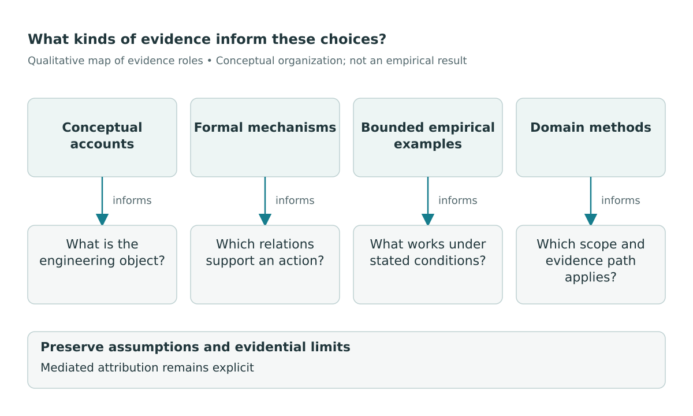
<figcaption><strong>What kinds of evidence inform these choices?.</strong> Different evidence roles inform corresponding engineering questions. A source’s assumptions and evidential limits constrain its use; claims reported through reviews or other witnesses retain that attribution. The map supplies no evidence ranking, experimental finding or general compliance claim.</figcaption>
</figure>

## A.1 What does coupling establish?

Functional dependence, cognitive constitution and biological organization are different claims. Gibson's affordance relates an environment to an animal's capabilities [115]. Maturana and Varela define autopoiesis through a network that produces its own components [88]. Varela, Thompson and Rosch develop enaction through recurrent sensorimotor activity in biological and cultural context [89]. Князева's conceptual account connects subject–environment co-emergence to self-organization [116]. None supplies a test that turns every connected software resource into a biological or conscious subject. The engineering use of these concepts requires an explicit statement of the relation being analyzed (Section 2).

Clark and Chalmers argue for active externalism, with conditions concerning reliable access, use and endorsement of an external resource [85]. Piredda examines both the risk of counting too much as part of the mind (overgeneration) and the asymmetry introduced by prior acceptance [117]. 이영의 distinguishes constitutive extension from causal dependence [86] and separately defends the extended-mind hypothesis against individuation objections [87]. The practical consequence is to test the resource's role and availability while keeping the philosophical disagreement visible. Reliable access can support an attribution of belief without establishing that the belief is true.

Distributed cognition likewise leaves a dispute over what counts as a single cognitive subject. 이영의 asks for a theory of collectivity and challenges categorical separation of distributed cognition from mind [118]. 천현득 argues that distributed cognitive processes need not imply an extended mind [53]. Marconi challenges extension through cognitive-subject individuation [119], while Marraffa's abstract proposes incorporating 4E insights within computational-representational explanation [120]. These are competing conceptual positions, not experiments certifying an agent architecture. The configured-system boundary in Section 2 can be useful without resolving them.

Wundrack's account of Lyre and Walter's handbook introduction presents situated cognition as a heterogeneous family whose terms vary across authors [285]; the original introduction remains unread. Lyre's p.187 fragment distinguishes embodiment that shapes representations, embodiment that constitutes their content or structure, and a radical position that dispenses with representations [281]. This taxonomy alone doesn’t establish the chapter's wider conclusions. Walter's publicly available notes separately distinguish what cognition is from where it occurs and leave constitutive criteria unsettled [283, notes 4, 18–22]. These distinctions prevent resource dependence from deciding either representation or cognitive constitution.

Human embodiment carries explanatory commitments beyond resource coupling. 叶浩生 reviews bodily properties and body–brain–environment integration, including unresolved empirical questions [121]. Versace, Brouillet and Vallet contrast embodied and internalist accounts in their opening theoretical discussion [122]. Stefan retains the lived body and an informed subject–world relation within psychotherapy [123]. Fugali's minimal naturalism preserves phenomenology's contribution to lived experience [124]. Their conceptual and human-specific scopes prevent an engineering dependency diagram from standing in for a theory of subjective experience.

Other accounts emphasize the formation of meaning. 이정모's abstract presents embodied and extended cognition as an interdisciplinary research program with open problems [125]. Murgiano relates habit and readiness to act to socially distributed meaning [126]. Caravà challenges narrow extension accounts through language, signs and pragmatism [127]. Макоева and colleagues' embodied multi-agent account also concerns meaning rather than demonstrated control performance [128]. These perspectives ask what a representation means in use; they don’t establish that a syntactically valid tool call has a valid consequence.

The unit of analysis can expand without absorbing every surrounding object. Laville identifies both environmental cognitive resources and transactions among agents [129]. Шкурко requires a defined problem-solving activity, with its information, time, resources and roles [130]. Roßler compares cognition and sociality with things, including boundary objects and normativity [131]. Dressen-Hammouda treats writing as participating in shared disciplinary understanding [132]. The engineering boundary requires a defined activity and functional contribution, with responsibility allocated separately (Sections 2 and 10). A shared account can organize work while remaining mistaken about independent reality.

Architecture descriptions need the same discipline. Van Gelder separates the dynamical hypothesis about what cognitive agents are from how they can be understood, and treats its extent as empirical [133]. Pfeifer and Scheier's selected complete-agent design couples bodily situation and ongoing behavior [134]. In Beer's book, editor Chandrasekaran distinguishes reactive, distributed and nonrepresentational descriptions; that editorial discussion doesn’t establish Beer's experimental results [135]. Brooks' behavior-generating modules provide a grounding methodology, with useful emergence still requiring design and testing [136]. Comparative evaluation concerns realized behavior, not preference for an architectural description (Section 19).

Anti-representationalism adds a further theoretical question. 배문정 reviews embodied and enactive accounts in tension with representation-centered explanations [137]. Clark's scaffolded-mind discussion shows how reliable environmental and social structures simplify cognitive demands without requiring every internal representation to disappear [138]. A representation control would test the function performed by a representation and the behavioral effect of its removal (Section 2). Dependence on a helpful external structure still requires a test of its loss.

Miłkowski and colleagues argue that wide approaches guide the search for organized mechanisms but can’t, by themselves, supply a complete explanation [284]. Their proposal includes internal processes and external interactions and permits computational or dynamical models within a mechanistic account. It remains an argued position, not a settled consensus. The engineering extension would identify the activities and dependencies producing the behavior, predict the effects of perturbation and test those predictions. A label such as embodied or distributed can’t replace that work.

## A.2 Where does the work occur?

Physical dynamics can perform work that a controller need not calculate explicitly. McGeer's passive walking depends on gravity, slope and mechanical parameters [139]. Pfeifer and Bongard describe morphology, compliance and sensor placement carrying control or preprocessing work [140]. Hof and colleagues' inverted-pendulum stability criterion includes position and velocity [141]. Kuo shows how a single-stance pendulum omits energetic work at step transitions [142]. The walking analogy therefore supports attention to dynamics and recovery margins; it doesn’t supply a universal stability rule for agent workflows.

Material representation changes the task itself. Zhang and Norman manipulate internal and external representations in bounded distributed tasks [143]. Kirsh describes spatial arrangements that reduce search, memory or choice demands [144]. Scaife and Rogers distinguish offloading, re-representation and graphical constraints [91]. Risko and Gilbert show that immediate offloading benefits can coexist with weaker unaided memory [145]. Tests of ordinary use and loss of the supporting resource would assess whether the human or system can recover without the convenient representation (Sections 4, 7 and 8).

A description can omit parts of the competence it describes. 鈴木宏昭 and 横山拓 discuss situated expertise that verbal fragments can’t fully capture [146]. 金雨薇 and colleagues review sensorimotor encoding and reactivation in human memory [147]. Neither establishes the integrity of a stored operational record. Brooks' independent sensing–acting layers offer a contrasting route through direct world interaction, but his representation argument is motivated by very simple intelligence [148]. Section 2 can admit both explicit and implicit realizations while Section 7 still demands evidence adequate for valid resumption.

A configuration can combine different control mechanisms. The original Simplex abstract proposes online control upgrades and discusses a semiconductor-process application, without establishing exact switching guarantees from its abstract [149]. 马龙轩 and colleagues' robotics review organizes interaction, perception, planning, execution and feedback while retaining accumulated-error and transfer challenges [150]. These are architecture descriptions with different scopes. Section 2 includes the surrounding machinery, and Section 19 tests what each addition contributes instead of inferring dependable operation from integration alone.

## A.3 What can observation and a model justify?

Active inference offers mechanisms under specified modeling premises. Friston and colleagues join preferred outcomes and epistemic uncertainty reduction in policy selection [151], then develop a process theory using a generative model and variational dynamics [152]. 磯村拓哉 explains belief updates and actions that change observations [153]. 乾敏郎 connects precision and curiosity to a subjectivity framework [154]. Model fit and preferred outcomes don’t establish institutional permission. Learning about the world, changing it and choosing a legitimate purpose require distinct assessments (Sections 3 and 8).

The biological and robotic versions also need separate scopes. 乾敏郎 links interoception, allostasis and motivation in an organism-focused account [155]. 谷淳's cognitive-neurorobotics discussion distinguishes revising latent intention from acting to change observations, with time scales and a metaprior affecting adaptation [156]. 横澤理子 and colleagues apply world models and expected free energy to uncertain robot localization and navigation [157]. Those results are model- and task-dependent. A stable prediction can arise through accommodating evidence or imposing an expectation; the evaluator needs independent consequence evidence to tell which occurred.

Learning, planning and reacting can share machinery while using different evidence. Sutton's original Dyna paper proposes their integration and distinguishes Dyna variants [158]. Sutton and Barto separate real experience from model-generated planning experience, showing how model errors propagate and a still-working policy can hide a new shortcut [159]. 宮崎和光 and 山口智浩 distinguish sensory/action feedback from learning feedback [160]. Rensi's educational thesis explains continuing agent–environment interaction and Q-learning [161]. Evaluation requires a record of which updates came from actual observations and which came from models (Section 18); changing the learning process changes the tested system.

Exploration rewards need a declared informational target. Pathak and colleagues reward prediction error in learned features in game tasks [162]. Латышев and Панов distinguish world-model uncertainty, knowledge change and structural relations as intrinsic signals [163]. Aubret, Matignon and Hassas separate stochastic surprise from compression progress and discuss resources and forgetting [164]. Schmid's human studies distinguish epistemic curiosity from instrumental information seeking and retain contrary findings about conflict and processing [165]. These differences strengthen Section 18's requirement for bounded informative probes; an intrinsic reward is neither proof of useful learning nor a consequence limit.

Formal revision addresses representation as well as consistency. Dufour-Lussier and colleagues expand a qualitative algebra to express alternatives required by revision [101]. 刘一松 and colleagues retain compatible conditional beliefs while coupling revision to action reasoning [102]. Хизанишвили compares ideal revision criteria with bounded human cognition [166]. Each leaves an external-evidence obligation. Consistency with an accepted statement doesn’t establish its truth or freshness, and an optimal revision that can’t finish before commitment may be unusable.

Partial observation doesn’t have one universal solution. Kurniawati reviews approximate POMDP methods under computational limits [167]. Karpas and Magazzeni compare planning formalisms for robotics [168]. Бобцов and Никифоров develop adaptive output control for uncertain systems [169]. Each approach uses a different class of model, with its own abstractions and guarantees. A validity assessment must declare what the system can observe and control, which approximation it uses and which consequences fall outside that model, without assuming a global snapshot or transferring a mathematical guarantee between domains (Section 4).

## A.4 Who can control the next transition?

Autonomy labels describe allocations rather than maturity. Sheridan and Verplank's official abstract relates supervisory teleoperation to sensors, actuators and task demands; it doesn’t by itself establish a detailed control-level ladder [170]. Beer, Fisk and Rogers frame robot autonomy levels as design choices affecting human activities and explicitly provide no causal model [171]. SAE J3016 defines designed driving roles [172]. Zieba and colleagues distinguish competence, resources and prescriptions permitting a task [173]. A system may have the skill and still lack capacity or permission; Section 5 tests those separately.

Fused inputs and sequential transfer create different seams. Cappelli continuously weights shared control using a Bayesian observation-degradation measure [174]. Макарова describes an interface through which human and automatic inputs combine and intended actions become visible [175]. Argall's rehabilitation review places assistance within motor and clinical constraints [176]. These task-specific allocations complement shared-navigation control [96]. The design question is how disagreement is handled during joint control, including whether one actor's useful decision is suppressed; it’s not answered by the proportion of automated input.

Learning incentives and operational interruption must remain distinct. Orseau and Armstrong study learning behavior under an interruption policy [177]. Hadfield-Menell and colleagues' Off-Switch Game examines reward uncertainty and a human switch within a game model [178]. Neither establishes that an in-progress physical action can stop, that a human channel remains usable or that a transfer is authorized. Recovery requires both the incentive analysis and an executable interruption or containment path (Section 9).

Usage control illustrates changing conditions during an action. 翟志刚 and colleagues' abstract distinguishes a general ongoing-authorization model from decidable restricted cases with finite attribute domains and no creating actions [179]. 黄娟 and colleagues use history and virtual roles for dynamic least privilege [180]. These mechanisms complement context management [56], continuing identity evidence [25] and temporary access with obligations [57]. They address different propositions. A successful identity check can’t establish every condition governing the resource or settle broader legitimacy.

A first response doesn’t establish a completed transfer. The review by Sekadakis and Yannis associates shorter takeover with some poorer control outcomes, without establishing a universal causal deadline [114]. Aguilar Alarcon and colleagues' ReCoVac abstract describes detecting a need for takeover, not validated completion [181]. The resumption project distinguishes ordinary driving skill from takeover skill [182]. Tomaselli's eye-tracking prototype measures attention and fatigue, which don’t alone certify readiness [183]. Sections 5 and 20 retain response, acceptance and stable operation as different outcomes.

Distributed expertise also needs named human responsibilities. 임상락 proposes expertise and epistemic responsibility across human–AI systems, without demonstrating gains across professions [184]. The CNPEN chatbot report warns that fluency can invite attribution of personhood and responsibility [185]. Its generative-AI report separates origin attribution from human responsibility and calls for linguistic and cultural evaluation [186]. 채지훈 and 황승현 propose structured cognitive control and a human final decision in a proof of concept [187]. These conceptual and normative accounts support explicit roles; a final approval or provenance mark alone doesn’t prove effective oversight.

Trust and remote control need their own evidence. 王姝彦 and 柴新 use active inference as a theoretical account of bidirectional trust [188]. Majstorovic and colleagues distinguish remote-assistance and teleoperation concepts with different responsibilities [189]. 杨俊儒 and colleagues warn that torque feedback can conflict with driver intent, while decoupling can suppress a useful driver decision [190]. Authority assessment requires testing the actual information and control channel (Section 5). Perceived trust, a communication link and a nominal human role don’t establish correct control allocation.

## A.5 What survives across time and interfaces?

Interactive agent architectures preserve different things. ReAct interleaves reasoning and action so observations can revise ongoing plans [191]. Reflexion carries verbal feedback into later attempts without changing model weights [192]. Voyager accumulates reusable skills within Minecraft [193]. Rollback-Induced Reflection chooses rollback locations and information to retain [194]. Their respective observation, game and restoration assumptions define what continuity is possible. Continuity requires the retained lesson as well as the governing state (Section 7); recovery requires a world in which the proposed restoration is actually available (Section 9).

Horizon measures answer different questions. Wijk and colleagues define software-task horizon through human completion time at specified success rates [195]. Script-consistency evaluation follows narrative commitments [196]. Chen, Wang and Qu distinguish task horizon, context and persistent memory, and treat independent error compounding as a null model [197]. None converts step count or remembered facts into a complete operational-continuity measure. Evaluation would vary dependencies, delayed effects and interruption (Section 18), with the failure and censoring rule of each horizon measure retained (Section 20).

A task's final check observes only its declared boundary. τ-bench combines simulated users, domain policies, database outcomes and repeated-run reliability [198]. WorkArena tests defined enterprise workflows [199]. AgentBench compares interactive environments [200]. GAIA uses tool-assisted multimodal questions [201]. These are useful comparisons with different observable endpoints. They can’t be silently pooled as one measure of authority, continuity or consequence closure. A benchmark extension must state the additional independent effects and duties its verifier observes.

Executable tests and organizational simulations also leave boundaries. SWE-bench checks code changes through task tests [202], while TheAgentCompany simulates work with applications and coworkers [203]. A passing repository test doesn’t establish deployment consequences, and a simulated coworker doesn’t establish real institutional authority. Deployment evaluation would retain these concrete success predicates and assess the additional unresolved effects (Sections 18 and 19).

Interface standardization improves comparison without making every endpoint equivalent. BrowserGym highlights resets and interference with shared records, while synchronous loops constrain reactive timing [204]. 홍승혁 and 이호웅 compare tool-selection methods using argument accuracy, latency and token cost [205]. 佐藤明智 and 南泰浩 constrain decoding to reduce malformed or hallucinated API calls [206]. 郑逸宁 and colleagues review tool use as a way to add computation and current information [207]. Comparisons require specified tools, interface versions, shared state and timing (Sections 2 and 18). Valid syntax is one check; actual consequence remains another.

Historical experience needs present applicability. Woopen's collective traffic memory aggregates location- and time-coded experience and supplies trajectory suggestions, whose abstract reports a prototype and planner comparison rather than a transferable numerical effect [208]. Вейбер and colleagues analyze chronology, retrieval, source verification and human responsibility in public-administration memory [100]. Their categorical governance conclusion is an argument, not a controlled proof about every future system. Section 7 retains source, date, scope and correction paths so an accessible memory can’t silently become current authority.

Continuity is also an attack surface. Евграфов and colleagues organize attacks across memory, tools, multiple agents, multimodal inputs and time [209]. AgentLAB tests long-horizon attacks on intent, tools and memory within a specified corpus [34]. A retained history can preserve an adversary's instruction as easily as a valid decision unless origin, authority and later use remain distinguishable. Perturbing those links and checking independent evidence would test continuity defenses; a threat taxonomy or tested defense corpus doesn’t establish complete protection (Sections 7 and 18).

## A.6 Which level can a plan legitimately revise?

Plans and intentions aren’t interchangeable with all desires. Amgoud and colleagues retain intentions, rejected desires and desires in abeyance when conflicts are resolved, under supplied plan and knowledge bases [210]. Панов's GoalMAP includes goal setting and selection within a sign-based planning model [211]. 権藤拓 and colleagues model others' intentions through multi-context BDI reasoning [212]. These frameworks make alternatives explicit but don’t authorize an actor to change its governing mission. An orientation record would retain the rejected branch and the reason a particular level was reopened (Section 8).

Human intervention can change the task structure. 林久志 and colleagues replan a bounded manipulation task after intervention or a changed goal [213]. Muratori adds state-space planning when an AgentSpeak/Jason plan fails while reusing applicable plans [214]. Ferrari's abstract describes ROSPlan action-sequence synthesis for a simulated delivery task [215]. Varotto works in a game with changing rules [216]. They support tests of plan revision under declared action and rule models, with no inference of clinical reliability or open-world completeness.

Dispatch and observation can disagree even within one coordinator. Tomasi separates generation, dispatch and sensing confirmation; delayed predicate updates can cause unnecessary replanning [217]. Facco distinguishes timely but failed actions, invalidating state updates and timeouts, with non-interruptibility retained as a limit [105]. Orientation tests would distinguish persistence after invalidation from churn caused by late evidence (Section 8). Recovery would preserve partially executed state across replanning (Section 9).

Team plans introduce constraints that individual plans don’t settle. 熊璐 and colleagues review collisions, deadlocks and shared resources in multi-robot planning [218]. 李忠奎 and colleagues use temporal-logic task specifications to address coordination conflicts [219]. 秦家虎 and colleagues connect game and control approaches under particular cooperation assumptions [220]. These reviews support declaring the collective objective, resource dependencies and progress conditions in Section 10; a collection of locally feasible plans can still obstruct the team.

Formal timing and transformation have their own meanings. 王喜辉 and colleagues distinguish finite-, fixed- and prescribed-time control families; their precise definitions belong to mathematical sections beyond the abstract [221]. Мелехин and Хачумов's predicates and semantic networks provide rule-based situation transformations and complexity estimates [222]. Neither supports importing an unspecified convergence deadline into an agent test. Evaluation requires measured or derived response bounds for the actual representation, hardware and disturbance (Section 18).

Social-simulation intelligibility differs from psychological fidelity. Adam and colleagues describe how BDI attitudes support elicitation, explanation and debugging while group commitments need extensions beyond individual attitudes [223]. Morge discusses coordination, conformity, destructive interaction and reproducibility in generative multi-agent systems [224]. Городецкий's historical review identifies limits in collective goal changes and unforeseen-situation handling [225]. Tests of those mechanisms would assess collective competence beyond understandable labels or plausible dialogue (Section 10).

## A.7 Which recovery paths really exist?

Recovery targets differ across traditions. 吴超 classifies resilience meanings rather than reducing them to return [226]. 北村正晴's abstract discusses Safety-II and adaptive abilities without supplying their complete enumeration [227]. 中西美和 treats avoiding unacceptable events and continuing function under change as complementary [228]. Trapp's conceptual chapter joins context-sensitive monitoring and reconfiguration while retaining shared-error concerns [229]. A recovery assessment requires the target function, unacceptable-event floors and surviving resources (Section 9); a successful rebound can’t establish future adaptive potential.

Survivability requires mechanisms that have actually been supplied. Калюжный and colleagues propose redundancy, diagnosis, repair, reconfiguration and human–automatic transitions for space robots [230]. Рыбина's tutoring architecture combines situational control with expert and ontology systems, with no abstract-level numerical comparison [231]. Мелехин and Хачумов propose constructing missing situation-transformation rules [232]. These are differently bounded architectures and proposals. They identify possible recovery mechanisms whose availability and effectiveness require testing in the configured system (Section 9).

Safe learning methods also depend on a declared envelope. Brunke and colleagues review model-based and learning-based robot control [233]. Garg and colleagues compare multi-robot shielding, certificates, barriers and reachability [234]. Black-Box Simplex supplies online decisions with a baseline controller under fallback assumptions [235]. Amodei and colleagues separate accident problems involving objectives, supervision, exploration and distribution shift [236]. This combination argues for multiple fault classes and explicit model, communication and sensing assumptions; it doesn’t establish an unrestricted safety wrapper.

Capability can degrade before a familiar action becomes impossible. Reschka's abstract and figure caption connect skill graphs to ability graphs aggregating current capability for decision and degradation, while explicitly bounding scenario coverage [237]. 星野智史 and colleagues schedule maintenance to reduce simultaneous unavailability in a parallel-robot structure [238]. These mechanisms complement physical redundancy [104]. Assessment would measure presently available capability and reserve, including whether one recovery consumes capacity needed for a second disturbance (Sections 6 and 9).

Contact and sensing impose task-specific limits. 김용건 and colleagues adjust search and impedance across stages of connector assembly under a fixed grasp and bounded misalignment [239]. Mazzotti uses force/torque sensing and human–robot teaching for the wire-loop task [240]. 양영하 and 이철수's abstract addresses noisy robot learning and transfer without exposing precise weight or performance claims [241]. These examples support varying sensing, contact and noise in Section 18, while preserving the operating range instead of generalizing a task result into agent reliability.

Robustness can consume resources or delay a response. 양정연 trades map resolution and repeated updates against confusion after sharp turns and computational load [242]. Cardoni's hardware-in-the-loop diagnosis changes features and sampling on constrained hardware, with filtering distinct from autonomous repair [111]. Bondavalli and Simoncini's data-flow architecture separates interpretation, routing and resource management but is explicitly partial [243]. A measurement profile would include deployable monitoring cost and containment timing (Section 20); neither a stable label nor a proposed fault-tolerance mechanism establishes completed recovery.

De Luna Almeida and colleagues' report supplies a concrete replication proposal, with short-term acyclic AND/OR plans, designer-assigned action criticality, and periodic or event-driven updates [282]. Its host-failure calculation multiplies individual failure probabilities; applying that calculation requires justifying failure independence. Planned application comparisons are future work in the report, not demonstrated benefits. Fixed and adaptive protection would be compared under identical disturbances and resource budgets, retaining overhead, correlated host failures and unattempted recovery (Section 19). The question is whether adaptation preserves the needed work, not simply whether more copies survive.

## A.8 When does a scenario become evidence?

Standards' public scopes draw different item boundaries. ISO 10218-1 concerns the industrial robot, with application integration assigned elsewhere [244]. ISO/TS 15066 concerns collaborative industrial applications [245]. ISO 3691-4 includes guidance and control that can be outside the driverless industrial truck and requires attention to its operating zone [246]. These are applicability comparisons, not clause-level compliance claims. The configured engineering object includes mechanisms that determine the result, with each standard’s sector and exclusions preserved (Section 2).

Published texts and developing texts also differ. The ISO/FDIS 13482 revision is a development-stage service-robot text [247], and ISO/WD TS 5083 Edition 2 is a working draft [248]. They can’t replace published obligations by being newer. ISO 26262 concerns malfunctioning safety-related vehicle electronics [249], while ISO 21448 addresses intended-functionality insufficiencies and foreseeable misuse [250]. Evaluation distinguishes malfunction, nominal insufficiency and other consequences (Sections 11 and 18); the applicable evidence path can change.

A taxonomy doesn’t supply coverage. SAE J3206 harmonizes ADS safety principles within its stated information-report scope [251]. ISO 34502 supplies a scenario-evaluation framework with a highway scope [252]. ISO 34504 organizes scenario tags [253]. ASAM OpenSCENARIO DSL expresses intent, constraints and coverage measures, while its XML relation doesn’t guarantee conversion [254]. These tools organize or express the test. Evaluation must still justify which situations the suite represents and which remain absent (Section 18).

Virtual qualification and scenario generation establish different properties. ISO/PAS 34506 qualifies virtual test environments without validating every model or the ADS [255]. Bagschik's opening dissertation problem separates expert-facing language from detailed simulation formats [256]. Bagschik and colleagues' knowledge-based generation varies highway scenarios [257]. Schuldt and colleagues' abstract proposes combinatorial evaluation and case reduction without establishing achieved completeness [258]. Record each transformation and validation claim rather than infer that an executable case covers its intended world.

Catalogs can encode uncertainty without estimating frequency. Фомин separates fuzzy scenario features from an occurrence-likelihood function in a proposed catalog process [259]. The SAKURA article establishes the program's scenario-construction scope rather than a complete scenario-construction method [260]. 范博 and colleagues' abstract calls for vehicle–road–cloud evaluation including communications, resilience and social effects [261]. Scenario evaluation requires both the catalog’s classification uncertainty and evidence for calibrated exposure (Section 18). A membership score or program name isn’t that evidence.

An integrated simulator can still miss the operating loop. CAVISE/CAPI joins vehicle, traffic and wireless-communication simulation through interfaces, with its abstract-level trials not proving fidelity [262]. Catalini builds a 3D environment and vehicle-controller demonstrations, while a tracking-to-control extension remains proposed [263]. Бобровская and Гавриленко's survey separates mapping, perception, localization, prediction, planning and control [264]. These comparisons make missing interactions inspectable; architectural completeness in a diagram isn’t validation of those interactions.

Scenario search needs realism as well as challenge. Zhong and colleagues review high-fidelity simulation for costly or rare cases [265]. Zhang and colleagues classify critical-scenario search [266]. Yan and colleagues distinguish learned statistical realism from accelerated evaluation, including possible changes in other road users' behavior [267]. 任睿晗 and colleagues warn that unrealistic dynamics or fixed-response background traffic can yield misleading failures [268]. The realized scenario and its feedback must be checked for fidelity before a synthetic crash can support a deployment claim (Section 18).

Real roads provide different strengths and limits. Гараган emphasizes their discovery value and correspondence checks alongside weak controllability, repeatability and scalability [269]. Koopman and Wagner propose staged domains, separated monitor/actuator assurance and fault injection within a historical testing analysis [270]. PEGASUS connects observed and systematic scenarios to concrete tests and critically examined safety arguments [271]. Field monitoring remains needed for surprises. Neither a catalog nor road distance alone establishes that all consequential interactions have been covered.

Anticipating a scenario and avoiding its harm are different achievements. 北島創 and 中村弘毅 separate reasonable foreseeability from preventability, including reference-driver assumptions and mitigation when avoidance is unavailable [272]. Westhofen and colleagues make criticality-metric suitability depend on context and the behavioral question [273]. The comparison would specify what the system could know, feasible responses and the outcome required by the criterion (Section 19). An alarming metric can’t create a feasible intervention after the response margin is gone.

UL 4600's item scope can include infrastructure, services and support processes materially affecting safety, while its scope excludes human-driver vigilance and takeover performance [31]. This gives Section 2 a wider item boundary and Section 5 a separate human-readiness obligation. The safety-case prompts are nonexhaustive; public scope identifies applicability and doesn’t establish compliance or complete assurance.

<figure data-added-figure="F35">
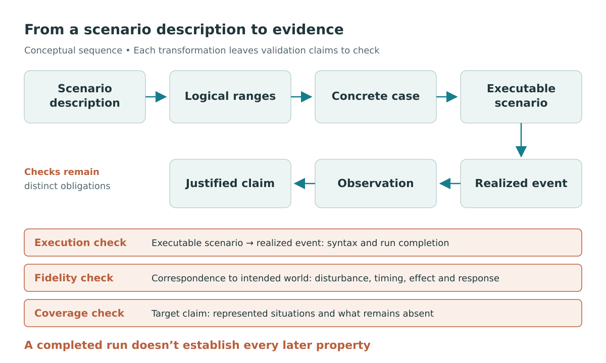
<figcaption><strong>From a scenario description to evidence.</strong> Each arrow represents a transformation whose validation claims remain to be checked. Execution, fidelity and coverage are distinct obligations; completing a run alone establishes neither correspondence to the intended world nor coverage for the target claim.</figcaption>
</figure>

## A.9 Which measurements justify a decision?

Deployment evidence needs its original exposure and comparator. Schwall and colleagues report historical public-road events with operator conditions and counterfactual disengagement analysis [274]. Di Lillo and colleagues compare a defined driverless liability-claims cohort with a human insurance benchmark [275]. These outcomes observe different slices of safety and don’t directly supply an agent-workflow baseline. A defensible comparison requires dates, operating domain, cohort, event definition and denominator (Section 20).

Predictive evidence and a credible argument complement observed outcomes. Jiao and colleagues estimate emerging collision risk but don’t demonstrate prevented crashes by a particular controller [112]. AVSC requires context-sensitive metrics, exposure normalization, segmentation and uncertainty [113]. Favarò and colleagues develop an argument for absence of unreasonable risk through acceptance criteria and structured evidence [276]. The AVSC assessment overview asks whether claims are supported and where uncertainty or gaps remain [277]. A favorable indicator is evidence for a stated claim, not a substitute for the whole acceptance argument.

Continuing operation can invalidate initial assumptions. AVSC's monitoring best practice links deployed performance to reassessment and improvement, including unknown environmental variation [278]. This is a recommended process rather than evidence that a particular organization executes it effectively. Reopening triggers, next checks and accepted owners remain relevant after apparent recovery (Sections 11 and 20). A closed action under its declared predicate can still leave downstream work unsettled.

## A.10 Source provenance and evidential limits

Reviews and other secondary sources are credited for the claims they report; citing them doesn’t imply direct consultation of the underlying works. Historical cases, conceptual arguments, formal mechanisms and bounded experiments support different kinds of claims. Their extension to consequential agents, maintenance arrangements and service hypotheses requires separate assessment.

